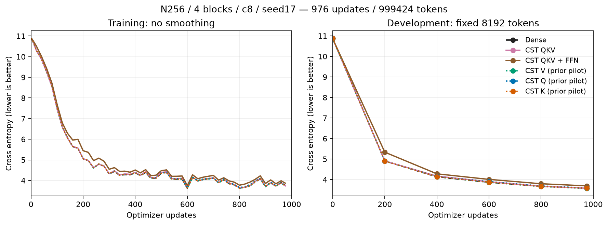
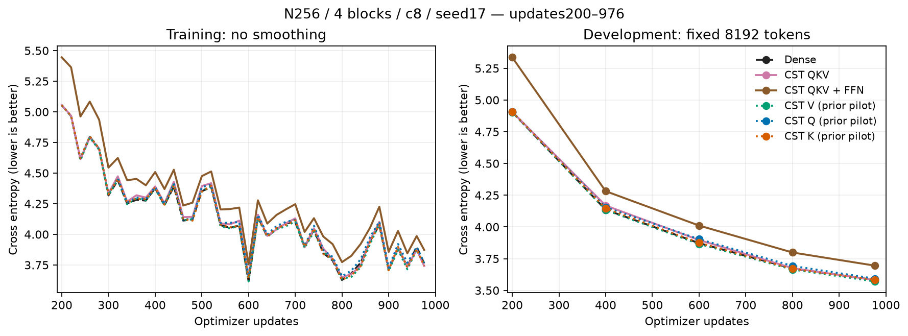
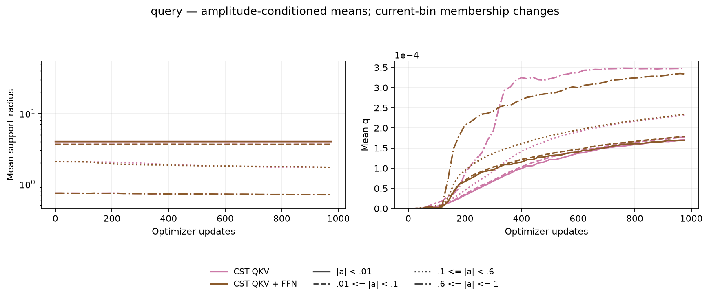
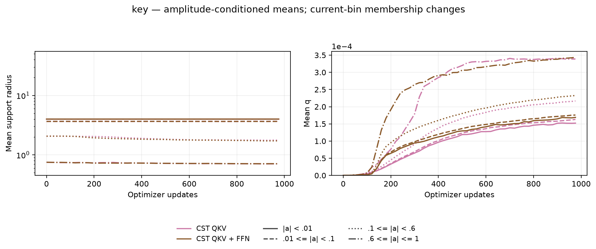
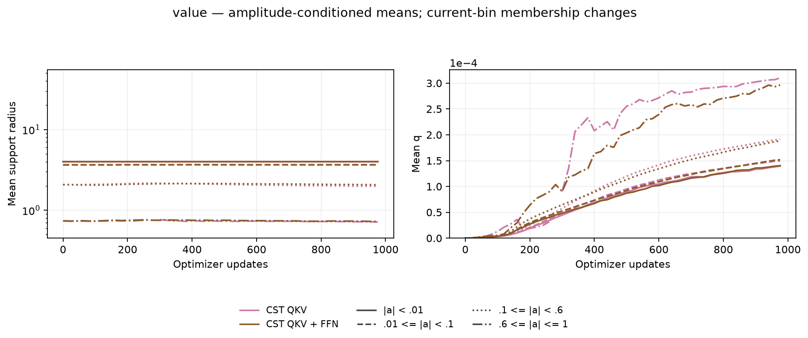
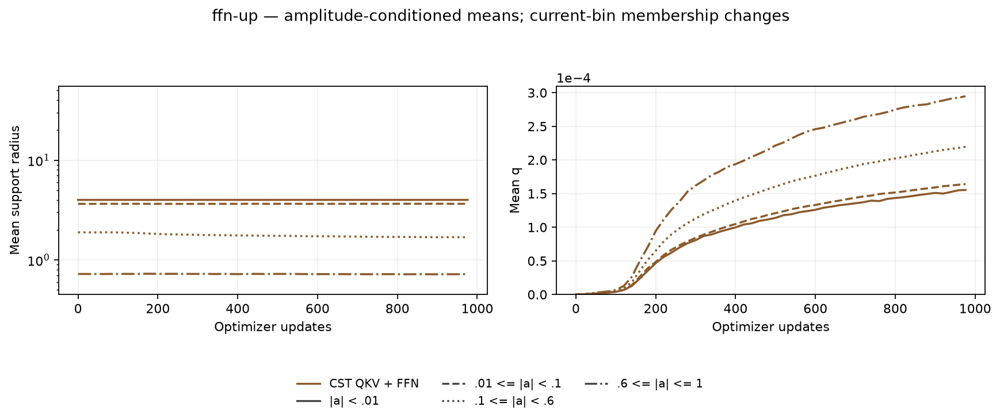
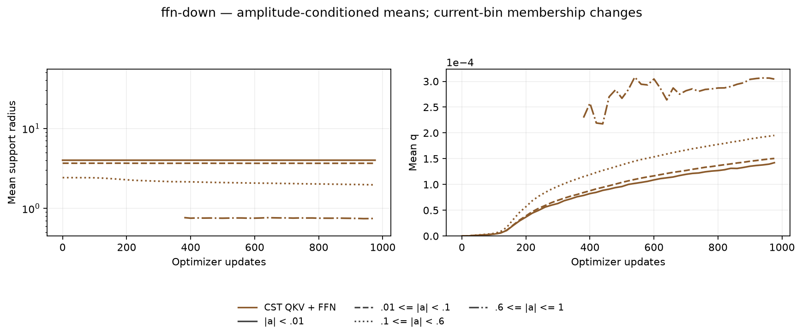

# CST QKV・FFN同時置換の結果

[English (canonical)](attention-combined-20261107-results.md) | 日本語

両方の同時置換モデルが976更新・999,424 tokenと学習済みcheckpointの独立監査を完了しました。
4ブロックのQKVをCSTにした場合のDEV CEは **3.580952** で、fresh Denseの **3.581960** に近い値です。
さらにFFNの両射影もCSTにすると **3.695186** です。学習は進みますが、この予算では
**+0.113225** の差が残っています。1 seedの短期的な実用可能性の観察であり、収束、非劣性、
一般的な精度優位の証明ではありません。confirmationや生成結果を選択に使っていません。

## 固定タスクと範囲

[固定プロトコル](attention-combined-20261107.ja.md)は幅256、pre-LNの4ブロック、4 head、
context128、FFN拡張4、seed17、batch2・累積4、FP32・TF32無効、AdamW(.9,.95)、
weight decay0、global clip1です。base LRは3e-4、Atom全体のLR倍率は16、
LRとデータ順序のhorizonは20M tokenに固定しています。rational Polar、初期q=0、
`A=ceil(8*sqrt(d_in*d_out))`を使い、Q/K/V各射影は2,048 Atom、FFN各射影は4,096 Atomです。
初期演算子の二次モーメントはDense目標の0.5%以内です。

QKVは12か所、QKV+FFNは20か所のCSTです。O射影、embedding、語彙出力、LayerNormはDenseのままで、
causal SDPA・softmaxも同じです。「QKV+FFN」はモデル全パラメータやAttention演算そのもののCST化ではありません。

| fresh条件 | DEV CE | DEV PPL | 更新 ms | allocated MiB | reserved MiB |
| --- | ---: | ---: | ---: | ---: | ---: |
| Dense | 3.581960 | 35.9439 | 11.21 | 482.50 | 490 |
| CST QKV | 3.580952 | 35.9077 | 511.42 | 622.31 | 660 |
| CST QKV + FFN | 3.695186 | 40.2530 | 958.23 | 826.44 | 886 |

点線のQ/K/V単独曲線は既存の監査済みパイロットを再利用しています
（[V](attention-v-20261107-results.ja.md)、[Q/K](attention-qk-20261107-results.ja.md)）。
参考曲線であり、今回取り直した速度・メモリ比較ではありません。3回のfresh Denseについて、
記録済み60行のstep、token、train/DEV loss、LR、group LR、勾配ノルムが完全一致しました。
時間はこの一致検査から除外しています。DEVは同じ固定8,192 tokenです。

更新時間は累積とデータ転送を含む同期済みoptimizer更新全体の中央値です。geometryと評価は時間外です。
メモリは更新全体のallocated/reserved peakであり、プロセス全体の使用量ではありません。
Dense / QKV / QKV+FFNのsetupは0.87 / 6.00 / 13.29秒、学習runnerのwall timeは
16.36 / 514.45 / 964.20秒でした。別途行ったqualification・compileは含みません。
この小幅・eager FP32実装では速度やGPUメモリの利点は示していません。

## パラメータ数とgeometry

対象のQ/K/V・FFN射影はbias込みでDense 2,891,776パラメータに対しCST 237,568パラメータで、
約12.17分の1です。モデル全体はDense / QKV / QKV+FFNの順に
16,058,112 / 15,369,984 / 13,403,904パラメータです。embeddingなどは共通なので、
モデル全体の削減率は限定的です。パラメータ数の削減率と学習peakメモリの削減率は同じではありません。
QKV / QKV+FFNのAtom数は24,576 / 57,344です。

各CST条件で55個のgeometry snapshotを保持しています。現在の振幅binごとに、
4ブロックをAtom数で重み付けして平均しています。bin所属は変化し、空binは欠測です。
count、分位点、L/Uはraw evidenceに保持し、存在しない過去geometryは補っていません。

## admissionと証拠

12か所と20か所はFFN種別とAttention種別の両方を固定した別々のadmission receiptを使います。
学習前に独立scalar quadrature、nativeの正方形・長方形Y/dX/全Atom VJP、
明示的causal masked-softmaxの結合勾配、未来tokenの勾配ゼロ、optimizer moment/resume、
実際の4ブロックtask/resumeを通過しています。学習後は **32か所のVJP、3条件のDEV完全再計算、
3条件の次更新Parameter・optimizer resume完全一致** を通過しました。最終geometryもcheckpointと一致します。

compact raw file 31個を回収しhash照合しました。ソースとcheckpointはremoteにも保持し、
所有workerは終了済みです。RTX4090はユーザーの別作業用に返しています。
新しい半径policyは一緒に数式を検討してから進めます。

測定時の演算子は`d2ca317f63b034e5138bb3471ede541159a9a60b`、consumerは
`13f717d44569109b543c7f6628e93883936bac1e`です。RTX4090 CC8.9、
Python 3.12.9、Torch 2.11.0+cu126。データmanifest SHA256:
`5b995103ca95d3c9b62a4e860039683dc734b0a0bb20e232db1b2e45aa690d01`。
compact archive SHA256:
`b4bcbd09385e8a80651d617f5db2e93b11437186a245e37736628e82a4435bdd`。
[図・ソースmanifest](assets/attention-combined-20261107/figure-manifest.json)にraw入力、過去曲線、
renderer、PNG/SVGのhashを記録しています。
`python scripts/plot_projection_pilot.py --run EVIDENCE --output FIGURES`に
`--historical PRIOR_RUN/retrieved/cst-v`とQ/Kの対応パスを加えて描画します。
再現時は測定時のソースと固定プロトコルを使ってください。現在の依存pinが過去実験の識別子を書き換えることはありません。
