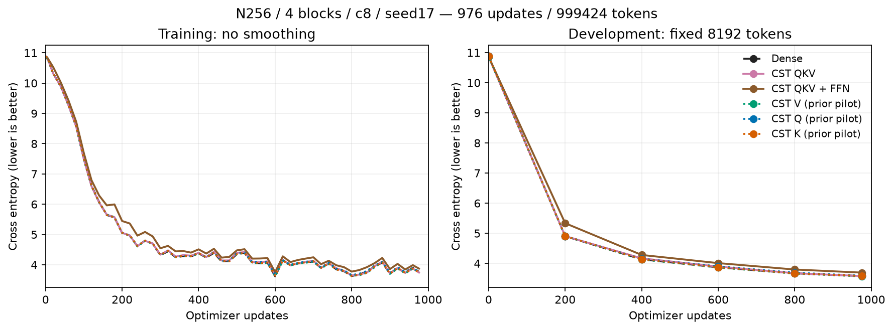
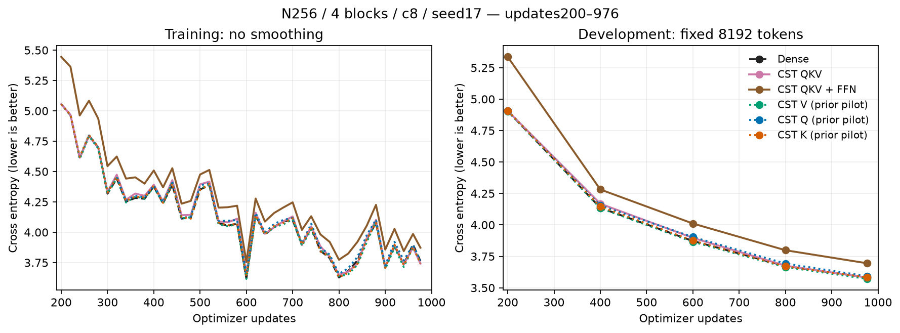
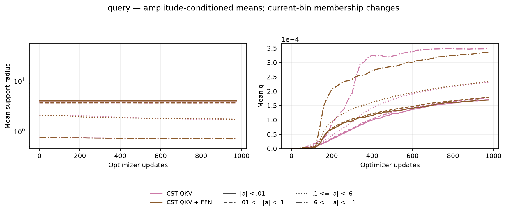
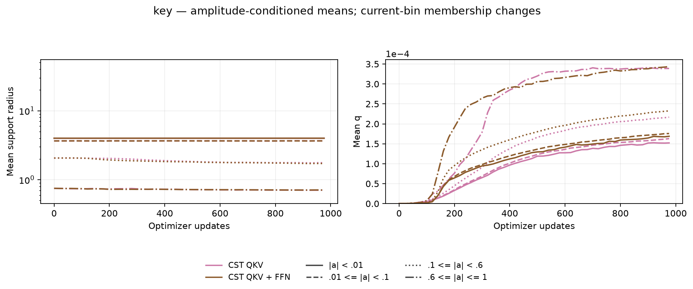
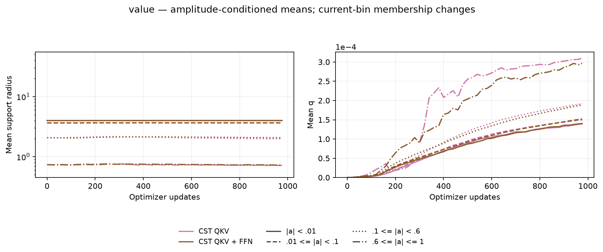
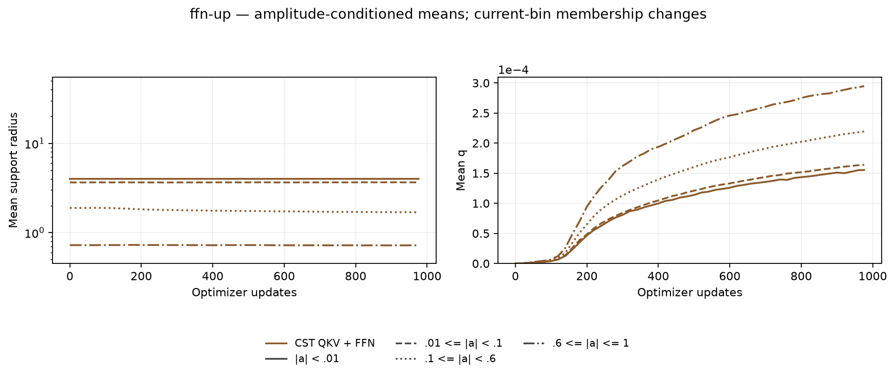
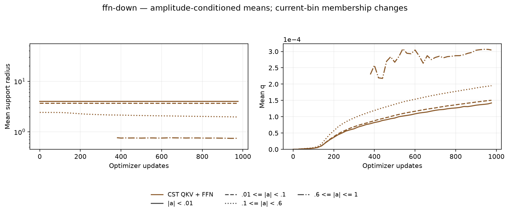

# Combined CST QKV and FFN results

English (canonical) | [日本語](attention-combined-20261107-results.ja.md)

Both combined models completed 976 updates / 999,424 tokens and independent
trained-checkpoint audits. QKV in all four blocks reached DEV CE **3.580952**,
close to fresh Dense **3.581960**. Replacing both FFN maps as well reached
**3.695186**: it learns, but a **+0.113225** gap remains at this budget. These are
one-seed feasibility observations, not convergence, noninferiority or a general
accuracy advantage. No confirmation or generation split was used for selection.

## Fixed task and scope

Keep the [fixed protocol](attention-combined-20261107.md): width 256, four pre-LN
blocks, four heads, context 128, FFN expansion 4, seed 17, batch 2 / accumulation
4, FP32 with TF32 off, AdamW (.9, .95), weight decay 0 and global clip 1. Base LR
is 3e-4, whole-Atom LR multiplier 16, with a fixed 20M-token LR/data-order horizon.
Use rational Polar, initial q=0, and
`A=ceil(8*sqrt(d_in*d_out))`: 2,048 Atoms per Q/K/V map and 4,096 per FFN map.
Initial operator second moments match the Dense targets within 0.5%.

QKV has 12 CST sites; QKV+FFN has 20. The O projection, embedding, vocabulary
output and LayerNorm stay Dense, and causal SDPA/softmax is unchanged. Thus
“QKV+FFN” does not mean that every model Parameter or attention operation is CST.

| Fresh condition | DEV CE | DEV PPL | Update ms | Allocated MiB | Reserved MiB |
| --- | ---: | ---: | ---: | ---: | ---: |
| Dense | 3.581960 | 35.9439 | 11.21 | 482.50 | 490 |
| CST QKV | 3.580952 | 35.9077 | 511.42 | 622.31 | 660 |
| CST QKV + FFN | 3.695186 | 40.2530 | 958.23 | 826.44 | 886 |

The dotted individual Q/K/V curves reuse the prior audited pilots
([V](attention-v-20261107-results.md), [Q/K](attention-qk-20261107-results.md)).
They are context, not fresh paired resource measurements. Across the three fresh
Dense controls, all 60 recorded numerical curve rows match exactly for steps,
tokens, training/DEV loss, LR, group LRs and gradient norm; timing is excluded.
DEV uses the same fixed 8,192 tokens.

Update time is the median synchronized complete optimizer update, including
accumulation and data transfer. Geometry and evaluation are outside the timer.
Memory is the complete-update allocated/reserved peak, not total process usage.
Setup took 0.87 / 6.00 / 13.29 seconds and learner wall time was 16.36 / 514.45 /
964.20 seconds for Dense / QKV / QKV+FFN; separate qualification/compilation is
not included. This eager FP32 implementation shows no speed or GPU-memory benefit
at this small width.

## Parameter budget and geometry

The targeted Q/K/V and FFN projections contain 2,891,776 Dense Parameters versus
237,568 CST Parameters, including their biases: about 12.17 times fewer. The full
models contain 16,058,112 / 15,369,984 / 13,403,904 Parameters for Dense / QKV /
QKV+FFN. Unchanged embeddings and other modules limit the whole-model reduction;
parameter reduction does not imply the same reduction in training peak memory.
QKV and QKV+FFN use 24,576 and 57,344 Atoms respectively.

Each CST arm retains 55 geometry snapshots. Means pool four blocks by Atom count,
conditioned on current amplitude bins; membership changes and empty bins are
missing. Counts, percentiles and L/U remain in raw evidence. No missing historical
geometry is invented.

## Admission and evidence

The 12-site and 20-site recipes have separate admission receipts bound to both
FFN kind and attention kind. Before learning, they passed independent scalar
quadrature, native square/rectangular Y/dX/all-Atom VJPs, explicit causal
masked-softmax integration gradients, future-token gradient zeros, optimizer
moments/resume and actual four-block task/resume checks. The trained audits
passed **32 site VJPs, three exact DEV recomputations and three exact next-update
Parameter/optimizer resume checks**. Final geometry matches the checkpoints.

All 31 compact raw files were retrieved and hash-verified; source/checkpoints
remain intact remotely and owned workers are inactive. The owner has reclaimed
the RTX4090. New radius policies wait for joint mathematical discussion.

Measured operator `d2ca317f63b034e5138bb3471ede541159a9a60b`; consumer
`13f717d44569109b543c7f6628e93883936bac1e`. RTX4090 CC8.9,
Python 3.12.9, Torch 2.11.0+cu126. Data manifest SHA256:
`5b995103ca95d3c9b62a4e860039683dc734b0a0bb20e232db1b2e45aa690d01`.
Compact archive SHA256:
`b4bcbd09385e8a80651d617f5db2e93b11437186a245e37736628e82a4435bdd`.
The [figure/source manifest](assets/attention-combined-20261107/figure-manifest.json)
binds raw inputs, historical curves, renderer and PNG/SVG files. Render with
`python scripts/plot_projection_pilot.py --run EVIDENCE --output FIGURES`, adding
`--historical PRIOR_RUN/retrieved/cst-v` and the corresponding Q/K paths. Use the
measured sources and fixed protocol for reproduction; current dependency pins
do not rewrite these experimental identities.
