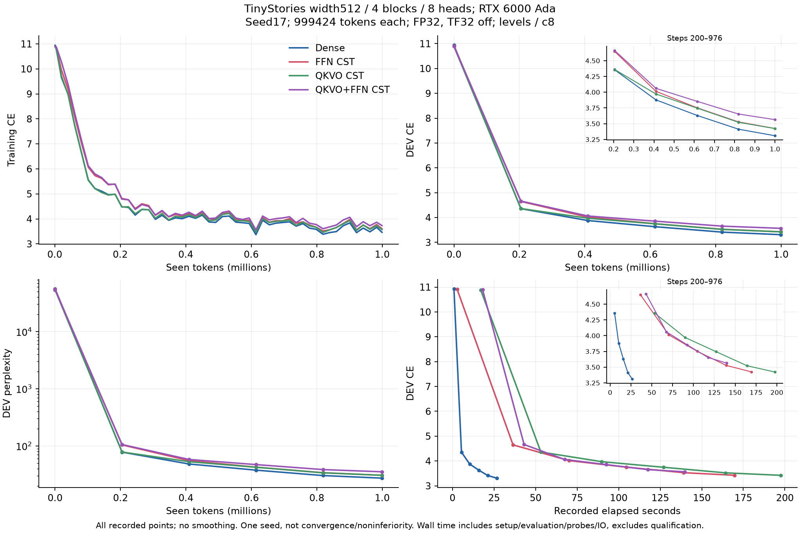
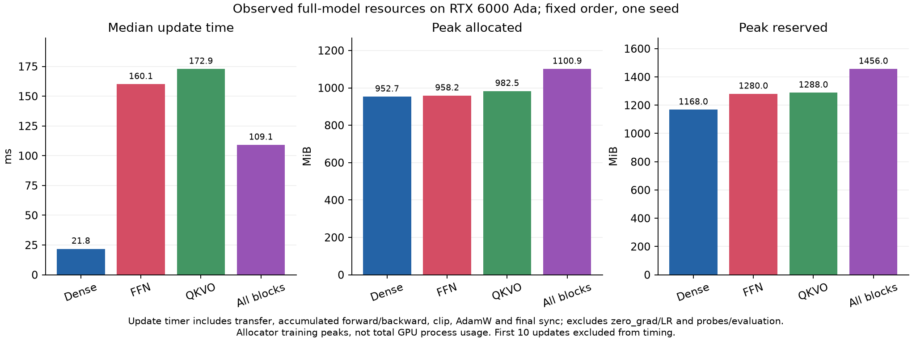
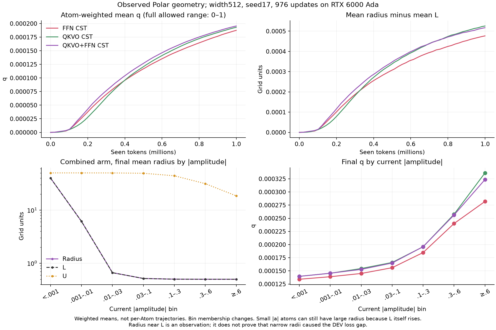

# RTX 6000 Ada：LM置換4条件の結果

[English](attention-output-6000ada-20261108-results.md) | **日本語**

全4条件で976更新・実999424 tokenを完了し、学習済みcheckpoint監査にも合格した。
幅512・1 seedの開発用パイロットであり、収束や非劣性の結果ではない。
[固定プロトコル](attention-output-6000ada-20261108.ja.md)。

| Arm | DEV CE (start → end) | Final DEV PPL | Update ms | tokens/s | Allocated MiB | Reserved MiB |
| --- | ---: | ---: | ---: | ---: | ---: | ---: |
| Dense | 10.9356 → 3.3090 | 27.36 | 21.79 | 47000 | 952.7 | 1168.0 |
| FFN CST | 10.9082 → 3.4244 | 30.70 | 160.08 | 6397 | 958.2 | 1280.0 |
| QKVO CST | 10.8897 → 3.4226 | 30.65 | 172.86 | 5924 | 982.5 | 1288.0 |
| QKVO+FFN CST | 10.8974 → 3.5644 | 35.32 | 109.09 | 9387 | 1100.9 | 1456.0 |

「全部」は4ブロック全てのQ/K/V/OとFFN up/downの24か所を置換する意味。
token/position埋め込みと共有語彙出力はDense。固定データ・データ順・通常Parameterの
名前ごとの初期化とseed17を共通にした。各射影のAtom数はceil(8 sqrt(d_in d_out))。
最小Atom探索は行っていない。

時間はwarmup後966更新の中央値。転送・4回のforward/backward・clip・AdamW・末尾同期を
含み、zero_grad/LR設定・冒頭同期・probe・評価・IOは除く。記録された経過時間には
setup・評価・probe・IOを含み、資格検査は含まない。allocated/reservedはallocatorの
学習時ピークでprocess全体のメモリではない。固定順序は独立したhardware反復ではない。
この順序では両方置換した方が部分置換より短時間だったが、原因はprofileしておらず、
置換箇所を増やせば一般に速くなるという主張はしない。
LM全体の観測値であり、Linear単体の時間と置き換えない。

学習前にAdaで3モデルの資格検査に新規合格した。全学習済みCST射影が、有界行数の
独立FP64 Y/dX/全Atom VJPに合格。各条件のDEVをcheckpointから厳密に再計算し、
独立した2回の復元から次のタスク更新とoptimizer状態が一致した。
confirmation・生成は実行していない。以前の同一ソースのAda回帰223件の記録は
hash照合して再利用し、再実行ではない。試行01のcontroller schema失敗は
資格検査・学習前のもので、別途保全している。

Operatorは `b393ac653f3b3893c378acda1c1752919c1539d1`、consumerは
`6bf20fe0cad5626374b9ebff93d892cc76801b33`。実機はNVIDIA RTX 6000 Ada Generation、
Torch 2.9.1+cu128、CUDA 12.8。request SHA256は
`2df9d9a84d0db9b8b34955e054e87a25e94f2ef81d38fd765384fd300d5db9b8`。コンパクトarchiveのSHA256は
`0f0468d9419a9fe2f8ce1318b36188bb555eaffec7e1ff550392f393380f5fe5`、47ファイルを検証済み。
回収時に所有実験processは全て非稼働。checkpoint・データ・ソース・native buildは
名前付きcluster保存先に保持し、コンパクトなlog・曲線・geometry・receipt・監査を
回収した。最終Tensor本体はclusterのcheckpointにあり、ローカルにはhashを保持する。

[集約JSON](attention-output-6000ada-20261108-results.json)に記録された全曲線・時間の要約、
ソース・checkpoint/結果hash・図のhashを残した。生の時間sampleはhashで紐付けた
ignoredのsummaryに保持する。
公開default採用、他の幅へのスケール、GPU単体の効果分離を示す結果ではない。

## Geometryの観測と次の仮説

これは事後的な記述で、DEV差の原因を特定した結果ではない。
終了時のAtom数で重み付けしたq平均は、FFNが0.000187、QKVOが0.000193、
両方が0.000195だった。qの範囲は0〜1。両方置換したモデルでは、半径平均1.410592、
L平均1.410075で、差は0.000517 grid単位。ただし全半径が0.5付近という意味ではない。
現在の|a|<0.001では、L自体が大きくなるため半径平均は39.91だった。

[Geometry JSON](attention-output-6000ada-20261108-geometry.json)に重み付き平均の全履歴と、
最終時点の振幅binを記録した。binの所属は途中で変わり、同じ個別Atomの追跡ではない。

現在のPolar更新はAdamW提案の半径方向成分を捨て、角度・振幅側の更新energyで半径を
広げ、半径方向の正則化を適用する。タスク勾配から半径を自由に最適化する方式ではない。
実装済みの `finite_chord` と `time_energy` は外側のstep幅に対して次の違いがある。

\[
\Delta q_{\rm activity}\propto
\|\Delta p_{\rm tangent}\|^2
\quad\text{と}\quad
\|\Delta p_{\rm tangent}\|^2/\eta.
\]

提案変位が学習率etaに比例する場合、それぞれO(eta²)とO(eta)で、微小stepでの
正則化はO(eta)。新しいL/U envelopeを考える前に、既存の更新clockを比較する根拠に
なる。ただし、このLMでtime_energyが改善する証明ではない。その比較は未実施で、
今回の事後解析を根拠に新しい学習は投入していない。座標移動を使うcontrollerは
さらに別の仮説。固定パイロットの設定・ソース・結果・結論は変更していない。
