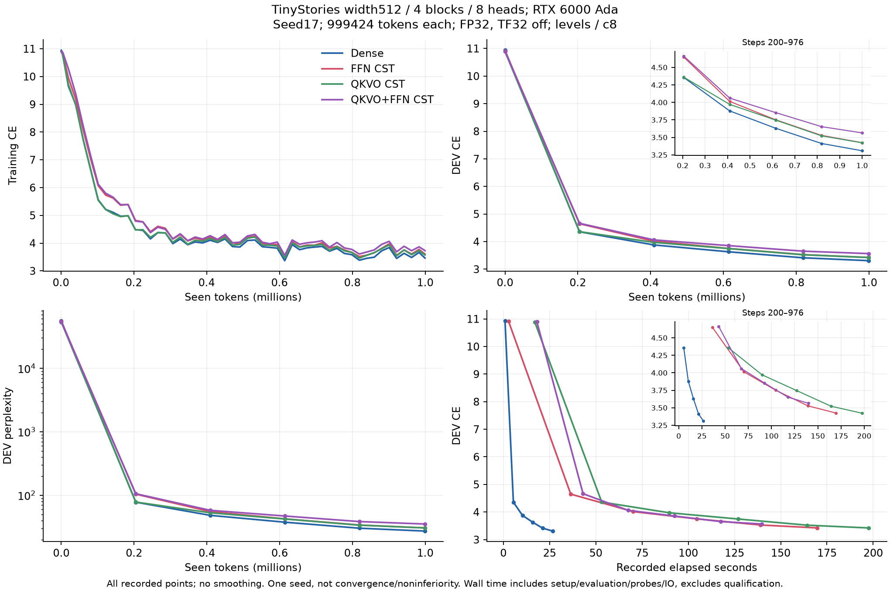
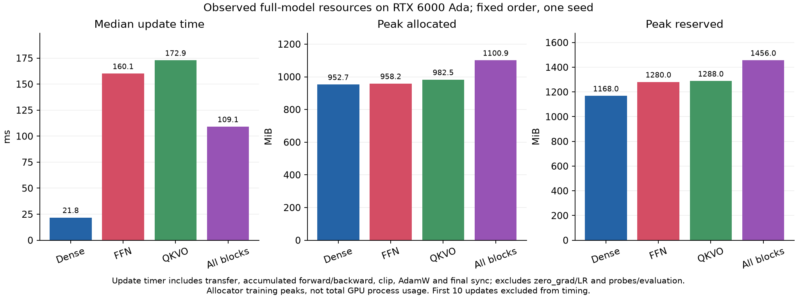
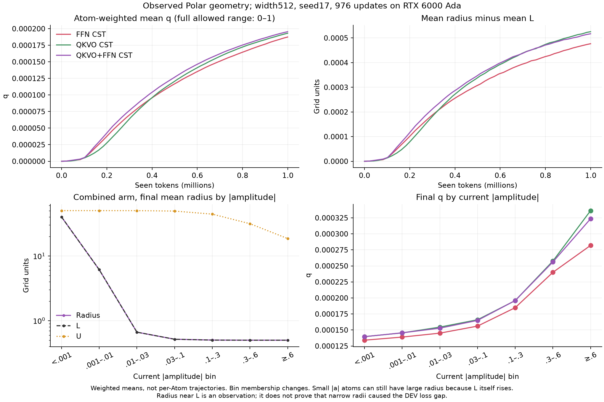

# RTX 6000 Ada: four-arm LM replacement results

**English** | [日本語](attention-output-6000ada-20261108-results.ja.md)

All four arms completed 976 updates / 999424 actual tokens and passed their
trained-checkpoint audits. This is a one-seed development pilot at width512,
not a convergence or noninferiority result. [Fixed protocol](attention-output-6000ada-20261108.md).

| Arm | DEV CE (start → end) | Final DEV PPL | Update ms | tokens/s | Allocated MiB | Reserved MiB |
| --- | ---: | ---: | ---: | ---: | ---: | ---: |
| Dense | 10.9356 → 3.3090 | 27.36 | 21.79 | 47000 | 952.7 | 1168.0 |
| FFN CST | 10.9082 → 3.4244 | 30.70 | 160.08 | 6397 | 958.2 | 1280.0 |
| QKVO CST | 10.8897 → 3.4226 | 30.65 | 172.86 | 5924 | 982.5 | 1288.0 |
| QKVO+FFN CST | 10.8974 → 3.5644 | 35.32 | 109.09 | 9387 | 1100.9 | 1456.0 |

"All" replaces Q/K/V/O and FFN up/down in all four blocks (24 sites).
Token/position embeddings and tied vocabulary output remain Dense. All arms
use the same frozen data/order, ordinary named initialization and seed17.
Atom count per map is ceil(8 sqrt(d_in d_out)); no minimum-Atom search was run.

Time is the median of 966 post-warmup updates. Each includes transfer, four
forward/backwards, clipping, AdamW and final synchronization; zero_grad/LR
assignment, initial synchronization, probes, evaluation and IO are excluded.
Recorded elapsed includes setup/evaluation/probes/IO, but not qualification.
Allocated/reserved are allocator training peaks, not total process memory.
Fixed sequential order is not independent hardware replication. The combined
arm was faster than the partial replacements in this order; its cause has not
been profiled, so this is not a general claim that more replacement is faster. These are
full-LM observations and must not be substituted for isolated Linear timings.

Three fresh model qualifications passed on Ada before learning. Every trained
CST map passed bounded-row independent FP64 Y/dX/all-Atom VJPs. Each arm's DEV
was recomputed exactly from its checkpoint; two independent restores gave the
same next task update and optimizer state. No confirmation or generation ran.
The old same-source Ada223 regression record was hash-verified and reused;
it was not rerun. Attempt01's controller schema failure occurred before any
qualification/learning and remains preserved separately.

Operator: `b393ac653f3b3893c378acda1c1752919c1539d1`; consumer:
`6bf20fe0cad5626374b9ebff93d892cc76801b33`. Actual GPU: NVIDIA RTX 6000 Ada Generation,
Torch 2.9.1+cu128, CUDA 12.8. Request SHA256:
`2df9d9a84d0db9b8b34955e054e87a25e94f2ef81d38fd765384fd300d5db9b8`. Compact archive SHA256:
`0f0468d9419a9fe2f8ce1318b36188bb555eaffec7e1ff550392f393380f5fe5`; 47 files verified.
All owned experiment processes were inactive at collection. Checkpoints,
datasets, source and native builds remain in the named cluster job directory;
compact logs, curves, geometry, receipts and audit records were downloaded.
Final tensor payloads are checkpoints on the cluster, with local hashes.

[Aggregate JSON](attention-output-6000ada-20261108-results.json) retains every
recorded curve point, timing summaries, sources, checkpoint/result hashes and
figure hashes. Raw timing samples remain in the ignored hash-linked summaries.
No public default, broader width scaling or hardware-isolated claim follows.

## Geometry observation and a next hypothesis

This is a post hoc description, not a causal attribution of the DEV gap.
The final Atom-weighted q means were 0.000187 (FFN), 0.000193 (QKVO) and
0.000195 (combined), on a declared 0–1 range. In the combined model, mean
radius was 1.410592 and mean L was 1.410075, a gap of 0.000517 grid units.
This does not mean every radius was near 0.5: for current |a|<0.001, the mean
radius was 39.91 because L itself rises for weak atoms.

[Geometry JSON](attention-output-6000ada-20261108-geometry.json) records all
weighted histories and final current-amplitude bins. These bins change
membership; the curves are not persistent individual-Atom trajectories.

The current Polar update discards the radial part of the AdamW proposal,
uses angular/amplitude motion energy to expand radius, and applies radial
regularization. It does not freely optimize radius from the task gradient.
The existing `finite_chord` and `time_energy` modes differ by the outer step:

\[
\Delta q_{\rm activity}\propto
\|\Delta p_{\rm tangent}\|^2
\quad\text{versus}\quad
\|\Delta p_{\rm tangent}\|^2/\eta.
\]

For proposals proportional to learning rate eta, those contributions are
respectively O(eta²) and O(eta), while the small-step regularization is O(eta).
This is a reason to compare the already implemented update clocks before
inventing another L/U envelope. It is not proof that time_energy improves this
LM: that comparison has not run, and no new training was launched from this
post hoc analysis. A later center-motion controller is a separate hypothesis.
The fixed pilot's recipe, sources, results and conclusions remain unchanged.
