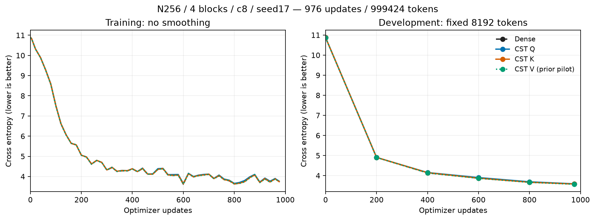
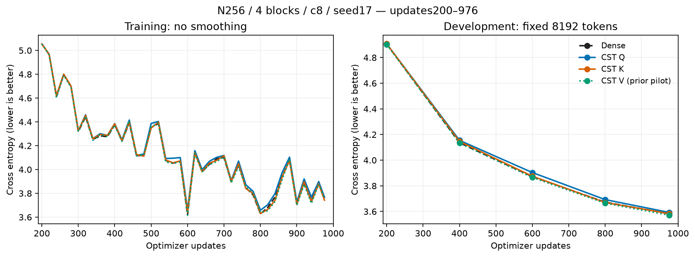
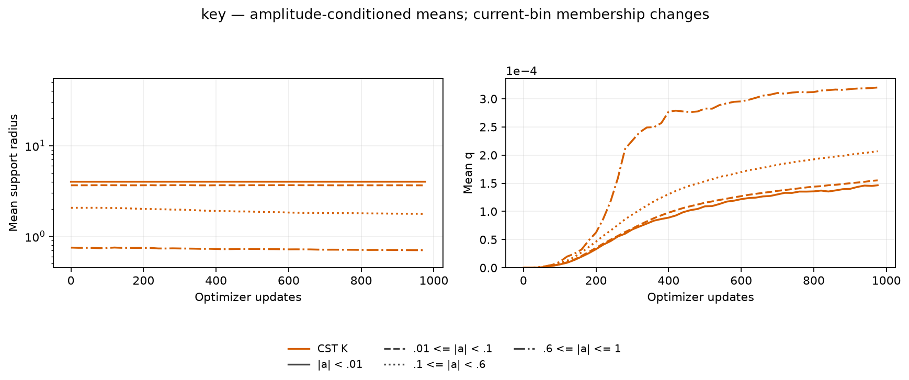
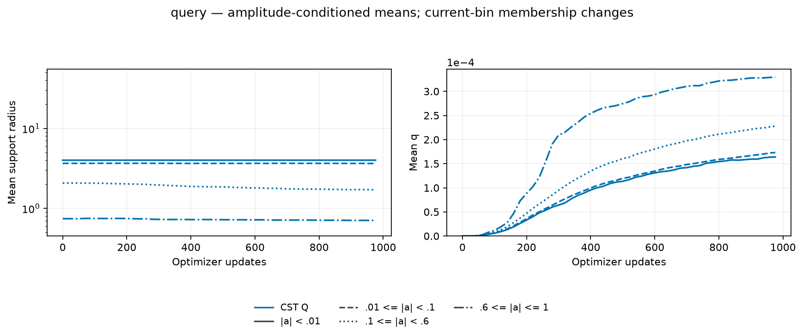

# CSTのQuery/Key射影の結果

[English (canonical)](attention-qk-20261107-results.md) | 日本語

新しいDense対照と対象射影CSTの学習は976更新/999424トークンと学習後監査を完了しました。
Denseに対して CST Q 3.592582 (difference +0.010622), CST K 3.582850 (difference +0.000890) です。対象の全射影が有限の勾配で学習し、短期DEV曲線は
Denseに近い形でした。1seedの記述的観測であり、正式な非劣性・収束や一般的な精度優位の
証拠ではありません。

幅256、pre-LN4ブロック、4head、context128、FFN4N、c8、seed17、batch2/累積4、
eager FP32/TF32無効、AdamW(.9,.95)、decay0、clip1、baseLR3e-4/Atom全体LR16倍、
LR/データ順序20Mトークン予定を揃えました。各ブロックで対象のQ/K/V射影だけがCST
（計4射影、各2048Atom）です。FFN、残りのAttention射影、O、埋め込み/語彙出力、
因果的softmax演算はDenseまたは従来演算です。有理式Polar、初期q0を使い、共有Parameterと
残すpacked Dense行の初期値は一致、CST二次モーメントはDense std.02へ誤差.5%以内です。

| Condition | DEV CE | DEV PPL | Update ms | Allocated MiB | Reserved MiB |
| --- | ---: | ---: | ---: | ---: | ---: |
| Dense | 3.581960 | 35.9439 | 11.32 | 482.50 | 490 |
| CST Q | 3.592582 | 36.3278 | 180.24 | 528.96 | 552 |
| CST K | 3.582850 | 35.9759 | 179.22 | 528.96 | 552 |
| CST V (prior pilot) | 3.570822 | 35.5458 | 176.20 | 528.96 | 552 |

更新時間は累積とデータ転送を含む同期済みoptimizer更新全体の中央値で、診断/評価を除きます。
メモリは更新全体のallocated/reservedピークで、GPUプロセス全体ではありません。
Vの過去値を表示する場合は以前の凍結実験に属し、新しい同時速度対照ではありません。
半径/qは4ブロックをAtom個数で重み付けし、bin所属は変化、空binは欠測です。
各新CST条件は55時点で個数・平均・p10/p90・L/Uを保存しています。Denseのgeometryや
存在しない過去のbin推移を作っていません。

## 検証と証拠

学習前に独立スカラー求積、実正方形nativeのY/dX/全Atom VJP、明示的masked-softmaxとの
統合勾配、未来token勾配ゼロ、optimizer moment/再開、4ブロック実タスク/再開が通りました。
学習後も全8対象射影のVJP、DEV3件の
厳密再計算、3件の次更新Parameter/optimizer state厳密再開一致、
最終geometry/checkpoint一致が通りました。compact raw全30ファイルを取得・
ハッシュ検証し、元checkpointはリモートに保持、所有workerは終了しています。
confirmation/生成による選択はなく、DEVは固定8192トークンです。

凍結operator `d2ca317f63b034e5138bb3471ede541159a9a60b`、学習consumer
`9bc0418dc4fc72820658e86ae8b7e5e747aad0df`。実機RTX4090 CC8.9、Torch2.11.0+cu126、
Python3.12.9です。data manifest SHA256は
`5b995103ca95d3c9b62a4e860039683dc734b0a0bb20e232db1b2e45aa690d01`、
archive SHA256は `4f209b48f13770134b0258f9cf6b5118a2e56ae0f0ee197577e62456300190e6`。
[figure/source hashes](assets/attention-qk-20261107/figure-manifest.json)に新旧入力・描画コード・PNG/SVGの
対応を残しています。[固定プロトコル](attention-qk-20261107.ja.md)と測定時のソースを使い、後のconsumerで
receipt形式まで同じだと仮定しないでください。

描画は `python scripts/plot_projection_pilot.py --run EVIDENCE --output FIGURES`、
Q/Kでは追加で `--historical PRIOR_V/retrieved/cst-v` を使います。raw証拠はGit外です。
この観測を受けてQKV/QKV＋FFNを別実験にしましたが、個別条件の結果だけで組み合わせ条件の
成立を証明したわけではありません。
