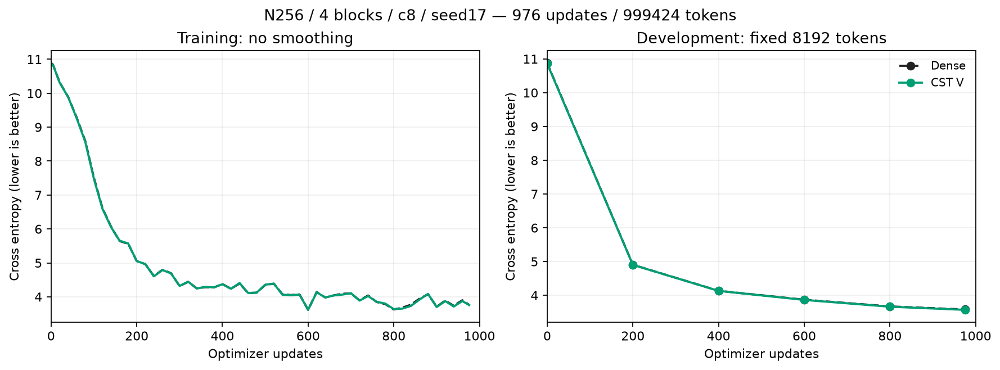
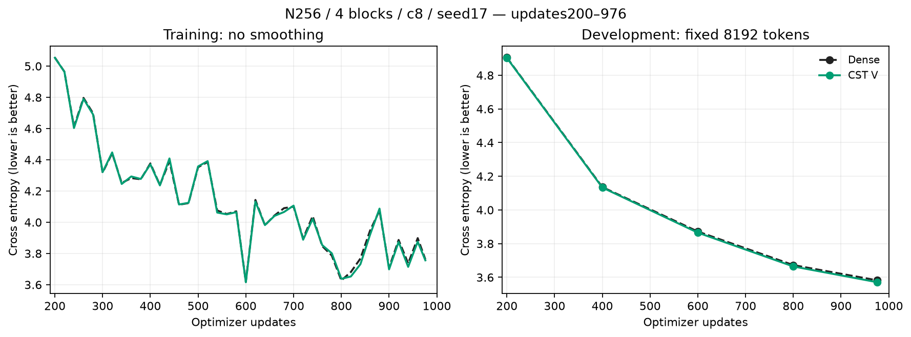
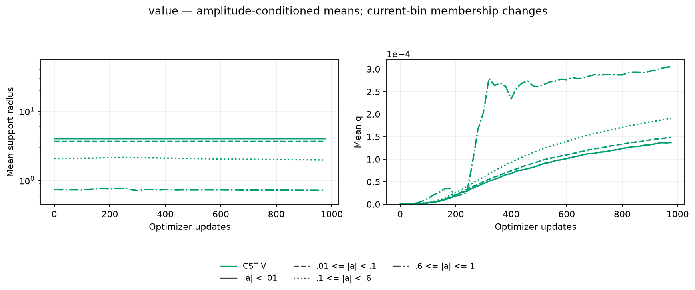

# CST V-projection results

English (canonical) | [日本語](attention-v-20261107-results.ja.md)

The fresh Dense/control and selected-CST learners completed 976 updates/999424
tokens and trained audits. CST V 3.570822 (difference -0.011138), relative to Dense.
All selected projections trained with finite gradients; their short DEV curves
remain close to Dense. These are descriptive one-seed observations, not formal
noninferiority, convergence or a general accuracy advantage.

Keep N256,four pre-LN blocks,four heads,context128,FFN4N,c8,seed17,
batch2/accumulation4,eager FP32/TF32off,AdamW(.9,.95),decay0,clip1,
baseLR3e-4/whole-Atom LR16 and the 20M-token LR/data-order horizon.
Only the selected Q/K/V projection in each block is CST (four sites,2048 Atoms
each). FFN, complementary attention projections, O, embedding/vocabulary output
and the causal softmax operator stay Dense/unchanged. Use rational Polar and
initial q0. All shared Parameters and complementary packed Dense rows match at
initialization; CST operator second moments match Dense std .02 within 0.5%.

| Condition | DEV CE | DEV PPL | Update ms | Allocated MiB | Reserved MiB |
| --- | ---: | ---: | ---: | ---: | ---: |
| Dense | 3.581960 | 35.9439 | 11.35 | 482.50 | 490 |
| CST V | 3.570822 | 35.5458 | 176.20 | 528.96 | 552 |

Update time is the median synchronized complete optimizer update, including
accumulation/data transfer; geometry/evaluation are outside timing. Memory is
the complete-update allocated/reserved peak, not total process usage. Historical
V points, when present, belong to the prior frozen pilot and are not fresh
paired resource measurements. Radius/q means pool four blocks by Atom count.
Bin membership changes over time and empty bins are missing. Each new selected
arm retains 55 geometry snapshots, counts, mean,p10,p90,L/U. No Dense geometry
or missing historical bin trajectories are invented.

## Admission and evidence

Independent scalar quadrature, actual native square Y/dX/all-Atom VJPs,
explicit masked-softmax integration gradients, future-token gradient zeros,
optimizer moments/resume and actual four-block task/resume passed before learning.
Trained audits passed4 selected-site VJPs,
2 exact DEV recomputations and
2 exact next-task-update/resumed optimizer
state checks. Final geometry matches checkpoints. All22
compact raw files were retrieved and hash-verified; original checkpoints remain
intact remotely and owned workers are inactive. No confirmation/generation was
used for selection. Fixed DEV has8192 tokens.

Frozen operator `d2ca317f63b034e5138bb3471ede541159a9a60b`; trained consumer
`48479cabf504053d37f8b7143d104f0a85b19fd9`. Actual hardware RTX4090 CC8.9,
Torch 2.11.0+cu126,Python 3.12.9. Data manifest SHA256
`5b995103ca95d3c9b62a4e860039683dc734b0a0bb20e232db1b2e45aa690d01`.
Compact archive SHA256 `a2794154797af986eac5842a16226bb23ade1ebec974efa7f10f51d04ddfa335`.
[Figure/source hashes](assets/attention-v-20261107/figure-manifest.json) bind primary and
historical inputs, plot code and PNG/SVG exports. Use the
[fixed protocol](attention-v-20261107.md) and its exact measured source, rather than assuming
that a later consumer checkout has the same receipt format.

Rendering uses `python scripts/plot_projection_pilot.py --run EVIDENCE --output FIGURES`;
Q/K additionally uses `--historical PRIOR_V/retrieved/cst-v`. Raw artifacts remain
outside Git. These observations motivated separate combined QKV/QKV+FFN studies;
they do not establish that combined configurations work.
