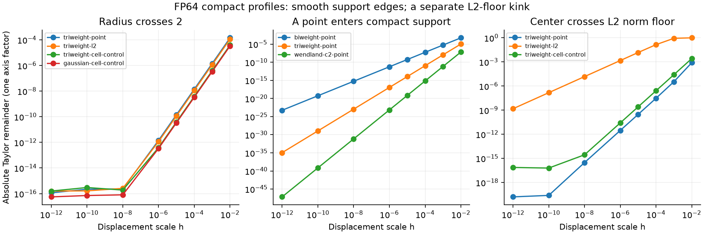

# Triweightの支持端は滑らか：正規化には別の境界挙動がある

[English (canonical)](compact-boundary-20261109-results.md) | 日本語

CPU240条件・1920変位を完了しました。モデル・optimizer・GPU・本番変更・速度/品質の
主張はありません。1軸profileの診断で、以前の1 Atom重み行列全体のノルム比較とは
対象が異なります。[protocol](compact-boundary-20261109.ja.md) |
[選択した結果・出自](compact-boundary-20261109-results.json)。

## 形と支持境界の測定

public raw TriweightはK(u)=max(0,1-u^2)^3で、u=±1ではK,K',K''がゼロになります。
支持へ入る直前の点ではK(1-epsilon)=(2epsilon-epsilon^2)^3でO(epsilon^3)です。
支持siteの選び直しで、非ゼロの裾を捨てる形ではありません。固定Torch profileは
独立した多項式の値・解析微分・端点の一次/二次微分ゼロと一致しました。

選んだ支持半径1・中心7の境界で、h1e-3→1e-4の絶対Taylor残差の次数は、Triweightが
2.99824、Biweightが1.99883、WendlandC2が3.99812でした。これはfixture固有の端の
次数で、関数全体の微分可能性の次数ではありません。WendlandC2の支持端は全体のC2より
速くゼロへ近づきます。調べたpublic形状では、以前のFourier区間の残差停滞と異なり
残差がゼロへ近づきます。例えば以前の階層境界の半径2・中心7.3では、Triweight L2の
残差はh1e-6で1.15e-12、h1e-12で1.58e-16です。Triweight自体はそこで階層を切り替えません。

支持端で一次微分がゼロなら、J delta thetaもゼロや高次になり、相対誤差・cosineは
収束しない・未定義になり得ます。実変化が三次で生じても一次予測ゼロと矛盾しません。
絶対残差と次数を見ることで、有限の跳びと区別します。

## 離散L2は別の契約

publicの点評価L2 profileは

\[
 \psi_j=\frac{g_j}{\max(\sqrt{\sum_k g_k^2},10^{-6})}
\]

です。ノルムfloorで値は連続ですが、勾配が折れます。1 siteのみ有効な例として
R0.4、中心0.4*sqrt(1-(1e-6)^(1/3))≈0.397995を使いました。
floorを跨ぐTaylor残差はh1e-6で1.49e-3、h1e-12で1.49e-9、次数0.999893です。
有限の値の跳びではありません。両側の独立した微分テストでも傾きの変化を確認しました。

支持の連続性とは別に、次の制約があります。

- 支持内にsiteがなければ、点評価raw/L2の値と勾配はゼロです。
  調べたR0.4・中心7.5の空支持内では、小さな変更後もゼロでした。
- floorより上で1 siteしか有効でない場合、L2正規化でその大きさが相殺されて値は1に
  なります。支持・ノルムの領域が変わるまで中心・幅の微分はゼロです。
  形が滑らかでも、全ての位置で有用な勾配が出るとは限りません。

R0.5・中心7.5の空支持から生まれる例では、L2の実変化がh1e-3で0.08970、h1e-6では
9.05e-11でした。数学的極限は連続でも、狭い領域で有限stepの挙動が大きくなり得ます。
optimizerの不具合・モデル品質を結論づけるものではありません。

## 固定cellのTriweight対照

独立した正規化密度35/(32R)*K((x-mu)/R)を、正確な多項式原始関数と端の裾の安定式で
全固定cellに積分しました。public Triweight cell_mass bindingの実装ではありません。
総massを保ち、点評価の空支持状態を避けます。R0.4・中心7.5では隣接cellが各1/2です。
動的局所周期や離散L2ノルムfloorを持ちません。独立した区分Gauss-Legendre積分と周期の
検証も成功しました。ただし、支持全体が1 cellに入る場合など一定領域は残り得るため、
連続性だけで学習勾配が非ゼロとは言えません。



## 数式の議論への示唆

Triweightは支持端が滑らかにゼロへつながるため、有限支持の出発点として候補になります。
無限の裾は必須ではありません。rawの支持内は6次多項式なので、1次元の支持区間和は

\[
 \sum_{j\in I}x_j K((j-\mu)/R)
 =\sum_{k=0}^{6}c_k(\mu,R)\sum_{j\in I}x_jj^k
\]

と書けます。この導出した恒等式から、Fourier momentの代わりに7個の多項式momentと
区間・階層queryを使う余地があります。ただし設計上の可能性であり、高速algorithmは
実装していません。大きい座標のべき乗による桁落ち、局所座標変換、正規化、dX・全
パラメータ勾配、complete-step時間・メモリは未検証です。compact cell積分には部分cellの
別処理が必要です。kernel・正規化・既定値の選択や学習開始は行っていません。

## 再現・検証

実行consumerは4420a2943348964ce447dd76870771068fe6de69、operatorはcleanな
0d277ae6dc0ae14fe515c7559f39535ed0238950です。CPU Torch2.13.0/Python3.11.15。
runner SHA256はc44437334444cb1880f1a608a5cbb7209c901ef4aa06c8f8c117496a88724ef6、
Gaussian helper SHA256はe40b373ed6c618cd53473b090c864097bcaa477c02ac351e264c7f122af03734、
raw summary SHA256はea47b1629087be4be8bd57c9a0f34b3b4d18ddc395e9be47239b2196f7b50b4eです。
証拠はCST_RESEARCH_EVIDENCE_ROOT/compact-boundary-cpu-20261109-01です。
新たな独立3テスト成功、全体280件中219成功・61任意skip、registry44研究の検証成功。
Ruffと描画した図の確認も成功しました。固定archiveのsource2015件を検証しました。SHA256は
24f1530d31f5ee6b5f758da36defe929f63095de2caa0b953460ec69db126abdです。

```bash
python scripts/inspect_compact_boundaries.py --output "$NEW_OUTPUT"
python scripts/report_compact_boundaries.py --run "$NEW_OUTPUT" --repository .
```

標準的なTriweightの形：[kedd kernel documentation](https://search.r-project.org/CRAN/refmans/kedd/html/kernel.fun.html)。
