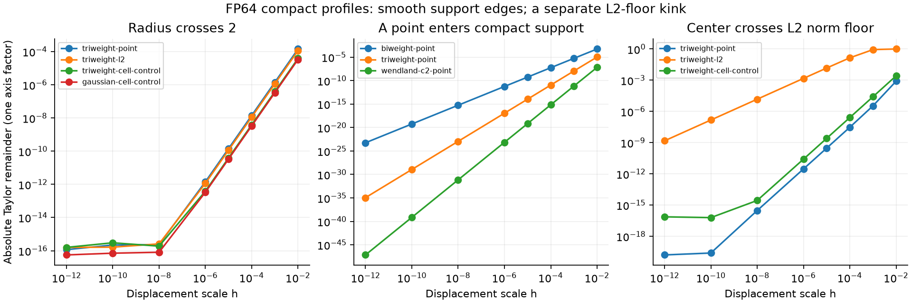

# Triweight support is smooth; normalization has separate boundary behavior

English (canonical) | [日本語](compact-boundary-20261109-results.ja.md)

Completed240 CPU fixture/profile/dtype records and1920 displacements. No model,
optimizer, GPU, production change or speed/quality claim. This is a one-axis
profile diagnostic, not the earlier full one-Atom weight-matrix norm comparison.
[Protocol](compact-boundary-20261109.md) |
[Selected results and provenance](compact-boundary-20261109-results.json).

## Shape and measured support boundary

Public raw Triweight is K(u)=max(0,1-u^2)^3. At u=±1, K,K',K'' all vanish.
For a point just entering support, K(1-epsilon)=(2epsilon-epsilon^2)^3,
which is O(epsilon^3). Changing support membership therefore does not discard a
nonzero tail. The frozen Torch profile matches independent polynomial values,
analytic derivatives and zero first/second derivatives at the endpoint.

At the selected support-radius1 boundary (center7), the absolute Taylor
remainder converges with order2.99824 for Triweight,1.99883 for Biweight and
3.99812 for WendlandC2 over h1e-3→1e-4. These are fixture-specific endpoint
orders, not global differentiability orders; WendlandC2's support edge vanishes
more rapidly than its global C2 designation requires. All tested public shapes
approach zero residual rather than showing the prior Fourier-window plateau.
For example, at the former radius2 hierarchy boundary and center7.3, Triweight
L2 remainder is1.15e-12 at h1e-6 and1.58e-16 at h1e-12. Triweight has no profile
hierarchy switch there.

When the first derivative vanishes at support, J delta theta can be zero or
higher order too. Relative error/cosine need not converge or even be defined;
a finite actual cubic response is consistent with a zero first-order prediction.
The absolute remainder and its order distinguish this from a finite jump.

## Discrete L2 is not the same contract

The public sampled L2 profile is

\[
 \psi_j=\frac{g_j}{\max(\sqrt{\sum_k g_k^2},10^{-6})}.
\]

The value stays continuous through the norm floor, but the derivative has a
kink. A single-active-site witness uses R0.4 and center
0.4*sqrt(1-(1e-6)^(1/3))≈0.397995. Across this floor the Taylor remainder is
1.49e-3 at h1e-6, falling to1.49e-9 at h1e-12: order0.999893, not a finite value
jump. Independent one-sided derivative tests confirm the slope change.

Two further exact limitations are separate from support continuity:

- When no site lies inside support, sampled raw/L2 values and gradients are zero.
  The tested R0.4,center7.5 empty interior remains zero under small changes.
- With just one active site above the floor, L2 normalization cancels that
  site's magnitude. Its normalized value is1, so center/width derivatives vanish
  until the support/norm regime changes. A smooth profile need not provide a
  useful gradient everywhere.

For an empty-support birth at R0.5,center7.5, the L2 actual change drops from
0.08970 at h1e-3 to9.05e-11 at h1e-6. Thus narrow finite-step behavior can be
large even though the mathematical limit is continuous. No optimizer fault or
model-quality conclusion follows.

## Fixed-cell Triweight control

An independent normalized density35/(32R)*K((x-mu)/R) is integrated over all
fixed cells with exact polynomial primitives and stable endpoint tails. This
is not an implemented public Triweight cell_mass binding. It conserves total
mass and avoids the sampled empty-support state: at R0.4,center7.5 its two
neighboring cells each receive1/2. It has no moving local period or discrete L2
norm floor. Independent piecewise Gauss-Legendre quadrature and periodic checks
pass. It can still have constant regions, e.g. a support fully inside one cell;
continuity alone does not guarantee nonzero learning gradients.



## Implications for the formula discussion

Triweight is a plausible compact-support starting point because its support
edges join zero smoothly. It does not require infinite tails. Its raw interior
is a degree6 polynomial, so a one-dimensional supported sum can be written

\[
 \sum_{j\in I}x_j K((j-\mu)/R)
 =\sum_{k=0}^{6}c_k(\mu,R)\sum_{j\in I}x_jj^k.
\]

This derived identity suggests7 polynomial moments and range/hierarchy queries,
rather than Fourier moments. It is only a design possibility, not an implemented
fast algorithm. Numerical cancellation in global powers, local coordinate
transforms, normalization, dX/all parameter gradients, complete-step time and
memory remain untested. Compact cell integrals require separate partial-cell
handling. No kernel/normalization/default was selected or training started.

## Reproduction and validation

Executed consumer4420a2943348964ce447dd76870771068fe6de69;
operator0d277ae6dc0ae14fe515c7559f39535ed0238950, clean checkout.
CPU Torch2.13.0/Python3.11.15. Runner SHA256
c44437334444cb1880f1a608a5cbb7209c901ef4aa06c8f8c117496a88724ef6;
Gaussian helper SHA256e40b373ed6c618cd53473b090c864097bcaa477c02ac351e264c7f122af03734;
raw summary SHA256ea47b1629087be4be8bd57c9a0f34b3b4d18ddc395e9be47239b2196f7b50b4e.
Evidence:CST_RESEARCH_EVIDENCE_ROOT/compact-boundary-cpu-20261109-01.
Three new independent tests pass; full suite280 tests:219 passed,61 optional
skips. Registry validation passes44 studies. Ruff and rendered figure inspection
pass. The frozen archive contains2015 verified source files, SHA256
24f1530d31f5ee6b5f758da36defe929f63095de2caa0b953460ec69db126abd.

```bash
python scripts/inspect_compact_boundaries.py --output "$NEW_OUTPUT"
python scripts/report_compact_boundaries.py --run "$NEW_OUTPUT" --repository .
```

Standard Triweight shape:[kedd kernel documentation](https://search.r-project.org/CRAN/refmans/kedd/html/kernel.fun.html).
