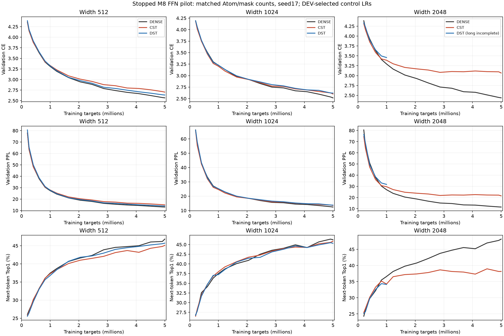
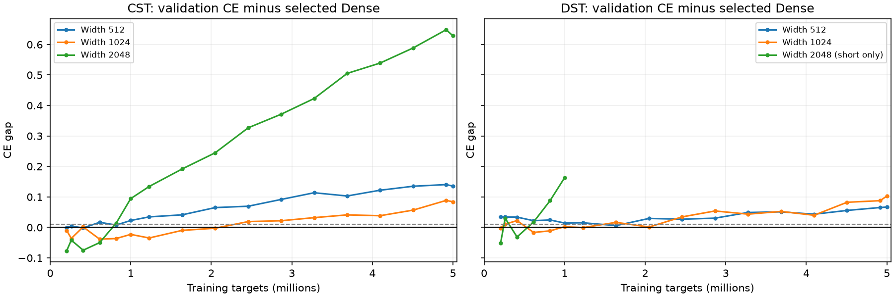
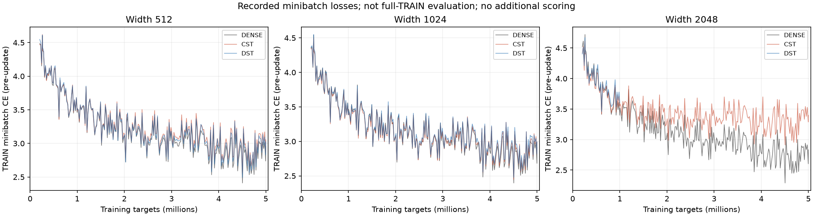
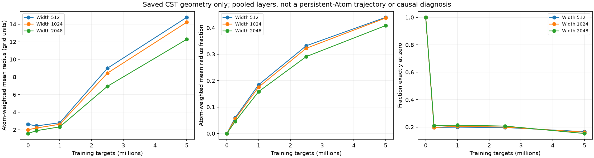
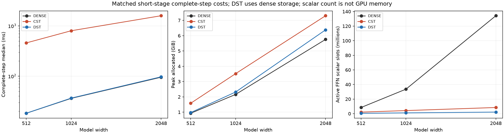

# CST研究の停止時点まとめ

[English (canonical)](cst-research-summary-20261111.md) | 日本語

**所有者の指示で実験は一旦停止しています。** 既存の研究記録を総括し、保存済みの幅比較を
独立に集計しました。このまとめのための学習・推論・新規モデル採点・GPUアクセスは行っていません。
最新studyはSTOPPEDです。短期24条件、長期9条件中8条件が完了しましたが、最後の幅2048 DSTは
中断し、その再実行も停止しました。結果とcheckpointは保持しています。

CSTがこれらのタスクを学習できること、一部置換でDenseに近い条件があることは確認できました。
一方、現在の全FFNレシピでは、線形Atom予算でのDense同等精度も、LM全体の速度・実測メモリの
優位性も示せていません。検証した設定の結果であり、CST全般の不可能性の証明ではありません。

## 直近の幅比較までに分かったこと

| 問い | 記録された結果 | 範囲・限界 |
| --- | --- | --- |
| 深いHIGGSで停滞したのはなぜか | 旧振幅初期化では値が強く減衰。作用素の二乗平均をHe/Xavierへ対応させる方式や、初期RMS校正で学習が進んだ。 | 1 seedのpilot。正規化が常に必要とも、初期化で一般的なDense同等性が得られたとも言えない。[初期化結果](higgs-initialization-results.ja.md)。 |
| Attentionに使えるか | 幅256・約1MでQKVのみのDEV CE3.580952、Dense3.581960。QKV+FFNは3.695186。OはDense。 | 旧Polarの小型pilot。全Attention・全パラメータ・大規模LMの証明ではない。[QKV/FFN](attention-combined-20261107-results.ja.md)、[幅512 QKVO](attention-output-6000ada-20261108-results.ja.md)。 |
| 1つのFFNで2写像を組にすると必ず悪いか | 幅512・5Mで1ブロックの組はCE2.567259、中央2ブロックは2.573492、Dense2.567102、全8写像は2.698948。 | 配置・圧縮量・残すDense容量が変わり、深さや隣接性の因果証明ではない。過去のDSTは4Aで、後の等A基準と異なる。[置換数](ffn-site-count-20261109-results.ja.md)、[配置・信号](lm-composition-20261109-results.ja.md)。 |
| 半径を自由に勾配学習すれば解決するか | 短期で直接半径学習CE3.424375、Polar3.424410。Polarに半径の連鎖律を通す比較は3.424036→3.422386。 | 半径へ勾配は届いたが差は解消せず。旧Polarのqと現在のenvelope fractionは別のパラメータ化。[独立半径](ffn-independent-radius-20261108-results.ja.md)、[連鎖律](ffn-polar-radius-gradient-20261108-results.ja.md)。 |
| 全パラメータの停止・全勾配消失なのか | 以前のprobeでは残差出力の増大、Parameterの移動、タスクに対する更新方向の一致度の低さを観測。一様な0への崩壊やrank崩壊ではなかった。 | 異なる学習状態・raw座標系の比較。低いcosineを無駄な学習の割合とは読めない。[タスク更新](lm-task-update-behavior-20261109-results.ja.md)。 |
| 微分予測と実際の変化は一致するか | 半径fractionの枝切替で有限変化とTaylor予測に大きな差。optimizerなしのFP64 witnessでも半径・位置の不連続を再現。 | 枝内VJPが正しくても全体が連続とは限らない。Adam履歴も影響し、唯一の原因ではない。[局所形状](lm-tangent-history-20261109-results.ja.md)。 |
| 滑らか化・Atom増量で原因は確定したか | 接続M16で半径更新の予測一致は改善したが損失差はわずか。同数AtomのM8/M16損失は近く、Atom増量の短期改善は次第に小さくなった。 | 実効幅を一致させていない。M16や形状だけが原因とは証明していない。[M16試験](lm-connected-short-20261109-results.ja.md)、[形状・容量](lm-geometry-epsilon-capacity-20261110-results.ja.md)、[Atom予算](lm-atom-budget-20261110-results.ja.md)。 |

各研究では演算・GPU・Atom数・学習量が異なるため、損失や時間を単一の対応比較として混ぜません。
Hub停止で検証済みローカル回収前に証拠を失った過去20M実験は、完了した精度結果に数えていません。

## 最新：c64固定の幅・学習量比較

[固定protocol](lm-width-scale-20261110.ja.md)。TinyStoriesのGPT2 tokens、pre-LN4ブロック、
8 heads、context128、FFN expansion4。8つのFFN写像をCST/DSTにし、Attention・埋め込み・
正規化・bias・埋め込みと共有する語彙出力は通常Denseです。実RTX4090、FP32/TF32無効、
seed17、共通データ順、1更新1024 targets。物語単位で分離した8192 targetsのDEVを
validationとしてeval/no_gradで評価し、TRAIN minibatchと4文脈probeは分けています。
confirmation32768 targetsは性能評価していません。Top1は次トークン正答率で、自由生成の品質ではありません。

A=64 sqrt(d_in*d_out)=128*width。各LinearでCST Atom数とDSTマスク1の数を一致させます。
DSTはDense重み＋マスクのままでCOO/CSR化していません。CSTは1 Atomあたりraw値4個です。
幅512/1024/2048でA=65536/131072/262144、Atom密度は6.25%/3.125%/1.5625%です。

M8、radius-envelope tau.003、初期fraction0、radius[.5,50]、振幅上限32。
CST通常LR.0003、Atomとfractionの倍率32、既存のfield別LR方針を維持。
Dense LR候補.0001/.0003/.001、DST疎重みLR.0003/.001/.003/.01（通常LR.0003固定）。
短期DEV CE最小、同値なら小さいLRで選び、全候補を残しました。幅順にDenseは.0003/.0003/.0001、
DSTは.003/.01/.01を選択。幅2048 Denseは探索範囲の下端、幅1024/2048 DSTは上端であり、
試した候補中の最良値であって最適値の特定ではありません。

短期976更新/999424 targetsから、選択したDense・DSTとCSTを4882更新/4999168 targetsまで
同じ保存状態から継続しました。20MのLR/配線horizon、optimizer、データ順を維持し、
再warmupやLRリセットはしていません。CSTは4882 Adam更新、完了DSTは配線専用stepを除く4863更新。
長期5M時点でLRを再最適化したわけではありません。

### validation損失

短期・約100万targets：

| 幅 | Dense CE | CST CE | DST CE |
| --- | ---: | ---: | ---: |
| 512 | 3.308981 | 3.331671 | 3.323396 |
| 1024 | 3.226502 | 3.203652 | 3.228753 |
| 2048 | 3.293915 | 3.388307 | 3.456834 |

長期・約500万targets：

| 幅 | Dense CE | CST CE | DST CE | CST − Dense |
| --- | ---: | ---: | ---: | ---: |
| 512 | 2.567102 | 2.702680 | 2.633874 | +0.135578 |
| 1024 | 2.517333 | 2.601438 | 2.619923 | +0.084106 |
| 2048 | 2.437633 | 3.066190 | — | +0.628557 |

未完DSTの終点は0でも途中の値でも推定値でもありません。1Mの終点を5Mモデルと同じ予算として比較しません。

長期の次トークンTop1（%）：

| 幅 | Dense | CST | DST |
| --- | ---: | ---: | ---: |
| 512 | 46.826 | 45.105 | 45.715 |
| 1024 | 46.240 | 45.862 | 45.325 |
| 2048 | 48.157 | 38.147 | — |

幅512のCST損失差は.022690→.135578へ拡大。幅1024の短期の優位−.022850も、長期では
+.084106になりました。幅2048は選択Denseより+.628557です。この設定では短期の近さが
長期の近さを保証しませんでした。完了した長期CSTはいずれも、記述上の目安CE差<=.01かつ
Top1低下<=.5ポイントを同時には満たしません。どの幅で同等になるかは未特定です。

幅2048のDense自体が、短期ではLR.0003より.0001で良い結果でした。一方CST/DSTの通常LRは
.0003固定。標準偏差.02の固定初期化、固定radius境界・tau、幅で変わる初期形状も解釈を
混ぜます。Atom不足・学習不足・optimizerの不具合・CSTの本質的な表現力不足を単独では
特定していません。1 seedとDEV選択から統計的同等性・収束・普遍的なスケーリング則は主張しません。

### TRAINと半径の観測

終点の固定TRAIN4文脈（各128 targets）の平均CE。TRAIN全体の評価ではありません。

| 幅 | Dense | CST | DST |
| --- | ---: | ---: | ---: |
| 512 | 2.499705 | 2.675772 | 2.623038 |
| 1024 | 2.514349 | 2.570025 | 2.618213 |
| 2048 | 2.425099 | 3.108234 | — |

この4文脈では学習側にも差があり、特に幅2048で大きく残っています。このprobeで測定された問題を
validationだけの問題とする単純な説明では足りません。TRAIN母集団のfitや汎化の原因は未特定です。

| 幅 | 平均半径：初期→5M | 終点の平均fraction | fractionが厳密に0 | active座標のmoment尺度<eps、出力/入力 |
| --- | ---: | ---: | ---: | ---: |
| 512 | 2.619 → 14.781 | 0.4397 | 16.65% | 11.70% / 16.73% |
| 1024 | 1.999 → 14.225 | 0.4372 | 16.25% | 15.70% / 19.28% |
| 2048 | 1.573 → 12.281 | 0.4084 | 15.32% | 27.65% / 29.05% |

8写像をAtom数で加重平均しています。activeは振幅絶対値>=.01。
moment割合はactive数で加重し、bias補正したAdam二次moment尺度をeps1e-8と比較したものです。
勾配ゼロ・Atom停止の割合ではありません。今回のfractionが全体で0に張り付いたわけではなく、
平均半径は広がりました。広い半径が損失差の原因、小さい/固定半径なら直る、という証明ではありません。
所属の変わる集計binから、同一Atomの連続軌跡を復元したわけでもありません。

### complete-stepの速度・メモリ・パラメータ

全9組で完了した共通1M区間を比較します。同期stepは4回のforward/backward、clip、optimizer/
配線更新を含み、最初10step、データ準備、validation/probe、checkpoint、oracleを除きます。
allocatedとreservedは別で、allocator履歴に以前のprobeが残る場合があります。
eager計測であり、Graph captureやGPUプロセス全体のメモリは測っていません。
DSTはDense保存の精度対照であって、疎カーネルの実装性能ではありません。

| 幅 | 手法 | 中央値ms | Allocated MiB | Reserved MiB | bias込みactive FFN scalar数 |
| --- | --- | ---: | ---: | ---: | ---: |
| 512 | DENSE | 18.25 | 949.67 | 1538 | 8,398,848 |
| 512 | CST | 458.21 | 1621.25 | 2358 | 2,107,392 |
| 512 | DST | 18.29 | 996.74 | 1594 | 534,528 |
| 1024 | DENSE | 36.13 | 2213.19 | 3288 | 33,574,912 |
| 1024 | CST | 800.06 | 3604.20 | 4478 | 4,214,784 |
| 1024 | DST | 36.55 | 2374.35 | 3450 | 1,069,056 |
| 2048 | DENSE | 95.23 | 5894.30 | 7960 | 134,258,688 |
| 2048 | CST | 1591.57 | 7479.13 | 8934 | 8,429,568 |
| 2048 | DST | 97.04 | 6533.69 | 8844 | 2,138,112 |

CSTのraw FFN scalar数はDenseの約1/4、1/8、1/16へ減りますが、この実装では全3幅で
complete-step allocated memoryが多く、stepも大幅に遅い結果でした。
パラメータ削減はLMの実測メモリ削減と同じではありません。全体にはDense Attention・語彙重みが
残るため、モデル全体が線形メモリになる設計でもありません。別の最適化済み大規模Linearの
結果をLM throughputへ置き換えず、今回の結果でその限定した演算比較を否定することもしません。
時間・メモリの成分別原因をこの研究でprofileしたわけではありません。

## 証拠・中断・現在の状態

native148件、task qualification24条件、完了checkpoint監査64件、全AのFP64
Y/dX/4 rawフィールド照合108件が通りました。最大abs誤差2.3409137575924888e-5、
最大relativeL2 4.597226532553932e-7、元の成分違反0。
各tensor/fieldのmaxabs<=3e-4かつrelativeL2<=1e-4は変更していません。
初期値、retain backward、observer/serialize後の次更新、mask/個数、有限FP32 moments、時計、
復元validationを記録範囲で確認済みです。半径routing全域の滑らかさの主張ではありません。
既存CPU結果はlibrary2300pass/2690optional skip、研究244pass/61optional skip。
このまとめのための追加GPUテストはありません。

元のsupervisorと最後のDSTプロセスが最終例外を残さず消失し、原因は不明です。
保存snapshotのsupervisor receiptをstudy全体の正常終了receiptとは扱いません。
元の976 checkpointから別の再実行を開始しましたが、所有者の指示で停止し、残るowned processが0、
GPU idleを確認しました。元の結果・checkpointと両attemptは保持しています。
最後のDST値・復旧完了・33条件すべて完了を主張しません。registryはSTOPPEDのままです。
保存済み結果の集計によって実験を再開したことにはしません。

| Item | Identity |
| --- | --- |
| Frozen torchcst | `0a70a0d8c78fff63758596b3442b1eadb5c30c48` |
| Frozen consumer | `09aeff15101be220de33e01fbde9553cee2cba99` |
| Joint source archive / 2265 files | `faec6fe8437c0100ae00173ef30a07124536a179466b2fd0001346bbb2bd0f16` |
| Verified through final CST / 392 payloads | `f9dad5782c797f6f191195723361709f969f20ef5532e97e3e16b5bd6d4d6b8f` |
| Token manifest | `5b995103ca95d3c9b62a4e860039683dc734b0a0bb20e232db1b2e45aa690d01` |

データ不要の集計scriptはmanifest、protocol/model/LR選択、対応する時計/個数、audit/checkpoint識別、
短期曲線prefixの完全一致を検査します。公開するのは曲線の必要な値と集約コストで、
raw logs・全timings・tensor・checkpointは外部保存です。再現：
`scripts/summarize_lm_width.py --run EXTRACTED --source-archive SOURCE --stop-receipt STOP --output NEW_DIRECTORY`。
[導出JSONと図のhash](lm-width-scale-20261110-results.json)。
集計script SHA `000757ac2789c8734736645c85582e350a81c0a640d71be5a45200d443c3213d`。
source archiveは固定し、後のreporting commitで変更していません。
PRは研究branchのままで、main mergeや公開default採用を意味しません。

## 未解決の問い

初期化の感度、配置・圧縮量への依存、実現したタスク更新方向の不利、離散半径routingの不連続は
観測できました。しかし、どれか一つで全FFNの精度差を説明できたわけではありません。
未収束の接線solveは到達可能性の下界であり容量上限ではありません。共分散probeも作用素rankの
上限ではありません。半径方針、幅に応じたLR、必要なAtom予算、残したDenseが補う変換は未解決です。
このまとめで因果介入を追加しておらず、実験は停止したままです。
