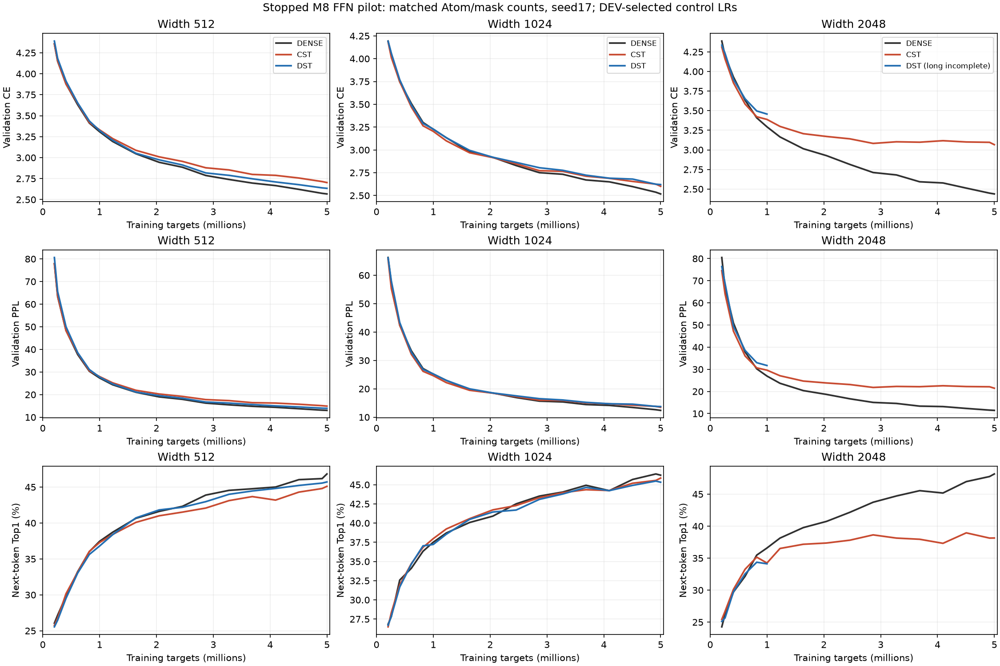
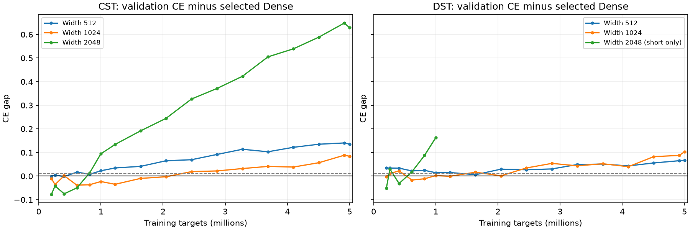
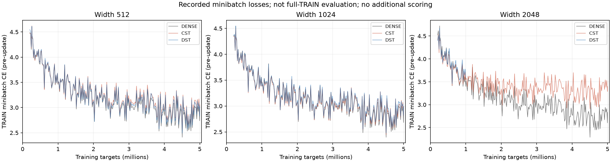
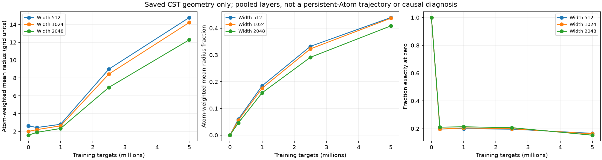
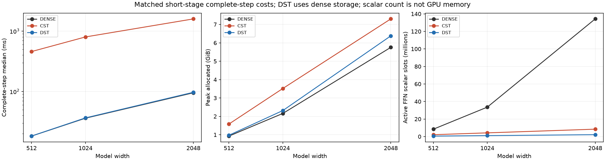

# CST research summary at the experiment pause

English (canonical) | [日本語](cst-research-summary-20261111.ja.md)

**Experiments are paused at the owner's request.** This report consolidates the
existing research record and independently aggregates the archived width study.
No training, inference, new model scoring or GPU access was performed to make
this report. The latest study is STOPPED, not fully completed: all 24 short arms
and8 of9 long arms finished; final width 2048 DST was interrupted and its retry
was stopped. Results/checkpoints remain preserved.

CST demonstrably learns these tasks, and limited replacements can approach
Dense under the tested conditions. The current all-FFN recipe has not demonstrated
Dense-equivalent quality with a linear Atom budget, or a full-LM speed/memory
advantage. This is a result about the tested recipes, not a universal impossibility.

## What the research established before the latest width study

| Question | Recorded finding | Scope / limitation |
| --- | --- | --- |
| Why did deep HIGGS learning stall? | Old amplitude initialization was severely attenuated. Matching operator second moments to He/Xavier, or calibrating initial RMS, restored learning in the tested deep models. | One-seed pilots; normalization is not universally required and initialization did not prove general Dense equivalence. [Initialization results](higgs-initialization-results.md). |
| Can CST replace attention projections? | Width256 QKV-only reached DEV CE3.580952 versus Dense3.581960 at about1M targets. QKV+FFN reached3.695186; O remained Dense. | Small old-Polar pilot; not all attention, all Parameters or a large-LM result. [QKV/FFN](attention-combined-20261107-results.md), [width 512 QKVO](attention-output-6000ada-20261108-results.md). |
| Is pairing two CST maps in one FFN automatically bad? | Width512,5M: one paired block CE2.567259, two middle paired blocks2.573492, Dense2.567102, all 8 maps2.698948. | Position, amount of compression and remaining Dense capacity vary; not a causal depth/adjacency proof. Historical DST uses4A, unlike the later equal-A rule. [Site count](ffn-site-count-20261109-results.md), [placement/signals](lm-composition-20261109-results.md). |
| Does freely learning radius remove the FFN gap? | Independent learned radius CE3.424375 versus Polar3.424410 in a matched short pilot. Live Polar radius chain rule changed3.424036→3.422386. | Gradients reached radius, but the gap was not removed. Old Polar and current envelope fraction are different parameterizations. [Independent radius](ffn-independent-radius-20261108-results.md), [chain rule](ffn-polar-radius-gradient-20261108-results.md). |
| Are all Parameters simply frozen or all gradients dead? | Earlier probes showed larger residual activations, moving Parameters and lower task-update alignment, without a uniform zero/rank collapse. | Different trained states and raw parameter units; low cosine is not a fraction of wasted learning. [Task updates](lm-task-update-behavior-20261109-results.md). |
| Is the finite update always predicted by the derivative? | Radius-fraction branch switches produced large finite/Taylor mismatches; an optimizer-free FP64 witness reproduced radius and position discontinuities. | Correct within-branch VJPs do not prove global continuity. Adam history is another contributor, not the sole cause. [Local geometry](lm-tangent-history-20261109-results.md). |
| Did smoothing or more Atoms settle the mechanism? | Connected M16 improved radius-update fidelity but barely closed task loss. Equal-count M8/M16 losses were similar; larger Atom budgets improved short CE with diminishing returns. | Effective widths were not matched; not a proof that M16 or geometry caused the task gap. [M16 trial](lm-connected-short-20261109-results.md), [geometry/capacity](lm-geometry-epsilon-capacity-20261110-results.md), [Atom budget](lm-atom-budget-20261110-results.md). |

These studies use distinct operators, hardware, Atom budgets and durations.
Their losses or timings must not be pooled as one controlled comparison.
The old20M-token run whose evidence disappeared before verified retrieval is
not admitted here as a completed accuracy result.

## Latest fixed-c64 width and duration comparison

[Protocol](lm-width-scale-20261110.md). TinyStories GPT2 tokens, four pre-LN
blocks, eight heads, context128, expansion4. All8 FFN maps are CST or DST;
attention, embeddings, normalization, biases and tied vocabulary output stay
ordinary Dense. Actual RTX4090, FP32/TF32off, seed 17, same data permutation,
1024 targets/update. Validation is story-disjoint8192 targets under eval/no_grad;
TRAIN minibatches and four-context probes are separate. Confirmation32768-target
performance was not evaluated; next-token Top1 is not free-generation quality.

A=64 sqrt(d_in*d_out)=128*width. CST Atom count equals DST Boolean mask-one
count per map; DST retains dense weights and masks, no COO/CSR. Raw CST scalars
are four per Atom, not one. At widths512/1024/2048, A=65536/131072/262144 and
Atom densities are6.25%/3.125%/1.5625%.

M8, radius-envelope tau.003, initial fraction0, radius[.5,50], amplitude cap32.
CST ordinary LR.0003, Atom and fraction multipliers32; inherited per-field policy.
Dense LR candidates.0001/.0003/.001; DST sparse LR.0003/.001/.003/.01 with ordinary
LR.0003 fixed. Select minimum short DEV CE, tie smaller LR; retain every candidate.
Dense selected.0003/.0003/.0001 and DST.003/.01/.01 by increasing width.
The width 2048 Dense winner is at the lower grid boundary; width 1024/2048 DST
winners are at the upper boundary. These are tested winners, not established optima.

The short horizon is976 updates/999424 targets. Selected Dense/DST and CST
continue from that exact checkpoint to4882 updates/4999168 targets, retaining
the20M LR/topology horizons, optimizer state and data order. CST has4882 Adam
updates; completed DST has4863 because topology-only steps consume data but
skip Adam. The short selected LRs are not reoptimized at5M.

### Validation losses

Short stage, about1M targets:

| Width | Dense CE | CST CE | DST CE |
| --- | ---: | ---: | ---: |
| 512 | 3.308981 | 3.331671 | 3.323396 |
| 1024 | 3.226502 | 3.203652 | 3.228753 |
| 2048 | 3.293915 | 3.388307 | 3.456834 |

Long stage, about5M targets:

| Width | Dense CE | CST CE | DST CE | CST minus Dense |
| --- | ---: | ---: | ---: | ---: |
| 512 | 2.567102 | 2.702680 | 2.633874 | +0.135578 |
| 1024 | 2.517333 | 2.601438 | 2.619923 | +0.084106 |
| 2048 | 2.437633 | 3.066190 | — | +0.628557 |

The missing final DST result is not zero, not the last partial value and not
an extrapolation. Do not compare its1M endpoint with5M models as equal budgets.

Long-stage next-token Top1 percentages:

| Width | Dense | CST | DST |
| --- | ---: | ---: | ---: |
| 512 | 46.826 | 45.105 | 45.715 |
| 1024 | 46.240 | 45.862 | 45.325 |
| 2048 | 48.157 | 38.147 | — |

At width 512 the CST CE gap grows.022690→.135578; at1024 a short advantage
−.022850 becomes a long gap+.084106. Width2048 ends+.628557 above selected Dense.
Thus short parity is not sustained parity in this recipe. No tested long CST
condition meets both descriptive guides, CE gap<=.01 and Top1 loss<=.5pp.
The smallest tested width giving matched quality remains unidentified.

Width2048 Dense itself performed worse at LR.0003 than.0001 in the short grid,
while CST/DST ordinary LR stayed.0003. Fixed normal std.02, unchanged radius
bounds/tau and width-dependent initial geometry further confound interpretation.
This does not isolate Atom shortage, insufficient training, an optimizer bug or
an inherent CST function-class limitation. One seed and DEV-selected LRs do not
establish statistical equivalence, convergence or a universal scaling order.

### TRAIN behavior and radius observations

Final mean CE on four fixed128-target TRAIN contexts (not full TRAIN):

| Width | Dense | CST | DST |
| --- | ---: | ---: | ---: |
| 512 | 2.499705 | 2.675772 | 2.623038 |
| 1024 | 2.514349 | 2.570025 | 2.618213 |
| 2048 | 2.425099 | 3.108234 | — |

These particular TRAIN contexts also retain a gap, especially at2048. The
remaining problem cannot be described solely as a measured validation-only
failure on these probes; population TRAIN fit and generalization are not identified.

| Width | Mean radius: initial→5M | Final mean fraction | Fraction exactly zero | Active coordinate moment scale below eps, out/in |
| --- | ---: | ---: | ---: | ---: |
| 512 | 2.619 → 14.781 | 0.4397 | 16.65% | 11.70% / 16.73% |
| 1024 | 1.999 → 14.225 | 0.4372 | 16.25% | 15.70% / 19.28% |
| 2048 | 1.573 → 12.281 | 0.4084 | 15.32% | 27.65% / 29.05% |

Means pool eight maps by Atom count. Active means absolute amplitude>=.01;
moment shares are weighted by active Atom counts and use bias-corrected Adam
second-moment scales with eps1e-8. They are not zero-gradient/stopped-Atom shares.
Fraction is not globally stuck at zero in this parameterization. Radii broaden
on average; that is not evidence that broad radius causes the quality gap or
that a smaller/fixed radius would repair it. Persistent-Atom trajectories were
not reconstructed from changing-bin summaries.

### Complete-step costs and parameter budgets

Use the completed common1M stage for all nine selected width/method pairs.
Synchronized step timing includes four forward/backwards, clipping and optimizer/
topology. Exclude first10 steps, data preparation, validation/probes, checkpoints
and oracles. Allocated/reserved are distinct; allocator history can include
prior probes. These eager measurements do not measure Graph capture or total
GPU process memory. DST is a dense-storage accuracy control, not a sparse kernel.

| Width | Method | Median ms | Allocated MiB | Reserved MiB | Active FFN scalar slots incl.bias |
| --- | --- | ---: | ---: | ---: | ---: |
| 512 | DENSE | 18.25 | 949.67 | 1538 | 8,398,848 |
| 512 | CST | 458.21 | 1621.25 | 2358 | 2,107,392 |
| 512 | DST | 18.29 | 996.74 | 1594 | 534,528 |
| 1024 | DENSE | 36.13 | 2213.19 | 3288 | 33,574,912 |
| 1024 | CST | 800.06 | 3604.20 | 4478 | 4,214,784 |
| 1024 | DST | 36.55 | 2374.35 | 3450 | 1,069,056 |
| 2048 | DENSE | 95.23 | 5894.30 | 7960 | 134,258,688 |
| 2048 | CST | 1591.57 | 7479.13 | 8934 | 8,429,568 |
| 2048 | DST | 97.04 | 6533.69 | 8844 | 2,138,112 |

Raw FFN scalars decrease to about1/4,1/8,1/16 of Dense, but this implementation
has higher complete-step allocated memory and much slower steps at all three
widths. Reduced parameter count is not measured LM memory efficiency. The
whole model still contains Dense attention and vocabulary weights; this is
not an all-linear-memory model. Separate optimized large-Linear results do not
establish full-LM throughput, and these results do not invalidate those scoped
operator comparisons. Component-level causes of memory/time were not profiled here.

## Evidence, interruption and research status

Native148 tests,24 task qualifications,64 completed checkpoint audits and108
full-A Y/dX/four-field FP64 numerical checks passed. Maximum absolute error
2.3409137575924888e-5, maximum relativeL2 4.597226532553932e-7, original component
violations0. Gates remain maxabs<=3e-4 AND relativeL2<=1e-4 per tensor/field.
Initialization, retained backward, observer/serialized next update, masks/counts,
finite FP32 moments, clocks and reloaded validation were checked within their
recorded scopes. This does not assert globally smooth finite radius routing.
Local CPU previously passed2300 library tests (2690optional skips) and244
research tests (61optional skips). No new GPU tests were run for this summary.

The original supervisor and final DST process disappeared without a final
exception; cause unknown. The prior snapshot's supervisor receipt is not a
successful full-study receipt. A separate retry from the original976 checkpoint
was started, then explicitly stopped by the owner. Stop verification records no
remaining owned process and an idle GPU. All previous results, checkpoints and
both attempts remain preserved. No final DST value, full recovery, or completed
33-arm campaign is claimed. The registry stays STOPPED; analysis of saved evidence
does not resume experiments.

| Item | Identity |
| --- | --- |
| Frozen torchcst | `0a70a0d8c78fff63758596b3442b1eadb5c30c48` |
| Frozen consumer | `09aeff15101be220de33e01fbde9553cee2cba99` |
| Joint source archive / 2265 files | `faec6fe8437c0100ae00173ef30a07124536a179466b2fd0001346bbb2bd0f16` |
| Verified through final CST / 392 payloads | `f9dad5782c797f6f191195723361709f969f20ef5532e97e3e16b5bd6d4d6b8f` |
| Token manifest | `5b995103ca95d3c9b62a4e860039683dc734b0a0bb20e232db1b2e45aa690d01` |

The data-free postprocessor verifies the manifest, protocol/model/LR selection,
matched clocks/counts, audit/checkpoint identities and exact copied short-curve
prefixes. It publishes curated curve values and aggregate costs; raw logs,
timings, tensors and checkpoints remain external. Reproduce with
`scripts/summarize_lm_width.py --run EXTRACTED --source-archive SOURCE --stop-receipt STOP --output NEW_DIRECTORY`.
[Derived JSON and figure hashes](lm-width-scale-20261110-results.json).
Postprocessor SHA `000757ac2789c8734736645c85582e350a81c0a640d71be5a45200d443c3213d`.
The source archive is fixed; later reporting commits do not mutate it.
PRs remain research branches; no main merge or default adoption is implied.

## What remains unresolved

We have evidence of initialization sensitivity, placement/compression dependence,
less useful realized task-update directions and discrete radius-routing defects.
None has been shown to explain the whole all-FFN gap. Incomplete tangent solves
are reachable lower bounds, not capacity ceilings. Current covariance probes are
not operator-rank bounds. The optimal radius policy, width-scaled learning rates,
required Atom budget and missing role of retained Dense transformations remain
open. Their causal tests have not been performed in this summary; experimentation
remains paused.
