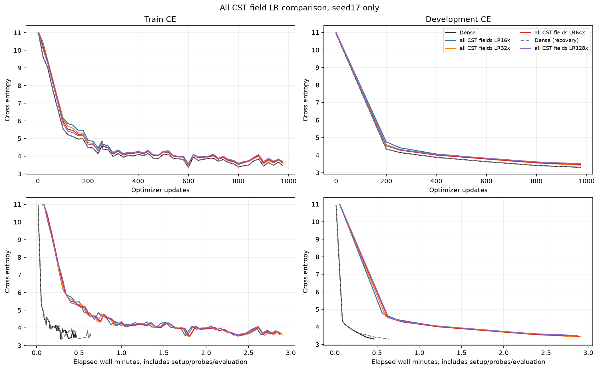
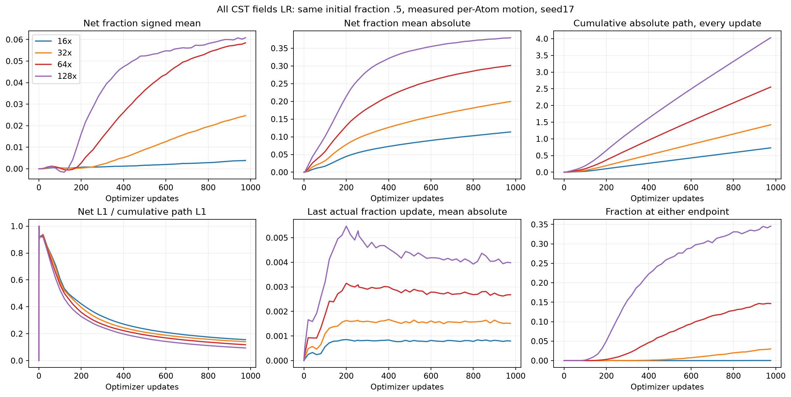
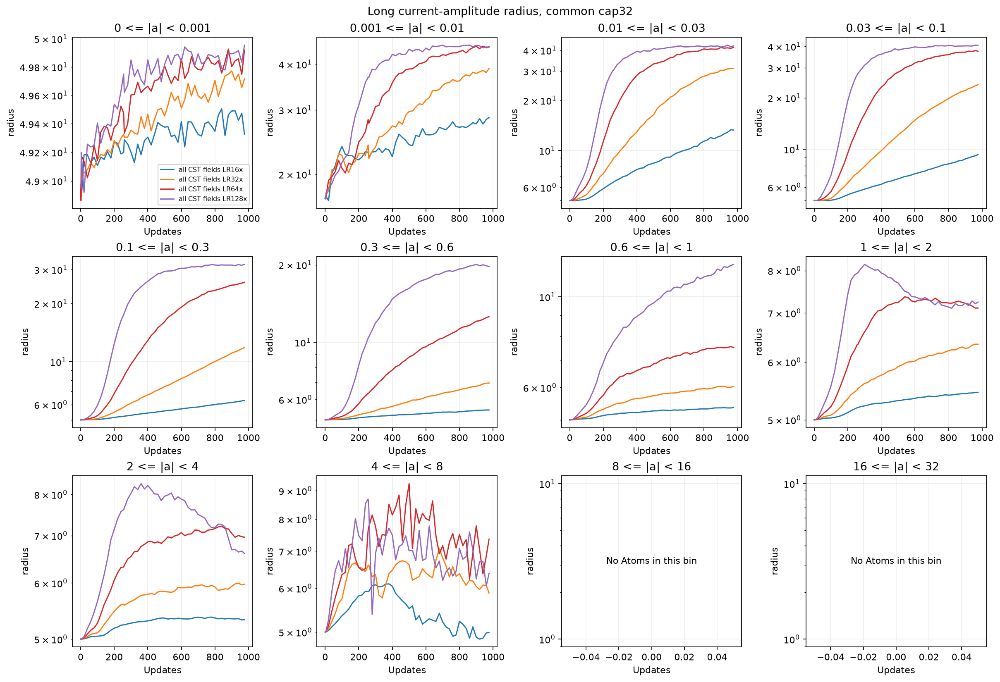
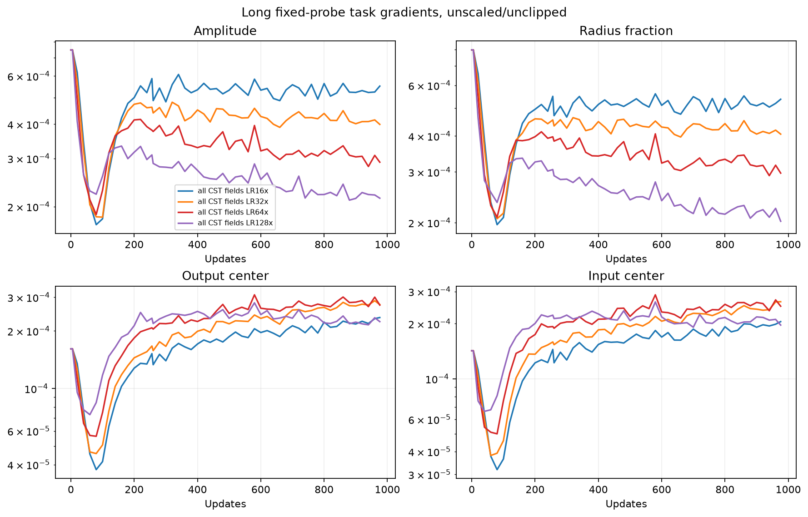

# CST全フィールドのLR比較：16/32/64/128倍

[English (canonical)](ffn-all-fields-lr-20261109-results.md) | 日本語

2026-11-09、RTX6000 Adaで完了。CST4条件の最良は32倍、
DEV CE3.432772、Dense3.308982、差+0.123791でした。
短期・開発1seedの比較であり、収束・非劣性・普遍的な最適LRの結論ではありません。

## 固定条件

[計画](ffn-all-fields-lr-20261109.ja.md)：TinyStories、幅512、pre-norm4ブロック、
heads8、context128、FFN拡大率4、FFN8行列すべて各8192Atomsで置換。
Attention・embedding・共有語彙headはDenseです。初期fraction=.5、tau=.003、
振幅上限32、半径[.5,50]、M8、levels_wide_amplitude、公開moment初期化。
probe-RMS校正は行いません。CST4条件の初期Parameterはbyte単位で一致します。
初回jobでDenseと16倍も新規実行。128倍は後述のCLI修正後、別jobでDense対照と
ともに実行しました。

CSTの振幅・入出力中心・fractionすべてを基準LRの16/32/64/128倍にします。
FFN bias・norm・embedding・attention・headを含む他のParameterは基準LRのまま。
AdamW基準LR3e-4、betas(.9,.95)、eps1e-8、decay0、global clip1、warmup200、
共通の20M-token予定長。最大CST field LRは.0048/.0096/.0192/.0384です。
seed17、batch2×128×蓄積4、同じtoken順、976更新=999424tokens、
256更新=262144tokens。DEV8192targetsのみ、confirmationは未使用。
PyTorch2.9.1+cu128、CUDA12.8、NVIDIA RTX6000 Ada Generation。
Parameter・physical row・Adam momentはFP32、写像内部はFP64、TF32off、eagerです。

## 学習・速度・メモリ

| Arm | DEV CE256 | DEV CE976 | Update median ms | Allocated / reserved peak MiB |
|---|---:|---:|---:|---:|
| Dense | 4.1484 | 3.3090 | 21.57 | 952.66 / 1168 |
| CST 16× | 4.4176 | 3.4864 | 159.24 | 975.65 / 1300 |
| CST 32× | 4.3262 | 3.4328 | 159.18 | 975.65 / 1302 |
| CST 64× | 4.2853 | 3.4696 | 155.92 | 975.65 / 1302 |
| Dense (recovery) | 4.1484 | 3.3090 | 21.67 | 952.66 / 1168 |
| CST 128× | 4.3117 | 3.5136 | 150.02 | 976.03 / 1300 |


時間は勾配蓄積・転送・forward/backward・clip・optimizerを含む更新中央値。
zero_grad・LR設定・probe・評価・observerを除きます。明示した2jobで逐次測定し、順序反転はしていません。LRにより学習後の半径・処理量も変わります。allocated/reservedは
PyTorch peakで、process全体・Graphではありません。準備/wall時間とFFN Parameter数の
精密値は[JSON](ffn-all-fields-lr-20261109-results.json)に記録。速度比較は探索的です。

## 実際のfraction・半径の変化

| CST LR | Mean absolute net Δfraction | Fraction mean | Radius mean | At either endpoint |
|---|---:|---:|---:|---:|
| 16× | 0.11374 | 0.50383 | 6.5383 | 0.0366% |
| 32× | 0.19962 | 0.52468 | 10.4160 | 3.0045% |
| 64× | 0.30135 | 0.55848 | 16.5856 | 14.6652% |
| 128× | 0.37975 | 0.56085 | 20.4063 | 34.5657% |


高いLRほど実際のfraction変化も増えており、全体が固定されているわけではありません。
端点の割合は16倍の0.0366%から128倍の34.5657%へ増加し、32倍を超えると最終損失は
悪化しました。高LRで更新が過大・不均衡になる可能性とは整合しますが、範囲制約が損失差の
原因だと断定はできません。今回の予算では、全field LRを上げるだけでDenseとの差は
埋まりませんでした。

初期fraction=0も有効な候補です。直接fractionを学習する写像なので、0でも片側の微分が
あり、sigmoidの飽和ではありません。過去の0スタートは振幅上限・field LRが異なるため、
同じ上限・LRで0と.5を比較するのは別の検証になります。

平均だけではAtom間の正負の相殺を隠すため、初期値からの絶対変化と毎更新の累積pathも
確認します。小振幅のAtomは設計上半径が広がるため、振幅別の図も見ます。半径は従来の
恒等式r(a_t,f_t)-r(a_0,f_0)=[r(a_t,f_t)-r(a_t,f_0)]+[r(a_t,f_0)-r(a_0,f_0)]
で分解し、因果的寄与とは扱いません。pathは毎更新の各Atomから集計し、個別の全時系列は
保存していません。Adam提案推定はFP32 momentからFP64で計算した範囲制約・丸め前の
値であり、厳密なraw proposal記録ではありません。

固定probeのfield勾配RMSと、sample時点の学習global勾配norm(clip前)をJSONに記録。
probeは共通の固定batchであり、学習時のclip済み勾配とは別です。非ゼロ勾配があるだけで
条件数が良いとは言えず、LRへの応答だけで勾配消失・容量・Denseとの差の原因は特定
できません。DenseのLR探索、Atom数増加、長期学習、別seedは今回未検証です。










追加図：

- [adam-fraction-updates](assets/ffn-all-fields-lr-20261109/adam-fraction-updates.png)
- [long-activation-rms](assets/ffn-all-fields-lr-20261109/long-activation-rms.png)
- [long-amplitude-radius_fraction](assets/ffn-all-fields-lr-20261109/long-amplitude-radius_fraction.png)
- [long-fraction_change-layers](assets/ffn-all-fields-lr-20261109/long-fraction_change-layers.png)
- [long-radius-layers](assets/ffn-all-fields-lr-20261109/long-radius-layers.png)
- [long-radius_fraction-layers](assets/ffn-all-fields-lr-20261109/long-radius_fraction-layers.png)
- [radius-update-components](assets/ffn-all-fields-lr-20261109/radius-update-components.png)

## 正しさ・監査・証拠

実際の4つのLR設定でconsumerのGPU検査に成功。全写像VJP、未完了forward保持、
fraction実更新、serialize後の次のmodel/Adam更新の完全一致を確認しました。
検査helperの振幅・中心16倍固定はsource固定前に設定可能へ変更し、CPU回帰で
16〜128倍のfield LRとscheduleの1回適用を検査しました。初回CPU test fixtureは
wide-amplitude backend指定が抜けていたため固定前に修正。GPU証拠や数値gateは
変更していません。既存68項目のoperator検査はsource・GPU/runtime・証拠hashの
完全一致を条件に再利用。CPU245検査は184passed/61optional skips、34studyの検証に成功。

最終・256更新の計12checkpoint(Dense再測定を含む)でDEV CEが完全再現。FP32 momentの有限性、
256/976 counter、範囲を確認。学習後up/downの16oracleでY/dX/全Atom微分を
既定atol1e-4/rtol4e-3のまま通過。最大絶対差Y/dX/dPは
6.8949075e-06/5.9685212e-06/9.5367432e-06。8時点のobserverのfraction・半径net変化も
checkpointから独立に再現しました。compact58ファイル、固定source
3734ファイル(各1867ファイルの2snapshot合計)、remote checkpointのhash18個を検証。
所有する学習/controller11PIDと監査4PIDは終了。
直後のGPUはNVIDIA RTX 6000 Ada Generation, 0 %, 39 MiB。checkpointはremoteで保全、compactとsourceは
local取得済み。RMS校正実験・confirmation評価・公開default採用はありません。

## 来歴・再現

証拠はCST_RESEARCH_EVIDENCE_ROOT配下の`ffn-all-fields-lr-6000ada-20261109-01`と
`ffn-all-fields-lr128-recovery-6000ada-20261109-01`。
raw log/checkpointはGit外、JSONにcheckpoint/図のhashと精密値を記録しています。
学習後の監査・作図コードは学習consumerと区別し、固定sourceは変更していません。

| Identity | Value |
|---|---|
| operator_commit | `0d277ae6dc0ae14fe515c7559f39535ed0238950` |
| consumer_commit | `86932ee557afabd446e5d438570194e396403450` |
| source_archive_sha256 | `cb19809064c8b82d5dfb8f10976cb1042d1bc6861fbf4ba297cf1ab85f83759f` |
| qualification_sha256 | `07c119b0c464bf27bf8cf535a63df891bda3d4c00e44160ae00b9a3aecc7f8f3` |
| initial_cst_parameter_sha256 | `75b4271cfe05d9ad4479cfbac3eaa05cae586e8beea4e2a65f1236b687cee634` |
| compact_archive_sha256 | `ac9444d219e2bbc2e25a4a25448235cce9d11ff5d94f021d8f83328dead687ad` |
| data_manifest_sha256 | `5b995103ca95d3c9b62a4e860039683dc734b0a0bb20e232db1b2e45aa690d01` |
| audit_source_sha256 | `802abf6e2e1c3f8673cf680dd73170d9f044ebdfbe3fe28260b839dbf3114089` |
| recovery_consumer_commit | `c115c38fdad10f4412271ef23771630cfcfbd7aa` |
| recovery_source_archive_sha256 | `10a28a5ee2dd2deee94be5a5fc692aa627611c5b0eede5681e9f687b8e164d3b` |
| recovery_compact_archive_sha256 | `29a58fd54642e654749455c8953fcb71f25deab56c39819ba6af91bb2fd3b1ea` |


検証済み証拠(retrieval-integrity.jsonとretrieved/を含む)を復元し、reporting依存を
導入すると図を再生成できます。

```bash
python scripts/plot_ffn_fraction_start.py --run "$CST_RESEARCH_EVIDENCE_ROOT/ffn-all-fields-lr-6000ada-20261109-01" --recovery-run "$CST_RESEARCH_EVIDENCE_ROOT/ffn-all-fields-lr128-recovery-6000ada-20261109-01"
python scripts/plot_ffn_fraction_lr.py --run "$CST_RESEARCH_EVIDENCE_ROOT/ffn-all-fields-lr-6000ada-20261109-01" --recovery-run "$CST_RESEARCH_EVIDENCE_ROOT/ffn-all-fields-lr128-recovery-6000ada-20261109-01"
```

固定source archiveとprotocol.json・cases.json・driver.py・launch/receipt・source hashに
実行条件を保全。再実行には検証済みtoken manifestと承認済みGPU環境が必要です。
初回128倍は学習前にCLIの選択肢不足でcode2終了し、元の失敗receipt/logを保全しました。
別sourceでCLIの128倍受付のみ修正。選択肢を除いたrunner AST一致と他の8つのadmission
sourceのbyte一致を確認し、新規qualificationとDense対照を実施しました。数値設定や
ハイパーパラメータの再調整はなく、全5学習条件で当初予算を完了。追加探索は自動実行しません。
