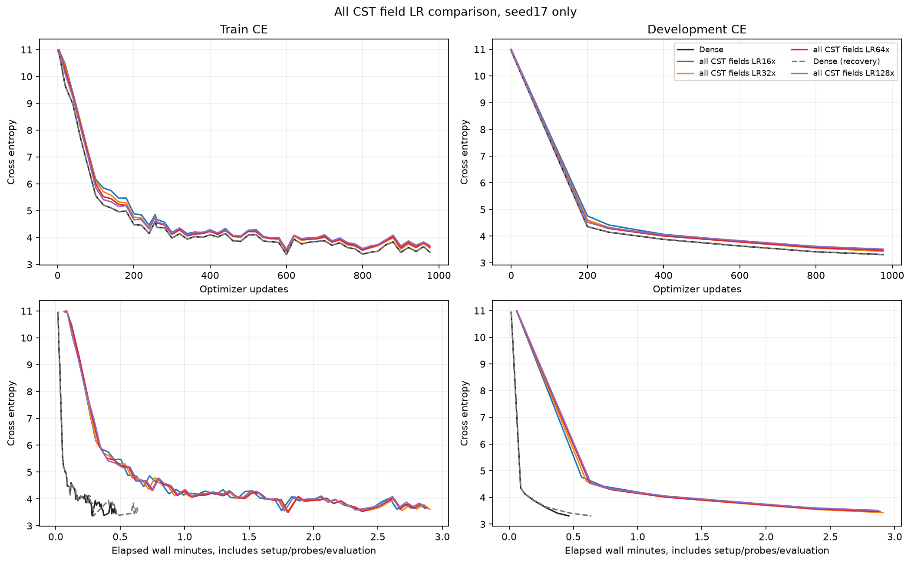
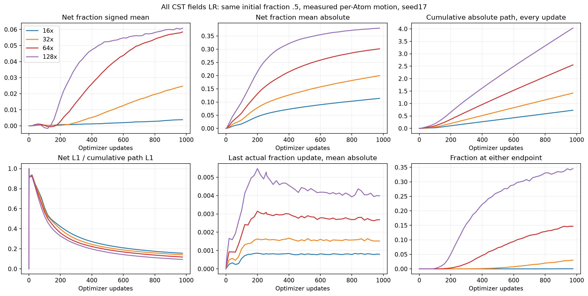
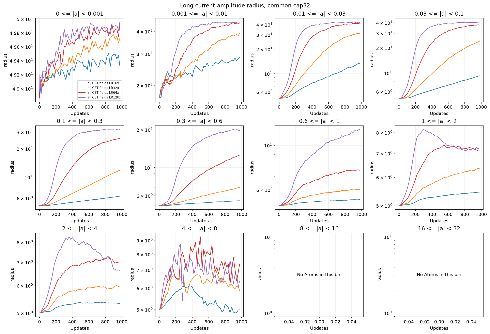
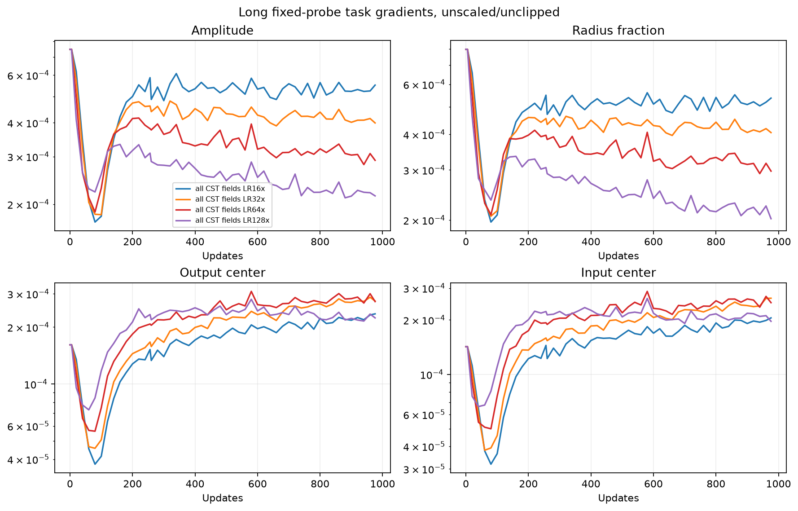

# All CST field LR comparison:16/32/64/128×

English (canonical) | [日本語](ffn-all-fields-lr-20261109-results.ja.md)

Completed on RTX 6000 Ada,2026-11-09. Best of the four tested CST rates was
32×, DEV CE 3.432772 versus Dense 3.308982
(gap +0.123791). This is a short, single-seed development comparison, not a
convergence, noninferiority or universal best-LR claim.

## Fixed protocol

[Protocol](ffn-all-fields-lr-20261109.md): TinyStories,width 512,four pre-norm blocks,
heads8,context128,FFN expansion4,all 8 FFN maps replaced by 8192 Atoms/map.
Attention,embedding and tied head remain Dense. Initial fraction=.5,tau=.003,
amplitude cap32,radius[.5,50],M8,levels_wide_amplitude,public moment initialization;
no probe-RMS calibration. CST initial Parameter bytes are identical across all 4
arms. Fresh Dense and 16× controls were measured in the first job; 128× and another
Dense control ran in the separate CLI-recovery job described below.

CST amplitude,input/output centers and fraction all use 16/32/64/128× base LR.
All other parameters,including FFN bias,norms,embedding,attention and head,keep
base LR. AdamW base LR 3e-4,betas(.9,.95),eps1e-8,decay0,global clip1,warmup200,
common20M-token planned horizon. Peak CST field LRs=.0048/.0096/.0192/.0384.
Seed17,batch2×128×accumulation4,same token order,976updates=999424tokens;
256update prefix=262144tokens. DEV8192 targets only,confirmation untouched.
PyTorch 2.9.1+cu128,CUDA 12.8,NVIDIA RTX 6000 Ada Generation. FP32 Parameters,
physical rows and Adam moments; FP64 map intermediates,TF32 off,eager execution.

## Learning, speed and memory

| Arm | DEV CE256 | DEV CE976 | Update median ms | Allocated / reserved peak MiB |
|---|---:|---:|---:|---:|
| Dense | 4.1484 | 3.3090 | 21.57 | 952.66 / 1168 |
| CST 16× | 4.4176 | 3.4864 | 159.24 | 975.65 / 1300 |
| CST 32× | 4.3262 | 3.4328 | 159.18 | 975.65 / 1302 |
| CST 64× | 4.2853 | 3.4696 | 155.92 | 975.65 / 1302 |
| Dense (recovery) | 4.1484 | 3.3090 | 21.67 | 952.66 / 1168 |
| CST 128× | 4.3117 | 3.5136 | 150.02 | 976.03 / 1300 |


Update medians include accumulation,transfers,forward/backward,clipping and
optimizer; exclude zero_grad,LR setup,probe,evaluation and observer. Measurements
are sequential across two explicitly identified jobs without order reversal; higher LR changes the learned
radius/workload. Allocated/reserved are PyTorch peaks,not process-wide/Graph
memory. Full-precision setup/wall times and FFN Parameter counts are in the
[JSON](ffn-all-fields-lr-20261109-results.json). Timing remains exploratory.

## Actual fraction/radius motion

| CST LR | Mean absolute net Δfraction | Fraction mean | Radius mean | At either endpoint |
|---|---:|---:|---:|---:|
| 16× | 0.11374 | 0.50383 | 6.5383 | 0.0366% |
| 32× | 0.19962 | 0.52468 | 10.4160 | 3.0045% |
| 64× | 0.30135 | 0.55848 | 16.5856 | 14.6652% |
| 128× | 0.37975 | 0.56085 | 20.4063 | 34.5657% |


Larger LR clearly increases actual fraction motion: the fraction is not globally
frozen. Endpoint occupancy rises from0.0366% at16× to34.5657% at128×, while
final loss worsens above32×. This is consistent with excessive or poorly balanced
updates at higher rates, but does not establish that projection causes the loss
gap. Raising all field rates alone did not close the Dense gap in this budget.

Initial fraction=0 remains a valid candidate: the direct fraction map has a
one-sided learning derivative there, not a sigmoid saturation. Historical
fraction=0 runs changed amplitude cap and field rates, so a controlled initial
fraction0-versus.5 comparison at the same cap/LR would be a separate study.

Means can hide cancellation across Atoms; mean absolute net change and per-update
path distinguish motion from a flat mean. Atoms with tiny amplitudes can have
broad radii by design,so examine amplitude bins. Radius decomposition keeps the
existing algebraic identity r(a_t,f_t)-r(a_0,f_0)=[r(a_t,f_t)-r(a_t,f_0)]
+[r(a_t,f_0)-r(a_0,f_0)]; this is not causal attribution. Actual path is reduced
every update; complete individual Atom histories are not retained. Analytic Adam
proposals use FP32 moments in FP64 before projection/rounding,not exact raw traces.

Fixed-probe gradient RMS and sampled training global pre-clip norms are recorded
in JSON. Probe gradients use the same fixed batch and are separate from training
clipped gradients. Nonzero field gradients do not establish good conditioning;
LR response alone cannot identify vanishing gradients,capacity or remaining
Dense-gap causes. The current comparison does not tune Dense LR or test larger
Atom counts,longer training or different seeds.










Additional figures:

- [adam-fraction-updates](assets/ffn-all-fields-lr-20261109/adam-fraction-updates.png)
- [long-activation-rms](assets/ffn-all-fields-lr-20261109/long-activation-rms.png)
- [long-amplitude-radius_fraction](assets/ffn-all-fields-lr-20261109/long-amplitude-radius_fraction.png)
- [long-fraction_change-layers](assets/ffn-all-fields-lr-20261109/long-fraction_change-layers.png)
- [long-radius-layers](assets/ffn-all-fields-lr-20261109/long-radius-layers.png)
- [long-radius_fraction-layers](assets/ffn-all-fields-lr-20261109/long-radius_fraction-layers.png)
- [radius-update-components](assets/ffn-all-fields-lr-20261109/radius-update-components.png)

## Qualification, audit and evidence

All 4 actual LR configurations passed fresh GPU consumer qualification,full map
VJPs,outstanding forwards,actual fraction updates and bit-exact serialized next
model/Adam state. The helper's prior16× amplitude/center constant was replaced
before freezing; a CPU regression verifies declared16–128× field rates and single
schedule scaling. Initial test fixture omitted the wide-amplitude backend and
was corrected before freezing; no GPU evidence or numerical gate was changed.
The 68 operator checks were reused only after exact operator source/GPU/runtime/
evidence-hash parity. CPU suite 245 tests: 184 passed, 61 optional skips; 34 studies validate.

All 12 final/prefix checkpoints (including repeated Dense) reproduce DEV CE exactly,with finite FP32 moments,
correct 256/976 counters and valid bounds. All 16 trained up/down Y/dX/all-Atom
oracles passed unchanged atol1e-4,rtol4e-3; max absolute errors
Y/dX/dP=6.8949075e-06/5.9685212e-06/9.5367432e-06. Eight observer net fraction/
radius snapshots independently reproduce from checkpoints. Compact retrieval
verified 58 files and 3734 source-file hashes across two1867-file snapshots;
18 remote checkpoint hashes verified. All
11 training/controller and 4 audit PIDs inactive.
After the final job GPU reported NVIDIA RTX 6000 Ada Generation, 0 %, 39 MiB. Checkpoints remain remotely preserved;
compact evidence and exact source are local. No RMS-calibration run,confirmation
evaluation or public default adoption occurred.

## Provenance and reproduction

Job/evidence locators:`ffn-all-fields-lr-6000ada-20261109-01` and
`ffn-all-fields-lr128-recovery-6000ada-20261109-01`,relative to
CST_RESEARCH_EVIDENCE_ROOT. Raw logs/checkpoints stay outside Git; JSON includes
checkpoint/figure hashes and precise metrics. Post-training audit/plots are
separate from the frozen training consumer and do not mutate its source.

| Identity | Value |
|---|---|
| operator_commit | `0d277ae6dc0ae14fe515c7559f39535ed0238950` |
| consumer_commit | `86932ee557afabd446e5d438570194e396403450` |
| source_archive_sha256 | `cb19809064c8b82d5dfb8f10976cb1042d1bc6861fbf4ba297cf1ab85f83759f` |
| qualification_sha256 | `07c119b0c464bf27bf8cf535a63df891bda3d4c00e44160ae00b9a3aecc7f8f3` |
| initial_cst_parameter_sha256 | `75b4271cfe05d9ad4479cfbac3eaa05cae586e8beea4e2a65f1236b687cee634` |
| compact_archive_sha256 | `ac9444d219e2bbc2e25a4a25448235cce9d11ff5d94f021d8f83328dead687ad` |
| data_manifest_sha256 | `5b995103ca95d3c9b62a4e860039683dc734b0a0bb20e232db1b2e45aa690d01` |
| audit_source_sha256 | `802abf6e2e1c3f8673cf680dd73170d9f044ebdfbe3fe28260b839dbf3114089` |
| recovery_consumer_commit | `c115c38fdad10f4412271ef23771630cfcfbd7aa` |
| recovery_source_archive_sha256 | `10a28a5ee2dd2deee94be5a5fc692aa627611c5b0eede5681e9f687b8e164d3b` |
| recovery_compact_archive_sha256 | `29a58fd54642e654749455c8953fcb71f25deab56c39819ba6af91bb2fd3b1ea` |


Restore verified compact evidence with retrieval-integrity.json and retrieved/,
install reporting dependencies,and regenerate plots:

```bash
python scripts/plot_ffn_fraction_start.py --run "$CST_RESEARCH_EVIDENCE_ROOT/ffn-all-fields-lr-6000ada-20261109-01" --recovery-run "$CST_RESEARCH_EVIDENCE_ROOT/ffn-all-fields-lr128-recovery-6000ada-20261109-01"
python scripts/plot_ffn_fraction_lr.py --run "$CST_RESEARCH_EVIDENCE_ROOT/ffn-all-fields-lr-6000ada-20261109-01" --recovery-run "$CST_RESEARCH_EVIDENCE_ROOT/ffn-all-fields-lr128-recovery-6000ada-20261109-01"
```

Frozen source archive and protocol.json,cases.json,driver.py,launch/receipt and
source hashes retain the execution recipe. Re-execution requires the verified
token manifest and approved GPU environment. The original 128× invocation failed at argparse(code2) before training because
CLI choices ended at 64×. Preserve that failed receipt/log. A new frozen source
only adds CLI 128× admission: runner AST equality after removing that choice and
byte equality of eight other admission sources are verified. Fresh 128×
qualification and Dense control passed; no numerical/hyperparameter retuning.
All 5 unique learning arms then completed their original budgets. No further sweep is automatic.
