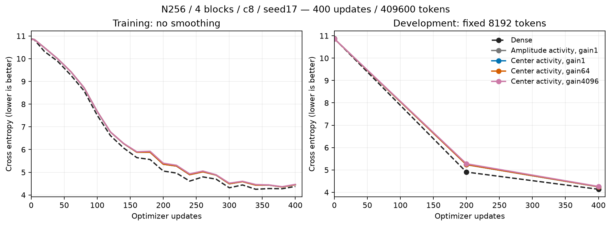
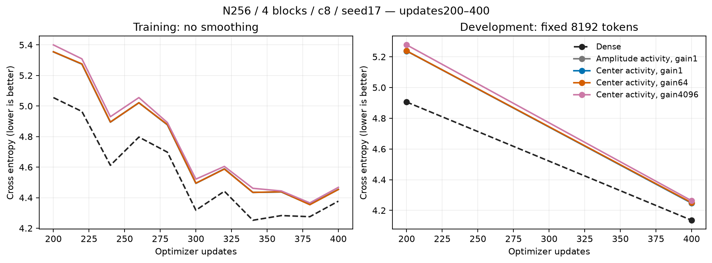
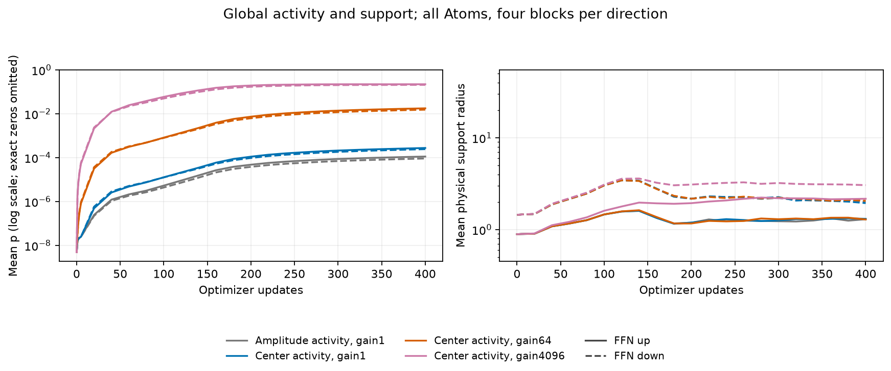
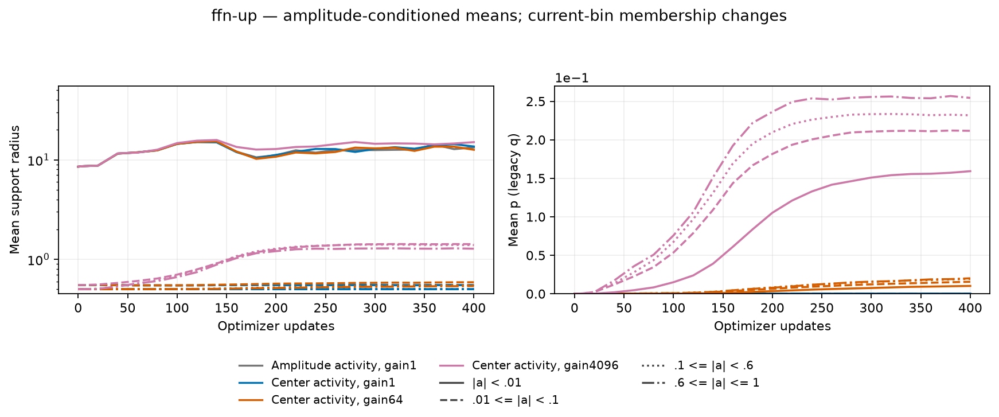
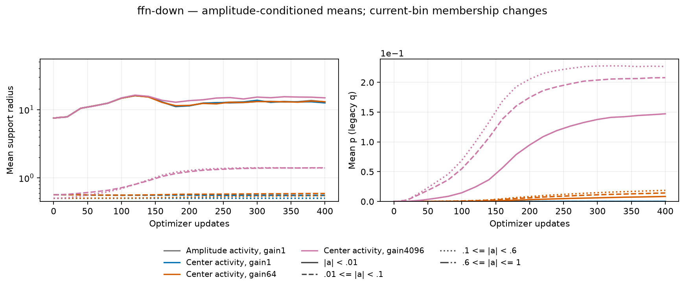
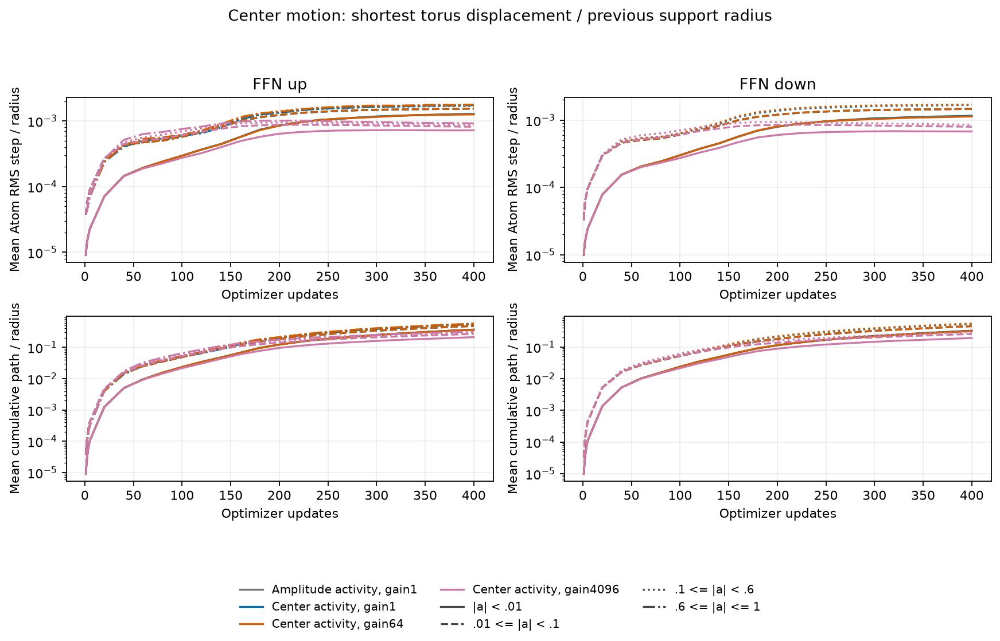
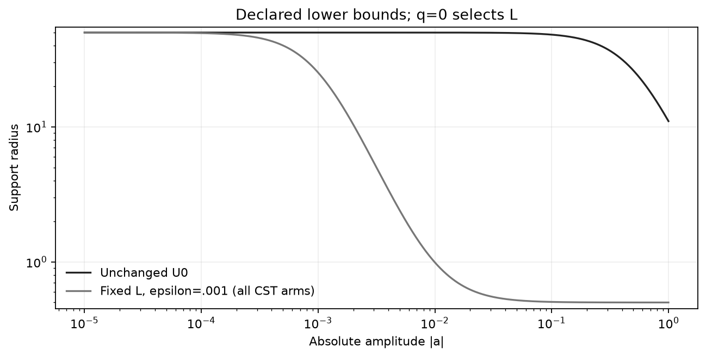

# 中心活動型PolarのFFN結果

[English (canonical)](ffn-center-activity-20261107-results.md) | 日本語

5条件とも400更新・409600 tokenと学習後監査を完了しました。中心活動型で最も低かったDEV CEは
4.247539（Center, gain1）で、fresh振幅活動型4.248089との差は-0.000550です。
1 seedの開発上の観察であり、デフォルト採用、正式な非劣性、収束、普遍的な活動則の主張ではありません。
この比較で品質改善は示せていません。gain4096ではpが大きく増えますが、この予算の損失は対照より高くなりました。

[固定条件](ffn-center-activity-20261107.ja.md)は幅256、pre-LN4ブロック、4 head、context128、
FFN4N、c8・各FFN射影4096 Atom、seed17、batch2・累積4、FP32・TF32無効、
AdamW(.9,.95)、decay0、clip1、baseLR3e-4・Atom全体LR16倍、LRとデータ順序のhorizon20M tokenです。
CSTはFFNの8か所で、Attention・embedding・語彙出力・正規化は共通です。
minimum-001のL/Uはこのcohortより前に開発結果から選んだ設定で、heldout選択ではありません。

CST4条件の初期全Parameterと8射影の初期化reportは完全一致しています。
全CSTで同じ明示登録Torch radius eager更新Algorithmを使い、native Linearも共通です。
振幅の角度方向の提案と(s,t)の配置を保ち、中心活動型だけ活動量を
受理後のtorus最短移動/更新前supportへ交換し、従来の蓄積・厳密半径減衰を使います。
clip/smoothstep目標値への直接代入、新しい中心embedding、隠れたEMA、追加の弱Atom拡張は導入していません。
gainは活動の尺度でLRではありません。support・ノルムが変わると以後の振幅・中心勾配も変わるため、
同一更新時の振幅の角度処理を保つことは、学習軌跡の一致を意味しません。

| Condition | DEV CE | DEV PPL | Update ms | Allocated MiB | Reserved MiB |
| --- | ---: | ---: | ---: | ---: | ---: |
| Dense | 4.135901 | 62.5459 | 79.04 | 481.50 | 488.00 |
| Amplitude, gain1 | 4.248089 | 69.9715 | 426.64 | 686.27 | 714.00 |
| Center, gain1 | 4.247539 | 69.9331 | 434.35 | 686.27 | 714.00 |
| Center, gain64 | 4.250420 | 70.1349 | 433.93 | 686.27 | 714.00 |
| Center, gain4096 | 4.262914 | 71.0166 | 496.98 | 686.27 | 714.00 |

| Condition / FFN direction | Mean p | Mean physical radius | Weak radius / count |
| --- | ---: | ---: | ---: |
| Amplitude, gain1 / up | 0.0001121896 | 1.29619 | 13.33377 / 997 |
| Amplitude, gain1 / down | 9.154124e-05 | 2.01981 | 12.97694 / 1962 |
| Center, gain1 / up | 0.0002756688 | 1.30919 | 13.59635 / 993 |
| Center, gain1 / down | 0.000243931 | 1.94267 | 12.55257 / 1925 |
| Center, gain64 / up | 0.01773773 | 1.28934 | 12.61361 / 993 |
| Center, gain64 / down | 0.01541493 | 2.06494 | 13.01589 / 1969 |
| Center, gain4096 / up | 0.2221289 | 2.16671 | 15.04431 / 923 |
| Center, gain4096 / down | 0.2079342 | 3.04876 | 14.86880 / 2006 |

DEVは固定8192 tokenで、confirmation/生成選択はしていません。半径・pは方向別4ブロックを
Atom数で重み付けした平均です。弱振幅は|a|<.01、bin所属は毎回変化し、空binは欠測です。
rawのqは活動pであってAtom密度ではありません。学習済みモデル間の平均半径はL/Uを通じて
振幅の分布変化にも依存し、平均pが増えても平均半径が必ず増えるわけではありません。振幅固定の介入ではありません。log-p図だけは厳密なゼロを表示せず、epsilonへ置換しません。
中心移動はAtomごとの規格化RMS/pathの平均で、全Atomを一括したRMSではありません。
supportが変わると分母も変わるため、比だけで実座標の移動が増えたとは判断しません。

更新時間は累積・データ転送を含む同期済みoptimizer更新全体の中央値で、probe・評価・中心観測は時間外です。
peakは更新全体のallocated/reservedで、プロセス全体のメモリではありません。
計測付きeager A100 MIG cohortの対照観測で、Graph・デバイス間・普遍的な速度の証拠ではありません。
表の順のsetup秒は1.61 / 27.99 / 27.91 / 27.80 / 27.11、学習runnerのwall秒は40.15 / 216.32 / 218.24 / 218.41 / 234.98です。
別途行ったCPU/CUDA admission、compile、学習後監査はログに残しています。

## admission・整合性・範囲

A100で新規CPU/CUDA更新テスト14件を通過しました。各recipeで独立quadrature、
native長方形Y/dX/全Atom VJP、mixed optimizer moment・CPU参照・完全resume、
実4ブロックtask/resumeを通過してから学習しています。学習後は32か所のVJP、
5条件のDEV完全再計算、次task更新Parameter・optimizer状態の完全一致、最終geometry一致を確認しました。
compact raw 48個を回収しhash照合しました。ソース・checkpointはremoteにも保存し、
所有workerは終了済みです。Hubや他jobには触らず、RTX4090は使っていません。

実機はA10080GB PCIe MIG3g.40gb、CC8.0、Torch2.6.0+cu126、Python3.12.9です。
Operator `1cb4bec3ae2f1a859a077bf1c664888082ccc7ab`; measured consumer `ac64f6db4fdf616870c41fed779e1119ecc5e441`.
Data SHA256 `5b995103ca95d3c9b62a4e860039683dc734b0a0bb20e232db1b2e45aa690d01`.
Compact archive SHA256 `19ad6885fa0d2c5a989b03e2b322be8cfa32272e575c59dc56a345c3dff3769d`.

[図・ソースmanifest](assets/ffn-center-activity-20261107/figure-manifest.json)にraw入力と学習後rendererを結び付けます。
再現には凍結した測定ソースを使い、後のreporting commitでrunを移行しません。
描画は`python scripts/plot_projection_pilot.py --run EVIDENCE --output FIGURES`です。
固定batchは完了しました。目標関数や座標embeddingの追試は別の仮説・protocolを定めて行い、自動延長しません。
