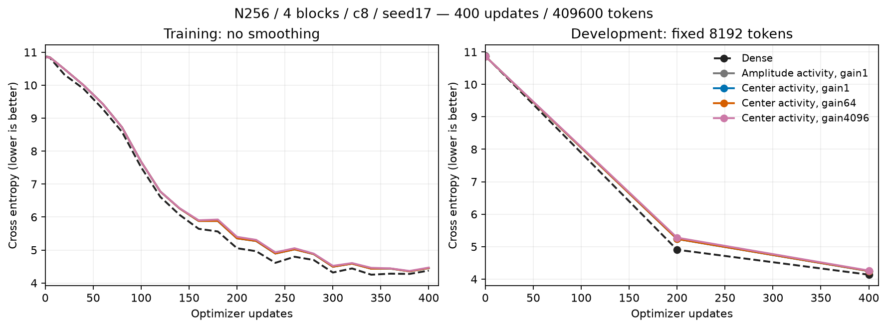
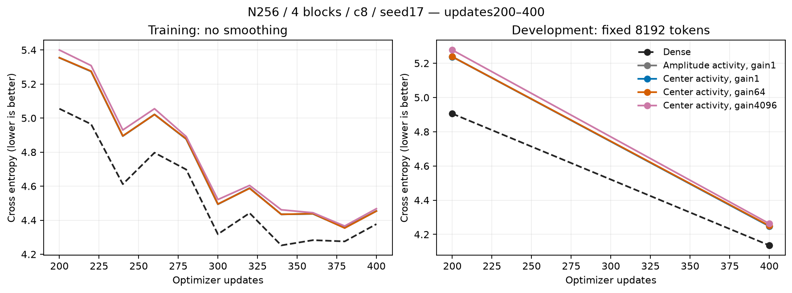
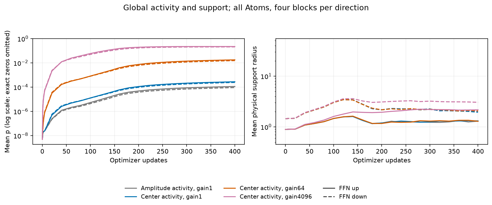
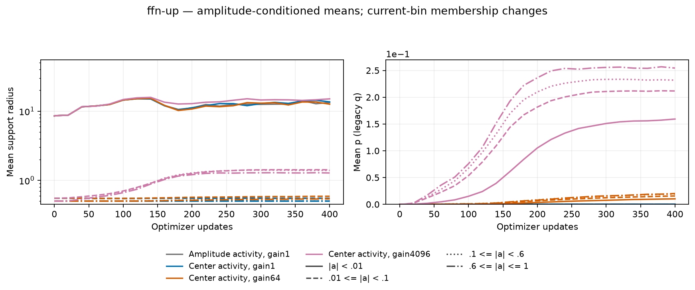
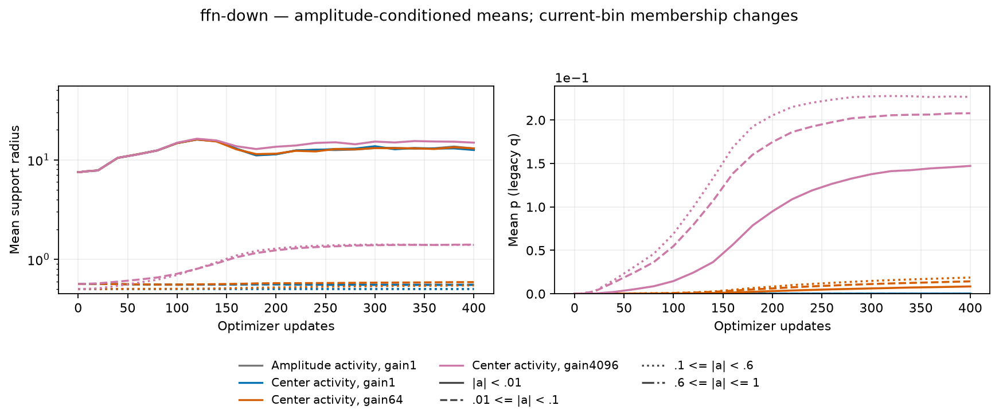
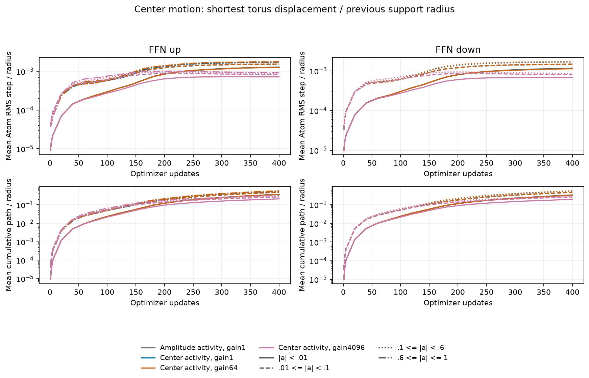
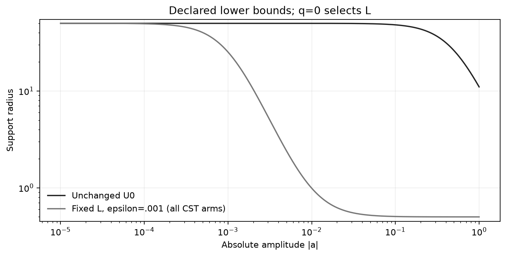

# Center-driven Polar FFN results

English (canonical) | [日本語](ffn-center-activity-20261107-results.ja.md)

All five learners completed 400 updates/409600 tokens and trained audits.
The lowest observed center-arm DEV CE is 4.247539
(Center, gain1), a difference of -0.000550 from fresh amplitude activity
4.248089. This is descriptive one-seed development evidence, not a selected
default, formal noninferiority, convergence or a universal activity law.
This comparison establishes no quality improvement. Gain4096 raises p substantially
and has higher loss than the control at this budget.

Keep the [fixed protocol](ffn-center-activity-20261107.md): N256/four pre-LN
blocks/four heads/context128/FFN4N/c8/A4096 per FFN map/seed17/batch2accum4,
FP32/TF32off,AdamW(.9,.95),decay0,clip1,baseLR3e-4/whole-Atom LR16 and
20M-token LR/data-order horizon. Eight FFN sites are CST; all Attention,
embedding, vocabulary head and normalization stay unchanged. The fixed
minimum-001 L/U was development-selected before this cohort; no heldout was
used for that choice.

The initial full-model Parameters and all eight initialization reports match
exactly across all four CST arms. All CST arms use the same explicit Torch
radius eager update Algorithm; native Linear is unchanged. Amplitude keeps its
angular proposal and (s,t) layout. Center arms replace only the activity energy
with accepted shortest torus motion / previous support, then retain existing
accumulation and exact radial decay. No direct clip/smoothstep target, new center
embedding, hidden EMA or extra dormant expansion is introduced. Gains change
activity, not learning rates. Changing support/norm can affect later amplitude
and center gradients, so unchanged instantaneous angular mechanics do not imply
identical learning trajectories.

| Condition | DEV CE | DEV PPL | Update ms | Allocated MiB | Reserved MiB |
| --- | ---: | ---: | ---: | ---: | ---: |
| Dense | 4.135901 | 62.5459 | 79.04 | 481.50 | 488.00 |
| Amplitude, gain1 | 4.248089 | 69.9715 | 426.64 | 686.27 | 714.00 |
| Center, gain1 | 4.247539 | 69.9331 | 434.35 | 686.27 | 714.00 |
| Center, gain64 | 4.250420 | 70.1349 | 433.93 | 686.27 | 714.00 |
| Center, gain4096 | 4.262914 | 71.0166 | 496.98 | 686.27 | 714.00 |

| Condition / FFN direction | Mean p | Mean physical radius | Weak radius / count |
| --- | ---: | ---: | ---: |
| Amplitude, gain1 / up | 0.0001121896 | 1.29619 | 13.33377 / 997 |
| Amplitude, gain1 / down | 9.154124e-05 | 2.01981 | 12.97694 / 1962 |
| Center, gain1 / up | 0.0002756688 | 1.30919 | 13.59635 / 993 |
| Center, gain1 / down | 0.000243931 | 1.94267 | 12.55257 / 1925 |
| Center, gain64 / up | 0.01773773 | 1.28934 | 12.61361 / 993 |
| Center, gain64 / down | 0.01541493 | 2.06494 | 13.01589 / 1969 |
| Center, gain4096 / up | 0.2221289 | 2.16671 | 15.04431 / 923 |
| Center, gain4096 / down | 0.2079342 | 3.04876 | 14.86880 / 2006 |

DEV uses 8192 fixed tokens. No confirmation/generation selection. Radius/p means
pool four blocks per direction by Atom count. Weak means |a|<.01; current-bin
membership changes and empty bins are missing. Existing raw q is the p activity,
not Atom density. Across trained models, mean radius also depends on changing
amplitude populations through L/U; a larger mean p need not imply a larger mean
radius. This is not a fixed-amplitude intervention. Exact zeros are omitted only from the log-p plot, never replaced
by epsilon. Center-motion plots are means of per-Atom normalized RMS/path,
not RMS over all Atoms; changed support changes their denominator and does not
by itself establish larger raw movement.

Update time is the median synchronized complete optimizer update including
accumulation/data transfer, with probes/evaluation/center sampling outside timing.
Peaks are complete-update allocated/reserved bytes, not total process memory.
These are descriptive paired measurements of an instrumented eager A100 MIG
cohort, not Graph, cross-device or universal performance evidence.
Setup seconds in table order: 1.61 / 27.99 / 27.91 / 27.80 / 27.11. Learner wall seconds: 40.15 / 216.32 / 218.24 / 218.41 / 234.98.
Separate CPU/CUDA admission, compilation and trained audits are retained in logs.

## Admission, integrity and scope

All 14 new actual CPU/CUDA update tests passed on A100. Each recipe separately
passed independent quadrature, actual native rectangular Y/dX/all-Atom VJPs,
mixed optimizer moments/CPU reference and exact resume, then actual four-block
task/resume. Trained audits passed 32 site VJPs, five exact DEV recomputations,
five exact next-task-update Parameter/optimizer resume checks and final geometry
agreement. All 48 compact raw files were retrieved and hash-verified;
source/checkpoints remain intact remotely and owned workers are inactive.
Hub and unrelated jobs were untouched; RTX4090 was not used.

Actual GPU A10080GB PCIe MIG3g.40gb,CC8.0,Torch2.6.0+cu126,Python3.12.9.
Operator `1cb4bec3ae2f1a859a077bf1c664888082ccc7ab`; measured consumer `ac64f6db4fdf616870c41fed779e1119ecc5e441`.
Data SHA256 `5b995103ca95d3c9b62a4e860039683dc734b0a0bb20e232db1b2e45aa690d01`.
Compact archive SHA256 `19ad6885fa0d2c5a989b03e2b322be8cfa32272e575c59dc56a345c3dff3769d`.

[Figure/source manifest](assets/ffn-center-activity-20261107/figure-manifest.json)
binds raw inputs and the post-training renderer. Use the frozen measured sources
for reproduction; a later reporting commit does not migrate the run. Render
with `python scripts/plot_projection_pilot.py --run EVIDENCE --output FIGURES`.
The fixed batch is finished; any target-function or coordinate-embedding study
requires a separately stated hypothesis/protocol, not an automatic continuation.
