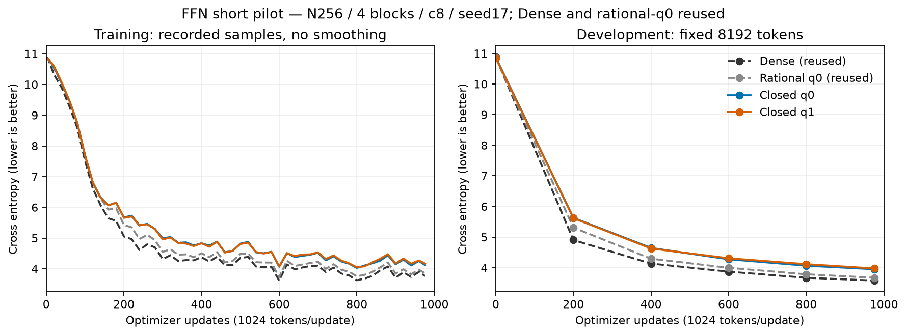
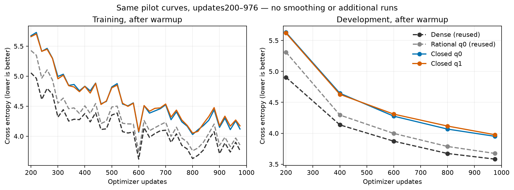
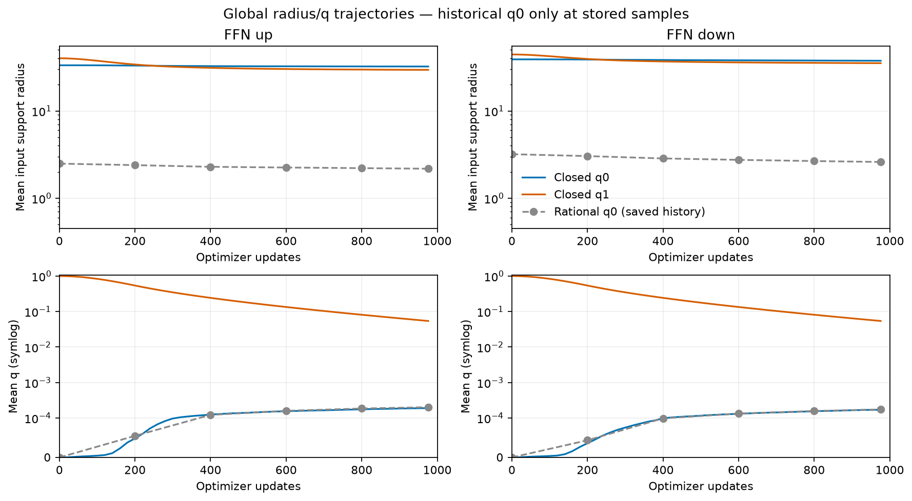
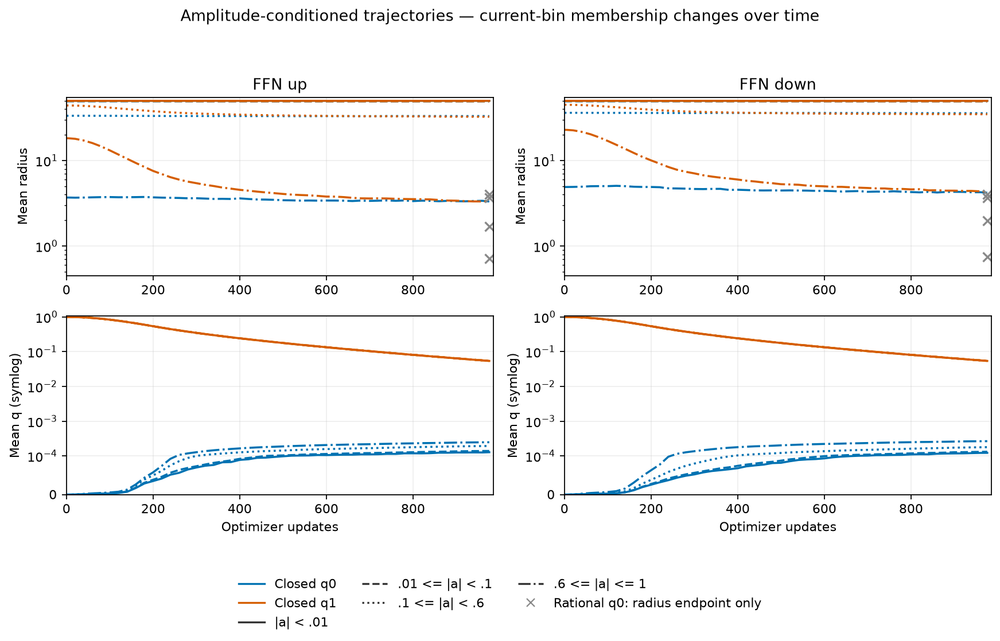
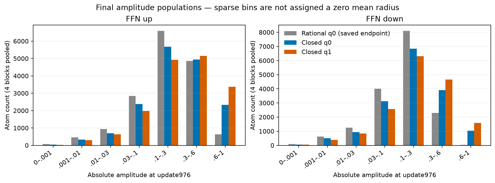

# 両端で合流する境界のFFN短期結果

[English（正本）](ffn-closed-envelope-results-20261107.md) | 日本語

新境界の2条件はそれぞれ976更新・999,424トークンを完走し、学習済みcheckpointの
監査も通りました。初期q0でも弱いAtomは広がります。ただし今回のpL4/pU1・最大半径50の
候補は、過去の従来q0・Denseの短期DEV結果には届きません。1seedの探索的観測であり、
両端で合流する形全体を否定した結果や、収束の主張ではありません。
[固定した短期protocol](ffn-closed-envelope-20261107.ja.md)を参照してください。

N256、FFN4N、pre-LN4ブロック、CST8射影、c8・各4096Atoms、seed17、context128、
batch2/accumulation4、20MのLR・データ順horizonを揃えました。
L=.5+49.5*(1-(a/a_max)^2)^4、U=.5+49.5*(1-(a/a_max)^2)、a_max1です。
Attention・埋め込み・出力はDenseです。新規学習は新境界の2条件だけです。
Dense・従来q0の曲線は監査済みR12を再利用し、従来q0の初期Parameter全バイトと
8射影の初期化報告が固定済みの過去sourceと一致することを確認しました。
旧all16 wrapperは保存済みstockの共通train53点・DEV6点とも一致しています。
従来q1は有界初期化探索で同じ目標に届かず、学習前に拒否しました。未調整の代替値は使いません。

## 観測

| Condition | DEV CE | DEV perplexity | Update ms | Allocated MiB | Reserved MiB |
| --- | ---: | ---: | ---: | ---: | ---: |
| Dense (reused) | 3.581960 | 35.9439 | 11.16 | 482.50 | 490 |
| Rational q0 (reused) | 3.673505 | 39.3897 | 442.45 | 687.28 | 716 |
| Closed q0 | 3.950559 | 51.9644 | 543.63 | 687.28 | 716 |
| Closed q1 | 3.976131 | 53.3104 | 548.73 | 687.28 | 716 |

| Condition / direction | Mean radius | Mean q | Weak radius / count | Strong radius / count |
| --- | ---: | ---: | ---: | ---: |
| closed-q0 / up | 32.2850 | 0.0001903 | 49.9939 / 377 | 3.3223 / 2330 |
| closed-q0 / down | 37.6121 | 0.0001716 | 49.9938 / 553 | 4.2074 / 1027 |
| closed-q1 / up | 29.5454 | 0.0542420 | 49.9936 / 325 | 3.3292 / 3373 |
| closed-q1 / down | 35.2661 | 0.0542231 | 49.9940 / 436 | 4.3193 / 1588 |

| Condition / direction | Initial amplitude RMS (mean of sites) | Clipped Atoms /16384 |
| --- | ---: | ---: |
| closed-q0 / up | 0.375163 | 123 |
| closed-q0 / down | 0.275021 | 4 |
| closed-q1 / up | 0.446502 | 468 |
| closed-q1 / down | 0.337641 | 48 |

DEVは固定8192トークンです。時間は同期した完全optimizer更新の中央値で、計測区間に
probe・評価を含めません。メモリはeager FP32/TF32offの完全更新allocated/reserved peakで、
GPUプロセス全体ではありません。新しい形状診断は更新時間の外で行います。
診断込みwall時間と過去の資源比較は探索的な観測で、同一jobの新規速度比較ではありません。
ここで速度・メモリの優位性は示していません。

半径・qは4ブロックをAtom数で重み付けして統合します。共有境界のため入出力半径は等しく、
up/downはFFNの射影方向です。弱いAtomは|a|<.01、強いAtomは|a|>=.6とします。
過去の従来q0全体値はup 2.1771 / q 0.0002020; down 2.6011 / q 0.0001743で、弱いAtomの半径は約4でした。
振幅binの所属は時点ごとに変わります。新しい各条件は0、1–5、以後20更新ごとと976の
55時点・8射影について、件数、平均/p10/p90、L/Uを保存しています。
空binは欠測でありゼロではありません。従来q0は全体6時点と半径binの保存済み終点だけです。
過去の途中のbin/q曲線は補っていません。灰色の×は半径の終点で、全体平均をbin曲線として扱いません。

初期化は期待されるoperator energyを0.5%以内に合わせます。実サンプルの活性値や
振幅分布を同じにするものではなく、clipping・RMS報告も解釈に必要です。
弱いAtomが広がったことだけで探索の改善は実証できません。実効rankは未測定です。
次に検討するのは振幅分布のどこで境界を下げ・開くかで、両端の合流だけで十分とは仮定しません。
形状・LR・Atom数・長期・3seedの追加探索やAttention実験は開始していません。

## 検証と保全

両条件で独立多項式積分、実寸両方向のnative Y/dX/全Atom VJP、制御勾配による
optimizer moment・復元、実4ブロックのタスク更新・復元が通りました。
native端点suiteは11件通過しました。各学習済みcheckpointでDEV再計算が完全一致し、
8射影すべての全Atom VJP、55時点の形状の保存と最終時点のcheckpointとの一致、復元後の同一タスク更新で
Parameter・optimizer状態の完全一致を確認しています。原本checkpointは変更していません。
新しい学習ではconfirmationを評価していません。

準備段階の失敗も保全しています。テスト依存の不足、最小半径の1ulp差による支持範囲の
分岐（新境界だけexpm1/log1pで修正）、監視ファイル名の衝突、補助初期化fixtureの
二次モーメント目標の隙間（実験の射影seedを使う検証へ修正）です。
試行01–04では学習していません。試行05でq0を一度学習し、監査v1の入れ子Tensorの
CPU/CUDA配置比較を再帰的に修正して同じcheckpointを監査、その後q1を一度学習しました。
許容差の緩和や、結果に基づく学習の再試行はしていません。

GPU operator sourceは`bfe43c1e234f48d8c7d1139939239dbef2f55970`、consumerは
`7b9eafa71c0e75332d3ecafe796049eb327726ad`です。後続operator head
`4902f0be0d3b7df1d086eee13aa07fd6e46cceb5`は従来有理式のcheckpoint互換処理だけを加え、数値operator・
更新メソッドとCUDAファイルは同一、新境界のmanifestも同一です。学習に使ったsourceとは区別します。
torchcst [PR152](https://github.com/takumiecd/torchcst/pull/152)はopt-inのままです。

archive SHA256は`ede57b3129f58bb37420f23070b236fbda0c1086e7d3a132e7062ffb64757cd6`です。登録済みevidence rootの
`ffn-feasibility-20261106/closed-envelope-20261107-05`にsource/request、曲線、診断、
検証・監査receipt、取得整合性検証を保全しました。checkpointは所有launch receiptが記録する
元のHubディレクトリに残しています。
[図・sourceのhash](assets/ffn-closed-envelope-20261107/figure-manifest.json)で派生図を結びます。
protocolと固定済みcommandで再現します。data manifestは`5b995103ca95d3c9b62a4e860039683dc734b0a0bb20e232db1b2e45aa690d01`です。
