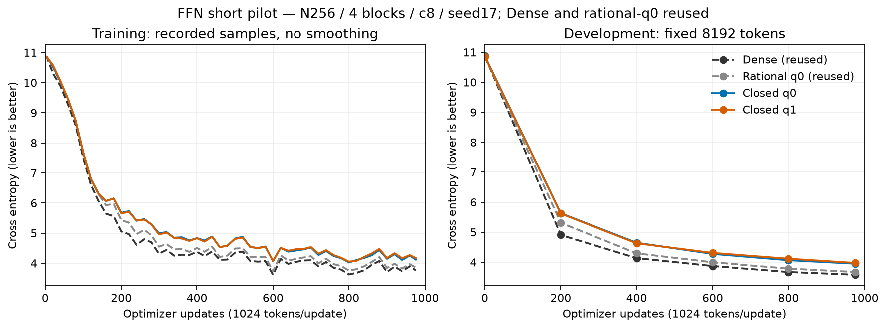
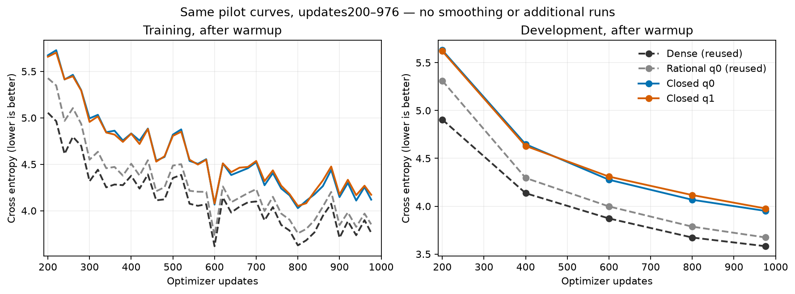
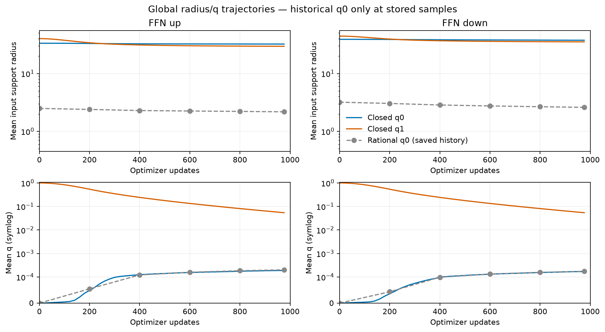
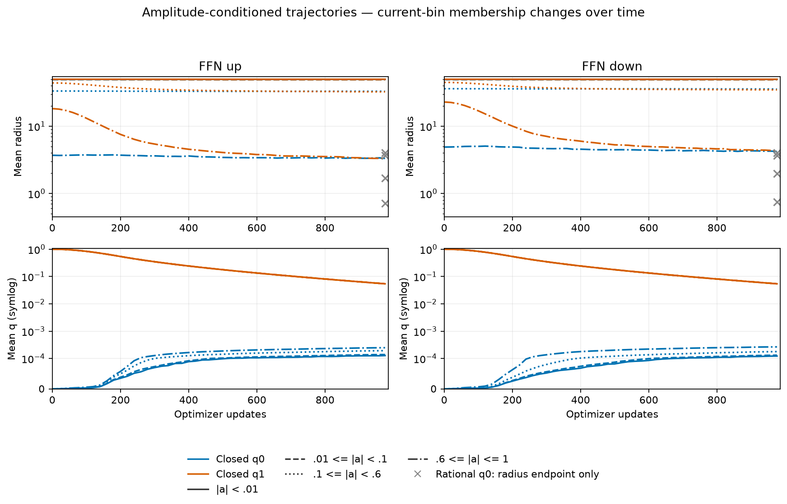
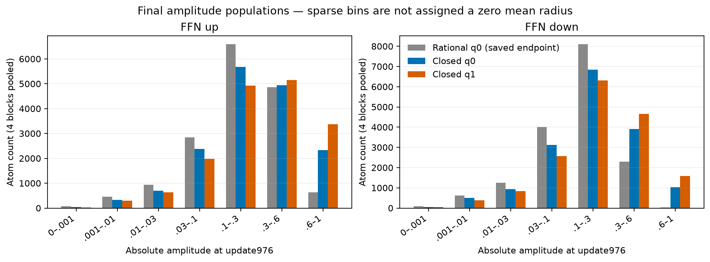

# Closed-envelope FFN pilot results

English (canonical) | [日本語](ffn-closed-envelope-results-20261107.ja.md)

The two closed-envelope learners each completed 976 updates/999,424 tokens and
passed trained checkpoint audits. Weak Atoms are broad even with initial q0.
The particular pL4/pU1/radius-max50 candidate does not recover the historical
rational-q0 or Dense short-budget DEV result. This is an exploratory one-seed
observation, not evidence against all closed-envelope shapes or a convergence
claim. See the [fixed pilot protocol](ffn-closed-envelope-20261107.md).

N256, FFN4N, four pre-LN blocks, eight CST projections, c8/4096 Atoms per
projection, seed17, context128, batch2/accumulation4 and the 20M LR/data-order
horizon are shared. The bounds are L=.5+49.5*(1-(a/a_max)^2)^4 and
U=.5+49.5*(1-(a/a_max)^2), a_max1. Attention/embed/output remain Dense.
Only the two new closed learners ran. The Dense and rational-q0 learning curves
are reused audited R12 observations; initial q0 Parameter bytes and all eight
initialization reports match the frozen historical source. The old all16
wrapper also matches the stored stock trajectory at 53 common train points and
six DEV points. Rational-q1 was rejected before learning because the bounded
initializer did not reach the same target; no unmatched fallback was trained.

## Observations

| Condition | DEV CE | DEV perplexity | Update ms | Allocated MiB | Reserved MiB |
| --- | ---: | ---: | ---: | ---: | ---: |
| Dense (reused) | 3.581960 | 35.9439 | 11.16 | 482.50 | 490 |
| Rational q0 (reused) | 3.673505 | 39.3897 | 442.45 | 687.28 | 716 |
| Closed q0 | 3.950559 | 51.9644 | 543.63 | 687.28 | 716 |
| Closed q1 | 3.976131 | 53.3104 | 548.73 | 687.28 | 716 |

| Condition / direction | Mean radius | Mean q | Weak radius / count | Strong radius / count |
| --- | ---: | ---: | ---: | ---: |
| closed-q0 / up | 32.2850 | 0.0001903 | 49.9939 / 377 | 3.3223 / 2330 |
| closed-q0 / down | 37.6121 | 0.0001716 | 49.9938 / 553 | 4.2074 / 1027 |
| closed-q1 / up | 29.5454 | 0.0542420 | 49.9936 / 325 | 3.3292 / 3373 |
| closed-q1 / down | 35.2661 | 0.0542231 | 49.9940 / 436 | 4.3193 / 1588 |

| Condition / direction | Initial amplitude RMS (mean of sites) | Clipped Atoms /16384 |
| --- | ---: | ---: |
| closed-q0 / up | 0.375163 | 123 |
| closed-q0 / down | 0.275021 | 4 |
| closed-q1 / up | 0.446502 | 468 |
| closed-q1 / down | 0.337641 | 48 |

DEV uses 8192 fixed tokens. Update time is the median synchronized complete
optimizer update, with no probes/evaluation in the timed interval. Memory is
the complete-update allocated/reserved peak in eager FP32/TF32off, not whole
GPU-process usage. New geometry diagnostics run outside timing; instrumented
wall time and historical resource overlays are exploratory, not a fresh paired
speed benchmark. Neither a speed nor a memory advantage is established here.

Radius and q means pool four blocks by Atom count. Input/output support radii
are equal under these shared bounds; up/down denote the FFN projections.
Weak means |a|<.01, strong means |a|>=.6. Historical rational-q0 global values:
up 2.1771 / q 0.0002020; down 2.6011 / q 0.0001743. Its weak radii were approximately 4.0. Current-amplitude-bin membership
changes over time. Each new arm stores 55 snapshots at 0, 1–5, every 20 updates and 976,
all eight sites, counts, mean,p10,p90 and L/U. Empty bins are missing, not zero.
Historical q0 has six global snapshots and a saved radius-bin endpoint only;
no intermediate historical bin/q curves are invented. Gray crosses are radius
endpoints. No global mean is substituted for an amplitude-conditioned curve.

The initializer matches expected operator energy to within 0.5%, not identical
sample activations or amplitude distributions. Retained clipping/RMS reports
matter when interpreting this recipe. Wider weak support alone is not a
demonstration of better task exploration; effective rank was not measured.
The next design question is where the envelopes should fall/open across the
amplitude distribution, rather than assuming endpoint closure alone suffices.
No further shape/LR/Atom/long-run/three-seed sweep or Attention run was started.

## Validation and preservation

Both recipes passed independent polynomial quadrature; native Y/dX/all-Atom
VJPs in both actual dimensions; controlled optimizer moments/resume; and actual
four-block task/resume checks. The native endpoint suite passed 11 cases. At
each trained checkpoint, DEV recomputation is exact, all eight complete-Atom
VJPs pass, 55 geometry snapshots are retained and the final one matches the checkpoint exactly, and a restored
next task update has exact Parameters/optimizer state. Original checkpoints
were unchanged by audit. The new learners did not evaluate confirmation.

Preparatory failures are preserved: missing test dependency; one-ulp
minimum-radius support-routing mismatch fixed with stable expm1/log1p only for
the closed law; a monitor filename collision; and a moment-target gap in an
auxiliary initializer fixture, corrected by using the actual pilot projection
seeds. No learner ran in attempts 01–04. Attempt 05 trained q0 once; auditor-v1's
nested CPU/CUDA device comparison was corrected recursively, then the same
q0 checkpoint was audited and q1 ran once. No tolerance was relaxed and no
outcome-based learner retry occurred.

GPU operator source: `bfe43c1e234f48d8c7d1139939239dbef2f55970`; consumer:
`7b9eafa71c0e75332d3ecafe796049eb327726ad`. The later operator head
`4902f0be0d3b7df1d086eee13aa07fd6e46cceb5` only adds rational legacy-checkpoint manifest
compatibility: all numerical operator/update methods and CUDA files are
unchanged; the closed manifest is identical. It is not the source used to train.
torchcst [PR152](https://github.com/takumiecd/torchcst/pull/152) remains opt-in.

Archive SHA256: `ede57b3129f58bb37420f23070b236fbda0c1086e7d3a132e7062ffb64757cd6`. The registered evidence root's
`ffn-feasibility-20261106/closed-envelope-20261107-05` retains source/request,
all raw curves, diagnostics, admission/audit receipts and the local retrieval
verification. Checkpoints remain at the original Hub directory recorded by the
owned launch receipts. [Figure/source hashes](assets/ffn-closed-envelope-20261107/figure-manifest.json)
bind the derived figures. Reproduce through the protocol and saved immutable
commands; the data manifest is `5b995103ca95d3c9b62a4e860039683dc734b0a0bb20e232db1b2e45aa690d01`.
