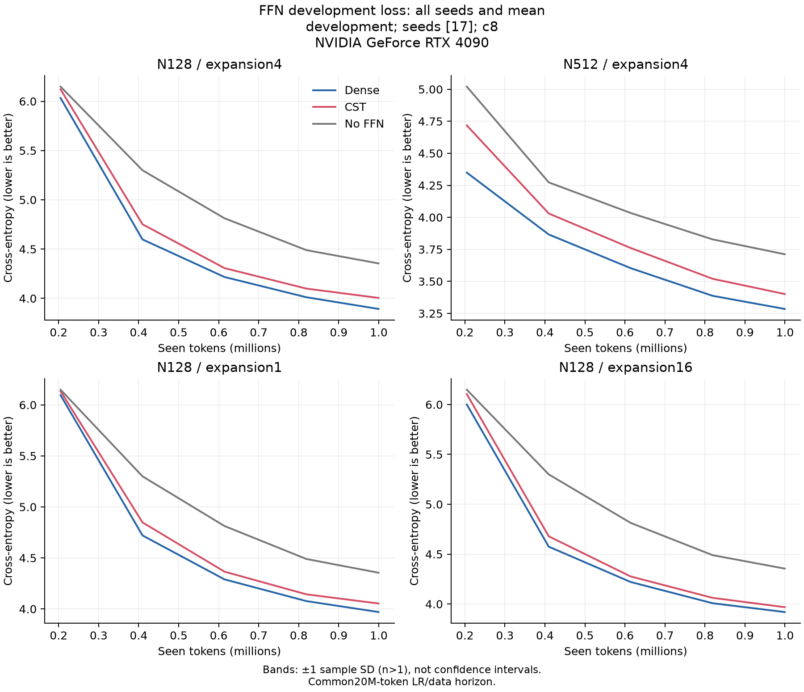
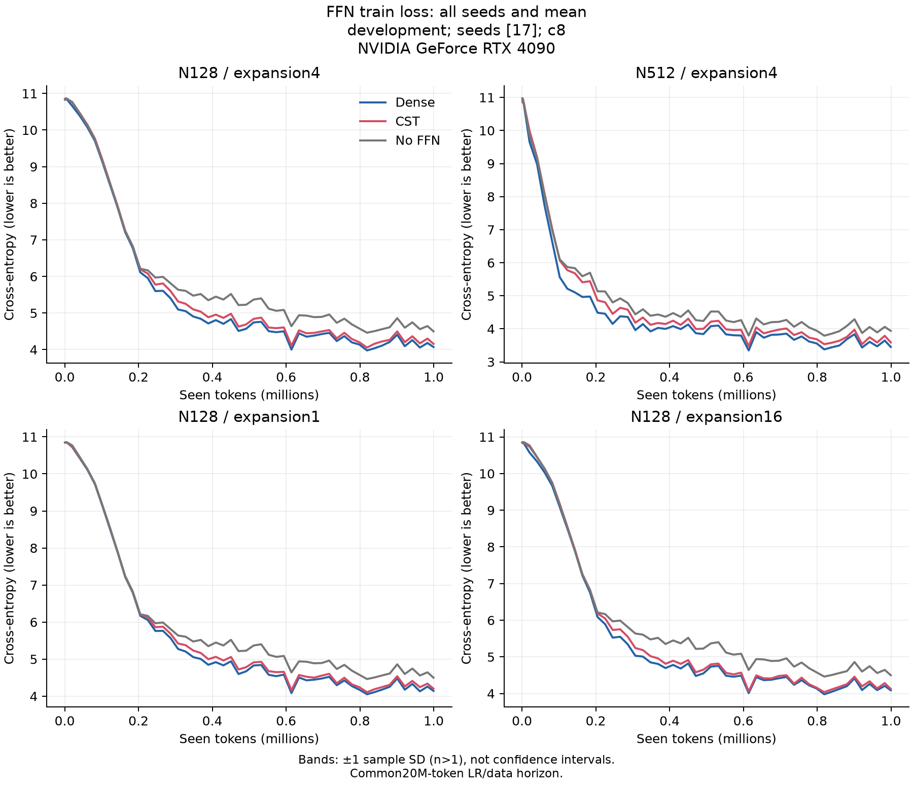
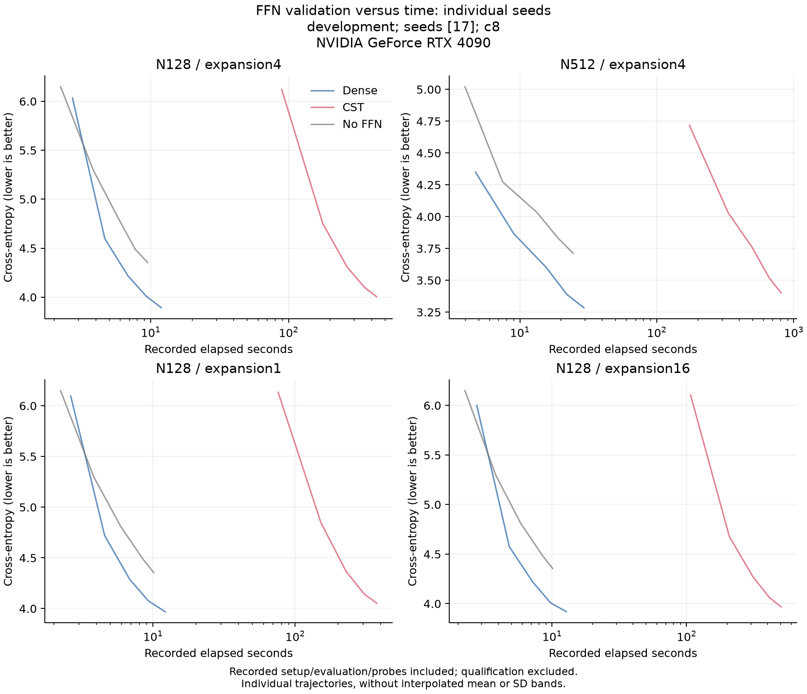
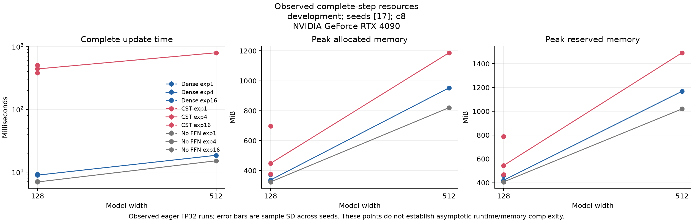

# FFN observation summary

English | [日本語](ffn-feasibility-r10-shapes-20261107.ja.md)

This aggregates hash-linked receipts; it does not rerun GPU validation. Values are mean ± sample SD across seeds, with SD omitted for one seed. These are not confidence intervals, noninferiority decisions or a general scaling law.

Cohort: development; seeds: [17]; requested tokens/arm: 1000000.

| Width | Expansion | FFN | DEV CE | DEV perplexity | Confirmation CE | Confirmation perplexity |
| ---: | ---: | --- | ---: | ---: | ---: | ---: |
| 128 | 1 | CST | 4.05337 | 57.59094 | 3.94301 | 51.57342 |
| 128 | 1 | Dense | 3.96956 | 52.96119 | 3.85522 | 47.23902 |
| 128 | 1 | No FFN | 4.35479 | 77.85071 | 4.28987 | 72.95694 |
| 128 | 4 | CST | 4.00487 | 54.86464 | 3.88635 | 48.73291 |
| 128 | 4 | Dense | 3.89271 | 49.04371 | 3.77153 | 43.44651 |
| 128 | 4 | No FFN | 4.35479 | 77.85071 | 4.28987 | 72.95694 |
| 128 | 16 | CST | 3.96799 | 52.87791 | 3.85481 | 47.21957 |
| 128 | 16 | Dense | 3.91922 | 50.36125 | 3.80068 | 44.73172 |
| 128 | 16 | No FFN | 4.35479 | 77.85071 | 4.28987 | 72.95694 |
| 512 | 4 | CST | 3.40110 | 29.99697 | 3.27479 | 26.43768 |
| 512 | 4 | Dense | 3.28466 | 26.69982 | 3.16427 | 23.67151 |
| 512 | 4 | No FFN | 3.71174 | 40.92501 | 3.58271 | 35.97082 |

| Width | Expansion | FFN | Update ms | Allocated MiB | Reserved MiB | FFN parameters |
| ---: | ---: | --- | ---: | ---: | ---: | ---: |
| 128 | 1 | CST | 378.12549 | 377.19482 | 468.00000 | 33792 |
| 128 | 1 | Dense | 9.06653 | 327.95166 | 410.00000 | 132096 |
| 128 | 1 | No FFN | 7.11622 | 323.91650 | 406.00000 | 0 |
| 128 | 4 | CST | 438.36754 | 447.81396 | 544.00000 | 68096 |
| 128 | 4 | Dense | 8.93204 | 336.97510 | 420.00000 | 526848 |
| 128 | 4 | No FFN | 6.95691 | 323.91650 | 406.00000 | 0 |
| 128 | 16 | CST | 501.67310 | 697.90430 | 788.00000 | 139776 |
| 128 | 16 | Dense | 9.17564 | 373.06885 | 460.00000 | 2105856 |
| 128 | 16 | No FFN | 6.99999 | 323.91650 | 406.00000 | 0 |
| 512 | 4 | CST | 792.79697 | 1187.04150 | 1492.00000 | 272384 |
| 512 | 4 | Dense | 18.48216 | 952.66064 | 1168.00000 | 8398848 |
| 512 | 4 | No FFN | 15.11546 | 820.33252 | 1020.00000 | 0 |

Perplexity is computed for each seed before aggregation.









## Paired CE differences (CST minus control)

| Width | Expansion | Control | Metric | Mean difference | Sample SD |
| ---: | ---: | --- | --- | ---: | ---: |
| 128 | 4 | Dense | development_ce | 0.11216 | — |
| 128 | 4 | Dense | confirmation_ce | 0.11482 | — |
| 128 | 4 | No FFN | development_ce | -0.34992 | — |
| 128 | 4 | No FFN | confirmation_ce | -0.40351 | — |
| 512 | 4 | Dense | development_ce | 0.11644 | — |
| 512 | 4 | Dense | confirmation_ce | 0.11052 | — |
| 512 | 4 | No FFN | development_ce | -0.31065 | — |
| 512 | 4 | No FFN | confirmation_ce | -0.30792 | — |
| 128 | 1 | Dense | development_ce | 0.08381 | — |
| 128 | 1 | Dense | confirmation_ce | 0.08779 | — |
| 128 | 1 | No FFN | development_ce | -0.30143 | — |
| 128 | 1 | No FFN | confirmation_ce | -0.34686 | — |
| 128 | 16 | Dense | development_ce | 0.04876 | — |
| 128 | 16 | Dense | confirmation_ce | 0.05413 | — |
| 128 | 16 | No FFN | development_ce | -0.38681 | — |
| 128 | 16 | No FFN | confirmation_ce | -0.43506 | — |

## Fixed-prompt examples

The first seed and first predefined prompt are shown for every architecture/arm, without selecting the best generation. This is not an independent language-quality evaluation. All prompts/seeds remain in report.json.

### N128, expansion1, CST

```text
Once upon a time, there was a little girl named Lily and the car, he wanted to help. Anna. He heard a time. He was a time, but he had very happy that she was a little boy named Lily she would be the little boy, but his friends. Her mom asked, "It's mommy. She got to go to the
```

### N128, expansion1, Dense

```text
Once upon a time, there was a little girl named Lily and the car. 
Tom saw a great day, there was so happy and it. He wanted to a little girl named Lily made a big little boy. She was very special and said, "It's okay?"
They asked, "It's mommy. She got to go to the
```

### N128, expansion1, No FFN

```text
Once upon a time, there was a little little little boy she was very very happy, he saw a time day, there there was a mom and her it was excited to the sky. He made a big little boy to so she were so he said,, but his friends?" Her boy. She had sad and went day day, "Mom, but the
```

### N128, expansion4, CST

```text
Once upon a time, there was a little girl named Lily and the car, the sun. Tom and saw a small boy. The bear and it. He was so much. 
"Iily had a lot of each other things and he said, "It's okay?"
They asked, "It's mom was so happy. You have to the
```

### N128, expansion4, Dense

```text
Once upon a time, there was a little girl named Lily and the car. Lily wanted to help. Anna and tried to be fun. He knew that it was so brave. 
"I'm sad. Lily went to play with the door and Ben, but you,?" she found a nice. They played with something big, "You have to the
```

### N128, expansion4, No FFN

```text
Once upon a time, there was a little little little boy she was very very happy, he saw a time day, there there was a mom and her it was excited to the sky. He made a big little boy to so she were so he said,, but his friends?" Her boy. She had sad and went day day, "Mom, but the
```

### N128, expansion16, CST

```text
Once upon a time, there was a little girl named Lily and the car. Lily wanted to help. Anna and tried to be fun. He knew that it was a big. One day, she had her a lot of each other things and he said, "It's okay?" Her mom asked, "It's mom was so it in. It was the
```

### N128, expansion16, Dense

```text
Once upon a time, there was a little girl named Lily and the car, he wanted to help. Anna. He heard a small. He knew that it was so much fun.
"I can take a lot of each other things and he said, "It's okay?"
They asked, "It's mom was so it. You can help the
```

### N128, expansion16, No FFN

```text
Once upon a time, there was a little little little boy she was very very happy, he saw a time day, there there was a mom and her it was excited to the sky. He made a big little boy to so she were so he said,, but his friends?" Her boy. She had sad and went day day, "Mom, but the
```

### N512, expansion4, CST

```text
Once upon a time, there was a little girl named Lily. One day, she wanted to help her when she noticed a walk in the pond and her mommy came to the water in the tree. 
Soon, the box were walking down and went, she had a few day. She was so sad and went for the air, looking at it.
```

### N512, expansion4, Dense

```text
Once upon a time, there was a little girl named Lily. One day, Lily wanted to help her to play with her toys. She saw a big fish playing with a big water in the tree.
Lily went to a big tree and said, "It's okay?" Her mom asked, "Yes, mom for the dog, let's help the
```

### N512, expansion4, No FFN

```text
Once upon a time, there was a little boy named Timmy was very sad he loved him but Timmy. He loved to make a big and his toy house. He had very happy.
But the little boy went to play things and he said, "It's okay?" Timmy asked, "Yes, Timmy, I have to play with the
```

## Provenance

- consumer_commit: `"70e02d864e661d3a87cd8aea322b49ae3f4a1f8f"`
- operator_commit: `"2b587e0f04ddf64e2bfb0c2e3db591e87a6f6440"`
- data_manifest_sha256: `"5b995103ca95d3c9b62a4e860039683dc734b0a0bb20e232db1b2e45aa690d01"`
- recipe: `{"amplitude_max": 1.0, "atom_lr_multiplier": 16.0, "coefficient": 8, "feature_order": "contiguous", "q": 0.0, "radius_birth": 4.0, "w_c": 0.3}`
- request_sha256: `376e062e3a633c31fed618e2d688f7965b92b8921e28abc6e96d883b81d3d4fd`
