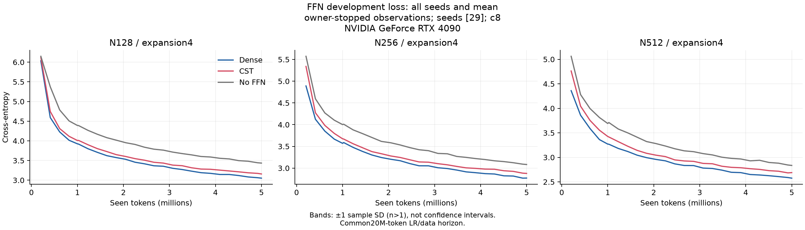
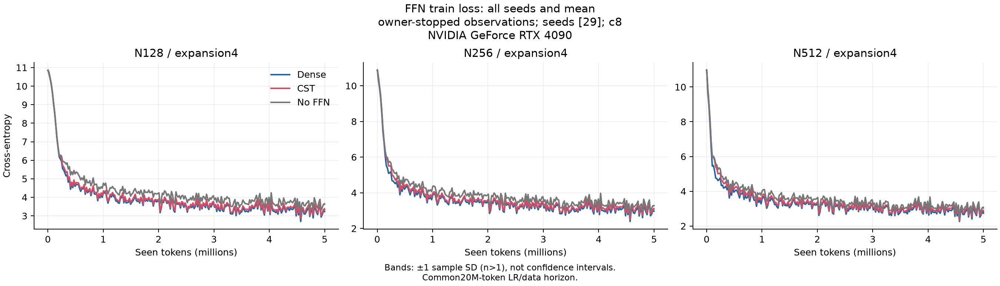
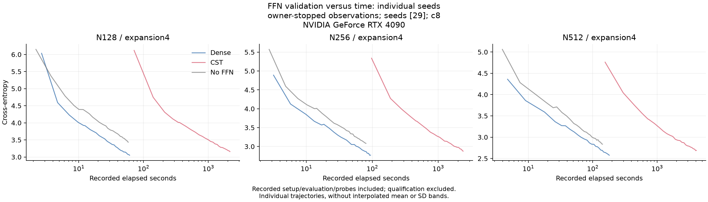
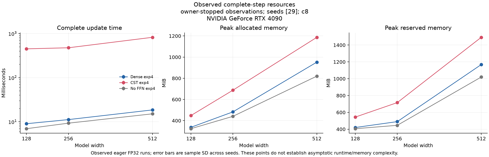

# FFNの観測集計

[English](ffn-feasibility-r11-seed29-20261107.md) | 日本語

**所有者の判断で停止した系列です。全3幅のseed29だけを保持し、予定seed29/43/71は完了していません。3 seed確認やseed間変動の主張はありません。別の観測用adapterで保持した全runと停止証拠を検証し、正式な3 seed reportの条件は緩めていません。**

hashを照合したreceiptの集計です。GPU検証を再実行したものではありません。平均±seed間の標本SDを示し、1 seedのSDは省略します。信頼区間・非劣性判定・一般的なスケーリング則ではありません。

Cohort: owner-stopped observations; seeds: [29]; requested tokens/arm: 5000000.

| Width | Expansion | FFN | DEV CE | DEV perplexity | Confirmation CE | Confirmation perplexity |
| ---: | ---: | --- | ---: | ---: | ---: | ---: |
| 128 | 4 | CST | 3.15823 | 23.52902 | 3.03691 | 20.84065 |
| 128 | 4 | Dense | 3.05203 | 21.15823 | 2.92656 | 18.66326 |
| 128 | 4 | No FFN | 3.43477 | 31.02416 | 3.30066 | 27.13046 |
| 256 | 4 | CST | 2.87768 | 17.77292 | 2.77403 | 16.02314 |
| 256 | 4 | Dense | 2.77073 | 15.97036 | 2.65688 | 14.25175 |
| 256 | 4 | No FFN | 3.08289 | 21.82140 | 2.96877 | 19.46805 |
| 512 | 4 | CST | 2.68898 | 14.71668 | 2.60475 | 13.52778 |
| 512 | 4 | Dense | 2.57642 | 13.15003 | 2.48887 | 12.04769 |
| 512 | 4 | No FFN | 2.83565 | 17.04140 | 2.74543 | 15.57136 |

| Width | Expansion | FFN | Update ms | Allocated MiB | Reserved MiB | FFN parameters |
| ---: | ---: | --- | ---: | ---: | ---: | ---: |
| 128 | 4 | CST | 450.64014 | 447.81396 | 544.00000 | 68096 |
| 128 | 4 | Dense | 9.03626 | 336.97510 | 420.00000 | 526848 |
| 128 | 4 | No FFN | 6.97197 | 323.91650 | 406.00000 | 0 |
| 256 | 4 | CST | 476.74665 | 687.27686 | 716.00000 | 136192 |
| 256 | 4 | Dense | 11.20865 | 482.50146 | 490.00000 | 2102272 |
| 256 | 4 | No FFN | 9.30154 | 440.39209 | 446.00000 | 0 |
| 512 | 4 | CST | 822.89964 | 1187.04150 | 1492.00000 | 272384 |
| 512 | 4 | Dense | 18.57388 | 952.66064 | 1168.00000 | 8398848 |
| 512 | 4 | No FFN | 15.14390 | 820.33252 | 1020.00000 | 0 |

Perplexityは各seedで計算してから集計します。









## seedを揃えたCE差（CST−対照）

| Width | Expansion | Control | Metric | Mean difference | Sample SD |
| ---: | ---: | --- | --- | ---: | ---: |
| 128 | 4 | Dense | development_ce | 0.10621 | — |
| 128 | 4 | Dense | confirmation_ce | 0.11035 | — |
| 128 | 4 | No FFN | development_ce | -0.27653 | — |
| 128 | 4 | No FFN | confirmation_ce | -0.26375 | — |
| 256 | 4 | Dense | development_ce | 0.10694 | — |
| 256 | 4 | Dense | confirmation_ce | 0.11715 | — |
| 256 | 4 | No FFN | development_ce | -0.20522 | — |
| 256 | 4 | No FFN | confirmation_ce | -0.19474 | — |
| 512 | 4 | Dense | development_ce | 0.11256 | — |
| 512 | 4 | Dense | confirmation_ce | 0.11587 | — |
| 512 | 4 | No FFN | development_ce | -0.14666 | — |
| 512 | 4 | No FFN | confirmation_ce | -0.14069 | — |

## 固定promptの例

最初のseed・最初の固定promptを各構成で示します。良い例の選別ではなく、独立した言語品質評価でもありません。全prompt・seedの出力はreport.jsonに保持します。

### N128, expansion4, CST

```text
Once upon a time, there was a little girl named Lily. One day, she wanted to help her mommy. She started to play in the garden, but she said she couldn't help her.
Lily went to a few minutes when she went, she noticed a few minutes. She was very sad and went to the store. She looked around the
```

### N128, expansion4, Dense

```text
Once upon a time, there was a little girl named Lily. She loved to play outside and pretend she was a small, there. She had a great time playing with her friends in the park. One morning she saw him scared she started to explore the store, but it didn't go. 
Lily and her mommy didn't know what to do
```

### N128, expansion4, No FFN

```text
Once upon a time, there was a little girl named Lily. One day, Lily wanted to help her mommy. One day, she saw a big, playing outside to play in the park. It was a big bag and she didn't't want, but it was too. Her mom asked her mom and asked her.
Lily, "I want
```

### N256, expansion4, CST

```text
Once upon a time, there was a little girl named Lily. One day, she wanted to help her mommy to help her mom.
Once upon a time, Lily's mommy replied, "But when you have to make things in the world, you can be beautiful?" Her mommy said, "Of course, Lily, let's go to the
```

### N256, expansion4, Dense

```text
Once upon a time, there was a little girl named Lily. One day, she wanted to help her mommy to help her make a mess and her it was too. 
When Lily got to her mommy, she saw that the story made her feel bad and sad. Her mommy said, "Lily, we can't get you to the
```

### N256, expansion4, No FFN

```text
Once upon a time, there was a little girl named Lily. One day, she wanted to help her mommy. She started to play in the garden, but her mommy was very excited. She had a lot of fun she couldn't find it, but she had a smile on her face. 
After a while, Lily got closer and started to
```

### N512, expansion4, CST

```text
Once upon a time, there was a little girl named Lily. One day, she wanted to help her mommy in the kitchen. She asked her mommy if she could help the cookies. 
But when Lily got to she got inside the stove, she saw Lily because she was very special. Her mommy said it was a good helper. Her mom
```

### N512, expansion4, Dense

```text
Once upon a time, there was a little girl named Lily. One day, she wanted to help her mommy in an adventure. She asked her mommy to help her. 
Lily was excited and asked her mommy to help the store, but they said no. Her mommy said they had to buy something to buy. 
Lily
```

### N512, expansion4, No FFN

```text
Once upon a time, there was a little girl named Lily. One day, she wanted to help her mommy in an adventure. She asked her mommy if she could help the little girl find them. Her mommy said she would be the best store, but Lily didn't go. 
Lily and her mommy went outside to play. Lily
```

## 来歴

- consumer_commit: `"70e02d864e661d3a87cd8aea322b49ae3f4a1f8f"`
- operator_commit: `"2b587e0f04ddf64e2bfb0c2e3db591e87a6f6440"`
- data_manifest_sha256: `"5b995103ca95d3c9b62a4e860039683dc734b0a0bb20e232db1b2e45aa690d01"`
- recipe: `{"amplitude_max": 1.0, "atom_lr_multiplier": 16.0, "coefficient": 8, "feature_order": "contiguous", "q": 0.0, "radius_birth": 4.0, "w_c": 0.3}`
- request_sha256: `ba1b60176eb52b20c45520901cfad57425c0209cccc1a3efa7c7aeb6120983be`
