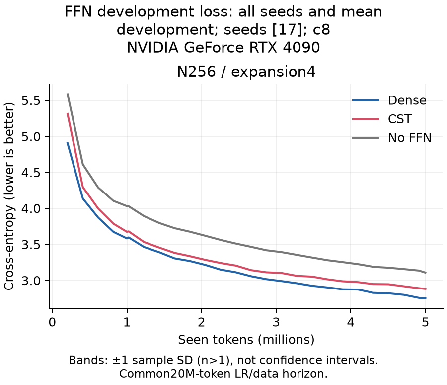
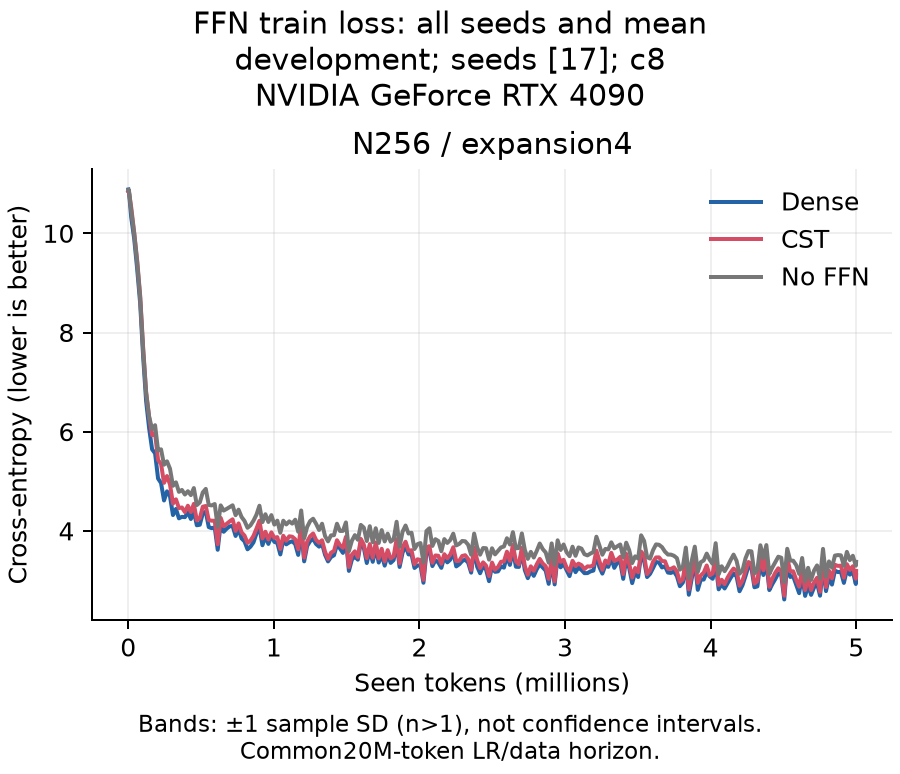
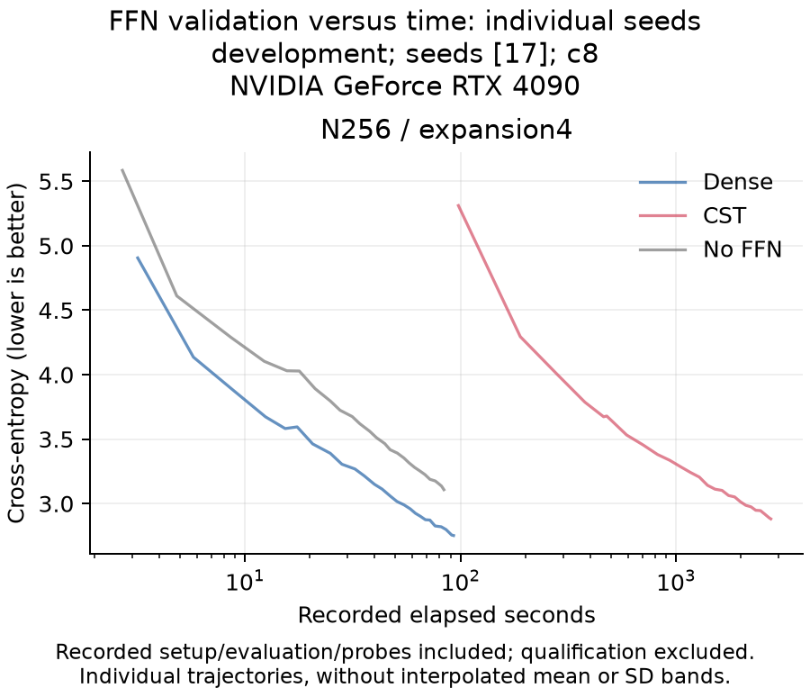
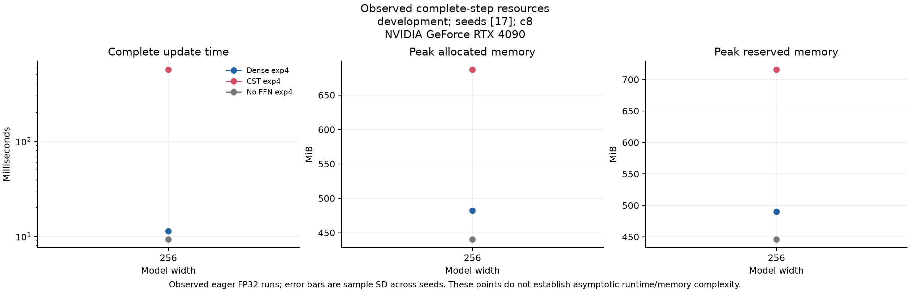

# FFNの観測集計

[English](ffn-feasibility-r8-selected-20261107.md) | 日本語

hashを照合したreceiptの集計です。GPU検証を再実行したものではありません。平均±seed間の標本SDを示し、1 seedのSDは省略します。信頼区間・非劣性判定・一般的なスケーリング則ではありません。

Cohort: development; seeds: [17]; requested tokens/arm: 5000000.

| Width | Expansion | FFN | DEV CE | DEV perplexity | Confirmation CE | Confirmation perplexity |
| ---: | ---: | --- | ---: | ---: | ---: | ---: |
| 256 | 4 | CST | 2.88124 | 17.83638 | 2.76959 | 15.95214 |
| 256 | 4 | Dense | 2.75219 | 15.67689 | 2.64910 | 14.14124 |
| 256 | 4 | No FFN | 3.10782 | 22.37219 | 2.98281 | 19.74321 |

| Width | Expansion | FFN | Update ms | Allocated MiB | Reserved MiB | FFN parameters |
| ---: | ---: | --- | ---: | ---: | ---: | ---: |
| 256 | 4 | CST | 569.09842 | 687.27686 | 716.00000 | 136192 |
| 256 | 4 | Dense | 11.36027 | 482.50146 | 490.00000 | 2102272 |
| 256 | 4 | No FFN | 9.29614 | 440.39209 | 446.00000 | 0 |

Perplexityは各seedで計算してから集計します。









## seedを揃えたCE差（CST−対照）

| Width | Expansion | Control | Metric | Mean difference | Sample SD |
| ---: | ---: | --- | --- | ---: | ---: |
| 256 | 4 | Dense | development_ce | 0.12905 | — |
| 256 | 4 | Dense | confirmation_ce | 0.12050 | — |
| 256 | 4 | No FFN | development_ce | -0.22658 | — |
| 256 | 4 | No FFN | confirmation_ce | -0.21322 | — |

## 固定promptの例

最初のseed・最初の固定promptを各構成で示します。良い例の選別ではなく、独立した言語品質評価でもありません。全prompt・seedの出力はreport.jsonに保持します。

### N256, expansion4, CST

```text
Once upon a time, there was a little girl named Lily. One day, Lily went to the park to play with her toys. She saw a big, red toys. Lily was very excited and wanted to play with him.
Suddenly, the dog, a man came to the dog. Lily was scared and asked her.
"Can we go to the
```

### N256, expansion4, Dense

```text
Once upon a time, there was a little girl named Lily. One day, Lily's mom saw a white red tree with a small leaves on it. Lily wanted to help the bug, but her mom said she was going to a good tree to put on the bench and put on the tree. Lily's head and went to the tree and saw that it was
```

### N256, expansion4, No FFN

```text
Once upon a time, there was a little girl named Lily. One day, Lily wanted to help her mommy and put on her.
Lily was playing with a little girl named Lily. She had a lot of fun with her toys and said, "Look, Lily?" Her mommy said, Lily and Lily was so happy. Lily looked around the
```

## 来歴

- consumer_commit: `"70e02d864e661d3a87cd8aea322b49ae3f4a1f8f"`
- operator_commit: `"2b587e0f04ddf64e2bfb0c2e3db591e87a6f6440"`
- data_manifest_sha256: `"5b995103ca95d3c9b62a4e860039683dc734b0a0bb20e232db1b2e45aa690d01"`
- recipe: `{"amplitude_max": 1.0, "atom_lr_multiplier": 16.0, "coefficient": 8, "feature_order": "contiguous", "q": 0.0, "radius_birth": 4.0, "w_c": 0.3}`
- request_sha256: `a51a1f99bdc9830782e80d38ef48c9db3ceaa38f8c6739294fa9aae71e8b95ca`
