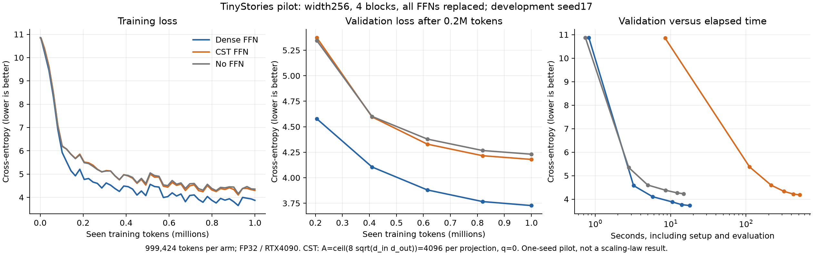
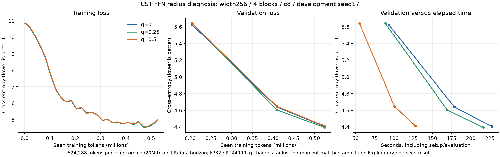
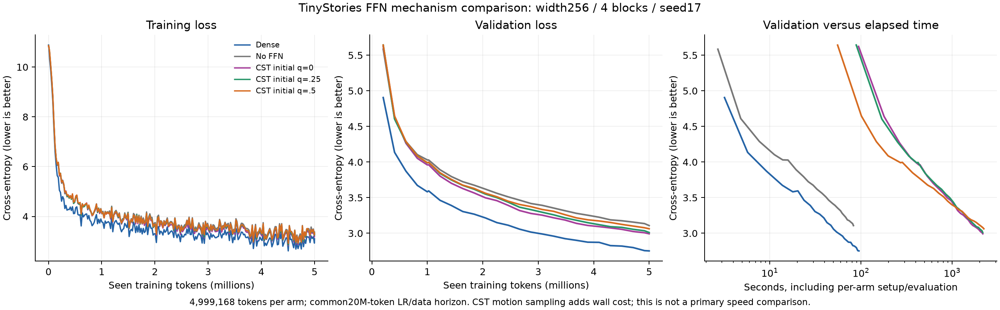
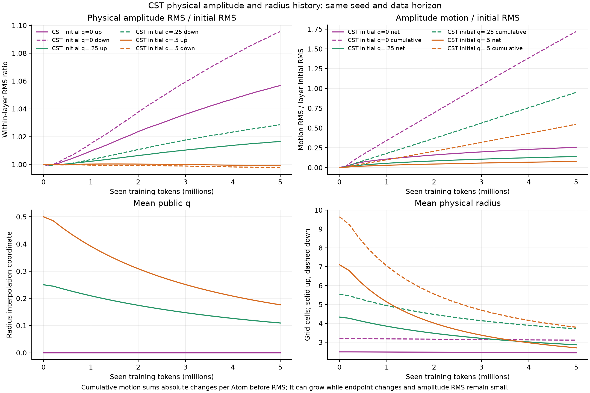
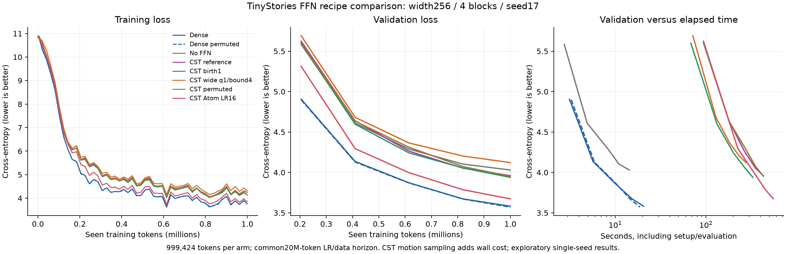
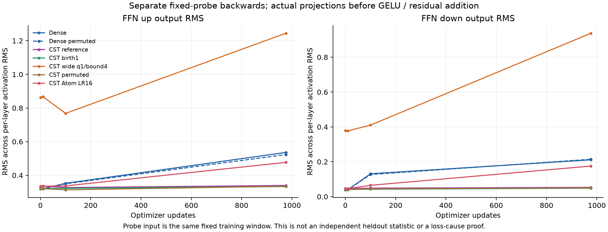
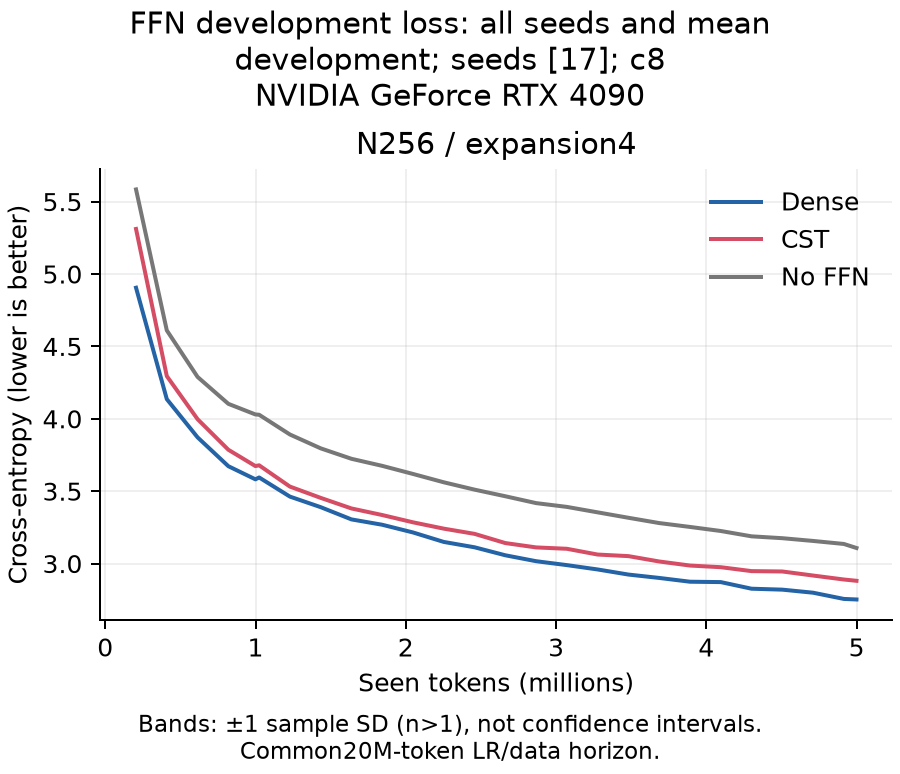

# FFNの有効性確認：初期観測

[English (canonical)](ffn-feasibility-results.md) | 日本語

開発用seed17の観測であり、3 seedの確認実験やスケーリング則の結果ではありません。
[検証計画](ffn-feasibility.ja.md)は進行中です。幅256・4 blockのcausal Transformerの
FFN全8射影に各4096 Atom、`A=ceil(8 sqrt(d_in d_out))`を用います。Attention、
embedding、重み共有する語彙出力はDenseのままです。FFNは256→1024→256、context128です。

## 最初の3条件pilot（R2）

各条件976 update・999424 tokenで学習しました。データ順序とcosine LRもこの短い
horizonです。Dense目標stdは.02、残差出力射影は.02/sqrt(8)、CSTは公開の二乗平均
初期化とq0を用います。条件間で共有するParameterは同じ初期化乱数系列です。
FP32、TF32off、RTX4090、Torch2.11.0+cu126、updateあたり1024 tokenです。

| FFN | Development CE | Perplexity | Peak allocated MiB |
| --- | ---: | ---: | ---: |
| Dense | 3.72727 | 41.57 | 482.50 |
| CST | 4.17978 | 65.35 | 687.28 |
| なし | 4.23073 | 68.77 | 440.39 |



CSTは学習しますが、この学習量ではDenseよりFFNなしに近い結果です。FFNの論理
Parameter数はDenseの6.48%ですが、実測GPU peakは大きくなっています。このrunは
実用上の速度・メモリ優位を示していません。native qualificationと別の学習済み
checkpoint監査で、Y、dX、全Atom座標VJP、optimizer moment/counterの有限性、
heldout CEの再計算を確認しました。記録した範囲での数値的な正しさを支えますが、
学習差の原因を説明するものではありません。

初期FFN出力RMSはDenseに近い値でした。CSTのdown射影RMSは.04–.05付近に留まり、
Denseは.12–.17へ増えました。その後の予定20M-token horizonのq0実験はownerの指示で
停止しました。最後の定期checkpointは2800 update・2867200 tokenです。未保存の
末尾を復元したとせず、このCEを短horizonのDense結果と直接比較しません。

## 半径の比較（R5）

q0/.25/.5を各512 update・524288 token、新しいrunで学習しました。LRとデータ順序の
予定horizonは共通20M tokenです。qごとに二乗平均を合わせ直しています。q変更は
物理半径に加えて振幅、空間相関、clippingも変えるため、半径だけの独立介入ではありません。

| 初期q | Development CE | update時間中央値 ms | Peak allocated MiB |
| --- | ---: | ---: | ---: |
| 0 | 4.40716 | 419.35 | 687.28 |
| .25 | 4.39447 | 396.89 | 687.28 |
| .5 | 4.41436 | 222.69 | 687.28 |



損失曲線はほぼ重なり、この初期観測では半径拡大による大きな改善は見えません。
時間はq.5/0/.25の順に実行した1つの逐次jobでの同期updateの観測で、順序を変えた
反復比較はありません。数学的なworkloadの変更をkernelだけの高速化とはせず、
これらの観測を外挿しません。

別途seed17の`make_cst` CPU fixtureでは平均半径up/downがq0で2.49/3.21、q.25で
4.35/5.58、q.5で7.14/9.71でした。実モデルの各層は名前別seedなので、個別の
初期化reportを保持しています。q1のup fixtureは振幅上限1で目標二乗平均に届かず、
q1の学習は実行していません。拡大時に現在の振幅・半径の結合が制約になります。

停止したq0 checkpointの同じAtom IDを照合すると振幅RMSはup .2280→.2359、
down .1171→.1237でした。最終振幅上位10%の平均半径は.914/1.637、下位10%は
3.967/3.992で、qはほぼ0です。弱いAtomが広く、強いAtomが狭い状態が共存し、
全体の平均半径だけではこの違いを見落とします。始点と終点だけから振幅の累積
往復量は判断できません。

## 5M-tokenの機構比較（R6）

5条件すべてが4882 update・4,999,168 tokenを完了しました。LRとデータ順序の予定
horizonは共通20M tokenです。新しい実験であり、短horizonのR2の条件・観測を
置き換えません。探索条件はdevelopment CEで選び、confirmation CEは監査用に
保持して条件選択には使いません。

| FFN | Development CE | Perplexity |
| --- | ---: | ---: |
| Dense | 2.75219 | 15.68 |
| No FFN | 3.10782 | 22.37 |
| CST initial q=0 | 2.99281 | 19.94 |
| CST initial q=.25 | 3.01012 | 20.29 |
| CST initial q=.5 | 3.06285 | 21.39 |



この学習量ではCSTの3条件ともFFNなしを上回りますが、Denseとの差は残ります。
初期qを増やしても最終development結果は改善しませんでした。開発用1 seedの観測で、
統計的優位や係数固定の幅スケーリングは未確認です。各update後の振幅CPUサンプリングが
wall時間に加わるため、時間軸の図は診断用であり、速度の主比較ではありません。



物理振幅RMSだけでは移動量を見落とします。初期q0の層内RMS比を全8層で集計すると
最終値は1.076です。正規化した始終点差のRMSは.256、累積絶対移動量は1.719でした。
物理振幅a_iに対し、次のように定義します。

$$
D_{\mathrm{net}}=\sqrt{\operatorname{mean}_i(a_i(t)-a_i(0))^2},\qquad
D_{\mathrm{path}}=\sqrt{\operatorname{mean}_i\left(\sum_\tau|\Delta a_i(\tau)|\right)^2}.
$$

各層の統計量をその層の初期振幅RMSで割ってから、層間のRMSを取っています。
サンプリングした振幅の総変動を測るもので、振動周波数や無駄な移動の証明ではありません。
q0は最終でも約5.2e-8です。初期q.5では平均qが.500→.176、物理半径のinput軸up/down平均が
7.106/9.643→2.707/3.796 cellに減りました。初期q.25でも同様に縮みます。
広く始めた条件が学習中ずっと広いわけではありません。q0は振幅に依存する半径下限で、
物理的なhard minimumの.5とは異なります。弱い振幅ではbirth値4近辺の半径も残ります。

別途、終了後の読み取り専用監査で全5 checkpointのhash/counter、optimizer状態の
有限性、厳密なmodel load/cache generation、development/confirmation CEの独立再計算を
確認しました。学習済みCST全24射影で、B1 T8のY/dX/全Atom VJPもchunk化したCPU FP64
参照と一致しました。監査ではoptimizer更新や追加学習はしていません。記録した数値的
範囲を支えますが、学習差の原因が一つに決まったわけではありません。

### 固定promptの生成例

事前に決めた最初のpromptについて全文を載せています。複数生成から良い例を選んだ
ものではありません。sampling seed7000、temperature.8、top-k40、最大64新規tokenです。
固定した2つのprompt、token ID、sampling設定は各raw summaryに保存しています。
示す3モデルとも意味や文法の破綻があり、これだけで言語品質を評価しません。

**Dense**

```text
Once upon a time, there was a little girl named Lily. One day, Lily's mom saw a white red tree with a small leaves on it. Lily wanted to help the bug, but her mom said she was going to a good tree to put on the bench and put on the tree. Lily's head and went to the tree and saw that it was
```

**CST initial q=0**

```text
Once upon a time, there was a little girl named Lily. One day, Lily's mom saw a white red red car. The toy had lots of colors wanted to make a beautiful pink dress on the floor. Lily went to a garden and went outside, but she had a few more fun. She played with and played with the butterfly in the sun.
```

**No FFN**

```text
Once upon a time, there was a little girl named Lily. One day, Lily wanted to help her mommy and put on her.
Lily was playing with a little girl named Lily. She had a lot of fun with her toys and said, "Look, Lily?" Her mommy said, Lily and Lily was so happy. Lily looked around the
```

## 限定した設定比較（R7）

計画したCSTの5設定と、新しいDense・固定順序のDense・FFNなしの対照を、各976 update・
999,424 tokenで学習しました。c8、幅256、seed17、共通予定20M-tokenのLR・データhorizon、
Denseの二乗平均目標は共通です。各CST設定は先に、実FFNの両方向（downのstd.02/sqrt(8)を
含む）のnative検証、独立polynomial quadrature、普通のParameterとAtomを混在させた
optimizer参照比較、小型モデルのserialized resume、実4 blockの2 update検証を通しました。

| FFN recipe | Development CE | Perplexity |
| --- | ---: | ---: |
| Dense | 3.58196 | 35.94 |
| Dense, permuted | 3.57049 | 35.53 |
| No FFN | 4.03015 | 56.27 |
| CST reference | 3.96004 | 52.46 |
| CST birth1 | 3.93924 | 51.38 |
| CST wide q1/bound4 | 4.12193 | 61.68 |
| CST permuted | 3.95231 | 52.06 |
| CST Atom LR16 | 3.67351 | 39.39 |



この限定比較ではAtom LR16がdevelopmentで最も良い結果です。通常順序のDenseとのCE差は
.09155で、標準CSTの差.37808より小さくなりました。普通のParameterの基本LRは共通です。
倍率は中心や角度を含むAtom Parameter全体にかかり、Polar policyのouter timeも変えます。
振幅だけのLR効果や、16が最適であることの証明ではありません。共通予定20M horizonのまま、
新しい5M-tokenの追加比較に進める候補とし、公開の標準設定や3 seed確認済みとは扱いません。

広い設定の実際の初期input軸平均半径はup/downで31.601/40.325 cell、最後は12.432/16.255でした。
4はbirth側の設定で、hard upper boundではありません。この大幅に広い条件は1M時点でFFNなし
より悪く、半径を増やすだけでは改善を示していません。振幅上限とw_cも変えており、半径だけの
独立介入ではありません。



別の固定学習windowのprobeで、down出力RMSを4層のRMSとして集計すると、標準CSTは
.0457→.0531、Atom LR16は.0457→.1753、Denseは.0389→.2111でした。広い設定では、初期化の
期待weight energyを目標に合わせても、初期up/down probe RMSが既に.862/.380で、Denseの
.319/.039と異なります。期待二乗平均の一致だけでは、相関するタスク入力でのactivationの一致を
保証しません。機構の観測であり、独立したheldout測定や原因が一つに決まる証拠ではありません。
CSTの振幅サンプリングがwall時間に加わるため、pilotの時間軸から実用上の速度優位を主張しません。

終了後の監査で、8つのpilotすべて、学習済みCST全40射影のY/dX/全Atom VJP、厳密なpayload/
cache generationのload、development/confirmation CEの独立再計算を確認しました。追加の
2タスクupdateは使い捨てのコピー上だけで行い、メモリ内のserialize後の次stepの損失・optimizer
moment/counter・Parameterが一致しました。8条件すべてでParameterの最大差は0です。
元のcheckpointを再開したり書き戻したりはしていません。

最初の監査は、FFNなし対照で意図的に使われない`norm2`にも勾配を要求した不備で停止しました。
失敗した監査とlogは保持しています。CPUで構成とoptimizer状態から未使用集合を厳密に確認し、
修正版の監査02ではこのFFNなしParameterにだけ勾配・状態の欠如を認め、8条件をすべて再監査
しました。CST Atomや使う普通のParameterの確認を緩めたわけではありません。

## 選択した設定の5M-token追加比較（R8）

幅256・c8・seed17で新しいDense/FFNなし/CST Atom LR16を各4882 update・4,999,168 token
学習しました。LR・データの予定horizonは共通20M tokenです。FFN全8射影がCSTで、初期q0・
振幅上限1・w_c.3・birth4は共通です。普通のParameterは基本LR3e-4のまま、各update後の
振幅サンプリングは無効です。[生成した詳細report](ffn-feasibility-r8-selected-20261107.ja.md)に
3条件すべてのtoken/時間軸の損失曲線、Parameter・resource表、固定promptと来歴を載せています。

| FFN | Development CE | Perplexity | FFN parameters |
| --- | ---: | ---: | ---: |
| Dense | 2.75219 | 15.67689 | 2102272 |
| CST Atom LR16 | 2.88124 | 17.83638 | 136192 |
| FFNなし | 3.10782 | 22.37219 | 0 |



この学習量ではCSTのFFNの寄与が見え、FFN Parameter数はDenseの6.48%ですが、Denseとの
development CE差.12905は残ります。開発用1 seedの観測です。5Mでも曲線は下がっており、
予算の終点であって、収束や最適Atom数を示したものではありません。旧R6のq0結果2.99281は
元のsourceに紐づく観測として保持し、新しいR8のq0 ablationとは扱いません。

終了後の監査で全3 checkpointの元hash、optimizer状態/counterの有限性、development/
confirmation CEの独立再計算、学習済みCST全8射影のB1T8のY/dX/全Atom VJPを確認しました。
使い捨てコピー上でserialize後の次のtask updateを確認し、全条件でParameter最大差は0でした。
元のcheckpointは上書きしていません。限定した幅・縦横比のpilotへ進める判断には
development CEだけを使いました。

最後の別の固定window probeで4層のRMSとして集計したup/down出力RMSはCST .654/.448、
Dense 1.079/.358です。down出力RMSが小さいという説明だけでは残る損失差を説明できません。
原因が一つに決まったものでも、heldout品質測定の代わりでもありません。

診断なしのcomplete update中央値はCST569.10ms、Dense11.36ms、allocated peakは
687.28/482.50MiB、reservedは716/490MiBでした。1つの逐次jobでの観測で、順序を入れ替えた
比較や独立したdevice反復はありません。Parameter圧縮は実用上の速度・GPUメモリ優位には
つながっていません。固定R8 consumerは`70e02d864e661d3a87cd8aea322b49ae3f4a1f8f`、
operatorは`2b587e0f04ddf64e2bfb0c2e3db591e87a6f6440`です。終了receipt SHA256は
`3029cd765869af95ca3c75f7ed71ae1b744c983cec7a199ea600b20076d5dfea`、
学習済み監査 SHA256は`3b7c5aceacf34c2ff7779351694b97248c65ead7f8662b0d39a5a756a0e9309a`です。
回収した小証拠archive SHA256は
`0327ac9e47d4675a2bfb71e4abbc2adeaafdf8e3665e2867a43651f0621e5922`です。
bundle内のraw全11ファイルをmanifestと照合しました。大きなcheckpointはGPU hostに
保持します。同じc8/Atom LR16の幅・縦横比pilotは以下のとおり完了し、3 seed確認と研究全体は未完了です。

## 選択した幅・縦横比のpilot（R10）

4つの新しい3条件pilotを、各条件976 update・999424 tokenまで実行しました。
固定R8 consumer/operator、seed17、共通20M LR・データhorizonです。各形状で設定を
厳密に合わせたnative検証と4 block実タスクpreflightを通り、終了監査では学習済みCST全8射影の
VJP、optimizer・serialize後の次step、CEの独立再計算を通りました。回収したbundleのraw全44ファイルを
manifestとhash照合しました。

| 幅 | Expansion | Dense DEV CE | CST DEV CE | FFNなし DEV CE | CST / Dense FFN Parameter数 |
| ---: | ---: | ---: | ---: | ---: | ---: |
| 128 | 1 | 3.96956 | 4.05337 | 4.35479 | 33792 / 132096 |
| 128 | 4 | 3.89271 | 4.00487 | 4.35479 | 68096 / 526848 |
| 128 | 16 | 3.91922 | 3.96799 | 4.35479 | 139776 / 2105856 |
| 512 | 4 | 3.28466 | 3.40110 | 3.71174 | 272384 / 8398848 |

開発条件の全てでCSTはFFNなしより改善し、Denseとの差は残ります。選択設定が最初のN256以外でも
動きましたが、1 seedのpilotでは3 seed確認、Atom数の最適性、収束、精度の漸近則は示せません。
この1M endpointとN256の5M endpointを、同じ学習量の幅比較として直接比べないでください。

[監査済みpilotの全報告](ffn-feasibility-r10-shapes-20261107.ja.md)に、token数・経過時間に対する
学習/開発曲線、固定promptの生成例、complete updateのallocated/reserved peakを残しています。
今回のeager FP32ではCSTの方が遅く、GPUメモリも多く使います。Parameter比が最も小さいのは
N512の272384/8398848≒3.24%ですが、FFN Parameter数の比であり、モデル全体の実測メモリ比ではありません。

4 block・expansion eでは、各射影のAtom数は\(A=\lceil8N\sqrt e\rceil\)です。
Atomごとの学習座標4つと通常のbiasから、\(P_{\mathrm{CST,FFN}}=32A+4(e+1)N\)、
\(P_{\mathrm{Dense,FFN}}=8eN^2+4(e+1)N\)となり、e4では532Nと32N²+20Nです。
係数固定のFFN Parameter数は構成上線形で、有効な精度が幅を変えても保たれるかが実験の問いです。
モデル全体にはDense attentionの二次のParameterが残ります。

主幅確認は幅128/256/512、seed29/43/71、3条件を各5M（新規27 run）と計画し、
設定・学習量・全seedの保持・有効性基準を最初の確認run前にcommit5654fc4で固定しました。
その後、所有者は短期field別LR実験を優先し、未着手のseed43/71の6条件を中止しました。
seed29の全3幅が変更せず完走し、終了監査・回収・hash照合まで完了しました。
系列は停止・未完了で、3 seedの主張や数値的失敗の主張はありません。研究計画に所有者の変更指示を
明示しています。R10親receipt SHA256は
`7b0d3a2bd8e006d445e3d705d4d55a6a1e8c6cf505ecdd4f17d3bdcf07f6579f`で、
archive/request/reporterのhashは派生図manifestに保持します。

## 所有者の停止後に保持したseed29観測（R11）

全3幅の新しいDense/FFNなし/CSTが、各4882 update・4999168 tokenまで完了しました。
元supervisor停止後、終了処理専用workerがN512の固定した終了監査を通しました。
保持した9条件全体で、学習済みCST全24射影のVJPとoptimizer/load/次task stepの監査が通り、
resume後のParameter最大差は全条件0でした。回収したraw全33ファイルをmanifestと照合しました。
seed43/71の学習は起動していません。

[保持した1 seedの全報告](ffn-feasibility-r11-seed29-20261107.ja.md)に、token数・時間に対する
全曲線、固定prompt例、Parameter数、allocated/reserved観測を残しています。
確認用CEはDense/CST/FFNなしでN128が2.92656/3.03691/3.30066、N256が
2.65688/2.77403/2.96877、N512が2.48887/2.60475/2.74543です。観測した全幅でCSTは
FFNなしより改善し、Denseとの差は約0.11～0.12CEでした。この有限範囲で線形FFN Atom/Parameter
予算を保った観測であり、3 seed再現性・収束・下限・普遍的スケーリング則は示しません。
現在のeager FP32では速度・実測GPUメモリの優位もありません。

停止系列専用の観測adapterは厳密なreaderで各runを検証し、owner-stop/finalizer証拠を結びます。
描画部分を再利用し、正式な3 seed集計の条件は変更しません。1 seedからseed間SDは推定しません。
別の短期field別LR機構比較は後述の追試reportに記録しており、中止したseed系列は再開しません。

## native検証の範囲と残作業

R5では両FFN方向、B2 T128、q0/.25/.5でY/dX/全Atom VJP、polynomial quadrature、
optimizer/model resumeの検証を通りました。別途、範囲を限定した2048対応経路が
RTX4090でR3の拡大12条件すべてを通り、512↔2048と128↔2048を含みます。これだけで
幅512の言語モデルの有効性や、別consumer/q設定の検証済みを意味しません。

R6/R7、選択したR8の5M追加比較、R10の幅・縦横比pilotは終了後の監査まで完了しました。
公開の標準設定は変更していません。別のR8 consumerと明示的な
2048 operatorで、幅512の実タスクsmokeと学習済み状態監査も通りました。20 updateの
固定batch smokeはheldoutでの有効性や速度の主比較ではありません。その後R11のseed29全幅で5Mの
heldout実行と監査が完了し、上の保全済み1 seed reportに完全更新時間・allocated/reservedを
集計しました。3 seed確認は所有者の判断で未完了のまま停止しており、中止条件は再開しません。
範囲を限定したbackendはtorchcst PR150で統合済みです。研究・公開field別LR APIのPR統合は未完了です。

[範囲を限定した2048検証記録](https://github.com/takumiecd/torchcst/blob/922a2f609575ad18bbc5d19235138d185f4968dd/docs/research-history/cuda-linear/ffn-rectangular-2048-20261107.ja.md)
に幅512の標準設定smokeを保持しています。complete updateの観測はDense18.40ms、CST726.25ms、
allocated peakは952.66/1187.04MiBでした。最初の10 updateを時間集計から除いた10 sampleで、
すべてLR warmup内です。速度の主比較の独立反復ではありません。この実装ではParameterの
圧縮が実測GPUメモリの削減を意味していません。

## CPUでの追加機構確認

以下は合成条件・初期化の観測であり、言語モデルの結果や標準設定の変更ではありません。
PolarのノルムQ=s²+t²、公開q=(Q−1)/3、接線方向の更新提案δu、step size hに対し、
標準の活動量更新は次式です。

$$
Q_* = \operatorname{clip}_{[1,4]}(Q+\gamma\|\delta u\|^2),\qquad
Q' = \left[1-\frac{Q_*-1}{Q_*}e^{-4\lambda h}\right]^{-1}.
$$

接線速度vを固定してδu=h vとすると、活動量の加算はh²に比例します。既存の
`time_energy`はこの加算をhで割ります。h=.0003、||v||=.15、gamma1、lambda.1、
1000 stepのCPU fixtureでは`finite_chord`のFP64でq≈6.36e-7となり、独立した
scalar漸化式と一致しました。FP32ではq≈2.65e-9、`time_energy`ではq≈.00212です。
小さい角度更新を繰り返してもqがほぼ0のままになり、FP32丸めでさらに活動量が
小さくなる場合があります。実際のAdam接線速度や学習差の原因を特定したわけでは
なく、R6学習のclock modeは変更していません。
これらは同じoperatorソースに対するローカルCPUのTorch2.13.0/Python3.11.15での
確認であり、remote CUDA updaterのFP32丸め動作を検証したものではありません。

別の限定したCPU初期化gridでは振幅上限とw_cを一緒に変えました。上限4、w_c1.2、
q1のseed17 up/down fixtureは、同じDense目標に合わせて平均半径31.53/40.54、
4096 Atom中350/10個のclipとなりました。この大幅に広い設定は座標系の条件も変え、
学習前に新たなnative qualificationが必要です。準備した候補であり、成功したモデル
ではありません。raw script/resultは証拠locator内の`polar-activity-clock-diagnostic*`と
`broad-radius-initialization-grid*`に保持します。

別の初期状態のGaussian入力確認では、各blockに独立な正規化入力512個を与えました。
4つのFFN出力共分散の和のparticipation ratioはDense184.13、CST q0で126.63、
CST q.5で62.09、隣接channel相関の平均は−.003、.419、.839でした。participation
ratioは共分散の統計量であり、代数的rankやタスク精度ではありません。blockごとに
出力channelを独立に並べ替えた共分散の和では、CSTの統計量は144.15/100.58でした。
これは共分散だけの反実仮想で、モデルを変更して学習した実験ではありません。
半径拡大で特徴の相関が強まる場合があり、全体RMSの一致だけではDense同様の特徴の
多様さを保証できません。広げる設定とAtom予算の確認に加え、birth側の半径下限を
狭める設定や固定の特徴順序も検証候補です。このfixtureで解決策が確認できたわけ
ではありません。`ffn-feature-covariance-initial*`を外部証拠として保持します。

## 来歴と保存証拠

TinyStories revision `f54c09fd23315a6f9c86f9dc80f725de7d8f9c64`、tiktoken0.12.0の
GPT-2 encoding、story単位で重複を排除したsplitを用います。token manifest SHA256は
`5b995103ca95d3c9b62a4e860039683dc734b0a0bb20e232db1b2e45aa690d01`です。

- R2/R5/R6/R7 operator：`9cb6de727ddbf5c2178fe18db6d580c9e181b926`。
- R2 consumer：`f75c1d2efe54767f6b9f65804c234924e6f6e191`。
- R7 consumer：`0e1d30279c213ad8f2ea9fc7895d3ccdea572c24`。
- R7終了receipt SHA256：`be725100159cc024f68d79895897357b143a5d6ba5949fca47a8e70127883180`。
- R7学習済み状態監査02 SHA256：`b5721388307aded0c3cd121ca8351c1e4fa5635576ce7a49bf64308b4a573cb6`。
- R7回収証拠archive SHA256：`66eb7c3df1e14e1ea87b528963b7af4625839cc7a3d6ed95959c4161a51a09e8`。
- R6 consumer：`f8de9b7f0e114e7c55035858f9544270ae381c21`。
- R6終了manifest SHA256：`2f2ff1be72d443f8a08212d5a559e177d55644fa488f3968d0361fd76f6122ed`。
- R6学習済み状態監査 SHA256：`b03d1bffa9a7f8d1017db47a7042aa3ca71aa748dbf46a1a28fd71a4552bbd67`。
- R5 consumer：`09e15b759fd796ad02c436e3580f1a223e098a92`。
- R5 native receipt SHA256：`4268f0d8ee42f4febd036e1f9846ecdd565231edaca330ef33fd5f4ddb49222b`。
- R5終了manifest SHA256：`17d42c7f9722373da24ab23ab3c4e3244e700ab38cb84791f4a64d88309e2b40`。
- R8選択幅検証consumer：`70e02d864e661d3a87cd8aea322b49ae3f4a1f8f`。
- R8幅512 native receipt SHA256：`b40ac9ffa47814408eb22d61f65c2a0313f0420632566609f168c269131785d6`。
- R8幅512学習済み状態監査 SHA256：`08080c751cf5c2c80d57663daa4031bcb7fd231a401187ace7d16161511a9593`。
- 拡大operator：`2b587e0f04ddf64e2bfb0c2e3db591e87a6f6440`、
  consumer：`036d0c5beb4a6f675ce1dbeafd4224e6c270f342`。
- 拡大native receipt SHA256：`419ab7750182bca2302d7152c6fc01c1a961efe69f19bf5bb22355f3aa299ce6`。

raw receipt、各条件summary/curves、独立監査結果、描画scriptは
`$CST_RESEARCH_EVIDENCE_ROOT/ffn-feasibility-20261106`から辿ります。R5のraw JSONと
curveは終了manifestとhashを照合済みで、学習済みR5 checkpointの独立監査は別工程です。
大きなcheckpointはhashとともにGPU hostに保持します。ここでのPNG/SVGは派生図で、
raw証拠ではありません。

## フィールド別LRの短期比較（R12）

[監査済みの振幅・中心比較](ffn-field-lr-r12-20261107.ja.md)は幅256・seed17・999424tokenの4条件を完了し、学習済みCST16射影のVJPと4条件のタスク復元監査を通りました。全16倍DEVCE3.67351に対し振幅1倍・中心16倍は3.84731で、振幅だけの減速は短期学習を悪化させ、事前のAPI差0.03ゲートは未達でした。Dense3.58196/FFNなし4.03015です。[監査済みR13/R14追試](ffn-field-lr-r14-20261107.ja.md)には中心・外部時間16倍に固定した振幅8・32・64倍を保全しています。振幅8倍は事前の工学的基準を通り（DEV3.694387・差0.020882）、API実装へ進めました。絶対値field_lrsはtorchcst PR151に実装済みで、native・完全LMのGPU検証は未完了です。R14の振幅だけの32・64倍はユーザーが意図したAtom全体の問いへの回答ではありません。[訂正版R15のAtom全体比較](ffn-whole-lr-r15-20261107.ja.md)も終了し、学習後監査まで通りました。全体32・64倍のDEV3.682039/3.687784は保全した16倍対照3.673505より改善しませんでしたが、1seedの限定観測で最適性は示しません。明示的な2048 operatorはtorchcst PR150を通じ9c8894へ統合し、検証済み2b587の祖先関係を保ちました。実験ソースは変更していません。
