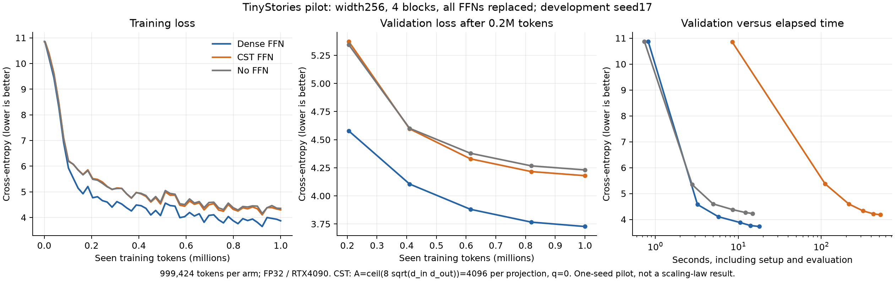
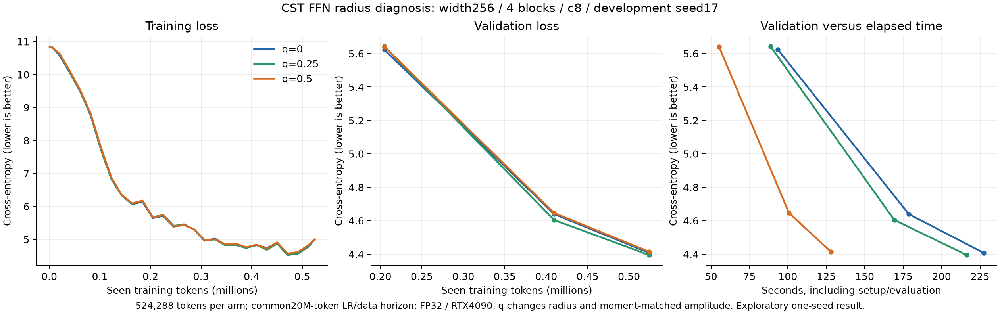
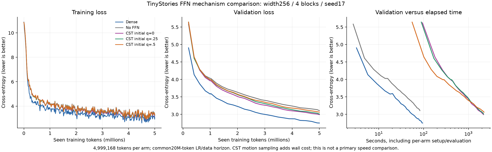
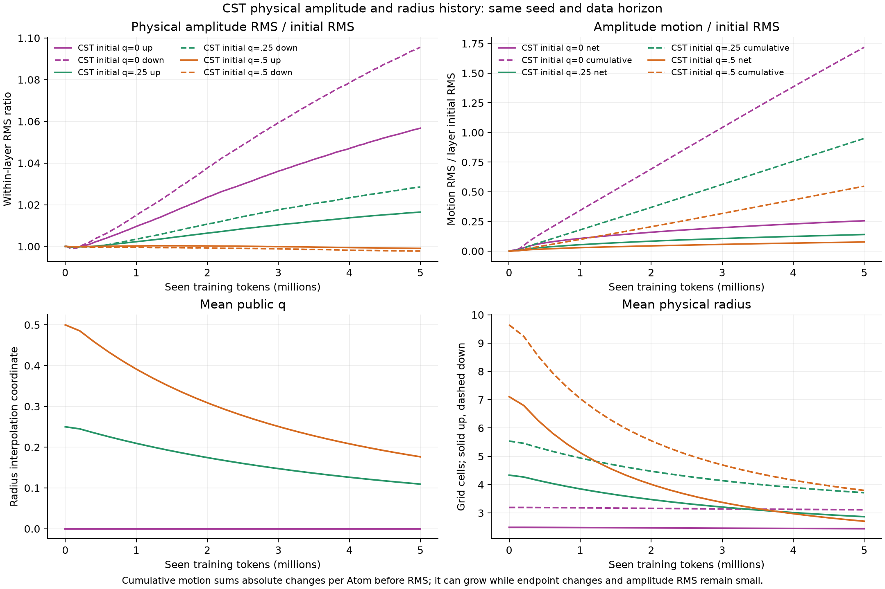
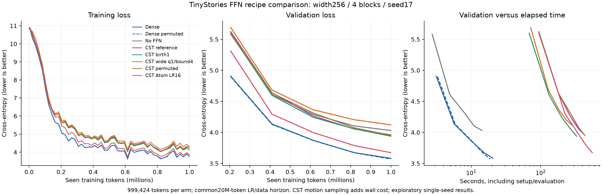
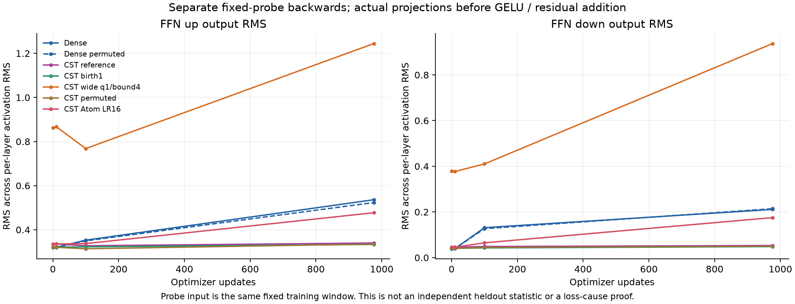
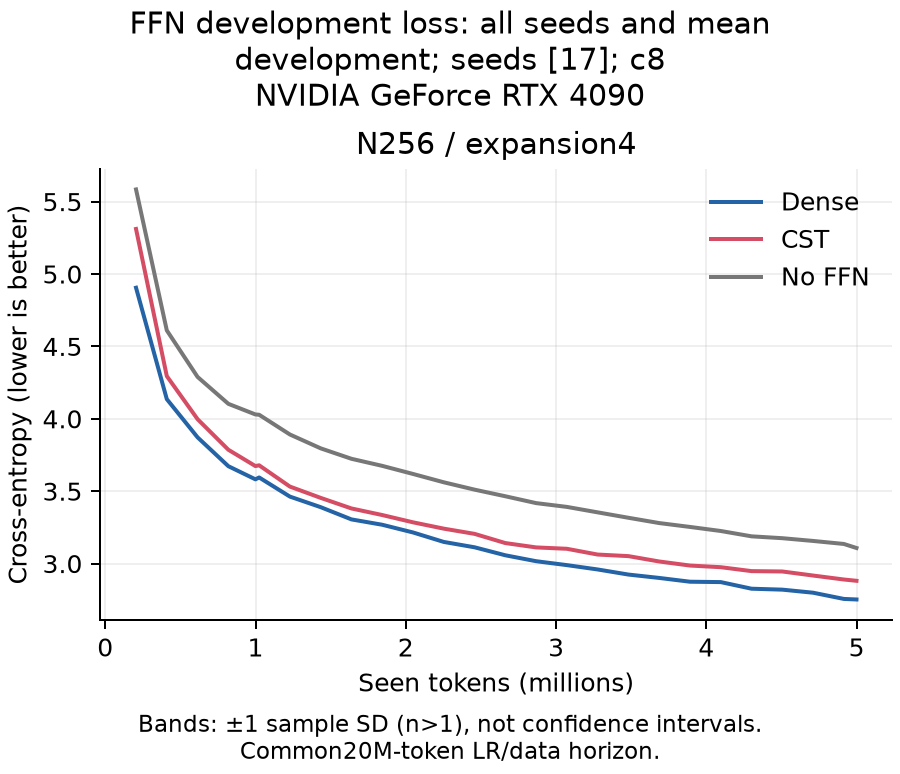

# FFN feasibility: initial observations

English (canonical) | [日本語](ffn-feasibility-results.ja.md)

These are development-seed17 observations, not three-seed confirmations or a
scaling-law result. The [study plan](ffn-feasibility.md) remains in progress.
All eight FFN projections in a four-block width256 causal Transformer use
CST with4096 Atoms each, `A=ceil(8 sqrt(d_in d_out))`; attention, embeddings
and tied vocabulary output stay Dense. FFNs are256→1024→256, context128.

## Initial three-arm pilot (R2)

Each arm trained for976 updates/999424 tokens. Data order and cosine LR used
that short horizon. Dense target std is.02, residual-output std is.02/sqrt(8),
and CST uses the public second-moment initializer with q0. Parameters shared
between arms have identical initialization streams. FP32, TF32off, RTX4090,
Torch2.11.0+cu126,1024 tokens per complete update.

| FFN | Development CE | Perplexity | Peak allocated MiB |
| --- | ---: | ---: | ---: |
| Dense | 3.72727 | 41.57 | 482.50 |
| CST | 4.17978 | 65.35 | 687.28 |
| None | 4.23073 | 68.77 | 440.39 |



CST learns, but remains much closer to no-FFN than Dense at this budget. Its
FFN logical parameter count is6.48% of Dense; its measured GPU peak is larger.
This run does not demonstrate a practical speed or memory advantage. Native
qualification and a separate trained-checkpoint audit checked Y, dX and all
Atom-coordinate VJPs, finite optimizer moments/counters and recomputed heldout
CE. Those checks support numerical correctness within their recorded scope;
they do not explain the learning gap.

Initial FFN activation RMS was close to Dense. CST's down-projection RMS stayed
near.04–.05 while Dense grew to.12–.17. A later q0 trajectory with a20M-token
planned horizon was stopped by the owner. Its last periodic checkpoint contains
2800 updates/2867200 tokens; do not reconstruct the unsaved tail or compare its
CE directly with the short-horizon Dense result.

## Radius family (R5)

Fresh q0/.25/.5 arms each trained512 updates/524288 tokens with the same planned
20M-token LR and data permutation. Moment matching was repeated per q. Changing
q changes amplitude, spatial correlation and clipping as well as physical
radius; this is not an isolated radius-only intervention.

| Initial q | Development CE | Median complete update ms | Peak allocated MiB |
| --- | ---: | ---: | ---: |
| 0 | 4.40716 | 419.35 | 687.28 |
| .25 | 4.39447 | 396.89 | 687.28 |
| .5 | 4.41436 | 222.69 | 687.28 |



The loss curves nearly overlap. These early results do not show a large benefit
from broadening. Times are observed synchronized updates from one sequential
job, ordered q.5/0/.25, without repeated order controls. A changed mathematical
workload is not a kernel-only speedup; do not extrapolate these observations.

In a separate seed17 `make_cst` CPU fixture, average up/down radii were2.49/3.21
(q0),4.35/5.58 (q.25) and7.14/9.71 (q.5). Actual model layers use named seeds and
retain their individual initialization reports. The q1 up fixture could not
reach the target second moment with amplitude bound1; no q1 learning run was
admitted. Broadening can encounter the current amplitude/radius coupling.

Matched Atom IDs in the stopped q0 checkpoint show amplitude RMS.2280→.2359
(up) and.1171→.1237 (down). Strongest-amplitude10% have average radii.914/1.637,
while weakest10% have3.967/3.992. q remains near zero. Broad weak Atoms coexist
with narrow strong Atoms; an overall mean radius obscures this distinction.
Endpoint comparisons cannot establish cumulative amplitude oscillation.

## Five-million-token mechanism comparison (R6)

All five arms completed4882 updates/4,999,168 tokens with the common planned
20M-token LR and data-order horizon. These fresh runs supersede neither the
short-horizon R2 protocol nor its recorded observations. Development CE selects
exploratory recipes; confirmation CE is retained for auditing, not recipe choice.

| FFN | Development CE | Perplexity |
| --- | ---: | ---: |
| Dense | 2.75219 | 15.68 |
| No FFN | 3.10782 | 22.37 |
| CST initial q=0 | 2.99281 | 19.94 |
| CST initial q=.25 | 3.01012 | 20.29 |
| CST initial q=.5 | 3.06285 | 21.39 |



All three CST arms improve over no-FFN at this budget, while Dense is still
better. Increasing initial q did not improve the final development result.
This is one development seed and does not establish statistical superiority or
fixed-coefficient width scaling. Per-update CPU amplitude sampling adds wall
cost; the elapsed-time panel is diagnostic, not a primary speed comparison.



Physical amplitude RMS alone hides substantial motion. For initial q0, its
within-layer RMS ratio ends at1.076 after aggregation across all eight layers.
The normalized endpoint-change RMS is.256, versus1.719 for cumulative absolute
motion. Specifically, for physical amplitudes a_i, define

$$
D_{\mathrm{net}}=\sqrt{\operatorname{mean}_i(a_i(t)-a_i(0))^2},\qquad
D_{\mathrm{path}}=\sqrt{\operatorname{mean}_i\left(\sum_\tau|\Delta a_i(\tau)|\right)^2}.
$$

Each layer's statistic is divided by that layer's initial amplitude RMS, then
combined by RMS across layers. This measures total variation of sampled
amplitudes; it does not measure oscillation frequency or prove useless motion.
q0 ends near5.2e-8. For initial q.5, mean q falls.500→.176 and mean physical input-axis
up/down radii fall7.106/9.643→2.707/3.796 cells. Initial q.25 similarly shrinks.
Thus the broader initial conditions do not stay broad throughout training.
q0 is the amplitude-dependent lower radius, not the hard physical minimum.5.
Weak amplitudes can still have radii near the birth value4.

The separate read-only terminal audit passed all five checkpoint hash/counter,
finite optimizer state, exact model-load/cache-generation and independently
recomputed development/confirmation CE checks. It also passed Y/dX/all Atom VJPs
against chunked CPU FP64 references at all24 trained CST projections (B1 T8).
No optimizer updates or new training occurred in that audit. This supports the
recorded numerical scope; it does not identify a unique learning-gap cause.

### Fixed-prompt examples

These are the complete samples for the first predeclared prompt, not the best
of several generations: sampling seed7000, temperature.8, top-k40, at most64 new
tokens. Both predefined prompts, token IDs and sampling settings remain in each
raw summary. All three shown models have semantic and grammatical failures;
these examples alone are not a language-quality evaluation.

**Dense**

```text
Once upon a time, there was a little girl named Lily. One day, Lily's mom saw a white red tree with a small leaves on it. Lily wanted to help the bug, but her mom said she was going to a good tree to put on the bench and put on the tree. Lily's head and went to the tree and saw that it was
```

**CST initial q=0**

```text
Once upon a time, there was a little girl named Lily. One day, Lily's mom saw a white red red car. The toy had lots of colors wanted to make a beautiful pink dress on the floor. Lily went to a garden and went outside, but she had a few more fun. She played with and played with the butterfly in the sun.
```

**No FFN**

```text
Once upon a time, there was a little girl named Lily. One day, Lily wanted to help her mommy and put on her.
Lily was playing with a little girl named Lily. She had a lot of fun with her toys and said, "Look, Lily?" Her mommy said, Lily and Lily was so happy. Lily looked around the
```

## Bounded recipe comparison (R7)

The five CST recipes in the study plan, plus fresh Dense, permuted-Dense and
no-FFN controls, each completed976 updates/999,424 tokens. All retain c8,
width256, seed17, the common planned20M-token LR/data horizon and the same Dense
moment targets. Each CST recipe first passed native qualification in both actual
FFN directions (including down std.02/sqrt(8)), independent polynomial quadrature,
mixed ordinary/Atom optimizer reference checks, small serialized model resume
and a two-update full four-block preflight.

| FFN recipe | Development CE | Perplexity |
| --- | ---: | ---: |
| Dense | 3.58196 | 35.94 |
| Dense, permuted | 3.57049 | 35.53 |
| No FFN | 4.03015 | 56.27 |
| CST reference | 3.96004 | 52.46 |
| CST birth1 | 3.93924 | 51.38 |
| CST wide q1/bound4 | 4.12193 | 61.68 |
| CST permuted | 3.95231 | 52.06 |
| CST Atom LR16 | 3.67351 | 39.39 |



Atom LR16 is the strongest development result in this bounded family. Its CE
is.09155 above contiguous Dense, versus.37808 for the reference CST recipe.
Ordinary parameters retain the same base LR. The multiplier acts on complete
Atom Parameters, including centers and angular coordinates, and changes the
Polar policy's outer time. The result does not isolate amplitude LR or establish
that16 is optimal. Select it for a longer fresh5M-token followup, not as a new
public default or a completed three-seed result. Keep the planned20M horizon.

The calibrated wide recipe actually began with mean input-axis radii31.601/40.325
cells in up/down projections, ending at12.432/16.255. Radius4 was a birth setting,
not a hard upper bound. This much broader condition is worse than no-FFN at1M;
more radius alone is not the demonstrated remedy. Because amplitude bound and
w_c also change, it is not an isolated radius intervention.



The separate fixed training-window probe shows reference CST down-output RMS
.0457→.0531, versus.0457→.1753 for Atom LR16 and.0389→.2111 for Dense, after
RMS aggregation across the four layers. The wide recipe already has initial
up/down probe RMS.862/.380, compared with Dense.319/.039, despite matching the
initializer's expected weight-energy target. Expected second-moment matching
does not guarantee the same activations on correlated task inputs. These probes
are mechanism observations, not an independent heldout measure or a unique
causal explanation. CST motion sampling adds wall cost; these pilot timing
panels do not establish a practical speed advantage.

The terminal audit passed all eight pilots,40 trained CST projection Y/dX/all
Atom VJPs, exact payload/cache-generation load checks and independent development/
confirmation CE recomputation. Two extra task updates were made only in disposable
copies: after in-memory serialization, the next-step losses, optimizer moments/
counters and parameter payloads agreed; maximum parameter difference was0 for
all eight arms. Original checkpoints were not resumed or overwritten.

The first audit attempt stopped because it incorrectly required gradients for
`norm2` parameters intentionally unused by the no-FFN control. That failed audit
and log remain retained. A CPU architecture/optimizer-state check established
the exact unused set; corrected audit02 allows missing gradients/state only
for those no-FFN parameters and reran all eight arms. It does not relax any CST
Atom or used ordinary-parameter check.

## Selected five-million-token followup (R8)

Fresh width256/c8/seed17 Dense, no-FFN and CST Atom LR16 arms completed 4,882
updates/4,999,168 tokens at the common planned 20M-token LR/data horizon. All
eight FFN projections remain CST; initial q0, amplitude bound 1, w_c .3 and birth 4
are unchanged. Ordinary parameters retain base LR 3e-4; per-update motion sampling
is disabled. The [complete generated report](ffn-feasibility-r8-selected-20261107.md)
contains all three loss curves versus tokens/time, parameter/resource tables,
fixed-prompt examples and their provenance.

| FFN | Development CE | Perplexity | FFN parameters |
| --- | ---: | ---: | ---: |
| Dense | 2.75219 | 15.67689 | 2102272 |
| CST Atom LR16 | 2.88124 | 17.83638 | 136192 |
| No FFN | 3.10782 | 22.37219 | 0 |



CST has useful FFN contribution at this budget, with 6.48% of Dense's FFN
parameters, and a remaining development CE gap 0.12905 to Dense. This is still
one development seed. Curves continue decreasing at 5M; this is a budget endpoint,
not demonstrated convergence or an optimum Atom count. The earlier R6 q0 result
2.99281 remains tied to its original source; it is not a fresh R8 q0 ablation.

The terminal audit passed all three checkpoints, original hashes, finite
optimizer state/counters, independently recomputed development/confirmation CE
and all eight trained CST projection Y/dX/all Atom VJPs at B1T8. Serialization
and the next task update in disposable copies gave maximum parameter difference 0
in every arm; original checkpoints were not overwritten. Only development CE
was used to proceed to the bounded width/aspect pilots.

The final separate fixed-window probe has up/down RMS .654/.448 for CST versus
1.079/.358 for Dense, after RMS aggregation across four layers. Small down-output
RMS alone no longer explains the remaining loss gap. This does not identify a
unique cause or replace heldout quality measurements.

Uninstrumented complete-update medians are 569.10 ms CST versus 11.36 ms Dense;
allocated peaks 687.28/482.50 MiB and reserved 716/490 MiB. These are one sequential
job's observations, without order crossover or independent device repetitions.
Parameter compression has not produced a practical speed or GPU-memory win.
The frozen R8 consumer is `70e02d864e661d3a87cd8aea322b49ae3f4a1f8f`, operator
`2b587e0f04ddf64e2bfb0c2e3db591e87a6f6440`. Terminal receipt SHA256:
`3029cd765869af95ca3c75f7ed71ae1b744c983cec7a199ea600b20076d5dfea`;
trained audit SHA256:
`3b7c5aceacf34c2ff7779351694b97248c65ead7f8662b0d39a5a756a0e9309a`.
Retrieved small-evidence archive SHA256:
`0327ac9e47d4675a2bfb71e4abbc2adeaafdf8e3665e2867a43651f0621e5922`.
All 11 bundled raw files matched their manifest. Bulk checkpoints stay on the GPU
host. The same c8/Atom LR16 recipe completed the width/aspect development
pilots below; three-seed confirmation and the overall study remain incomplete.

## Selected width and aspect pilots (R10)

All four fresh three-arm pilots completed 976 updates/999,424 tokens per arm,
with the frozen R8 consumer/operator, seed17 and common20M LR/data horizon.
Each shape passed its own exact-recipe native qualification and four-block task
preflight. Each terminal audit passed all eight trained CST projection VJPs,
optimizer/serialized next-step checks and independent CE recomputation. All44
bundled raw files matched the retrieved manifests.

| Width | Expansion | Dense DEV CE | CST DEV CE | No-FFN DEV CE | CST / Dense FFN parameters |
| ---: | ---: | ---: | ---: | ---: | ---: |
| 128 | 1 | 3.96956 | 4.05337 | 4.35479 | 33792 / 132096 |
| 128 | 4 | 3.89271 | 4.00487 | 4.35479 | 68096 / 526848 |
| 128 | 16 | 3.91922 | 3.96799 | 4.35479 | 139776 / 2105856 |
| 512 | 4 | 3.28466 | 3.40110 | 3.71174 | 272384 / 8398848 |

CST improves on no-FFN in every development condition but remains behind Dense.
The selected recipe works beyond the initial N256 shape; these one-seed pilots
do not establish three-seed confirmation, an optimal Atom count, convergence or
an asymptotic quality law. Do not compare these1M endpoints directly with N256's
5M endpoint as a matched-budget width comparison.

The [full audited pilot report](ffn-feasibility-r10-shapes-20261107.md) overlays
training/development curves by tokens and elapsed time, retains fixed-prompt
examples and records complete-update allocated/reserved peaks. In these eager
FP32 observations CST remains slower and uses more GPU memory. The smallest
parameter fraction here is N512:272384/8398848≈3.24%; this is an FFN parameter
count, not a measured whole-model memory reduction.

For four blocks and expansion e, each projection uses
\(A=\lceil8N\sqrt e\rceil\). Four trainable coordinates per Atom and the ordinary
biases give \(P_{\mathrm{CST,FFN}}=32A+4(e+1)N\), versus
\(P_{\mathrm{Dense,FFN}}=8eN^2+4(e+1)N\). At e4 these are532N and32N²+20N.
The fixed-c FFN parameter count is linear by construction; whether its useful
quality persists with width is the empirical question. Dense attention still
contributes quadratic parameters to the whole model.

The main-width confirmation family is now running: widths128/256/512,
seeds29/43/71 and all three arms at5M each (27 fresh runs). Its recipe, budget,
retention rules and usefulness criterion were fixed in commit5654fc4 before the
first confirmation run. No three-seed result is available yet. The raw R10 parent
receipt SHA256 is `7b0d3a2bd8e006d445e3d705d4d55a6a1e8c6cf505ecdd4f17d3bdcf07f6579f`;
archive/request/reporter hashes are retained in the derived figure manifest.

## Native scope and remaining work

R5 qualification passed both FFN directions at B2 T128, q0/.25/.5, Y/dX/all Atom
VJPs, polynomial quadrature and optimizer/model resume checks. Separately, the
scoped2048 route passed all12 expanded R3 native cases on RTX4090, including
512↔2048 and128↔2048. This does not establish full language-model feasibility
at width512, or qualify a different consumer/q recipe automatically.

The R6/R7 sequences, selected R8 5M followup and R10 width/aspect pilots have
completed their terminal audits. Public defaults remain unchanged. Width512
reference complete-task smoke and trained-state audit also
passed under the separate R8 consumer and explicit2048 operator. A20-update
fixed-batch smoke is not heldout feasibility or a primary performance result.
Three-seed matched-budget width confirmation, final performance/memory summaries
and PR integration remain incomplete.

The [scoped2048 validation record](https://github.com/takumiecd/torchcst/blob/922a2f609575ad18bbc5d19235138d185f4968dd/docs/research-history/cuda-linear/ffn-rectangular-2048-20261107.md)
retains the N512 reference smoke: observed complete updates18.40ms Dense versus
726.25ms CST, allocated peaks952.66/1187.04MiB. These are ten timing samples
after excluding the first ten updates, all still within LR warmup, not primary
performance repetitions. Parameter compression does not imply a measured GPU
memory reduction in this implementation.

## Additional CPU mechanism checks

These are synthetic/calibration observations, not language-model results or
changes to the default recipe. For Polar norm Q=s²+t², public q=(Q−1)/3, tangent
proposal δu and step size h, the default activity clock uses

$$
Q_* = \operatorname{clip}_{[1,4]}(Q+\gamma\|\delta u\|^2),\qquad
Q' = \left[1-\frac{Q_*-1}{Q_*}e^{-4\lambda h}\right]^{-1}.
$$

With fixed tangent velocity v, δu=h v, its activity increment is proportional
to h². The existing `time_energy` option divides that increment by h. A 1000-step
CPU fixture at h=.0003, ||v||=.15, gamma1 and lambda.1 produced q≈6.36e-7 in
FP64 with `finite_chord`, matching an independent scalar recurrence; FP32 gave
q≈2.65e-9. `time_energy` gave q≈.00212. Thus a near-zero q can coexist with
small repeated angular updates, and FP32 rounding can further reduce activity.
This does not establish the actual Adam tangent velocity or the learning-gap
cause; no clock mode was changed in the R6 learning runs.
These local CPU checks used Torch2.13.0/Python3.11.15 against the same operator
source; they do not validate the remote CUDA updater's FP32 rounding behavior.

A separate bounded CPU initialization grid varied amplitude bound and w_c
together. With bound4, w_c1.2 and q1, the seed17 up/down fixtures matched the
same Dense targets with average radii31.53/40.54 and350/10 clipped Atoms out of
4096. These much wider settings also change coordinate conditioning and require
new native qualification before learning. They are prepared alternatives, not
successful models. Raw scripts/results are `polar-activity-clock-diagnostic*`
and `broad-radius-initialization-grid*` under the evidence locator.

A separate initial-state Gaussian-stimulus check used512 independent normalized
inputs per block. Summing the four FFN output covariance matrices gave
participation-ratio statistics184.13 (Dense),126.63 (CST q0) and62.09 (CST q.5);
mean adjacent-channel correlations were−.003,.419 and.839. Participation ratio
is a covariance statistic, not the algebraic rank or a task-accuracy measure.
Independent output-channel permutations changed the combined CST covariance
statistics to144.15/100.58; this was a covariance-only counterfactual, not a
trained-model intervention. Larger radius can increase feature correlation,
so matching global RMS does not establish Dense-like feature diversity. Narrower
birth-radius settings and fixed feature orderings remain hypotheses to test,
alongside broadening and Atom-budget checks. No remedy is established by this
fixture. Retain `ffn-feature-covariance-initial*` in the external evidence.

## Provenance and retained evidence

TinyStories revision `f54c09fd23315a6f9c86f9dc80f725de7d8f9c64`, tiktoken0.12.0
GPT-2 encoding, whole-story deduplicated splits. Token manifest SHA256:
`5b995103ca95d3c9b62a4e860039683dc734b0a0bb20e232db1b2e45aa690d01`.

- Operator for R2/R5/R6/R7: `9cb6de727ddbf5c2178fe18db6d580c9e181b926`.
- R2 consumer: `f75c1d2efe54767f6b9f65804c234924e6f6e191`.
- R7 consumer: `0e1d30279c213ad8f2ea9fc7895d3ccdea572c24`.
- R7 terminal receipt SHA256: `be725100159cc024f68d79895897357b143a5d6ba5949fca47a8e70127883180`.
- R7 trained-state audit02 SHA256: `b5721388307aded0c3cd121ca8351c1e4fa5635576ce7a49bf64308b4a573cb6`.
- R7 retrieved evidence archive SHA256: `66eb7c3df1e14e1ea87b528963b7af4625839cc7a3d6ed95959c4161a51a09e8`.
- R6 consumer: `f8de9b7f0e114e7c55035858f9544270ae381c21`.
- R6 terminal manifest SHA256: `2f2ff1be72d443f8a08212d5a559e177d55644fa488f3968d0361fd76f6122ed`.
- R6 trained-state audit SHA256: `b03d1bffa9a7f8d1017db47a7042aa3ca71aa748dbf46a1a28fd71a4552bbd67`.
- R5 consumer: `09e15b759fd796ad02c436e3580f1a223e098a92`.
- R5 native receipt SHA256: `4268f0d8ee42f4febd036e1f9846ecdd565231edaca330ef33fd5f4ddb49222b`.
- R5 terminal manifest SHA256: `17d42c7f9722373da24ab23ab3c4e3244e700ab38cb84791f4a64d88309e2b40`.
- R8 selected-width qualification consumer: `70e02d864e661d3a87cd8aea322b49ae3f4a1f8f`.
- R8 N512 native receipt SHA256: `b40ac9ffa47814408eb22d61f65c2a0313f0420632566609f168c269131785d6`.
- R8 N512 trained-state audit SHA256: `08080c751cf5c2c80d57663daa4031bcb7fd231a401187ace7d16161511a9593`.
- Expanded operator: `2b587e0f04ddf64e2bfb0c2e3db591e87a6f6440`;
  consumer `036d0c5beb4a6f675ce1dbeafd4224e6c270f342`.
- Expanded native receipt SHA256: `419ab7750182bca2302d7152c6fc01c1a961efe69f19bf5bb22355f3aa299ce6`.

Resolve `$CST_RESEARCH_EVIDENCE_ROOT/ffn-feasibility-20261106` for raw receipts,
per-arm summary/curves, independent audit results and plotting scripts. R5 raw
JSON/curve hashes were verified against the terminal manifest; trained R5
checkpoint audit remains separate. Bulk checkpoints stay on the GPU host with
their hashes. PNG and SVG here are derived figures, not raw evidence.
