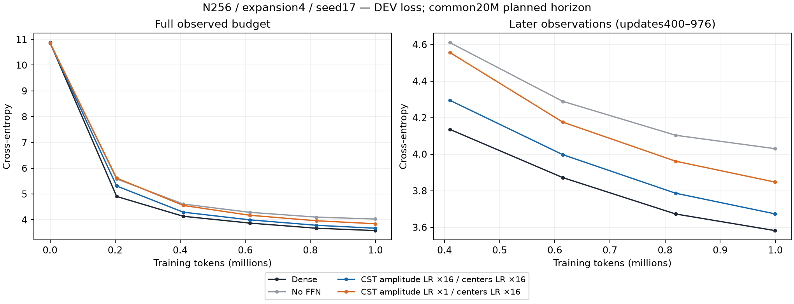
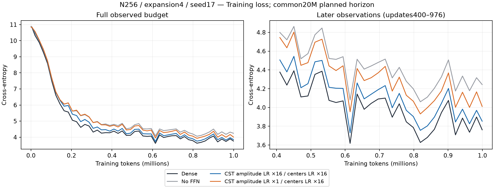
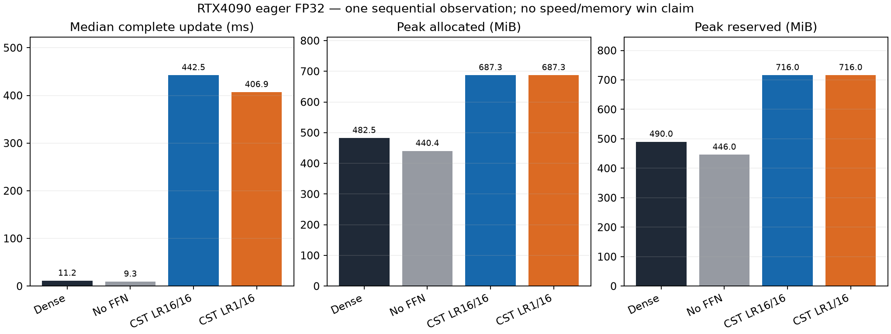

# 振幅・中心の学習率の短期比較（R12）

[English (canonical)](ffn-field-lr-r12-20261107.md) | 日本語

幅256・拡張率4・seed17で、新規4条件が各976更新・999,424トークンを完了しました。
CST条件は4ブロックのFFN全8射影をc8で置換し、Attention・埋め込み・出力はDenseです。
共通の予定20M LR・データ期間、FP32/TF32無効、batch2/context128/蓄積4、
AdamW betas(.9,.95)、eps1e-8、減衰0、全体clip1です。Adam正規化後に(s,t)をまとめて
調整し、振幅方向の提案LRを変えます。中心の最大LR0.0048、Polar外部時間の最大値0.0048、
通常パラメータの最大LR0.0003は揃えています。

| 条件（0.0003に対する倍率） | DEV CE | 確認用CE | 更新中央値 ms | Allocated MiB | Reserved MiB |
| --- | ---: | ---: | ---: | ---: | ---: |
| Dense | 3.58196 | 3.44496 | 11.16 | 482.50 | 490 |
| FFNなし | 4.03015 | 3.91403 | 9.30 | 440.39 | 446 |
| CST 振幅LR16 / 中心LR16 | 3.67351 | 3.53755 | 442.45 | 687.28 | 716 |
| CST 振幅LR1 / 中心LR16 | 3.84731 | 3.71077 | 406.89 | 687.28 | 716 |

振幅の最大LRを0.0048から0.0003へ下げると、終端DEV CEが0.17381悪化しました。
両CST条件ともFFNなしより改善しますが、全16倍の方がDenseに近い結果です。
公開APIへ進むための事前のDEV差0.03以内というゲートは**未達**でした。
この短期予算内では振幅も速く調整する方が良いという証拠で、収束・最適LR・16倍そのものの
必要性・seed再現性を示すものではありません。外部時間が同じでも、Polarの法則には
振幅と活動度の結合が残るため、qや半径は固定されません。確認用スコアは報告しますが、
次の振幅LRの選択には使っていません。

時間は最初の10更新を除く同期した更新全体のsample各966個です。蓄積・データ転送を含み、
probe・評価は除外します。逐次eager観察であり、デバイスの独立反復ではありません。
Denseより速度やモデル全体のGPUメモリが優位という結果ではありません。
FFNパラメータ数は両CST条件136192、Dense2102272です。

学習前に両設定のCPU/nativeパラメータ・moment・counter、全16倍と標準CSTAdamW、
実8射影タスクの保存・復元後更新を確認しました。remote Torch2.11上でも独立Adam式を含む
CPU契約テスト5件を通りました。学習後は学習済みCST16射影のY/dX/全Atom VJP、
DEV・確認用CEの独立再計算、4条件の保存・復元後タスク更新を通りました。
復元後のパラメータ最大差はすべて0です。元checkpointは読み取り専用とし、追加の更新は
使い捨てコピー上で行いました。

Attempt01は、異なるoptimizer契約を登録した後のAtom管理状態を比較用モデルにもコピーした
検証fixtureの不備により、学習前に停止しました。失敗ログ・receipt・固定ソースは保持します。
Attempt02ではoptimizer登録前にモデルを複製し、回帰テストを追加しました。
学習の自動再試行・再開はしていません。学習モデルの失敗とは扱いません。

次は振幅8倍・中心16倍・外部時間16倍という中間条件を1つだけ確認します。
実行前に[計画](ffn-field-lr.ja.md)でゲートと対照再利用の境界を固定します。
公開`field_lrs` APIや既定値を採用したとは扱いません。

## 来歴

- Consumer：`834f22a569aaa2948edd052df9dce8aaa1ce95d2`。
- Operator：`2b587e0f04ddf64e2bfb0c2e3db591e87a6f6440`。
- 実GPU・環境：NVIDIA GeForce RTX4090、CC8.9、Torch2.11.0+cu126、
  Python3.12.9、NumPy2.0.2/PCG64。モデル・契約・operator検証・データ・motionの
  ソースは固定R8 consumerとバイト単位で同じです。
- Archive `field-lr-r12-02-evidence.tar.gz` SHA256：
  `34ddda1866cf15e3496cd176a87333877fafdc048ec39ff1c54b8066c74b6ff6`。
- 学習済み監査 SHA256：`8bf7f36a4c462abfffc29cb5c273beed207091d0fd9c182611afc4fc27fa1734`。
- manifestを含むarchive内12ファイルを回収・hash照合しました。
  raw summary・曲線・qualification・監査・receipt、失敗した実行、source manifest、
  bootstrapの厳密なargv、固定promptの生成例は
  `$CST_RESEARCH_EVIDENCE_ROOT/ffn-feasibility-20261106`から辿れます。
  大きなcheckpointはhashとともにGPU hostに残し、小bundleをcheckpoint backupとは扱いません。
- 派生した図・report・adapterのhashはassetの`figure-manifest.json`に記録します。
  専用観察adapterがsource・data・予算・設定・曲線checkpoint/LR・学習後監査を確認します。
  フィールド別LR条件を拒否する正式3seedレポーターのゲートは緩めず、再利用しません。
