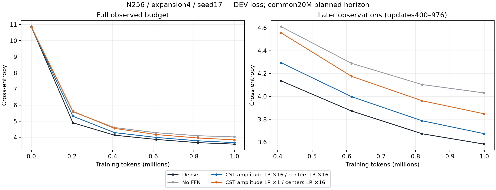
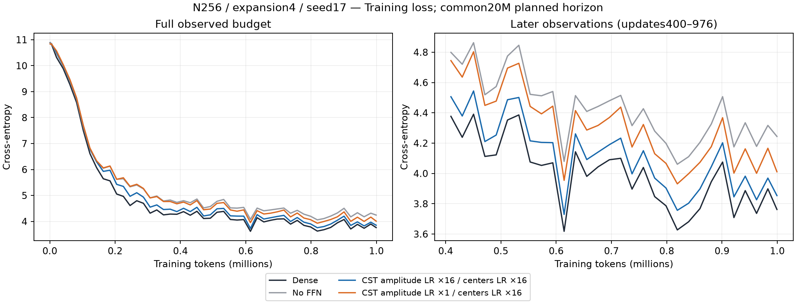
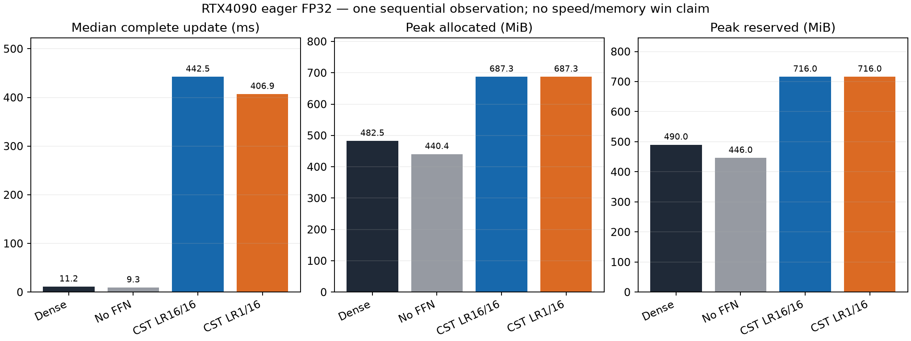

# Short amplitude/center learning-rate comparison (R12)

English (canonical) | [日本語](ffn-field-lr-r12-20261107.ja.md)

All four fresh arms completed976 updates/999,424 tokens at width256, expansion4,
seed17. The four-block CST models replace all eight FFN projections at c8;
attention, embeddings and output remain Dense. Same20M planned LR/data horizon,
FP32/TF32off, batch2/context128/accumulation4, AdamW betas(.9,.95), eps1e-8,
decay0, global clip1. The proposal-rate intervention changes the joint(s,t)
amplitude direction after Adam normalization, with center peak rates0.0048 and
Polar outer peak time0.0048 fixed. Ordinary peak LR is0.0003 throughout.

| Arm (multiples of0.0003) | DEV CE | Confirmation CE | Update median ms | Allocated MiB | Reserved MiB |
| --- | ---: | ---: | ---: | ---: | ---: |
| Dense | 3.58196 | 3.44496 | 11.16 | 482.50 | 490 |
| No FFN | 4.03015 | 3.91403 | 9.30 | 440.39 | 446 |
| CST amplitude LR16 / centers LR16 | 3.67351 | 3.53755 | 442.45 | 687.28 | 716 |
| CST amplitude LR1 / centers LR16 | 3.84731 | 3.71077 | 406.89 | 687.28 | 716 |

Reducing amplitude peak LR from0.0048 to0.0003 worsened final DEV CE by0.17381.
Both CST models improve on no FFN, while all16 is closer to Dense. The
prespecified DEV gap<=0.03 gate for proceeding to the public API **did not pass**.
This supports faster amplitude adaptation within this short budget; it does not
establish convergence, an optimal rate, necessity of exactly16× or seed
repeatability. Equal outer time does not freeze q/radii: amplitude/activity
coupling remains part of the declared Polar law. Confirmation scores are
reported but were not used to select the next amplitude rate.

Timing uses966 synchronized full updates per arm, excluding the first10;
accumulation/data transfer are included and probes/evaluation are excluded.
These sequential eager observations are not independent device repetitions.
There is no measured whole-model speed or memory advantage over Dense. Both
CST arms have136192 FFN parameters versus2102272 for Dense.

Before learning, both field recipes passed CPU/native parameters/moments/counters,
all16 versus stock CSTAdamW, and actual eight-projection task serialization and
next-step gates. The remote Torch2.11 CPU independent-Adam contract passed5tests.
After learning, all sixteen trained CST Y/dX/all-Atom VJPs, independently
recomputed DEV/confirmation CE and four serialized next-task-step audits passed.
All four maximum resume parameter errors were0. Original checkpoints stayed
read-only; extra task steps used disposable copies.

Attempt01 stopped before any learner because the stock comparison fixture
copied Atom-owned optimizer state after binding a different optimizer contract.
Its log/failed receipts and frozen source are retained. Attempt02 copied pristine
models first, with a regression test; no learner was automatically retried or
resumed. This was a qualification-fixture error, not a trained-model failure.

Next is one bounded amplitude8×/centers16× development condition, keeping outer
time16×. The [protocol](ffn-field-lr.md) fixes its gates and reuse boundary before
execution. Public `field_lrs` API/default adoption has not happened.

## Provenance

- Consumer: `834f22a569aaa2948edd052df9dce8aaa1ce95d2`.
- Operator: `2b587e0f04ddf64e2bfb0c2e3db591e87a6f6440`.
- Actual GPU/runtime: NVIDIA GeForce RTX4090, CC8.9, Torch2.11.0+cu126,
  Python3.12.9, NumPy2.0.2/PCG64. The model/contract/operator qualification/data/
  motion sources are byte-identical to the frozen R8 consumer.
- Archive `field-lr-r12-02-evidence.tar.gz` SHA256:
  `34ddda1866cf15e3496cd176a87333877fafdc048ec39ff1c54b8066c74b6ff6`.
- Trained audit SHA256: `8bf7f36a4c462abfffc29cb5c273beed207091d0fd9c182611afc4fc27fa1734`.
- Twelve archive members including the manifest were retrieved/hash verified.
  Raw summaries/curves/qualification/audit/receipt, failed attempt, source
  manifests, exact bootstrap argv and fixed-prompt generations resolve under
  `$CST_RESEARCH_EVIDENCE_ROOT/ffn-feasibility-20261106`. Bulk checkpoints remain
  on the GPU host with hashes; the small bundle is not a checkpoint backup.
- Derived figure/report/adapter hashes are in the asset `figure-manifest.json`.
  The separate observation adapter enforces exact source/data/budget/recipe,
  curve checkpoints/rates and trained audits. It does not weaken or reuse the
  formal three-seed reporter, which rejects field-LR optimizer variants.
