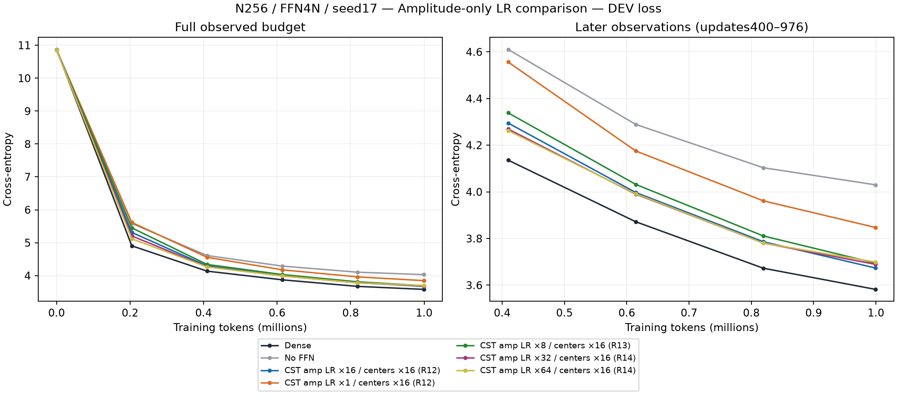
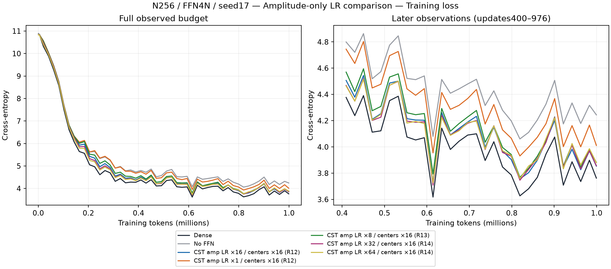
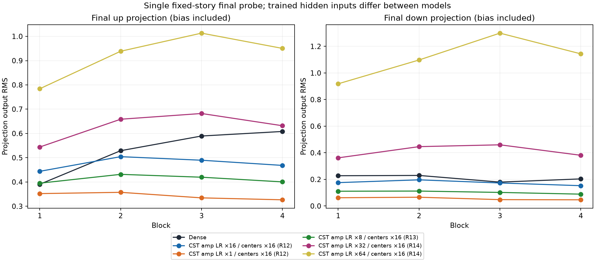
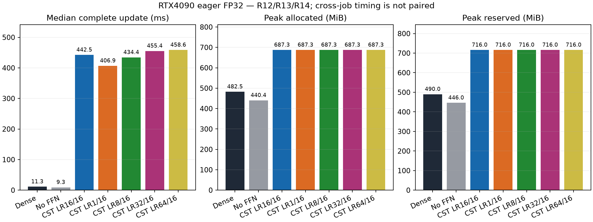

# 振幅だけを変えた学習率の観察（R12–R14）

[English](ffn-field-lr-r14-20261107.md) | 日本語

**これは振幅だけの介入であり、Atom全体32倍・64倍の実験ではありません。**
実行側が高学習率の要望を解釈し違え、R14後にユーザーから訂正されました。
これらの計測は別の比較として保全します。訂正版R15はstock CSTAdamWで振幅・両中心・
Polar外部時間をまとめて上げます。その結果は分けて評価する必要があります。

全行はN256、FFN4N、pre-LN Transformer4ブロック、CST8投影、c8、seed17、実際999,424トークン・
976更新、共通20M予定のLR・データ期間です。通常のピークLRは0.0003。
ここでのCSTは両中心のピークとPolar外部時間を0.0048に固定し、正規化後の連成(s,t)振幅
提案の学習率だけを変更しています。q・activityはPolar則によって振幅の動きと連成します。
AdamW betas(.9,.95)、epsilon1e-8、decay0、batch2/context128/accumulation4、
global clip1、eager FP32/TF32offは共通です。Attention・embedding・outputはDenseのままです。
演算子はtorchcst2b587e0f04ddf64e2bfb0c2e3db591e87a6f6440であり、学習には研究用アダプタを
使っています。新公開field_lrs APIの学習結果ではありません。

| Arm | DEV CE | Confirmation CE | Update median ms | Allocated MiB | Reserved MiB |
| --- | ---: | ---: | ---: | ---: | ---: |
| Dense | 3.581960 | 3.444963 | 11.31 | 482.50 | 490 |
| No FFN | 4.030150 | 3.914033 | 9.28 | 440.39 | 446 |
| CST amp16 / centers16 / outer16 | 3.673505 | 3.537554 | 442.45 | 687.28 | 716 |
| CST amp1 / centers16 / outer16 | 3.847312 | 3.710769 | 406.89 | 687.28 | 716 |
| CST amp8 / centers16 / outer16 | 3.694387 | 3.563697 | 434.36 | 687.28 | 716 |
| CST amp32 / centers16 / outer16 | 3.689207 | 3.556204 | 455.44 | 687.28 | 716 |
| CST amp64 / centers16 / outer16 | 3.698881 | 3.562070 | 458.57 | 687.28 | 716 |

振幅を16倍から1倍に下げるとDEVは0.173807悪化しました。限定した8倍の追試は16倍との差が
0.020882で、事前の工学的基準「差0.03以内・FFNなしより有用・全正しさ検証成功」を通りました。
これはフィールド別LRを設定できるAPIの実装を支持しますが、統計的同等性やデフォルト採用では
ありません。振幅32倍・64倍の最終DEVは16倍より0.015701・0.025375高い値でした。
途中の曲線では先に改善する場合もあります。Atom全体の最良LR、収束、最適値、seed再現性は
示していません。開発上の選択にはDEVだけを用い、confirmationは報告のため掲載しています。

R13・R14とも新規Dense・FFNなしを実行し、そのDEV・confirmationはR12と完全一致しました。
旧品質対照の再利用はmodel・dataのソースとoptimizerクラスのソースバイト一致で裏付けています
（Python版をまたぐASTシリアライズのハッシュではありません）。R13は学習後8投影VJP・3条件の
シリアライズ後の次タスク更新、R14は16投影VJP・4条件の復元監査を通りました。
復元時の最大パラメータ誤差はすべて0でした。manifestを含むR13の10ファイル・R14の12ファイルを
回収しハッシュ照合しました。学習前の起動失敗も非公開の証拠保存先に保全し、学習の再試行・
再開はしていません。

固定した1storyでの最終RMSには投影バイアスを含み、モデル間で学習後の隠れ入力も異なります。
高い振幅LRは投影出力、特にdown投影の増大と関連しますが、半径・activityの因果分離実験でも
Dense RMSへの一致が必要だという証拠でもありません。FFNなしには投影RMSの点はありません。
ジョブ間の時間は記述的な観測であり、対になった性能比較ではありません。
FFNパラメータは136,192対2,102,272へ圧縮していますが、計測されたeager GPU allocationと
完全更新時間はDenseより大きく、速度・メモリの優位は主張しません。

## 証拠と再現

| Cohort | Consumer | Archive SHA256 | Trained audit SHA256 |
| --- | --- | --- | --- |
| R12 | `834f22a569aaa2948edd052df9dce8aaa1ce95d2` | `34ddda1866cf15e3496cd176a87333877fafdc048ec39ff1c54b8066c74b6ff6` | `8bf7f36a4c462abfffc29cb5c273beed207091d0fd9c182611afc4fc27fa1734` |
| R13 | `0b9dba7412f4b6162883b84a0d7160e2f16f57ff` | `2185fe612db8ae80546c4c4e66daa28ec2db406eaa5236bf93123b940f449d39` | `a0b3f248bcf9bbac6b85d723d974b77815e36bacc14cd24ba34c8785b9b88eb0` |
| R14 | `86e83fc92543b770f51bdfd7749baab4276f8b6c` | `c115a4623811e890a0ce7b6fc1c1a71e7bd9dd034e7aa77957a625d840a9324e` | `3d95c8deee0e80ae7974e204d6be23bdf85e0d9df7140d8ff746e1466b719b89` |

実機はすべてRTX4090 CC8.9・24GB級、Torch2.11.0+cu126、Python3.12.9、NumPy2.0.2です。
データmanifest SHA256は
`5b995103ca95d3c9b62a4e860039683dc734b0a0bb20e232db1b2e45aa690d01`。
登録studyの外部証拠保存先にarchive・controller・元checkpoint・report scriptを保全しています。
厳格な結合reportは`report-field-lr-r14-01.py`で、R14の成果物を照合し、厳格なR13 reportを
SHA256で固定してから旧曲線を重ねます。`--root`に回収R14ツリー、`--output`に新規ディレクトリを
指定します。同じ親ディレクトリの厳格なR13・R12 reportも必要です。
図・reportのハッシュは[figure manifest](assets/ffn-feasibility-20261107/figure-manifest.json)に記録しています。

設定可能な公開APIは[torchcst PR151](https://github.com/takumiecd/torchcst/pull/151)に実装済みです。
このreportの時点ではCPU一式・build・CIが成功し、native GPU・完全LMの検証は未完了です。
R13の試作実装の結果で新実装を検証したことにはしません。
訂正後のAtom全体32倍・64倍は[protocol](ffn-field-lr.ja.md)に記録しています。
