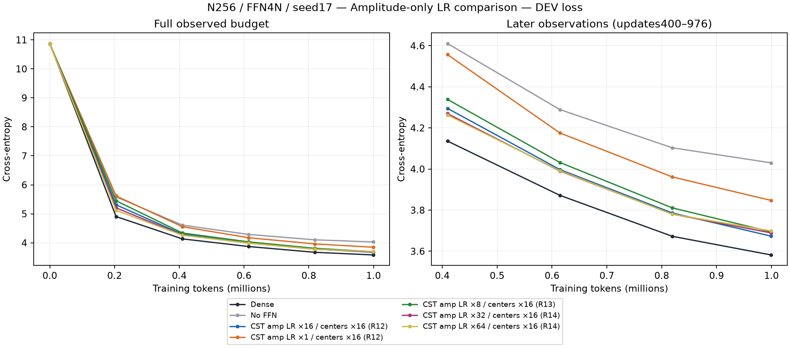
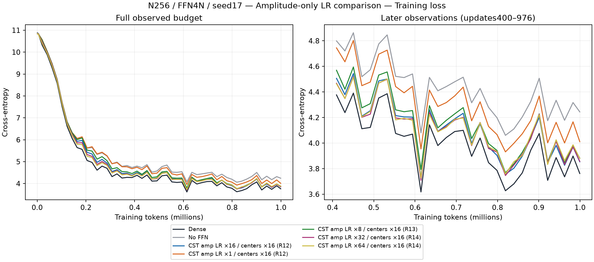
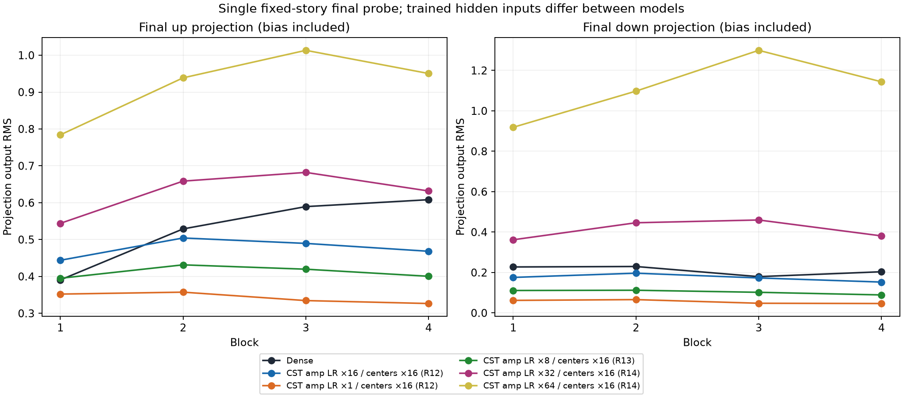
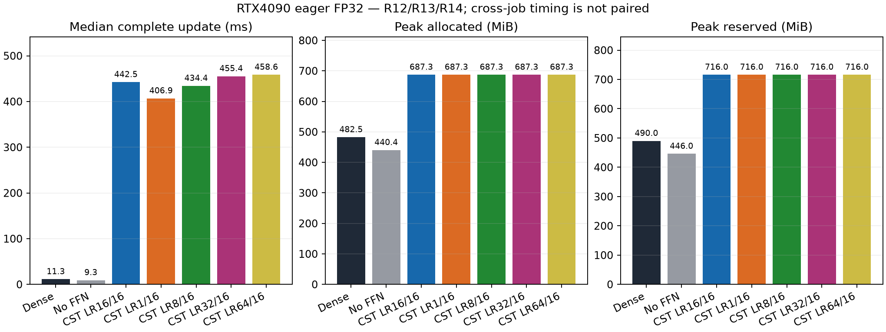

# Amplitude-only learning-rate observations (R12–R14)

English (canonical) | [日本語](ffn-field-lr-r14-20261107.ja.md)

**These are amplitude-only interventions, not whole-Atom32×/64× experiments.**
The assistant misinterpreted the owner's higher-rate request; the owner corrected
it after R14. Retain these measurements as a separate contrast. Corrected R15
uses stock CSTAdamW and raises amplitude, both centers and Polar outer time
together; its results must be evaluated separately.

All rows use N256, FFN4N, four pre-LN Transformer blocks, eight CST projections,
c8, seed17,999,424 actual tokens/976updates, and the same20M planned LR/data
horizon. Ordinary peak LR is0.0003. All CST rows here keep both center peaks
and Polar outer peak time0.0048; only the normalized joint(s,t) amplitude
proposal rate changes. q/activity remains coupled to amplitude motion under the
Polar law. AdamW betas(.9,.95), epsilon1e-8, decay0, batch2/context128/accumulation4,
global clip1, eager FP32/TF32off are unchanged. Attention/embedding/output stay
Dense. The mathematical operator is torchcst2b587e0f04ddf64e2bfb0c2e3db591e87a6f6440;
these learning runs use the research adapter, not the new public field_lrs API.

| Arm | DEV CE | Confirmation CE | Update median ms | Allocated MiB | Reserved MiB |
| --- | ---: | ---: | ---: | ---: | ---: |
| Dense | 3.581960 | 3.444963 | 11.31 | 482.50 | 490 |
| No FFN | 4.030150 | 3.914033 | 9.28 | 440.39 | 446 |
| CST amp16 / centers16 / outer16 | 3.673505 | 3.537554 | 442.45 | 687.28 | 716 |
| CST amp1 / centers16 / outer16 | 3.847312 | 3.710769 | 406.89 | 687.28 | 716 |
| CST amp8 / centers16 / outer16 | 3.694387 | 3.563697 | 434.36 | 687.28 | 716 |
| CST amp32 / centers16 / outer16 | 3.689207 | 3.556204 | 455.44 | 687.28 | 716 |
| CST amp64 / centers16 / outer16 | 3.698881 | 3.562070 | 458.57 | 687.28 | 716 |

Reducing amplitude from16× to1× worsened DEV by0.173807. The bounded8× follow-up
was0.020882 above16× and passed the prespecified engineering gate of at most0.03,
usefulness vs no FFN, and all correctness checks. This supports implementing a
configurable field-rate API; it is not statistical equivalence or default
adoption. Amplitude32× and64× were0.015701 and0.025375 above16× at this endpoint.
Their earlier curves sometimes improve more quickly. None of this establishes
the best whole-Atom LR, convergence, an optimum or seed repeatability. DEV alone
was used for development choices; confirmation is reported for completeness.

Each R13/R14 cohort ran fresh Dense/no-FFN controls whose DEV/confirmation values
exactly reproduce R12. Reuse of old quality baselines is backed by unchanged
model/data source bytes and optimizer-class source bytes (not cross-Python AST
serialization hashes). R13 passed8 trained projection VJPs and3 serialized
next-task-step audits; R14 passed16 VJPs and4 resume audits. All resume maximum
parameter errors were0. R13 archive10members and R14 archive12members including
their manifests were retrieved and hash verified. Failed pre-learning launch
attempts remain in the private evidence locator; no learner was retried/resumed.

The fixed-story final RMS plot includes projection bias and different trained
hidden inputs. Higher amplitude rates are associated with larger projection
outputs, particularly down-projections; this is not an isolated causal test of
radius/activity or a requirement to match Dense RMS. No-FFN has no projection
RMS points. Cross-job timings are descriptive, not paired performance evidence.
These runs compress FFN parameters (136,192 vs2,102,272) while using more measured
eager GPU allocation and longer complete updates than Dense. No speed or memory
win is claimed.

## Evidence and reproduction

| Cohort | Consumer | Archive SHA256 | Trained audit SHA256 |
| --- | --- | --- | --- |
| R12 | `834f22a569aaa2948edd052df9dce8aaa1ce95d2` | `34ddda1866cf15e3496cd176a87333877fafdc048ec39ff1c54b8066c74b6ff6` | `8bf7f36a4c462abfffc29cb5c273beed207091d0fd9c182611afc4fc27fa1734` |
| R13 | `0b9dba7412f4b6162883b84a0d7160e2f16f57ff` | `2185fe612db8ae80546c4c4e66daa28ec2db406eaa5236bf93123b940f449d39` | `a0b3f248bcf9bbac6b85d723d974b77815e36bacc14cd24ba34c8785b9b88eb0` |
| R14 | `86e83fc92543b770f51bdfd7749baab4276f8b6c` | `c115a4623811e890a0ce7b6fc1c1a71e7bd9dd034e7aa77957a625d840a9324e` | `3d95c8deee0e80ae7974e204d6be23bdf85e0d9df7140d8ff746e1466b719b89` |

All use actual RTX4090 CC8.9/24GB-class, Torch2.11.0+cu126, Python3.12.9,
NumPy2.0.2. Data manifest SHA256 is
`5b995103ca95d3c9b62a4e860039683dc734b0a0bb20e232db1b2e45aa690d01`.
The registered study's external evidence locator retains the archives,
controllers, original checkpoints and report scripts. The strict combined
report is `report-field-lr-r14-01.py`; it validates R14 artifacts and anchors the
strict R13 report by SHA256 before overlaying prior curves. Run with `--root`
pointing to the retrieved R14 tree and `--output` to a new directory. The sibling
strict R13 and R12 reports are required. Figure/report hashes are recorded in
[the figure manifest](assets/ffn-feasibility-20261107/figure-manifest.json).

The configurable public API is implemented in
[torchcst PR151](https://github.com/takumiecd/torchcst/pull/151). At this report's
checkpoint, its CPU suite/build/CI passed and native GPU/full-LM qualification
remains pending. R13's prototype result does not validate the new implementation.
The corrected whole-Atom32×/64× protocol is in [the protocol](ffn-field-lr.md).
