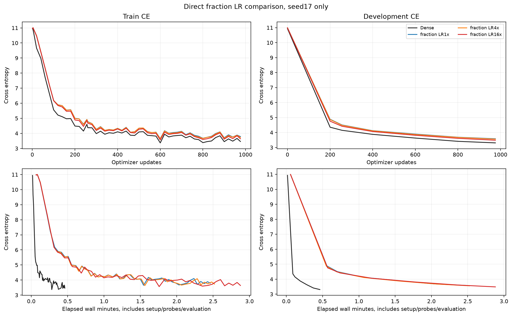
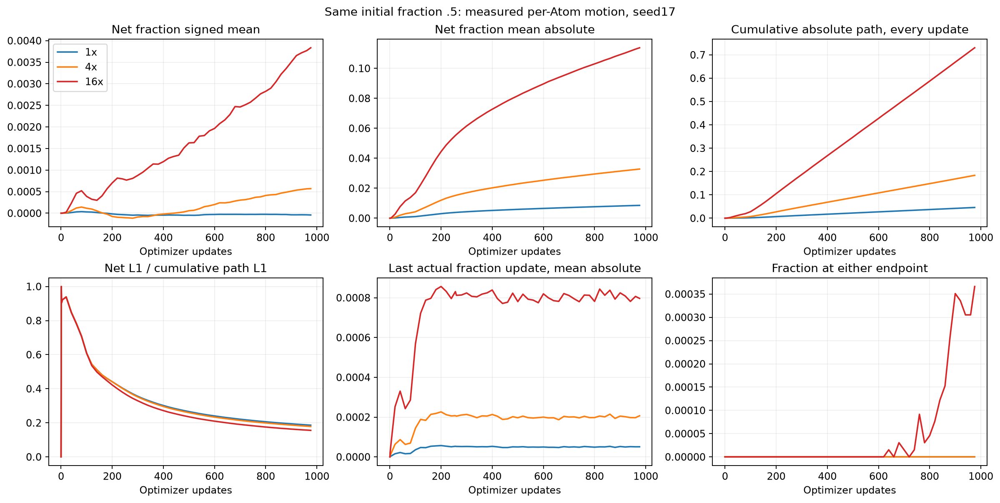
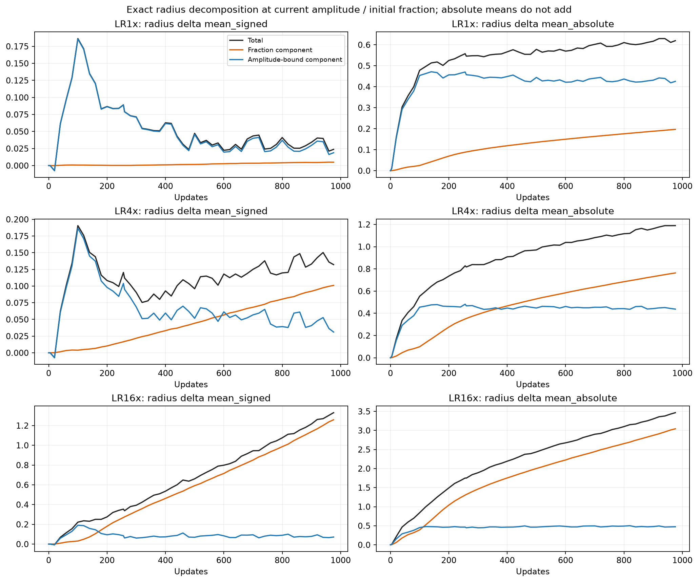

# fractionの学習率比較：fractionは動き、今回の短期比較では高いLRで改善

[English (canonical)](ffn-fraction-lr-20261109-results.md) | 日本語

2026-11-09、RTX6000 Adaで完了。初期fraction=.5と他のCST条件を固定し、fractionの
LR16倍でDEV交差エントロピーが1倍から0.09644改善しました。Denseとの差は0.17738
残ります。976更新・開発用1seedの結果であり、収束や普遍的な推奨LRの結論ではありません。

## 条件

[固定した計画](ffn-fraction-lr-20261109.ja.md)を参照。TinyStories、幅512、pre-norm
4ブロック、8heads、context128、FFN拡大率4。8個のFFN行列すべてを各8192Atoms
(A=8√(d_in d_out))のCSTに置換。Attention、embedding、共有語彙headはDenseです。
seed17、batch2×128×勾配蓄積4=1024tokens/更新。256更新=262144tokens、
976更新=999424tokens。全条件を同じ予算まで完了し、途中選択はしていません。

初期fraction=.5、tau=.003、振幅上限32、半径範囲[.5,50]、M8、
`levels_wide_amplitude`。公開moment初期化を使い、probe-RMS校正は行いません。
CST3条件の初期Parameterはbyte単位で一致し、token順序も同一です。Denseも同じ
jobで新規に実行しましたが、初期activation RMSはCSTと異なります。過去のfraction=0
の結果は履歴であり、今回のLR比較の対照には混ぜません。

AdamW基準LR3e-4、betas(.9,.95)、eps1e-8、decay0、global clip1、warmup200更新、
共通の20M-token予定長。振幅・中心は全条件で基準LRの16倍、fractionのみ1/4/16倍
(最大絶対LR .0003/.0012/.0048)。Parameter・Adam moment・physical rowはFP32、
写像内部はFP64、TF32off、eager実行。NVIDIA RTX6000 Ada Generation、
PyTorch2.9.1+cu128、CUDA12.8です。

## 学習・時間・メモリ

| Arm | DEV CE at256 | DEV CE at976 | Update median (ms) | Peak allocated / reserved (MiB) |
|---|---:|---:|---:|---:|
| Dense | 4.1484 | 3.3090 | 21.52 | 952.7 /1168 |
| Fraction LR1× | 4.5058 | 3.5828 | 128.94 | 975.7 /1304 |
| Fraction LR4× | 4.4856 | 3.5594 | 133.26 | 975.7 /1300 |
| Fraction LR16× | 4.4176 | 3.4864 | 159.59 | 975.7 /1302 |

表の時間は更新全体の中央値で、勾配蓄積・転送・forward/backward・clip・optimizerを含み、
zero_grad・LR設定・probe・評価・観測処理を除きます。準備秒数はDense0.97、
LR1/4/16で3.60/3.63/3.65、準備・probe・評価・観測込みの総wall秒数は
33.39/150.40/153.35/175.01です。同一job内の逐次測定で順序反転は行っていません。
学習後の半径が処理量も変えるため、演算そのものの高速化比較ではありません。
メモリはPyTorch allocated/reservedのピークで、GPU process全体・Graphは未測定。
FFNのParameter数はDense8398848、CST272384ですが、この幅512のLM全体では
ピークallocatedメモリの優位はありません。

## なぜ平均が固定に見えたか

65536個すべてのfractionが初期値から変化しました。正負の変化が相殺され、最終の平均は
.499958/.500570/.503835のままです。平均だけではAtomごとの動きを捉えられません。
表のnetは初期値との差、pathは各更新の絶対変化量の累積です。

| Fraction LR | Mean signed net Δf | Mean absolute net Δf | Mean cumulative absolute path | Mean absolute radius fraction component |
|---|---:|---:|---:|---:|
| 1× | −0.000042 | 0.00856 | 0.04595 | 0.19672 |
| 4× | +0.000570 | 0.03279 | 0.18364 | 0.76339 |
| 16× | +0.003835 | 0.11374 | 0.73030 | 3.04329 |

LR16倍ではfractionの平均絶対net変化がLR1倍の13.3倍。約50.3%のAtomで増加、
49.7%で減少しました。端点に達したのは24/65536個(0.0366%)のみで、LR1/4倍では
0個です。以前の平均が平らだったことを、広範なclampやfractionの勾配消失で説明する
根拠はありません。Adamはmomentを正規化するため、生の勾配の大きさだけでは更新量は
決まりません。最後の実測平均絶対Δfは.00005093/.00020682/.00079655、保存moment
からのAdam提案推定は.00005093/.00020682/.00079684。後者は範囲制約・丸め前の
推定であり、厳密なraw proposalの記録ではありません。

累積pathは毎更新の各Atomの変化から集計しましたが、全Atomの個別時系列は保存していません。
net L1/path L1=.186/.179/.156で、時間方向にも相殺があります。これだけで勾配が
誤っているとは言えません。

## 実際の半径

観測では次の恒等式を使います。第1項が現在の振幅におけるfraction成分、第2項が
初期fractionにおける振幅による境界変化成分です。

\[
r(a_t,f_t)-r(a_0,f_0)
=\underbrace{r(a_t,f_t)-r(a_t,f_0)}_{\text{fraction component at current amplitude}}
+\underbrace{r(a_t,f_0)-r(a_0,f_0)}_{\text{amplitude-bound component at initial fraction}}.
\]

これは代数的な分解であり、学習効果の因果的な分解ではありません。成分それぞれの
絶対平均を足しても、全変化の絶対平均にはなりません。LR16倍のfraction由来の半径変化の
絶対平均は3.0433、LR1倍は0.1967。振幅による境界変化成分はそれぞれ0.4739、0.4256です。
平均半径は初期5.2079から5.2317/5.3400/6.5383へ変化しました。損失は改善していても
平均半径は増えています。全Atomが一様に縮むという挙動ではありません。対数半径の写像や
小振幅で半径が広いAtomを含むため、単純平均に加えて振幅別の図を確認すべきです。
一般的な半径と精度の法則が示されたわけではありません。








追加図（層別半径・fraction、振幅別半径・fraction、勾配、activation RMS、Adam更新）：

- [Radius distributions by layer](assets/ffn-fraction-lr-20261109/long-radius-layers.png)
- [Fraction distributions by layer](assets/ffn-fraction-lr-20261109/long-radius_fraction-layers.png)
- [Layer fraction changes](assets/ffn-fraction-lr-20261109/long-fraction_change-layers.png)
- [Amplitude-binned radius](assets/ffn-fraction-lr-20261109/long-amplitude-radius.png)
- [Amplitude-binned fraction](assets/ffn-fraction-lr-20261109/long-amplitude-radius_fraction.png)
- [Field gradient RMS](assets/ffn-fraction-lr-20261109/long-field-gradients.png)
- [Activation RMS](assets/ffn-fraction-lr-20261109/long-activation-rms.png)
- [Actual and analytic Adam updates](assets/ffn-fraction-lr-20261109/adam-fraction-updates.png)

## 正しさ・監査・取得

既存68項目のoperator検査はsource全体・GPU/runtime・証拠hashの一致を確認して再利用。
今回の3設定はいずれもconsumerの新規検査に成功しました。写像/JacobianのVJP、未完了の
forwardを保持した実行、実際のfraction更新、serialize後の次のmodel/Adam更新の完全一致を
含みます。観測処理はParameter・勾配・optimizer state・RNGを変更しません。
CPU suiteは182passed/61skipped、登録33studyの検証も成功しました。

最終・256更新の計8checkpointでDEV CEが完全再現(差0)。FP32 optimizer momentの
有限性、256/976のcounter、振幅・fractionの範囲を確認しました。学習後のup/down行列の
encoded-row FP64 oracleは計12検査で、Y/dX/全Atom微分の最大絶対差は
1.64e-6/2.09e-6/7.63e-6。既定のatol1e-4/rtol4e-3を変更せず通過しました。
6時点のfraction・半径のnet変化をcheckpointから独立に再計算し、観測ログと一致しました。

compact34ファイルと固定source1849ファイルのhashを検証。remote checkpointの
hashは12個確認し、うち8checkpointを監査。所有する学習/controller6PIDと監査2PIDは
すべて終了し、GPUは0%、39MiBでした。checkpointはremoteで保全、compact証拠と
固定sourceはlocalへ取得済み。RMS校正実験・confirmation評価・公開default採用は
行っていません。

## 来歴と再現

job/証拠ディレクトリは`CST_RESEARCH_EVIDENCE_ROOT`配下の
`ffn-fraction-lr-6000ada-20261109-01`です。[数値・監査JSON](ffn-fraction-lr-20261109-results.json)
に丸め前の値とcheckpoint/図のhashを記録。raw log/checkpointはGit外に保全します。
学習consumerは次のcommitで固定し、学習後の監査・作図コードは区別しています。
学習sourceを変更した再実行は行っていません。

| Identity | Value |
|---|---|
| torchcst commit | `0d277ae6dc0ae14fe515c7559f39535ed0238950` |
| Training consumer commit | `9b531538a90014022dcaf20a0188446cce348f53` |
| Source archive SHA256 | `5d559937bd56e04ce210a287fe59dde3a514571264403dd331c6d6c5356bf1e9` |
| Data manifest SHA256 | `5b995103ca95d3c9b62a4e860039683dc734b0a0bb20e232db1b2e45aa690d01` |
| Qualification SHA256 | `bd3a9298eaeeb9ca7fe1ad7415b790ede61942b0db9b059c30962992c3bff8cd` |
| Initial CST Parameter SHA256 (all3 arms) | `75b4271cfe05d9ad4479cfbac3eaa05cae586e8beea4e2a65f1236b687cee634` |
| Compact result archive SHA256 | `d1bf5569c5803b57b8e925e682927c8fc9e698009afbfa55fdfc4ecbdfa6d999` |
| Post-training audit source SHA256 | `9d333be89bba8d7337ca80442032f3a25f99e218022cd9e1915e9be1baf70815` |

検証済み証拠(`retrieval-integrity.json`と`retrieved/`を含む)を復元し、reporting依存を
導入した環境で図を再生成できます。

```bash
python scripts/plot_ffn_fraction_start.py --run "$CST_RESEARCH_EVIDENCE_ROOT/ffn-fraction-lr-6000ada-20261109-01"
python scripts/plot_ffn_fraction_lr.py --run "$CST_RESEARCH_EVIDENCE_ROOT/ffn-fraction-lr-6000ada-20261109-01"
```

固定source archiveに正確なrunner、jobに`protocol.json`・`cases.json`・`driver.py`・
launch/receipt・監査sourceを保全しています。学習の再実行にはそれらのsource、検証済み
token manifest、qualification、承認済みGPU接続が必要です。

高いfraction LRは今回の条件で有望です。3seed確認・長期学習・別の初期fraction/tau/幅、
Denseとの差の原因は今回未検証。16倍は、この1seed・3条件の中で最も良かった値です。
