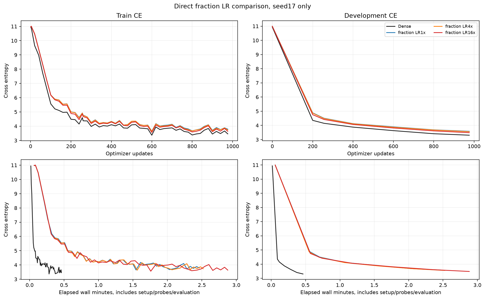
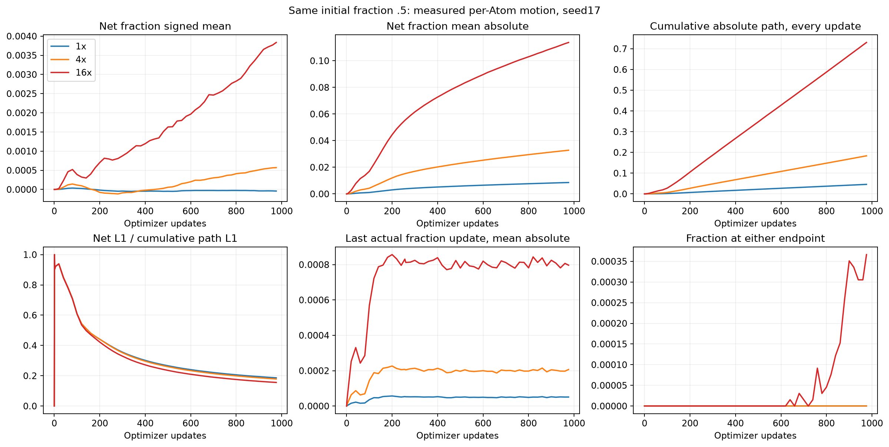
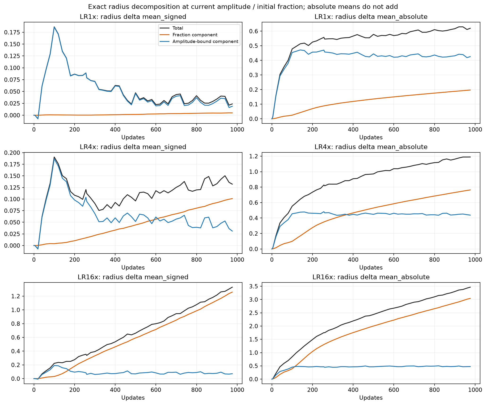

# Fraction LR comparison: fraction moves and higher LR improves this pilot

English (canonical) | [日本語](ffn-fraction-lr-20261109-results.ja.md)

Completed on RTX 6000 Ada, 2026-11-09. Holding initial fraction=.5 and all other
CST settings fixed, fraction LR16× improved DEV cross-entropy by 0.09644 relative
to LR1×. Dense remains better by 0.17738. This is one development seed at 976
updates, not a convergence result or a universal LR recommendation.

## Conditions

See the [frozen protocol](ffn-fraction-lr-20261109.md). TinyStories width 512,
4 pre-norm blocks, 8 heads, context 128, expansion 4. All 8 FFN maps use 8192 Atoms each
(A=8√(d_in d_out)); attention, embedding and tied vocabulary head remain Dense.
Seed 17, batch2×128×accumulation4=1024tokens/update; step256=262144tokens and
step976=999424tokens. All runs completed the same budget, without early selection.

Initial fraction=.5,tau=.003,amplitude cap32,radius range[.5,50],M8,
`levels_wide_amplitude`. Public moment initialization, without probe-RMS
calibration. The three CST arms have byte-identical initial Parameters and the
same token order. Dense is freshly run in the same job; its initial activation
RMS differs from CST. Old fraction=0 results are historical context, not controls
for this LR comparison.

AdamW base LR 3e-4,betas (.9,.95), eps 1e-8, decay 0, global clip 1, 200-update warmup and
the same 20M-token schedule horizon. Amplitude/centers use 16× base LR throughout;
fraction uses1×/4×/16× (peak absolute LR .0003/.0012/.0048). FP32 Parameters,
Adam moments and physical rows; FP64 map intermediates,TF32 off,eager execution.
GPU NVIDIA RTX 6000 Ada Generation; PyTorch 2.9.1+cu128, CUDA 12.8.

## Learning, time and memory

| Arm | DEV CE at256 | DEV CE at 976 | Update median (ms) | Peak allocated / reserved (MiB) |
|---|---:|---:|---:|---:|
| Dense | 4.1484 | 3.3090 | 21.52 | 952.7 /1168 |
| Fraction LR1× | 4.5058 | 3.5828 | 128.94 | 975.7 /1304 |
| Fraction LR4× | 4.4856 | 3.5594 | 133.26 | 975.7 /1300 |
| Fraction LR16× | 4.4176 | 3.4864 | 159.59 | 975.7 /1302 |

Times are scoped complete-update medians: accumulation, transfers, forward,
backward, clipping and optimizer; exclude zero_grad, LR setup, probes, evaluations
and observer work. Setup seconds: Dense0.97,LR1/4/16=3.60/3.63/3.65; total wall
seconds including setup/probes/evaluations/observer=33.39/150.40/153.35/175.01.
These are exploratory sequential measurements in one job, without order reversal.
Learned radius changes the workload; timing is not an isolated arithmetic speed
claim. PyTorch allocated/reserved peaks are measured; GPU-process-wide and Graph
memory are not. FFN Parameter counts are 8398848 Dense versus 272384 CST, but total
LM peak allocated memory is not lower in this width 512 experiment.

## Why the mean looked fixed

All 65536 fraction values changed from initialization. Their positive and negative
changes nearly cancel: final mean fraction=.499958/.500570/.503835. Looking only
at this mean hides the increasing per-Atom motion:

| Fraction LR | Mean signed net Δf | Mean absolute net Δf | Mean cumulative absolute path | Mean absolute radius fraction component |
|---|---:|---:|---:|---:|
| 1× | −0.000042 | 0.00856 | 0.04595 | 0.19672 |
| 4× | +0.000570 | 0.03279 | 0.18364 | 0.76339 |
| 16× | +0.003835 | 0.11374 | 0.73030 | 3.04329 |

At LR16×, mean absolute net fraction change is 13.3× LR1×. About 50.3% of Atoms
increase and 49.7% decrease. Only 24/65536 Atoms reach either endpoint (0.0366%);
none do at LR1×/4×. The observations do not support widespread clamping or a
vanishing fraction gradient as the explanation for the earlier flat mean.
Adam normalizes its moments, so raw gradient magnitude alone is not update size.
At the final update, actual mean absolute Δf=.00005093/.00020682/.00079655;
the analytic Adam proposals from stored moments are.00005093/.00020682/.00079684.
They precede bounds and rounding and are estimates, not exact raw-proposal traces.

Cumulative absolute path is reduced from every actual per-Atom update; full
individual trajectories were not saved. Net L1/path L1=.186/.179/.156 shows
substantial cancellation over time, not by itself an incorrect gradient.

## Physical radius

The observer uses the exact identity:

\[
r(a_t,f_t)-r(a_0,f_0)
=\underbrace{r(a_t,f_t)-r(a_t,f_0)}_{\text{fraction component at current amplitude}}
+\underbrace{r(a_t,f_0)-r(a_0,f_0)}_{\text{amplitude-bound component at initial fraction}}.
\]

This is an algebraic decomposition, not causal attribution of training effects;
absolute means of the two components do not add to total absolute change.
At LR16× the fraction component's mean absolute radius change grows to 3.0433,
versus 0.1967 at LR1×. The amplitude-bound components are 0.4739 and 0.4256.
Mean radius starts 5.2079 and ends 5.2317/5.3400/6.5383. Thus loss improves even
while mean radius increases: the result is not uniform shrinking of all Atoms.
The log-radius map and low-amplitude broad Atoms matter; inspect amplitude bins,
not only unweighted means. This does not establish a general radius/accuracy law.








Additional plots:

- [Radius distributions by layer](assets/ffn-fraction-lr-20261109/long-radius-layers.png)
- [Fraction distributions by layer](assets/ffn-fraction-lr-20261109/long-radius_fraction-layers.png)
- [Layer fraction changes](assets/ffn-fraction-lr-20261109/long-fraction_change-layers.png)
- [Amplitude-binned radius](assets/ffn-fraction-lr-20261109/long-amplitude-radius.png)
- [Amplitude-binned fraction](assets/ffn-fraction-lr-20261109/long-amplitude-radius_fraction.png)
- [Field gradient RMS](assets/ffn-fraction-lr-20261109/long-field-gradients.png)
- [Activation RMS](assets/ffn-fraction-lr-20261109/long-activation-rms.png)
- [Actual and analytic Adam updates](assets/ffn-fraction-lr-20261109/adam-fraction-updates.png)

## Qualification, audit and retrieval

The prior 68 operator checks were reused only after exact operator-source,
GPU/runtime and evidence-hash parity. All 3 current configurations passed fresh
consumer qualification, including map/Jacobian VJPs, outstanding forwards,
actual fraction updates and exact serialized next model/Adam update. The observer
preserves Parameters, gradients, optimizer state and RNG. CPU suite: 182 passed,
61 skipped; 33 registered studies validate.

All 8 final/step256 checkpoints reproduce DEV CE exactly (difference0), with finite
FP32 optimizer moments, expected256/976 counters and valid amplitude/fraction
bounds. Twelve trained up/down encoded-row FP64 oracle checks cover Y,dX and all
Atom derivatives; maximum absolute differences are1.64e-6/2.09e-6/7.63e-6, below
the unchanged atol1e-4,rtol4e-3 gate. Six fraction/radius net-change observer
snapshots were independently recomputed from checkpoints and matched.

Compact retrieval: 34 files and 1849 frozen source files hash-verified; 12 remote
checkpoint hashes verified, 8 checkpoint audits. All 6 training/controller and 2
audit PIDs were inactive; GPU then reported 0%, 39 MiB. Checkpoints remain remotely
preserved; compact evidence and exact frozen source are local. No RMS-calibration
run, confirmation-set evaluation or public-default adoption occurred.

## Provenance and reproduction

Job/evidence directory: `ffn-fraction-lr-6000ada-20261109-01`, relative to
`CST_RESEARCH_EVIDENCE_ROOT`. [Compact metrics and audit](ffn-fraction-lr-20261109-results.json)
include full precision and checkpoint/figure hashes. Raw logs/checkpoints remain
outside Git. Training froze the consumer below; post-training audit/plot code is
separate and did not alter or rerun training.

| Identity | Value |
|---|---|
| torchcst commit | `0d277ae6dc0ae14fe515c7559f39535ed0238950` |
| Training consumer commit | `9b531538a90014022dcaf20a0188446cce348f53` |
| Source archive SHA256 | `5d559937bd56e04ce210a287fe59dde3a514571264403dd331c6d6c5356bf1e9` |
| Data manifest SHA256 | `5b995103ca95d3c9b62a4e860039683dc734b0a0bb20e232db1b2e45aa690d01` |
| Qualification SHA256 | `bd3a9298eaeeb9ca7fe1ad7415b790ede61942b0db9b059c30962992c3bff8cd` |
| Initial CST Parameter SHA256 (all3 arms) | `75b4271cfe05d9ad4479cfbac3eaa05cae586e8beea4e2a65f1236b687cee634` |
| Compact result archive SHA256 | `d1bf5569c5803b57b8e925e682927c8fc9e698009afbfa55fdfc4ecbdfa6d999` |
| Post-training audit source SHA256 | `9d333be89bba8d7337ca80442032f3a25f99e218022cd9e1915e9be1baf70815` |

After restoring verified evidence (including `retrieval-integrity.json` and
`retrieved/`), regenerate plots with the reporting dependency installed:

```bash
python scripts/plot_ffn_fraction_start.py --run "$CST_RESEARCH_EVIDENCE_ROOT/ffn-fraction-lr-6000ada-20261109-01"
python scripts/plot_ffn_fraction_lr.py --run "$CST_RESEARCH_EVIDENCE_ROOT/ffn-fraction-lr-6000ada-20261109-01"
```

The frozen source archive contains the exact runner and the job retains
`protocol.json`, `cases.json`, `driver.py`, launch/receipt files and audit source.
Re-execution needs that source, the verified token manifest, qualification and
approved GPU access.

Higher fraction LR is a useful candidate in this setting. Three-seed confirmation,
longer training, different initial fractions/tau/widths and the remaining Dense
gap are untested here; 16× is only the best of these three one-seed runs.
