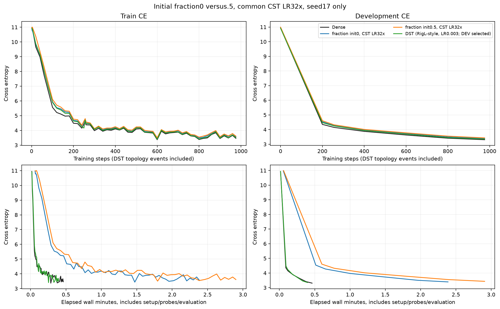
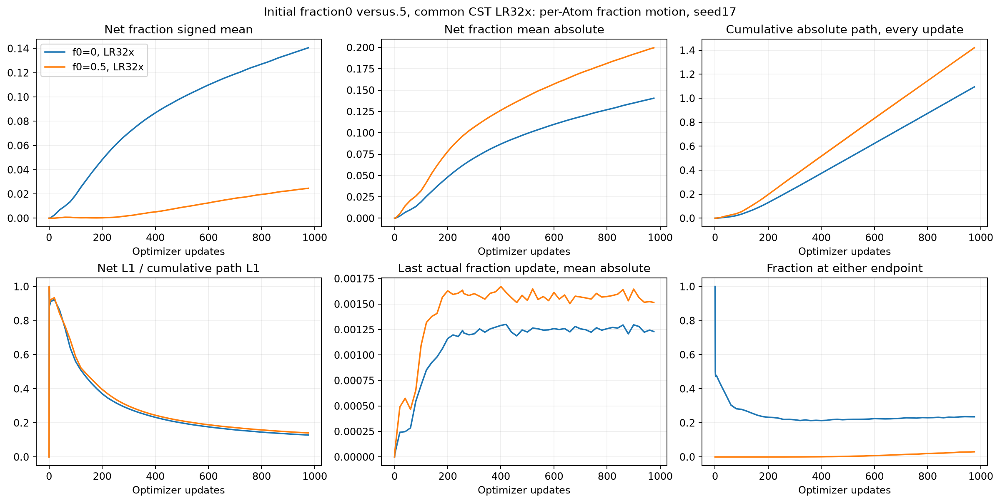
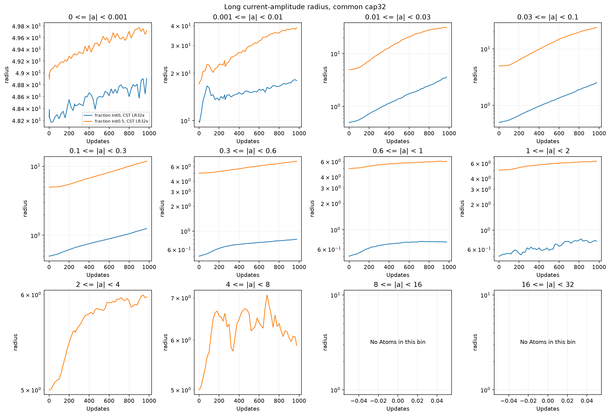
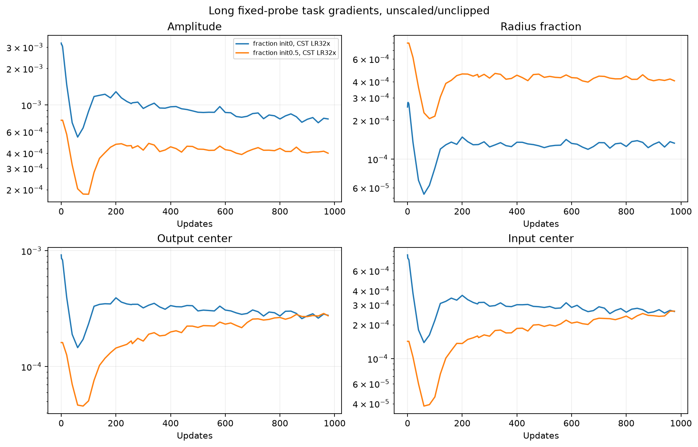
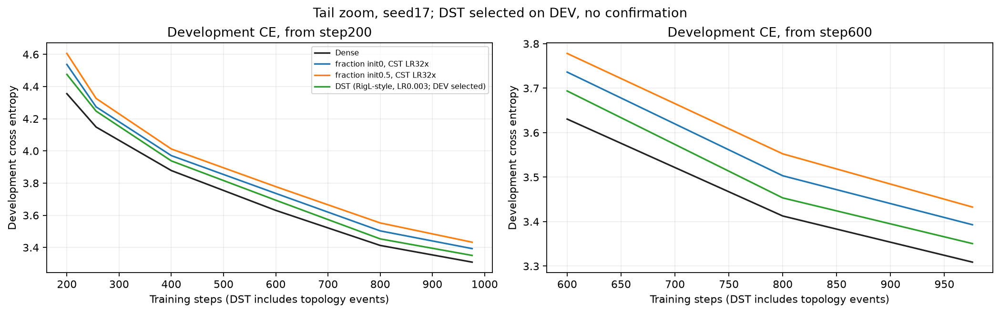

# 初期fraction0と.5の比較：CST全field共通LR32倍

[English (canonical)](ffn-fraction-zero-start-20261109-results.md) | 日本語

2026-11-09、RTX6000 Adaで完了。976更新のDEV CEは初期fraction0が
3.393048、.5が3.432772、Denseが3.308982。
0−.5の差は-0.039724、0−Denseは+0.084067。開発用1seedのみで、収束・非劣性・
普遍的な最適初期化の結論ではありません。

今回、0スタートで損失が0.039724改善し、更新中央値も159.16msから127.33msへ
約20%短縮、allocated peakはほぼ同程度でした。平均半径は初期1.2667から1.9032、
.5スタートは5.2079から10.4160へ変化。0スタートの約76.47%のAtomは最終fractionが
正で、平均は0から.14055へ動きました。全体が固定されるわけではありません。半径・
振幅初期化・その後の最適化が一緒に変わるため、半径だけの因果やDense同等を
示した結果ではありません。

## 条件と32倍の意味

[計画](ffn-fraction-zero-start-20261109.ja.md)：幅512、pre-norm4ブロック、8heads、
context128、拡大率4、FFN8行列すべて各8192Atoms。Attention・embedding・共有語彙
headはDenseです。CSTの振幅・入力中心・出力中心・radius_fractionの4fieldすべてが
基準LRの32倍、最大.0096。他のParameter(FFN bias・norm・Attention・embedding・
headを含む)は基準LR3e-4のまま。同じscheduleを1回適用し、32倍は固定絶対LRではありません。

初期fraction0/.5、tau=.003、振幅上限32、半径[.5,50]、M8、levels_wide_amplitude、
公開moment初期化(up分散.0004/down.00005)。同じseedで中心と振幅の乱数を固定し、
initializerがfractionごとに振幅を計算するため、初期Parameter hashは異なります。
振幅を固定してfractionだけ変えた比較ではなく、初期化設定全体の比較です。
probe/output RMS校正は行っていません。

seed17、976更新=999424tokens、batch2×128×蓄積4、同じtoken順、
256更新=262144tokensでも観測。AdamW betas(.9,.95)、eps1e-8、decay0、global clip1、
warmup200、共通20M-token予定長。DEV8192targetsのみ、confirmation未使用。
PyTorch2.9.1+cu128、CUDA12.8、NVIDIA RTX6000 Ada Generation、TF32off、eager。
Parameter・moment・physical rowはFP32、写像内部はFP64です。

## 学習・時間・メモリ

| Arm | DEV CE256 | DEV CE976 | Update median ms | Allocated / reserved peak MiB |
|---|---:|---:|---:|---:|
| Dense | 4.1484 | 3.3090 | 21.62 | 952.66 / 1168 |
| Initial fraction0 | 4.2737 | 3.3930 | 127.33 | 975.53 / 1300 |
| Initial fraction0.5 | 4.3262 | 3.4328 | 159.16 | 975.65 / 1302 |


時間は蓄積・転送・forward/backward・clip・optimizerを含み、zero_grad・LR設定・
probe・評価・observerを除きます。準備/wall時間、Parameter数、精密値は
[JSON](ffn-fraction-zero-start-20261109-results.json)に記録。同一jobの逐次測定で
順序反転はなく、速度比較は探索的です。allocated/reservedはPyTorch peakであり、
process全体・Graphではありません。学習後の半径で処理量も変わります。過去の.5/Denseは
参考に留め、今回のsourceで両対照を新規実行しました。

## fraction・半径の動き

| Initial fraction | Final fraction mean | Mean absolute net Δfraction | Final radius mean | At lower / upper endpoint |
|---|---:|---:|---:|---:|
| 0 | 0.14055 | 0.14055 | 1.9032 | 23.534% / 0.012% |
| 0.5 | 0.52468 | 0.19962 | 10.4160 | 1.114% / 1.891% |


fractionはsigmoidを介さず直接学習します。初期0では範囲内へ増える更新は可能で、
減る更新は下限で止まります。下限にあるだけでは適切な制約解と有用な更新の阻害は区別
できません。非ゼロ勾配やLRへの応答だけでは条件数やDense差の原因は特定できません。
初期fractionは半径写像と振幅初期化の両方に影響します。初期/最終activation RMSは
観測し、校正はしていません。

毎更新で各Atomの更新/pathを集計し、個別の全時系列は保存していません。半径は恒等式
r(a_t,f_t)-r(a_0,f_0)=[r(a_t,f_t)-r(a_t,f_0)]+[r(a_t,f_0)-r(a_0,f_0)]で分解し、
因果的寄与とは扱いません。Adam提案推定はFP32 momentからFP64で計算した範囲制約・
丸め前の値で、厳密なraw proposal記録ではありません。小振幅・広半径のAtomも含む
平均だけでなく、振幅別の図も確認します。










追加図：

- [adam-fraction-updates](assets/ffn-fraction-zero-start-20261109/adam-fraction-updates.png)
- [long-activation-rms](assets/ffn-fraction-zero-start-20261109/long-activation-rms.png)
- [long-amplitude-radius_fraction](assets/ffn-fraction-zero-start-20261109/long-amplitude-radius_fraction.png)
- [long-fraction_change-layers](assets/ffn-fraction-zero-start-20261109/long-fraction_change-layers.png)
- [long-radius-layers](assets/ffn-fraction-zero-start-20261109/long-radius-layers.png)
- [long-radius_fraction-layers](assets/ffn-fraction-zero-start-20261109/long-radius_fraction-layers.png)
- [radius-update-components](assets/ffn-fraction-zero-start-20261109/radius-update-components.png)

## 正しさ・監査・取得

両設定でconsumerの新規GPU検査に成功。全写像VJP、未完了forward保持の一致、
fraction実更新、serialize後の次のmodel/Adam更新の完全一致を確認しました。
source固定前に、振幅上限が広い場合のresume gateを境界のfraction0にも拡張。
既存operator68検査は全byte・GPU/runtime・hashの一致を条件に再利用。
CPU245検査は184passed/61optional skips、35studyと12registry検査が成功。
失敗条件の再調整・再実行はなく、数値gateは変更していません。

最終/256更新の6checkpointでDEV CEが完全再現。FP32 Adam momentの有限性、
256/976counter、振幅/fraction範囲を確認。学習後up/downの8encoded-row FP64検査で
Y/dX/全Atom微分を従来atol1e-4/rtol4e-3で通過し、最大絶対差は
2.4942748e-06/2.7282641e-06/8.1062317e-06。4時点のobserver net変化もcheckpointから
独立再現。compact28ファイル、source1885ファイルを取得検証し、
remote checkpoint hash9個を検証。所有する学習/controller
5PIDと監査2PIDは終了。最終GPUはNVIDIA RTX 6000 Ada Generation, 0 %, 39 MiB。
checkpointはremote保全、compactと固定sourceはlocal取得済み。RMS校正実験・
confirmation評価・公開default採用・追加実験の自動実行はしていません。

## 来歴・再現

証拠はCST_RESEARCH_EVIDENCE_ROOT配下の`ffn-fraction-zero-start-6000ada-20261109-01`。
raw log/checkpointはGit外、JSONにcheckpointと図のhashを記録。学習後の作図コードは
固定consumerと分け、学習sourceは変更・再実行していません。

| Identity | Value |
|---|---|
| operator_commit | `0d277ae6dc0ae14fe515c7559f39535ed0238950` |
| consumer_commit | `46a1d70072ca739ede5f70b86c97e1dd54c6e88a` |
| source_archive_sha256 | `fbf662b6ca8ef9125784a8cf39f14277e619a6467b8ad27e5fb4e16be58b6230` |
| qualification_sha256 | `55bd09b1ffa775d77e59e86b3561da616c3def8da99dcf226a0518443a29182d` |
| compact_archive_sha256 | `d06b94db5a6bf605542d272f341e136e18f958345a1076c2959ac9bb769ff746` |
| data_manifest_sha256 | `5b995103ca95d3c9b62a4e860039683dc734b0a0bb20e232db1b2e45aa690d01` |
| initial_parameter_sha256_fraction0.0 | `479bb6666233e250a4c748ce649d3869f0265b081271b5bcc12d52d0806fdc70` |
| initial_parameter_sha256_fraction0.5 | `75b4271cfe05d9ad4479cfbac3eaa05cae586e8beea4e2a65f1236b687cee634` |
| audit_source_sha256 | `802abf6e2e1c3f8673cf680dd73170d9f044ebdfbe3fe28260b839dbf3114089` |


検証済み証拠(retrieval-integrity.jsonとretrieved/を含む)を復元し、reporting依存を導入すると
図を再生成できます。

```bash
python scripts/plot_ffn_fraction_start.py --run "$CST_RESEARCH_EVIDENCE_ROOT/ffn-fraction-zero-start-6000ada-20261109-01"
python scripts/plot_ffn_fraction_lr.py --run "$CST_RESEARCH_EVIDENCE_ROOT/ffn-fraction-zero-start-6000ada-20261109-01"
```

固定source archive、protocol.json・cases.json・driver.py・launch/receipt・hashに
実行条件を保全。再実行には検証済みtoken dataと承認済みGPU接続が必要です。
別seed・長期学習・別fraction/tau/Atom数/幅は今回の結果の範囲外です。

## 同条件DSTの追加重ね描き、2026-11-09

上の元の学習データは変更していません。学習曲線には[Tau/DST研究](ffn-zero-start-tau-dst-20261109-results.ja.md)の
source/runtime/データ/形/有効予算を照合したTinyStories DSTも追加しました。
DEVで選択した疎重みLR.003、CE3.350667です。Dense保存のRigL-style精度参照であり、
疎実装の効率の証拠ではありません。独立した対照と更新した図のhashは、元の3runの数値と
分けてJSONに記録しています。


