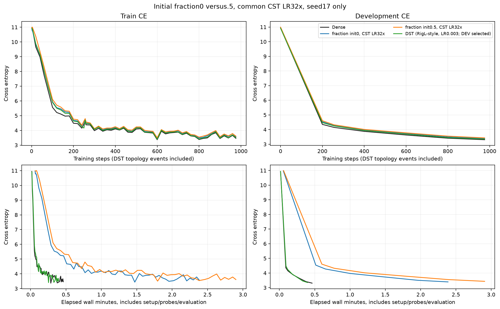
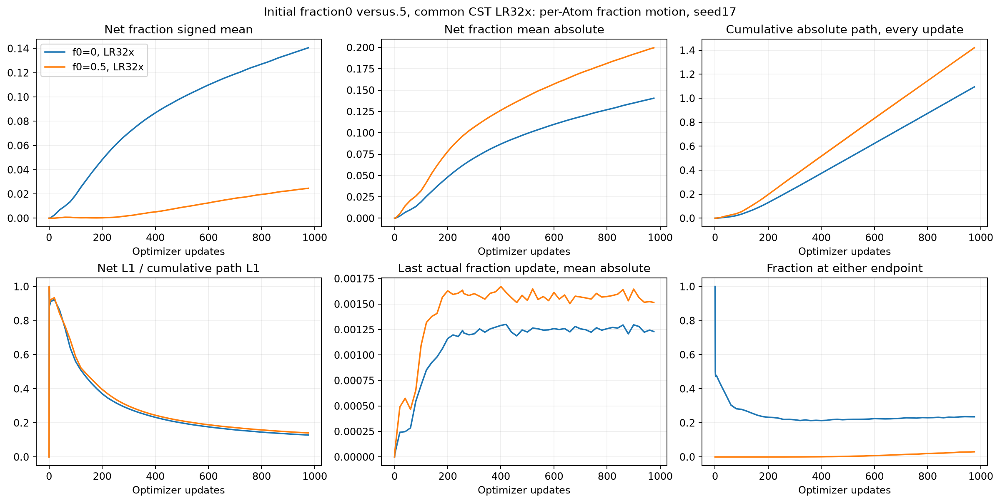
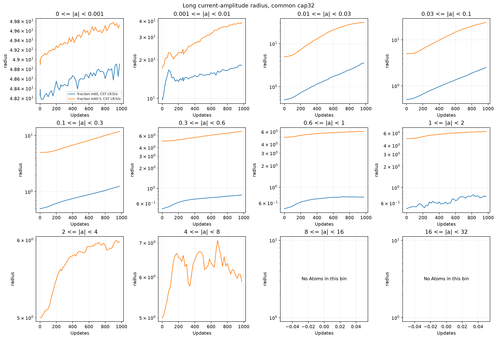
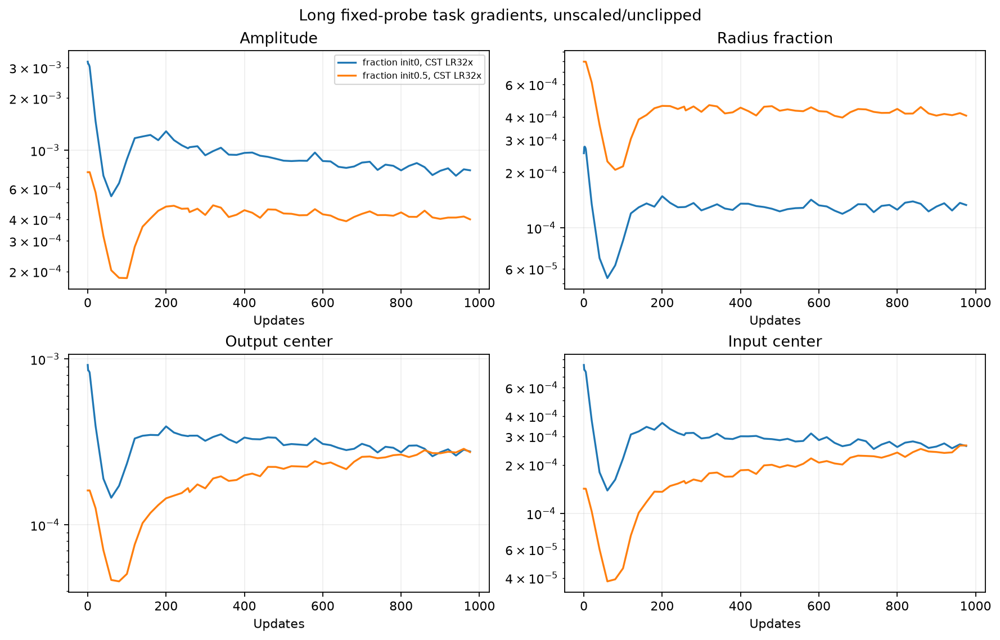
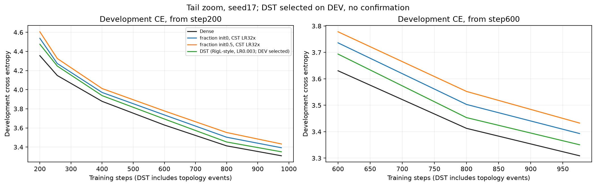

# Initial fraction0 versus.5 with common CST field LR32×

English (canonical) | [日本語](ffn-fraction-zero-start-20261109-results.ja.md)

Completed on RTX 6000 Ada,2026-11-09. DEV CE at 976updates: initial fraction0
3.393048,fraction.5 3.432772,Dense 3.308982.
Fraction0 minus.5=-0.039724; fraction0 minus Dense=+0.084067. One development
seed only,not a convergence/noninferiority or universal initialization claim.

In this pilot,zero start reduced loss by 0.039724 and the scoped update median
from 159.16ms to 127.33ms (about 20% shorter),with similar allocated peak. Mean
radius started 1.2667 and ended 1.9032,versus 5.2079→10.4160 for.5. About 76.47%
of zero-start Atoms end with positive fraction; the mean rises 0→.14055. Thus
zero start does not freeze all fractions. Radius,amplitude initialization and
subsequent optimization change together; this does not isolate a radius-only
mechanism or establish Dense equivalence.

## Conditions and LR meaning

[Protocol](ffn-fraction-zero-start-20261109.md): width 512,four pre-norm blocks,
8heads,context128,expansion4,all 8 FFN maps with 8192 Atoms each. Attention,embedding
and tied vocabulary head remain Dense. All four CST fields(amplitude,input
center,output center,radius_fraction) share 32× base LR,peak .0096. Every non-Atom
Parameter,including FFN bias,norms,attention,embedding and head,keeps base LR 3e-4.
The field rates follow the same schedule once;32× is not a fixed absolute LR.

Initial fraction0/.5,tau=.003,amplitude cap32,radius[.5,50],M8,
levels_wide_amplitude,public moment initialization(up variance.0004/down.00005).
The same named seed fixes center draws and amplitude noise; the initializer
computes amplitudes for each fraction,so exact initial Parameter digests differ.
This compares two complete initialization configurations,not a fraction-only
perturbation with amplitudes frozen. No probe/output-RMS calibration.

Seed 17,976updates=999424tokens,batch2×128×accumulation4,same token order;
256update prefix=262144tokens. AdamW betas(.9,.95),eps1e-8,decay0,global clip1,
200update warmup,common20M-token horizon. DEV8192targets only,confirmation
untouched. PyTorch 2.9.1+cu128,CUDA 12.8,NVIDIA RTX 6000 Ada Generation,TF32 off,
eager; FP32 Parameters,moments and physical rows,FP64 map intermediates.

## Learning,time and memory

| Arm | DEV CE256 | DEV CE976 | Update median ms | Allocated / reserved peak MiB |
|---|---:|---:|---:|---:|
| Dense | 4.1484 | 3.3090 | 21.62 | 952.66 / 1168 |
| Initial fraction0 | 4.2737 | 3.3930 | 127.33 | 975.53 / 1300 |
| Initial fraction0.5 | 4.3262 | 3.4328 | 159.16 | 975.65 / 1302 |


Times include accumulation,transfers,forward/backward,clip and optimizer; exclude
zero_grad,LR setup,probe,evaluation and observer. Setup/wall times,Parameter counts
and full-precision metrics are in [JSON](ffn-fraction-zero-start-20261109-results.json).
Sequential same-job timing without order reversal is exploratory. Allocated and
reserved are PyTorch peaks,not process-wide or Graph memory. Different learned
radii change the workload. Previous.5/Dense results are context; these controls
were freshly repeated under the same new source.

## Fraction and radius motion

| Initial fraction | Final fraction mean | Mean absolute net Δfraction | Final radius mean | At lower / upper endpoint |
|---|---:|---:|---:|---:|
| 0 | 0.14055 | 0.14055 | 1.9032 | 23.534% / 0.012% |
| 0.5 | 0.52468 | 0.19962 | 10.4160 | 1.114% / 1.891% |


The fraction is learned directly,not via a sigmoid. At initial0,projection permits
inward/increasing fraction updates and rejects outward/decreasing ones. A lower
endpoint alone does not distinguish a legitimate constrained solution from blocked
useful updates. Nonzero gradients or LR response alone cannot diagnose conditioning
or prove the cause of the Dense gap. Initial fraction changes both the radius map
and the amplitude initialization procedure; initial/final activation RMS are
observed rather than calibrated.

Actual per-Atom updates/path are reduced every step; complete individual histories
are not stored. Radius components use the algebraic identity
r(a_t,f_t)-r(a_0,f_0)=[r(a_t,f_t)-r(a_t,f_0)]+[r(a_t,f_0)-r(a_0,f_0)],not a causal
training decomposition. Analytic Adam proposals use stored FP32 moments in FP64,
before bounds/rounding,and are not exact raw-proposal traces. Inspect amplitude
bins as well as means,which include broad low-amplitude Atoms.










Additional plots:

- [adam-fraction-updates](assets/ffn-fraction-zero-start-20261109/adam-fraction-updates.png)
- [long-activation-rms](assets/ffn-fraction-zero-start-20261109/long-activation-rms.png)
- [long-amplitude-radius_fraction](assets/ffn-fraction-zero-start-20261109/long-amplitude-radius_fraction.png)
- [long-fraction_change-layers](assets/ffn-fraction-zero-start-20261109/long-fraction_change-layers.png)
- [long-radius-layers](assets/ffn-fraction-zero-start-20261109/long-radius-layers.png)
- [long-radius_fraction-layers](assets/ffn-fraction-zero-start-20261109/long-radius_fraction-layers.png)
- [radius-update-components](assets/ffn-fraction-zero-start-20261109/radius-update-components.png)

## Qualification,audit and retrieval

Both configurations passed fresh full-map VJPs,outstanding-forward equality,
actual fraction motion and exact serialized next model/Adam update,including
fraction0 at the boundary. The resume gate was extended before freezing to cover
all wide-amplitude starts. Operator 68-check evidence was reused only after exact
operator bytes/GPU/runtime/hash parity. CPU 245 tests: 184 passed, 61 optional skips;
35-study registry and 12 targeted registry checks pass. No failed learning arm was
retuned/restarted and numerical gates were unchanged.

All 6 final/prefix checkpoints reproduce DEV exactly,with finite FP32 Adam moments,
256/976 counters and valid amplitude/fraction bounds. Eight trained up/down FP64
encoded-row Y/dX/all-Atom VJPs passed unchanged atol1e-4/rtol4e-3,max absolute
Y/dX/dP=2.4942748e-06/2.7282641e-06/8.1062317e-06. Four observer net-change frames
independently reproduce from checkpoints. Retrieved 28 compact files and
1885 source files;9 remote checkpoint hashes verified.
All 5 training/controller and 2 audit PIDs inactive;
final GPU:NVIDIA RTX 6000 Ada Generation, 0 %, 39 MiB. Checkpoints remain remotely preserved;
compact evidence and frozen source are local. No RMS-calibration run,confirmation
evaluation,public default adoption or automatic further experiment occurred.

## Provenance and reproduction

Job/evidence directory:`ffn-fraction-zero-start-6000ada-20261109-01`,relative to
CST_RESEARCH_EVIDENCE_ROOT. Raw logs/checkpoints remain outside Git. JSON includes
checkpoint and figure hashes. Post-training plotting is separate from the frozen
consumer and does not modify/re-execute training source.

| Identity | Value |
|---|---|
| operator_commit | `0d277ae6dc0ae14fe515c7559f39535ed0238950` |
| consumer_commit | `46a1d70072ca739ede5f70b86c97e1dd54c6e88a` |
| source_archive_sha256 | `fbf662b6ca8ef9125784a8cf39f14277e619a6467b8ad27e5fb4e16be58b6230` |
| qualification_sha256 | `55bd09b1ffa775d77e59e86b3561da616c3def8da99dcf226a0518443a29182d` |
| compact_archive_sha256 | `d06b94db5a6bf605542d272f341e136e18f958345a1076c2959ac9bb769ff746` |
| data_manifest_sha256 | `5b995103ca95d3c9b62a4e860039683dc734b0a0bb20e232db1b2e45aa690d01` |
| initial_parameter_sha256_fraction0.0 | `479bb6666233e250a4c748ce649d3869f0265b081271b5bcc12d52d0806fdc70` |
| initial_parameter_sha256_fraction0.5 | `75b4271cfe05d9ad4479cfbac3eaa05cae586e8beea4e2a65f1236b687cee634` |
| audit_source_sha256 | `802abf6e2e1c3f8673cf680dd73170d9f044ebdfbe3fe28260b839dbf3114089` |


Restore verified compact evidence with retrieval-integrity.json and retrieved/;
install reporting dependencies,then regenerate plots:

```bash
python scripts/plot_ffn_fraction_start.py --run "$CST_RESEARCH_EVIDENCE_ROOT/ffn-fraction-zero-start-6000ada-20261109-01"
python scripts/plot_ffn_fraction_lr.py --run "$CST_RESEARCH_EVIDENCE_ROOT/ffn-fraction-zero-start-6000ada-20261109-01"
```

Frozen source archive,protocol.json,cases.json,driver.py,launch/receipt and hashes
retain the exact recipe. Re-execution requires verified token data and approved
GPU access. More seeds,longer training,other fractions,tau,Atom counts and widths
are outside this result.

## Post hoc matched DST overlay,2026-11-09

The original learning data above remain unchanged. The learning figure now also
includes the source/runtime/data/shape/active-budget-matched TinyStories DST
reference from the [tau/DST study](ffn-zero-start-tau-dst-20261109-results.md):
DEV-selected sparse LR.003,CE3.350667. It is a dense-storage RigL-style accuracy
reference,not sparse efficiency evidence. JSON records the independent reference
and updated figure hashes separately from the original three-run metrics.


