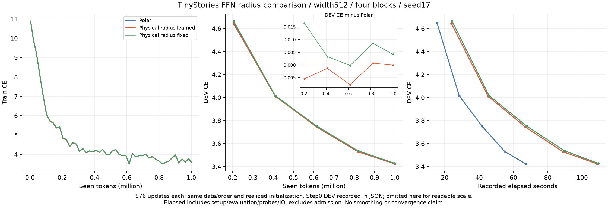
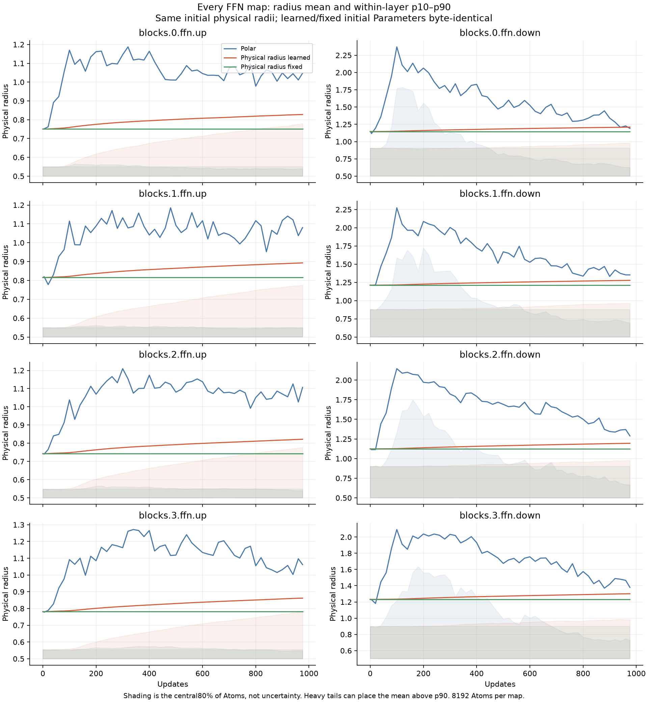
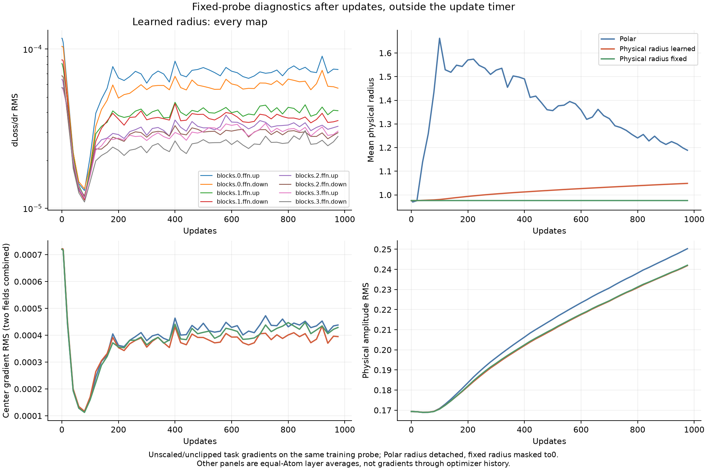

# 独立半径の勾配学習：RTX6000 Ada FFNの結果

[English（正本）](ffn-independent-radius-20261108-results.md) | 日本語

3条件ともseed17、幅512・4ブロック、FFNの8射影・各8192Atomで
976更新・999424tokenを完了した。Attention、embedding、共有語彙出力はDense。
[実行前に固定したprotocol](ffn-independent-radius-20261108.ja.md)。

| Arm | DEV CE | DEV PPL | Median update ms | Allocated / reserved MiB | Mean radius: start → end | Final radius=0.5 |
| --- | ---: | ---: | ---: | ---: | ---: | ---: |
| Polar | 3.42440987 | 30.7045 | 59.50 | 958.18 / 1280 | 0.975274 → 1.188574 | 0.00% |
| Physical radius learned | 3.42437524 | 30.7035 | 101.85 | 958.12 / 1282 | 0.975274 → 1.048464 | 12.59% |
| Physical radius fixed | 3.42864565 | 30.8349 | 102.90 | 958.12 / 1282 | 0.975274 → 0.975274 | 0.00% |

直接半径を学習する条件は、この予備比較でPolarとほぼ同じDEV CEだった
（差−0.00003463）。物理表現で半径を固定する対照より0.00427041低い。
1seed・短期予算の観測であり、統計的改善、非劣性、収束の証明ではない。
以前の同じrecipeのDense参考値は3.30898162だが、今回はDenseを再実行していない。
今回の半径変更でその差が解消したわけではない。

## 半径と勾配に何が起きたか

全FFN射影で半径の損失勾配が非ゼロとなり、半径が変化した。物理半径65536個すべての
最終保存値は初期値と異なるが、平均絶対変化は0.09169738に留まる。すべてが大きく
動いたことや、大きな半径が速く縮められることを示すものではない。
平均は0.975274から1.048464へ広がり、一方12.586975%が下限0.5に達した。
一律に縮小したわけではない。最終時点で上限50に厳密一致するAtomは0だったが、
最大49.999905のように境界近くのAtomは存在する。
固定対照の半径は完全に不変で、半径のAdam momentも厳密に0を保った。

同じ固定probeでの半径勾配RMSの層平均は、初期7.92235e-5、最終4.11239e-5。
最終時点の8射影すべてで非ゼロだった。更新後に測った、clip・蓄積scale前の
probe勾配であり、蓄積した学習勾配ではない。Polarの半径は損失からdetachし、
fixedは半径勾配をmaskするため、未定義・0は設計上のもの。
中心座標の勾配RMSも描いたが、毎更新の中心移動履歴は記録していない。
補助CPU分析の中心変位は初期・最終間の正味変位であり、速度や経路全体とは区別する。

帯は層内のp10〜p90で、信頼区間ではない。裾の大きいAtomにより平均がp90を超えることも
あるので、平均だけでは大多数の形状を判断できない。Polarは振幅・activityに半径が
依存し、推移の変動も大きいが、今回はその違いが大きなDEV差にはつながらなかった。

## 解釈と数値的な範囲

learned/fixedは物理表現、通常のAdamW、初期tensor、完全なnative半径VJPを共通にし、
fixedの半径勾配だけをclip前に0にする。この比較が半径学習の切り分けになる。
Polar対physicalではパラメータ・更新の幾何も変わり、学習中の振幅依存envelope結合も
外れるため、半径勾配だけの比較ではない。通常Parameterは初期値がbyte一致し、
learned/fixedのAtom Parameterとlogitも完全一致した。Polarとの初期logitの
最大絶対誤差は1.66893e-6（検査基準atol3e-5/rtol3e-4）。

独立半径は直接のParameterで、forward内のclampはない。AdamW後に半径[0.5,50]、
振幅[-1,1]へ射影し、最終の全物理値がこの境界内であることを確認した。
制約あり・単一LRの比較なので、無制約の最適半径や最良の半径LRは特定していない。
損失勾配で半径を更新して今回の学習を保てることは確認できたが、追加の座標移動制御が
必要であることを示した結果ではない。

共有半径は入出力両factorに効き、dLoss/drは両方の寄与を含む。別の非公開Planで、
保存するmoments/responsesはFP32のまま、安定したprofile係数・微分の構成だけを
thread内の一時FP64で行ってcastする。FP64 response bufferは追加しておらず、
公開defaultも変えていない。[勾配と更新則の数式整理](radius-coordinate-gradient-discussion-20261108.ja.md)
に半径微分を通すPolar拡張案を記録したが、その拡張・移動量依存更新は未実行。
現在のPolarは半径方向のoptimizer提案を除くため、backward項を追加するだけでは
通常のq学習にはならない。

時間はwarmup後966回の同期した完全更新の中央値。転送、蓄積4回のforward/backward、
clip、AdamW、末尾同期を含み、zero_grad/LR設定、冒頭同期、probe、評価、IOは除く。
wall timeはsetup・評価・probe・IOを含み、資格検査は除く。
メモリはallocatorの学習時ピークで、他のprocess/runtime領域は含まない。
実行順はPolar→learned→fixedに固定した。この実装のphysical更新時間はPolarの約1.71倍。
fixedでも完全な半径微分を計算してからmaskしており、固定半径用の速度最適化ではない。
以前の異なる観測runtimeの時間と置き換えて比較しない。

## 検証と再現

ローカルconsumer検査は232件中171成功・61skip、演算子の対象CPU検査は14成功・
CUDA30skip。Ada試行04で最終演算子のCPU/CUDA回帰231件が成功した。
試行05はconsumerのreceipt組立だけを修正した後、同一演算子・同一runtimeの231件と
native buildをhash確認して再利用し、3条件のモデル検査は新規に行った。
独立Gauss求積、実256非連続行・両FFN形状の全8192Atomに対するY/dX/全4成分VJP、
同じgraphの再backward、全モデル初期値・更新、厳密な実行許可、次の1更新の復元に合格。

学習後も全3checkpointでDEVの厳密な再計算、全射影の独立CPU参照VJP、
固定probeとcheckpointの一致、固定半径/moment、独立2回の復元から次の更新と
optimizer stateの一致を確認した。追加の読み取り専用CPU分析でも、checkpointを変えずに
最終境界・変位を検査した。confirmation・生成は評価していない。

Operator `88c2e8a7c4aa312f4f096c5169d712ace49ac979`; consumer
`40df1a94349fccb5134413a5659eed69c83f108c`. Actual NVIDIA RTX6000 Ada48GB,
Torch2.9.1+cu128, CUDA12.8. Job: `ffn-independent-radius-6000ada-20261108-05`.
Request SHA256: `e577067d8b4ba697c2bce409b040e04576685cbfaaef4780aa8e2b6330ec595a`.
Source archive SHA256: `e1847bc82a8ac9ccf1ca002fcbad4ba341cd4e48fced0219ed74d47f3b4b4812`.
Compact archive SHA256: `dcae47ec745b72c548b35c4cccdf849f6de103d48b018eadba2994263d6b8c3f`.
38 compact files and1758 source files hash-verified;10 recorded controller/worker
PIDs inactive. Checkpoints/data/source/native builds remain on the cluster;
checkpoint hashes and compact logs/curves/receipts/audits were retrieved.

source snapshotは変更しない。固定commitとtoken manifestを使い、まず
`python -m cst_research.experiments.ffn_radius_qualification --output QUAL` を実行する。
次に[protocolにある既存learnerコマンド](ffn-independent-radius-20261108.ja.md)に、
各条件のhash付き `QUAL/{polar,learned,fixed}.json` を渡す。
controllerコマンド、runtime、script/source/checkpoint hash、生のsampleはignoredの
compact evidenceに保持。[集約JSON](ffn-independent-radius-20261108-results.json)には
全学習点、各層の初期・最終統計、55点の診断集計を残した。
実装は研究PR35・演算子PR155上にあり、mergeや公開default採用は行っていない。

失敗した凍結試行4件も別々に保全し、どれもlearner開始前だった。
それらの記録された17processも全て非稼働を確認した。最初の3件は実装・検査経路の
問題であり、学習の負の結果ではない。試行04は数値回帰の成功記録を上記のとおり再利用し、
receipt組立の失敗自体も残している。

| Attempt | Prelearning stop | Verified compact archive SHA256 |
| --- | --- | --- |
| 01 | FP32 derivative scratch type; Polar-only test baseline | `39f85747f91aa63bc32f5572203e89ec2fb6f9d4ffaf96edc7457db3f6a320a5` |
| 02 | CPU-only oracle called on CUDA | `5958f0dd67b9dcf6a0f04207acb29599222ac509f79acbf2e7a03483e76b1a8d` |
| 03 | FP32 helpers assumed Polar coordinate fields | `dd710f9cff4b5038aee64cbadb2c4a1a0a2d86a1cf253ac9930e6d17b3837b7b` |
| 04 | Duplicate result-metadata keyword after numerical gates passed | `0f26e2239f0c901f188d016586b298f22bf4eb3e86f3049f8adbc9ea75421293` |
