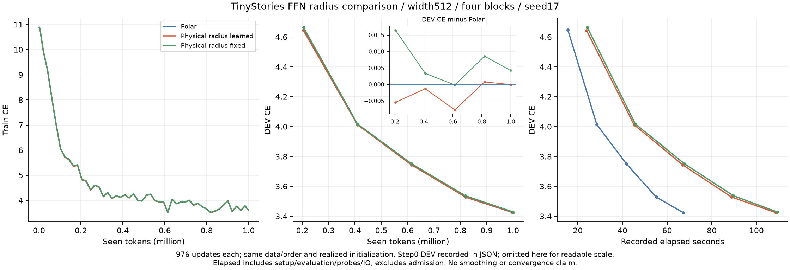
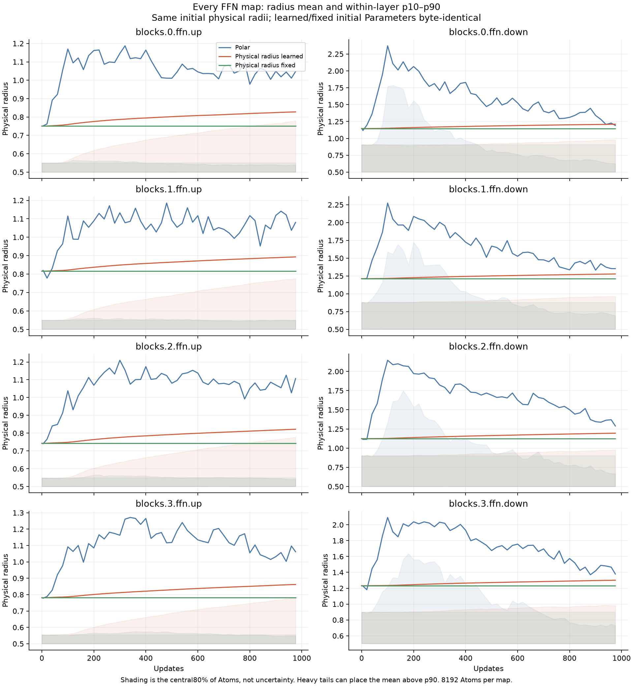
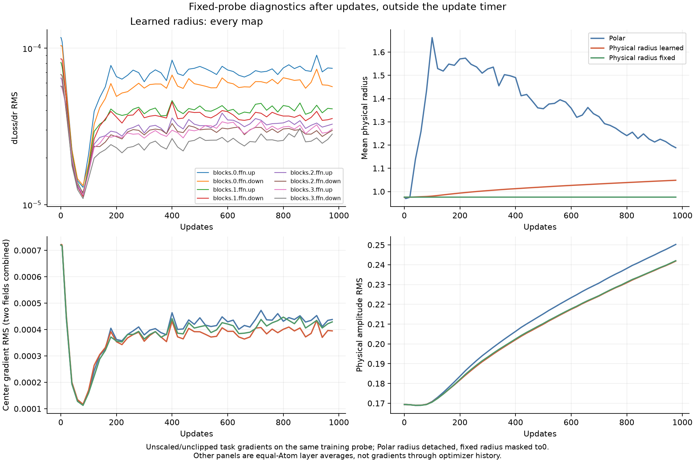

# Independent radius learning: FFN results on RTX6000 Ada

English (canonical) | [日本語](ffn-independent-radius-20261108-results.ja.md)

All three arms completed976 updates/999424 tokens, seed17, width512, four blocks,
eight FFN CST maps with8192 Atoms each. Attention, embeddings and tied vocabulary
output remained Dense. [Prospective protocol](ffn-independent-radius-20261108.md).

| Arm | DEV CE | DEV PPL | Median update ms | Allocated / reserved MiB | Mean radius: start → end | Final radius=0.5 |
| --- | ---: | ---: | ---: | ---: | ---: | ---: |
| Polar | 3.42440987 | 30.7045 | 59.50 | 958.18 / 1280 | 0.975274 → 1.188574 | 0.00% |
| Physical radius learned | 3.42437524 | 30.7035 | 101.85 | 958.12 / 1282 | 0.975274 → 1.048464 | 12.59% |
| Physical radius fixed | 3.42864565 | 30.8349 | 102.90 | 958.12 / 1282 | 0.975274 → 0.975274 | 0.00% |

The direct-radius arm reached essentially the same DEV CE as Polar in this
pilot (difference−0.00003463), and0.00427041 lower than the physical fixed-radius
control. This is an observation from one seed and a short budget, not a
statistical improvement, noninferiority or convergence claim. The historical
Dense reference reached3.30898162 under the older matched recipe; no new Dense
run was done, and this radius change has not removed that gap.

## What happened to radius and gradients

Every FFN map had nonzero task-radius gradients and changed radii. All65536
physical radii differ from their initial stored values at the endpoint, but the
mean absolute change is only0.09169738; this is not evidence that every radius
moved substantially or that large radii can rapidly narrow. The mean grew from
0.975274 to1.048464 while12.586975% reached the lower bound0.5. Radius therefore
did not uniformly shrink. No Atom was exactly at the upper bound50 at the end;
near-boundary Atoms still exist (maximum49.999905). The frozen arm's radii and
radius Adam moments remained exactly unchanged/zero.

Equal-Atom layer-averaged radius-gradient RMS on the fixed probe was
7.92235e-5 initially and4.11239e-5 finally. All eight final layer RMS values were
nonzero. These are unscaled/unclipped probe gradients measured after updates,
not accumulated training gradients. Polar radius is detached from task loss;
fixed radius gradients are masked, so their absence/zero is by design. Center
field gradient RMS is also plotted, but no per-step center-motion history was
collected. The supplemental CPU analysis records endpoint net displacement,
which must not be interpreted as velocity or a full trajectory.

The bands are within-layer p10–p90, not confidence intervals. Heavy tails can
put the mean above p90. Mean radius alone can therefore hide the bulk geometry.
Polar's radius depends on amplitude and activity and is visibly more variable;
this shape difference did not translate into a material DEV difference here.

## Interpretation and numerical scope

Learned versus fixed uses the same physical representation, ordinary AdamW,
initial tensors and full native radius VJP, with only the fixed radius gradient
masked before clipping. This is the radius-learning control. Polar versus
physical additionally changes the parameter/update geometry and removes the
ongoing amplitude–radius envelope coupling; it is not a pure radius-gradient
ablation. Initial ordinary Parameters were byte-identical, learned/fixed Atom
Parameters and logits were identical, and the Polar/physical initial logits
agreed to maximum1.66893e-6 absolute error (gate3e-5/3e-4).

Independent radius is a direct Parameter with no forward clamp. AdamW updates
are projected afterward to radius[0.5,50] and amplitude[-1,1]. All endpoint
physical values passed these bounds. This constrained, single-LR experiment
does not identify unrestricted optimal radii or the best radius LR. It shows
that the task gradient can update radius and sustain this pilot's learning;
it does not establish that an added coordinate-motion rule is needed.

The same physical radius affects both factors; dLoss/dr includes both. A
separate private Plan keeps retained moments/responses FP32 and evaluates
stable profile coefficients/derivatives in thread-local FP64 before casting.
No FP64 response buffers were added, and no public default changed. See
[the gradient/update equations](radius-coordinate-gradient-discussion-20261108.md)
for a proposed radius-live Polar extension. That extension and motion-dependent
updates were not run. Current Polar projects radial optimizer proposals away,
so adding a backward term alone would not implement ordinary q learning.

Time is the median of966 post-warmup synchronized full updates including
transfer, four accumulated forward/backwards, clipping, AdamW and final sync.
It excludes zero_grad/LR assignment, initial synchronization, probes,
evaluation and IO. Recorded wall time includes setup/evaluation/probes/IO,
not qualification. Allocator training peaks exclude other process/runtime
storage. Order was fixed Polar→learned→fixed. The physical path is about1.71x
Polar's update time here; the fixed control also computes then masks the full
radius derivative. It is not an optimized frozen-radius implementation. Do not
substitute these times for earlier pilots with different observed runtimes.

## Verification and reproduction

Local consumer suite:232 tests,171 passed/61 skipped; targeted operator CPU
checks14 passed/30 CUDA skipped. Ada executed231 CPU/CUDA regressions on the
final operator source in attempt04. Attempt05 hash-verified and reused that
same-operator/same-runtime regression record and native build after fixing only
consumer receipt packing, then ran fresh three-mode qualifications. Independent
Gauss quadrature, actual256-row/noncontiguous all-8192-Atom Y/dX/all-four-field
VJPs for both FFN shapes, retained backward, full-model initialization/update,
strict admission and serialized next-task-step checks all passed.

All three trained checkpoints passed exact DEV recomputation, every trained
map's independent CPU-reference VJPs, fixed-probe/checkpoint agreement,
fixed-radius/moment checks and two-restore parameter/optimizer next-step parity.
A post hoc read-only CPU check also verified all endpoint bounds/displacements
without changing checkpoints. Confirmation and generation were not evaluated.

Operator `88c2e8a7c4aa312f4f096c5169d712ace49ac979`; consumer
`40df1a94349fccb5134413a5659eed69c83f108c`. Actual NVIDIA RTX6000 Ada48GB,
Torch2.9.1+cu128, CUDA12.8. Job: `ffn-independent-radius-6000ada-20261108-05`.
Request SHA256: `e577067d8b4ba697c2bce409b040e04576685cbfaaef4780aa8e2b6330ec595a`.
Source archive SHA256: `e1847bc82a8ac9ccf1ca002fcbad4ba341cd4e48fced0219ed74d47f3b4b4812`.
Compact archive SHA256: `dcae47ec745b72c548b35c4cccdf849f6de103d48b018eadba2994263d6b8c3f`.
38 compact files and1758 source files hash-verified;10 recorded controller/worker
PIDs inactive. Checkpoints/data/source/native builds remain on the cluster;
checkpoint hashes and compact logs/curves/receipts/audits were retrieved.

The fresh source snapshot is immutable. Reproduce with the frozen commits and
verified token manifest, first run
`python -m cst_research.experiments.ffn_radius_qualification --output QUAL`, then
use the [protocol's existing learner command](ffn-independent-radius-20261108.md)
for each mode with its hashed `QUAL/{polar,learned,fixed}.json` admission.
Controller commands, runtime, script/source/checkpoint hashes and raw samples
are in the ignored compact evidence; the [aggregate JSON](ffn-independent-radius-20261108-results.json)
retains all recorded learning points, per-layer endpoint statistics and
55-point diagnostic aggregates. The source implementation is on research
PR35 and operator PR155; neither was merged or adopted as a public default.

Four failed frozen attempts are preserved separately; none started a learner,
and all17 recorded processes from those attempts were verified inactive. The
first three failures were implementation/test-admission issues, not negative
learning results. Attempt04's passed numerical regression evidence was reused
as described above, while its receipt-packing failure remains recorded.

| Attempt | Prelearning stop | Verified compact archive SHA256 |
| --- | --- | --- |
| 01 | FP32 derivative scratch type; Polar-only test baseline | `39f85747f91aa63bc32f5572203e89ec2fb6f9d4ffaf96edc7457db3f6a320a5` |
| 02 | CPU-only oracle called on CUDA | `5958f0dd67b9dcf6a0f04207acb29599222ac509f79acbf2e7a03483e76b1a8d` |
| 03 | FP32 helpers assumed Polar coordinate fields | `dd710f9cff4b5038aee64cbadb2c4a1a0a2d86a1cf253ac9930e6d17b3837b7b` |
| 04 | Duplicate result-metadata keyword after numerical gates passed | `0f26e2239f0c901f188d016586b298f22bf4eb3e86f3049f8adbc9ea75421293` |
