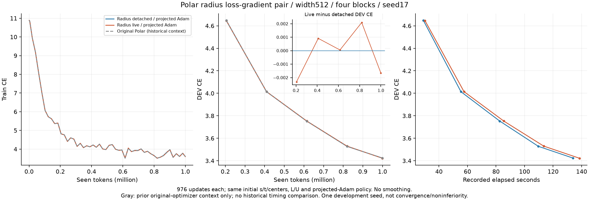
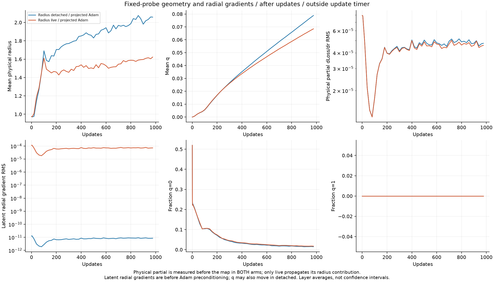
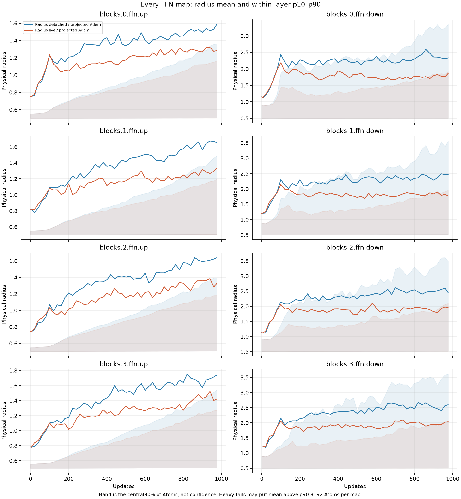

# Polar半径の連鎖律：FFNの同条件比較結果

[English（正本）](ffn-polar-radius-gradient-20261108-results.md) | 日本語

両条件ともseed17、幅512・4ブロック、FFN8射影・各8192Atomで
976更新・999424tokenを完了した。初期Parameterとlogitはbyte一致した。
[実行前に固定したprotocol](ffn-polar-radius-gradient-20261108.ja.md)。

| Radius loss gradient | Final DEV CE | DEV PPL | Final mean radius | Final mean q | Median update ms | Allocated / reserved MiB |
| --- | ---: | ---: | ---: | ---: | ---: | ---: |
| polar_detached | 3.42403589 | 30.6930 | 2.058201 | 0.078821 | 125.74 | 969.05 / 1294 |
| polar_live | 3.42238586 | 30.6424 | 1.622871 | 0.068468 | 130.14 | 985.51 / 1314 |

最終DEV CEの「あり−なし」は−0.00165004だった。学習曲線はほぼ重なり、途中のDEV差は
正負が入れ替わる。1seedの開発観測であり、一貫した精度改善、非劣性、収束、最適な
半径policyを示すものではない。

灰色の従来Polarは別optimizerを使った過去の参考曲線で、一次対照ではない。
別に検証済みのcohortで3.42440987だった。従来Polarと今回のliveだけを比較すると、
backwardと更新則の変更が混ざる。過去の時間は混ぜず、新しいDense・confirmation・
生成も実行していない。

## 半径の勾配がlatentの半径方向へ届いた

最後の固定probeで、latent半径方向の勾配RMSの層平均は、detachで8.56968e-12、
完全な微分を通すliveで7.20069e-5だった。liveの全8射影で非ゼロ。
物理偏微分dLoss/dr自体は両条件で非ゼロ（層平均RMS4.76321e-5/4.58504e-5）だが、
detachはその上流で意図的に止めている。t成分の勾配は物理半径の微分とは区別する。

最終の平均qはdetach/liveで0.078821/0.068468、平均物理半径は2.058201/1.622871。
初期0.975274からは両方広がっており、liveがなし側より狭いのであって、初期から
一律に縮んだわけではない。全FFN射影でliveの最終平均半径が対応するdetachより小さい。
detachのqは固定ではない。生の損失勾配が接線方向でも、成分ごとのAdamの
preconditioningとannulus射影によりqは動き得る。図の半径方向勾配はAdamとclipの前。

公称初期q0でも、FP32のs/t二乗和が1の周りに丸められ、実保存値の平均は4.94e-9。
厳密なq=0の割合は丸めに依存し、許容差つきで境界付近にいる割合とは異なる。
記録したprobeで厳密なq1のAtomは0。帯は層内p10〜p90で、信頼区間ではない。
大きな裾により平均がp90を超える場合もある。
55地点の同じ固定学習batchを測っており、中心の速度や移動経路全体は示していない。

## 実装と精度形式

研究用wrapperが元のPolar s/t/中心Parameterを所有し、物理Tensorへ写像して、
公開LinearBinding/Dispatcherから検証済みの物理半径CUDA Planを呼ぶ。
新しいCUDA kernelや公開Polar parameterization/defaultは追加していない。
L/Uと対数半径の値は従来のまま。liveはL/Uの振幅依存とqの半径方向依存の両方を微分し、
q0/q1に内向きのJacobianを明示する。値の補正でforwardを一致させながら制約内の
微分を与えるものであり、clamp角の無制約な中央微分ではない。

両条件とも通常のCartesian AdamW後に1<=norm(s,t)<=2へ射影する
（FP32保存の許容差5e-7）。従来の接線/activity更新とは異なる。
半径正則化・activity clockは使わず、射影によるmomentのtransportもしない。
Attention、embedding、共有語彙出力はDense。データ・順序・初期値・Atom LR16倍・
20M-token horizon・batch/蓄積・976更新を揃え、HPOやseed選択はしていない。

精度形式の明確化：ParameterとLinear入出力はFP32・TF32無効。
研究用Python写像はFP64で計算して物理TensorをFP32へcastし、eager autogradは
FP64の写像中間値を保存し得る。物理CUDAのZ/H/G response保存はFP32のまま。
したがって全計算FP32の最適化実装・production性能の結果ではない。
これは凍結sourceの説明であり、sourceや数値許容差を変更したものではない。
今回のliveは更新中央値が3.50%、peak allocatedが16.46MiB増えた。
functional dispatch、Python写像、射影の同期も含み、原因別の速度寄与はprofileしていない。

時間はwarmup後966回の同期した完全更新の中央値。転送、蓄積4回のforward/backward、
clip、AdamW/射影、末尾同期を含み、zero_grad/LR設定、冒頭同期、診断・評価・IOは除く。
wall timeにはsetup・評価・probe・IOを含み、資格検査は除く。
メモリはallocatorの学習時ピークで、process全体ではない。
固定順detach→liveであり、独立したhardware反復ではない。

## 検査・監査と再現

CPU検査234件中173成功・61skip、registry12件成功、29studyの宣言が有効。
torchcstの数値sourceは変更せず、全演算子fileとruntimeの一致を確認したうえで、
回帰231件とnative buildを再利用した。合成写像のGauss求積（微分の最大誤差5.89e-15）、
中央差分（1.50e-9）、FP32/FP64のq0/q1を含むCPU/GPU写像・勾配、
両実256行FFN形状・全8192AtomのY/dX/全4成分VJP、再backward、モデル初期値の
完全一致、完全なタスク更新の復元は新規に検査した。

強制GCなしの完全backward32回でallocatedの幅はdetach3.875MiB/live3.5MiBで、
事前固定した128MiB基準に収まった。両学習後checkpointでDEVの厳密な再計算、
全8wrapperのVJP、最終probeの一致、annulus制約、独立2回復元から次の
タスクParameter/Adam stateの完全一致を確認した。監査でcheckpoint本体は変更していない。

Operator `88c2e8a7c4aa312f4f096c5169d712ace49ac979`; consumer
`99a1d033d19c2c3b6285cef46dd10a81cfe7b651`. Actual NVIDIA RTX6000 Ada48GB,
Torch2.9.1+cu128,CUDA12.8. Job `ffn-polar-radius-gradient-6000ada-20261108-01`.
Request SHA256 `837c5d917716da25d83809cfb6e7f60ab7d526bb592906478624db4446b7a890`.
Source archive SHA256 `6fba897e4fda75d4cfca1b29ecbab2eae038b83c4de5dc3652812ccee31d19d7`.
Compact archive SHA256 `c333107b820bd9dd4e1de4d8ab7a680b3999356a5157fd91649a16dc765db853`.
29 compact files and1775 source files independently hash-verified;8 recorded
controller/worker PIDs inactive. Checkpoints/data/source/native builds remain
on the cluster, with transported checkpoint hashes. No failed attempt or
learner restart occurred in this pair.

固定commitとprotocolのtoken manifestを使い、まず
`python -m cst_research.experiments.ffn_polar_radius_qualification --output QUAL`
を実行する。その後、hash付き `QUAL/polar_detached.json` と `QUAL/polar_live.json`
を既存learnerに渡す。controllerコマンド、runtime、script/source/binary/checkpoint
hashと生の時間/probeはignoredのcompact evidenceに保全する。
[集約JSON](ffn-polar-radius-gradient-20261108-results.json)に全学習点、55地点の診断、
層ごとの初期・最終統計を残した。[数式整理](radius-coordinate-gradient-discussion-20261108.ja.md)と
CPU連鎖律プログラムでは、以前の代数検査と今回のLM実行を区別する。

完全な連鎖律は研究用の選択肢として保全する価値がある。
公開Polarのdefault変更や、新しい座標移動依存の半径則を採用する根拠にはまだ足りない。
追加のlearnerは動いていない。
