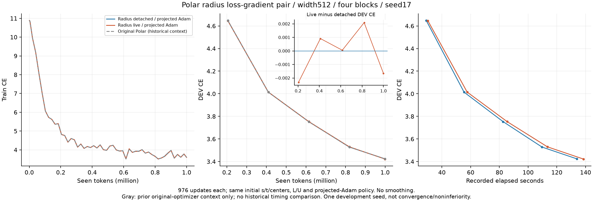
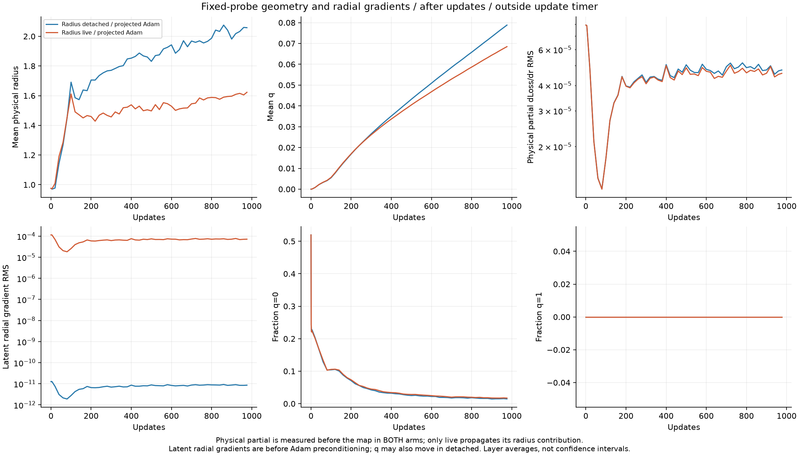
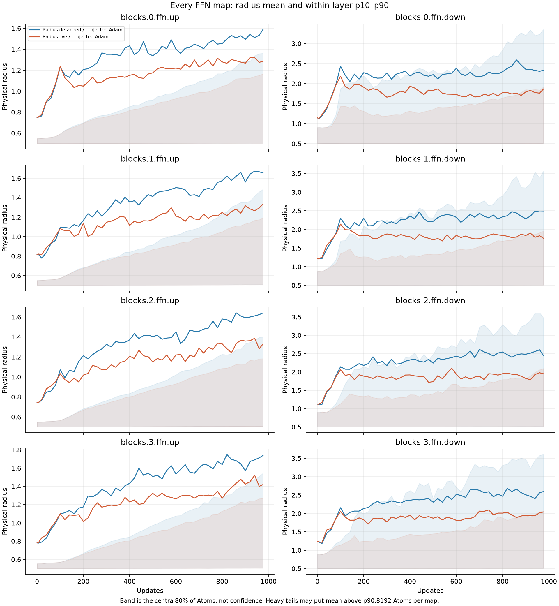

# Polar radius chain rule: matched FFN results

English (canonical) | [日本語](ffn-polar-radius-gradient-20261108-results.ja.md)

Both arms completed976 updates/999424 tokens, seed17, width512, four blocks,
eight FFN maps with8192 Atoms per map. Initial Parameters and logits were
byte-identical. [Frozen protocol](ffn-polar-radius-gradient-20261108.md).

| Radius loss gradient | Final DEV CE | DEV PPL | Final mean radius | Final mean q | Median update ms | Allocated / reserved MiB |
| --- | ---: | ---: | ---: | ---: | ---: | ---: |
| polar_detached | 3.42403589 | 30.6930 | 2.058201 | 0.078821 | 125.74 | 969.05 / 1294 |
| polar_live | 3.42238586 | 30.6424 | 1.622871 | 0.068468 | 130.14 | 985.51 / 1314 |

The final live-minus-detached DEV CE was−0.00165004. The learning curves mostly
overlap and the DEV difference changes sign at intermediate evaluations. This
is a small one-seed development observation, not evidence of consistent quality
improvement, noninferiority, convergence or an optimal radius policy.

The gray original Polar curve is historical context with a different optimizer,
not the primary control. It reached3.42440987 in its separately verified cohort.
Original Polar versus the new live arm would confound backward and update-law
changes. No historical timing is pooled here, and no new Dense/confirmation or
generation run was performed.

## The radius gradient reached the latent radial direction

At the last fixed probe, the layer-averaged latent radial-gradient RMS was
8.56968e-12 with the radius detached versus7.20069e-5 with the full chain live.
All eight live layers had nonzero radial gradients. Physical partial dLoss/dr
was nonzero in both arms (4.76321e-5/4.58504e-5 layer-average RMS); the detached
arm deliberately stops that partial upstream. The t-field gradient is not a
physical radius derivative.

Mean q ended0.078821/0.068468 and mean physical radius2.058201/1.622871 for
detached/live. Both radii grew from0.975274; the live arm was less broad than
the detached control, rather than uniformly shrinking from initialization.
Every live FFN map had a smaller final mean radius than its paired detached map.
q is not frozen in the detached arm: elementwise Adam preconditioning and
annulus projection can move it even with a tangential raw task gradient.
The raw radial gradients shown are before Adam preconditioning and clipping.

Nominal initial q0 has mean4.94e-9 in stored FP32 because squared s/t norms
round around1. Exact q=0 fractions therefore depend on rounding; they are not
the fraction within a tolerance of the boundary. No Atom was exactly at q1 in
these recorded probes. Bands are within-layer p10–p90, not confidence intervals;
heavy tails may put the mean above p90. Probes use the same fixed training batch
at55 checkpoints and do not establish center velocity or a full motion history.

## Implementation and precision

The private research wrapper owns original Polar s/t/center Parameters, maps
them to a physical Tensor and uses public LinearBinding/Dispatcher with the
already qualified physical-radius CUDA Plan. No new CUDA kernel or public Polar
parameterization/default was introduced. L/U and the logarithmic radius values
are unchanged. The live map differentiates both L/U's amplitude dependence and
q's radial dependence, with an explicit inward Jacobian at q0/q1. An exact-value
correction keeps the forward values equal while supplying that constrained
derivative. It is not an unconstrained central derivative at a clamp corner.

Both arms use ordinary Cartesian AdamW plus post-step projection to
1<=norm(s,t)<=2 (stored FP32 tolerance5e-7), rather than the old tangent/activity
update. There is no radial regularizer/activity clock and moments are not
transported by the projection. Attention, embeddings and tied vocabulary output
remain Dense; data/order, initialization, LR16x Atom group,20M-token horizon,
batch/accumulation and976-update budget are shared. No HPO or seed selection.

Precision clarification: Parameters and Linear inputs/outputs are FP32 with
TF32 disabled. The research Python map explicitly computes in FP64, casts its
physical Tensor to FP32, and its eager autograd can retain FP64 map intermediates.
The physical CUDA Z/H/G responses remain FP32. Thus this is not an all-FP32
optimized implementation or a production performance result. This clarification
describes the frozen source, without changing the source or numeric tolerance.
Live increased observed median update time3.50% and peak allocated memory16.46MiB
in this implementation. Functional dispatch, Python-map overhead and projection
synchronizations are included; no cause-specific speed attribution was profiled.

Timing is966 post-warmup synchronized complete updates including transfer,
four accumulated forward/backwards, clip, AdamW/projection and final sync.
zero_grad/LR assignment, initial sync, diagnostics/evaluation/IO are excluded.
Wall time includes setup/evaluation/probes/IO, not qualification. Allocator
training peaks are not total process usage. Fixed order detached→live is not
independent hardware replication.

## Admission, audits and reproduction

CPU suite234 tests:173 passed/61 skipped; registry12 checks pass and29 studies
validate. No torchcst numerical source changed. Its231 CPU/CUDA regression record
and build were reused only after exact operator-file/runtime verification.
Fresh admission covered composed Gauss quadrature (max derivative error5.89e-15),
central differences (1.50e-9), CPU/GPU map values/gradients including q0/q1 in
FP32/FP64, all8192-Atom Y/dX/all-four-field VJPs for both actual256-row FFN
shapes, retained backward, exact model initialization and full task resume.

32 repeated full backwards without forced GC had allocated spreads3.875MiB
(detached)/3.5MiB(live), below the prespecified128MiB gate. Both trained checkpoints
passed exact DEV recomputation, all8 wrapper VJPs, final probe/checkpoint parity,
annulus feasibility and two-restore next-task parameter/Adam-state equality.
The serialized checkpoint files were unchanged by auditing.

Operator `88c2e8a7c4aa312f4f096c5169d712ace49ac979`; consumer
`99a1d033d19c2c3b6285cef46dd10a81cfe7b651`. Actual NVIDIA RTX6000 Ada48GB,
Torch2.9.1+cu128,CUDA12.8. Job `ffn-polar-radius-gradient-6000ada-20261108-01`.
Request SHA256 `837c5d917716da25d83809cfb6e7f60ab7d526bb592906478624db4446b7a890`.
Source archive SHA256 `6fba897e4fda75d4cfca1b29ecbab2eae038b83c4de5dc3652812ccee31d19d7`.
Compact archive SHA256 `c333107b820bd9dd4e1de4d8ab7a680b3999356a5157fd91649a16dc765db853`.
29 compact files and1775 source files independently hash-verified;8 recorded
controller/worker PIDs inactive. Checkpoints/data/source/native builds remain
on the cluster, with transported checkpoint hashes. No failed attempt or
learner restart occurred in this pair.

Reproduce from the frozen commits and token manifest in the protocol: run
`python -m cst_research.experiments.ffn_polar_radius_qualification --output QUAL`,
then the existing learner for each mode using hashed `QUAL/polar_detached.json`
and `QUAL/polar_live.json`. Controller commands, runtime, script/source/binary/
checkpoint hashes and raw timing/probe records remain in ignored compact
evidence. [Aggregate JSON](ffn-polar-radius-gradient-20261108-results.json) retains
all learning points,55-point diagnostic aggregates and initial/final per-layer
statistics. The [equation record](radius-coordinate-gradient-discussion-20261108.md)
and CPU chain-rule program distinguish earlier algebra checks from this LM run.

The result supports keeping the full-chain formulation as a research option.
It does not yet justify replacing the public Polar default or adding a
coordinate-motion radius rule. No further learner remains active.
