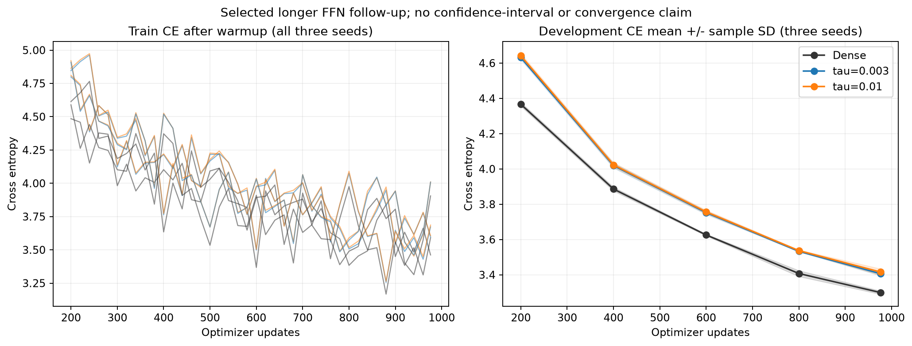
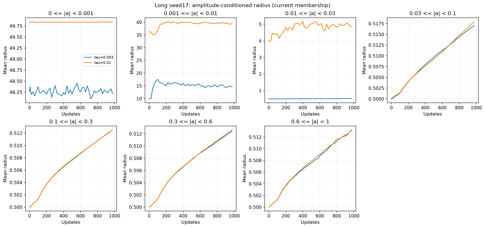

# Radius-envelope FFNのtau比較結果

[English](ffn-radius-fraction-tau-20261109-results.md) | 日本語

RTX6000 Ada48GBで予定した15本を完了しました。tau5条件＋Denseの短期比較後、
選んだ2条件＋Denseを3seedで追試しました。公開の新しい包絡線と完全なタスク勾配で
FFN8射影を学習でき、長めの比較では3seedすべてでtau.003が.01より低損失でした。
ただしDenseとの差は残り、この幅512実装ではLM全体の速度・ピークメモリの優位はありません。
別の定数準備パイロットでは旧Linear更新を3〜4%短縮しましたが、以下のモデル全体の
コストを解消するものではありません。

## 学習結果

[プロトコル](ffn-radius-fraction-tau-20261109.ja.md)を学習前に固定しました。
幅512、4pre-normブロック、8head、context128、expansion4、各FFN射影8192Atom。
Attention・embedding・共有語彙headはDense。Parameter/物理行FP32、写像中間FP64、
TF32無効。公開moment初期化でupstd.02、downstd.02/sqrt(8)に合わせ、CST全88初期化の
相対誤差は.005以内、最大.0049944でした。通常重み・中心・振幅乱数seedは共通ですが、
tau間で実現する物理行列まで同一ではありません。

短期はseed17、256更新/262144tokensです。

|条件|最終DEV交差エントロピー|
|---|---:|
|Dense|4.148382|
|tau.003|4.335841|
|tau.01|4.338758|
|tau.03|4.343493|
|tau.1|4.416189|
|tau.3|4.524157|

事前の「有限な最終DEV損失の低い2条件」という規則で.003/.01を選びました。
長めの比較は最初から976更新/999424tokensを実行し、20M-tokenのデータ順序と
LR horizonを維持しました。AdamW baseLR3e-4、betas(.9,.95)、eps1e-8、decay0、clip1。
振幅・中心は16倍、radius_fractionは公開field_lrsで1倍。フィールドLRはgroupの
scheduleに一度だけ追従し、二重には減衰しません。LR・Atom数・fraction初期値は探索していません。

|条件|seed17|seed29|seed43|平均 ± 標本標準偏差|
|---|---:|---:|---:|---:|
|Dense|3.308982|3.291380|3.297274|3.299212 ± .008959|
|tau.003|3.407896|3.394959|3.415552|3.406136 ± .010409|
|tau.01|3.422456|3.395599|3.429072|3.415709 ± .017727|

.003−Denseは+.098915、+.103579、+.118278、平均+.106924。
.003と.01の差はseedのばらつきに比べて小さいです。曲線はまだ下がっており、
限定予算・DEV選択による有効性比較です。収束・普遍的最適tau・非劣性・confirmation結果は示していません。

[経過時間も含む長めの全曲線](assets/ffn-radius-fraction-tau-20261109/long-learning-curves.png)、
[短期5条件の全曲線](assets/ffn-radius-fraction-tau-20261109/short-learning-curves.png)。
帯は3seedの標本標準偏差であり、信頼区間ではありません。

## 半径とfractionの挙動

radius_fractionはゼロ固定ではありません。全射影・各seedの最終平均は
.003で約.00610〜.00612、.01で.00673〜.00679でした。ゼロの割合はそれぞれ
11.32〜11.43%、9.92〜10.04%で、1に達したものはありません。
固定した1倍LRでは変化は小さく、フィールドLRの最適性は示していません。

seed17の平均半径は.003で1.267→1.243、.01で3.027→5.316。
3seedでの最終平均は1.215〜1.256と5.269〜5.316です。小振幅で広い半径を持つ
Atomもこの平均に含まれます。seed17の最終状態を振幅別に見ると次の通りです。

|現在の絶対振幅|平均半径 tau.003|平均半径 tau.01|
|---|---:|---:|
|[0,.001)|48.221|49.842|
|[.001,.01)|14.587|39.674|
|[.01,.03)|.521|4.856|
|[.03,.1)|.517|.518|
|[.1,.3)|.513|.513|

設計通り、小振幅では広く、大振幅では下限付近です。tauを変えると初期分布も
学習後の振幅分布も変わります。binは現在の振幅で分類し直すため、固定Atom集団の
追跡ではなく、半径と精度の因果法則を示すものではありません。

|表示|短期tau全5条件|長めseed17の2条件|
|---|---|---|
|各射影の半径|[図](assets/ffn-radius-fraction-tau-20261109/short-radius-layers.png)|[図](assets/ffn-radius-fraction-tau-20261109/long-radius-layers.png)|
|各射影のfraction|[図](assets/ffn-radius-fraction-tau-20261109/short-radius_fraction-layers.png)|[図](assets/ffn-radius-fraction-tau-20261109/long-radius_fraction-layers.png)|
|振幅別半径|[図](assets/ffn-radius-fraction-tau-20261109/short-amplitude-radius.png)|[図](assets/ffn-radius-fraction-tau-20261109/long-amplitude-radius.png)|
|振幅別fraction|[図](assets/ffn-radius-fraction-tau-20261109/short-amplitude-radius_fraction.png)|[図](assets/ffn-radius-fraction-tau-20261109/long-amplitude-radius_fraction.png)|
|固定probeの各フィールド勾配|[図](assets/ffn-radius-fraction-tau-20261109/short-field-gradients.png)|[図](assets/ffn-radius-fraction-tau-20261109/long-field-gradients.png)|

## 速度とメモリ

同一6000 Ada/runtimeで、長めの3seedそれぞれの更新中央値の範囲です。

|条件|測定対象の更新時間ms|peak allocated MiB|peak reserved MiB|FFN学習パラメータ|
|---|---:|---:|---:|---:|
|Dense|22.257〜22.365|952.66|1168|8,398,848|
|tau.003|118.297〜118.513|975.78|1300|272,384|
|tau.01|126.749〜126.882|975.78|1300|272,384|

CSTのFFNパラメータは約30.8分の1、モデル全体は21.2%少ない
30,281,216対38,407,680です。ただし、この構成では計算中間・保存データが節約を打ち消し、
allocated peakは2.4%多くなりました。測定対象の更新時間はDenseの約5.3倍/5.7倍。
accumulation・転送・前後伝播・clip・optimizerを含み、zero_grad・scheduler・probe・
評価を除きます。先頭10更新は時間標本から除外。ピークは各更新で測り、GPUプロセス全体や
Graph captureの値ではありません。実行順序と学習後の半径による負荷も異なり、
モデルの限定範囲の性能です。kernel採用の測定には使いません。
Denseはseed17で先頭、29/43で最後、CSTの順序は43で反転。
準備はDense.834〜.839秒、CST3.179〜3.727秒、各実行の全wall時間は
Dense34.25〜46.46秒、CST134.49〜148.59秒でした。
新規qualificationとsource準備を含む全ジョブは22.77分です。

## 検証と保全

tau全5条件で全モデルの写像値・Jacobian、同時に保持したforwardの独立backward、
有限な更新とfractionの変化を確認しました。.03では保存復元後の次のParameter・
moments・stepが完全一致。最初の試行は、復元時に意図的に更新される配置世代まで
一致を求めた検査の不備で学習前に停止しました。記録を保全し、数値許容差も学習条件も変えていません。

長めの9checkpointすべてでDEV CEが記録値と完全一致しました。全optimizer stateは
step976、FP32 momentsは有限で、CST8射影の振幅/fraction範囲も検査済みです。
学習済みup/down計12件で、非連続7行入力のY/dX/全Atom勾配を照合しました。
元のFP32物理行を保ち、物理参照をFP64で積算。最大絶対誤差はそれぞれ
1.4473e-6、2.2638e-6、5.7221e-6で、既存のatol1e-4/rtol4e-3を維持しました。

[JSON結果](ffn-radius-fraction-tau-20261109-results.json)にsource/data/archive hashと
seed別数値を記録。operator443ee84c、consumer539af8eを凍結し、compact archive SHA256は
`b464081160e67309d4dc6187e9f88ebd07c8208ea640a7dd00997f9d65e065c1`。
compact79ファイル、source1814ファイルをローカルでhash照合しました。
大きな15checkpointはclusterに残しhash検証済み。raw証拠はGit外です。
学習/controller17プロセスとaudit2プロセスは停止済みで、GPUは0%/39MiBへ戻りました。
サーバー停止・公開デフォルト変更・mergeはしていません。

図は`scripts/plot_ffn_radius_fraction.py --run VERIFIED_RUN`で再生成できます。
PNGをGitに保存し、SVG・raw timelineは証拠側に保存。学習後の読み取り専用検査は
凍結sourceをPYTHONPATHへ指定し`scripts/audit_ffn_radius_fraction.py`で実行します。
consumer CPU検査は全237件、176成功/61任意skip、registry30 studyが有効です。
operatorのCPU/GPU検査と別の速度pilotはtorchcst PR157に保存しています。
次のFFN参照設定は明示的tau.003が妥当ですが、ライブラリのデフォルト変更・fraction LR探索・
幅を広げる比較は、それぞれ別途確認する必要があります。
