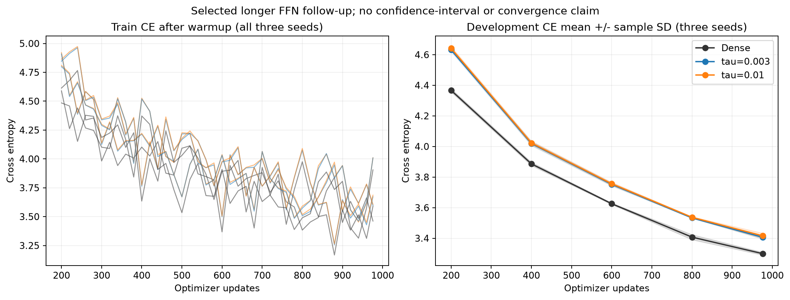
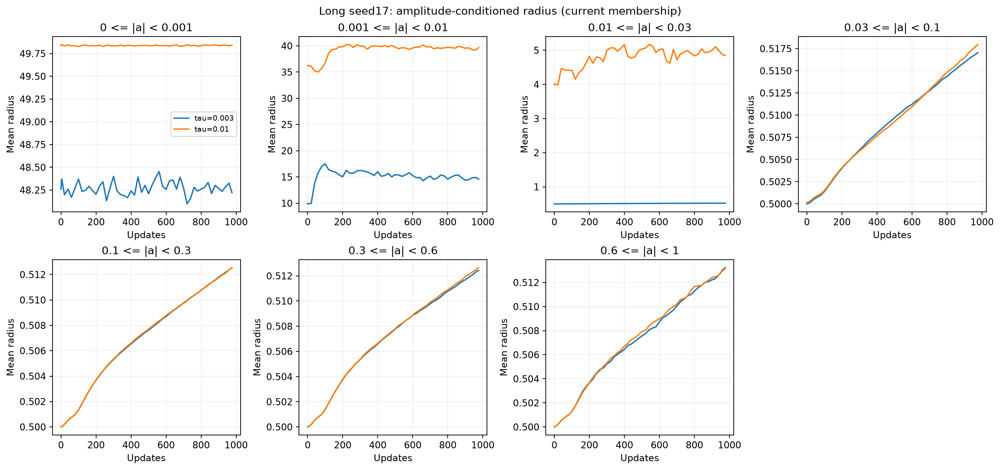

# Radius-envelope FFN tau results

English (canonical) | [日本語](ffn-radius-fraction-tau-20261109-results.ja.md)

All15 planned runs completed on RTX6000 Ada48GB: five tau screening arms plus
Dense, then two selected arms plus Dense at three seeds. The new public envelope
and its full task gradient work in all eight FFN maps. Tau.003 was lower-loss
than.01 in each longer seed. Dense retains a measurable loss advantage, and this
width512 implementation has no end-to-end speed or peak-memory advantage.
The operator's separate prepared-map pilot reduced its old Linear step by3–4%;
that result does not remove the model-level cost below.

## Learning results

The [protocol](ffn-radius-fraction-tau-20261109.md) was fixed before learning.
Width512, four pre-norm blocks, eight heads, context128, expansion4, A8192 per
FFN map; Dense attention/embedding/tied head. FP32 Parameters and physical rows,
FP64 map intermediates, TF32off. Public moment initialization matches upstd.02
and downstd.02/sqrt(8); all88 CST initialization reports had relative error<=.005
(max.0049944). Ordinary weights, centers and amplitude-noise seeds are shared;
physical matrices need not be identical across tau.

Short seed17 screening at256updates/262144tokens:

|Arm|Final DEV cross entropy|
|---|---:|
|Dense|4.148382|
|tau.003|4.335841|
|tau.01|4.338758|
|tau.03|4.343493|
|tau.1|4.416189|
|tau.3|4.524157|

The prespecified lowest-finite-DEV rule selected .003/.01. Longer runs restarted
from scratch for976updates/999424tokens, retaining the20M-token schedule/order
horizon. AdamW baseLR3e-4, betas(.9,.95),eps1e-8,decay0,clip1; amplitude/centers16x,
radius_fraction1x through public field_lrs. The field rate follows the group
schedule once; it is not decayed twice. No LR, Atom-count or fraction-init search.

|Arm|Seed17|Seed29|Seed43|Mean ± sample SD|
|---|---:|---:|---:|---:|
|Dense|3.308982|3.291380|3.297274|3.299212 ± .008959|
|tau.003|3.407896|3.394959|3.415552|3.406136 ± .010409|
|tau.01|3.422456|3.395599|3.429072|3.415709 ± .017727|

Tau.003 minus Dense is+.098915,+.103579,+.118278, mean+.106924.
The .003/.01 difference is small relative to seed variation. The curves are still
descending: this is a bounded, development-selected feasibility comparison, not
convergence, a universal optimal tau, noninferiority, or confirmation-set evidence.

[All longer curves including wall time](assets/ffn-radius-fraction-tau-20261109/long-learning-curves.png)
and [all five screening curves](assets/ffn-radius-fraction-tau-20261109/short-learning-curves.png).
The band is sample SD of three seeds, not a confidence interval.

## Radius and fraction behavior

Radius fractions are not stuck at zero. Final means across all sites/seeds were
approximately.00610–.00612 for tau.003 and.00673–.00679 for.01. Zero occupancy
was11.32–11.43% and9.92–10.04%, respectively; none reached1. With the fixed1x
fraction LR they moved modestly, so this does not establish an optimal field LR.

At seed17, mean radius changed1.267→1.243 for.003 and3.027→5.316 for.01.
Across three seeds, final mean radius was1.215–1.256 versus5.269–5.316.
These means include the broad, low-amplitude population. At seed17/final:

|Current absolute amplitude|Mean radius, tau.003|Mean radius, tau.01|
|---|---:|---:|
|[0,.001)|48.221|49.842|
|[.001,.01)|14.587|39.674|
|[.01,.03)|.521|4.856|
|[.03,.1)|.517|.518|
|[.1,.3)|.513|.513|

Small-amplitude atoms retain broad radii as designed; higher-amplitude atoms
remain near the lower bound. Changing tau changes both the initial distribution
and the learned amplitude distribution. These bins use current membership,
not fixed Atom cohorts, so they do not prove a causal radius/accuracy law.

|View|Screening, all five tau values|Longer seed17, selected two|
|---|---|---|
|Every site's radius|[Plot](assets/ffn-radius-fraction-tau-20261109/short-radius-layers.png)|[Plot](assets/ffn-radius-fraction-tau-20261109/long-radius-layers.png)|
|Every site's fraction|[Plot](assets/ffn-radius-fraction-tau-20261109/short-radius_fraction-layers.png)|[Plot](assets/ffn-radius-fraction-tau-20261109/long-radius_fraction-layers.png)|
|Amplitude-conditioned radius|[Plot](assets/ffn-radius-fraction-tau-20261109/short-amplitude-radius.png)|[Plot](assets/ffn-radius-fraction-tau-20261109/long-amplitude-radius.png)|
|Amplitude-conditioned fraction|[Plot](assets/ffn-radius-fraction-tau-20261109/short-amplitude-radius_fraction.png)|[Plot](assets/ffn-radius-fraction-tau-20261109/long-amplitude-radius_fraction.png)|
|Fixed-probe field gradients|[Plot](assets/ffn-radius-fraction-tau-20261109/short-field-gradients.png)|[Plot](assets/ffn-radius-fraction-tau-20261109/long-field-gradients.png)|

## Speed and memory

Same6000 Ada/runtime; range of the per-run medians over the three longer seeds:

|Arm|Timed update ms|Peak allocated MiB|Peak reserved MiB|FFN trainable parameters|
|---|---:|---:|---:|---:|
|Dense|22.257–22.365|952.66|1168|8,398,848|
|tau.003|118.297–118.513|975.78|1300|272,384|
|tau.01|126.749–126.882|975.78|1300|272,384|

CST uses about30.8x fewer FFN parameters and21.2% fewer total model parameters
(30,281,216 versus38,407,680), but temporary/saved computation offsets those
savings here: allocated peak is2.4% higher. The timed update is about5.3x/5.7x
Dense. It includes accumulation/transfers/forward/backward/clipping/optimizer,
but excludes zero_grad/scheduler, probes and evaluation. Samples omit the first10
updates. Peaks are measured over updates, not GPU-process usage or Graph capture.
Run order and learned radius workloads differ; this is scoped model performance,
not a kernel adoption measurement. Dense ran first at seed17, last at29/43;
CST order was reversed at43. Preparation was.834–.839s Dense,3.179–3.727s CST;
per-run total wall time was34.25–46.46s Dense,134.49–148.59s CST. The whole
job including fresh qualification/source preparation took22.77minutes.

## Verification and preservation

All five exact full-model qualifications passed: map values/Jacobians, separate
outstanding forward saves, finite updates and fraction movement. The .03 model's
serialized next Parameters, moments and counters matched exactly. The first
attempt stopped before learning because the verifier compared placement-generation
metadata that is intentionally invalidated on load. That attempt is preserved;
no numeric tolerance or learning recipe changed.

All nine longer checkpoints reproduced their recorded DEV CE exactly. Every
optimizer state had976 steps and finite FP32 moments; all eight CST sites passed
amplitude/fraction bounds. Twelve trained up/down references checked Y,dX and
all Atom gradients at seven noncontiguous rows, keeping original FP32 physical
rows and accumulating the physical reference in FP64. Maximum absolute errors
were1.4473e-6,2.2638e-6,5.7221e-6; the unchanged gate was atol1e-4/rtol4e-3.

[Machine-readable results](ffn-radius-fraction-tau-20261109-results.json) contain
all source/data/archive hashes and per-seed metrics. Operator443ee84c, consumer
539af8e were frozen; compact archive SHA256
`b464081160e67309d4dc6187e9f88ebd07c8208ea640a7dd00997f9d65e065c1`.
79 compact files and1814 source files were locally hash-verified. Fifteen large
checkpoints remain on the cluster with verified hashes; raw evidence is outside
Git.17 training/controller and2 audit processes were inactive; GPU returned to
0%/39MiB. No server shutdown, public-default change or merge was performed.

Reproduce plots using `scripts/plot_ffn_radius_fraction.py --run VERIFIED_RUN`;
PNG figures are tracked, SVG and raw timelines stay with the evidence. The
read-only trained audit is `scripts/audit_ffn_radius_fraction.py` with the frozen
source on PYTHONPATH. CPU consumer checks:237 tests,176passed/61optional skips;
registry30 studies valid. Operator CPU/GPU checks and its distinct timing pilot
are recorded in torchcst PR157. A sensible next FFN reference is explicit tau.003;
changing the library default, tuning fraction LR, and wider-model scaling each
require a separate comparison.
