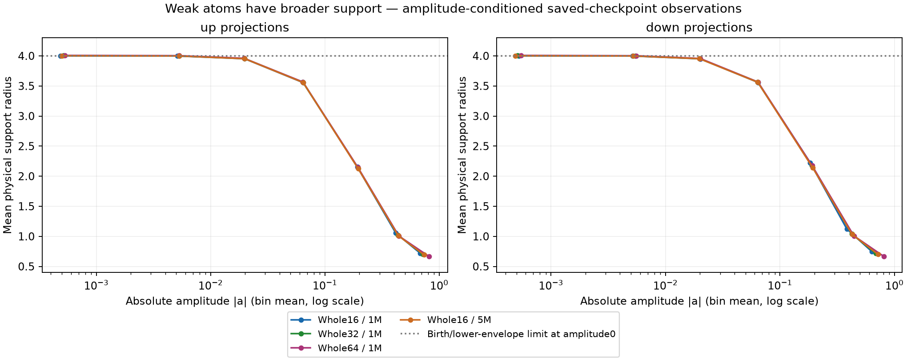
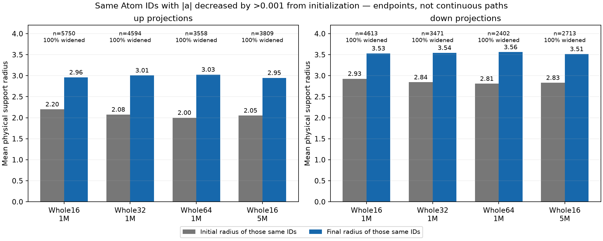
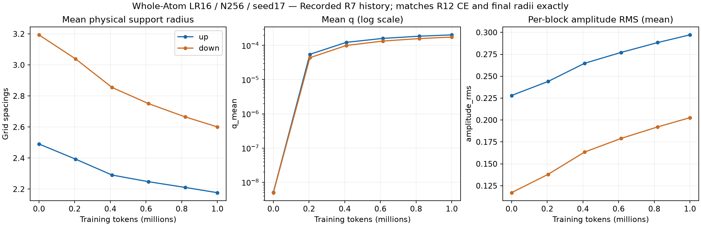
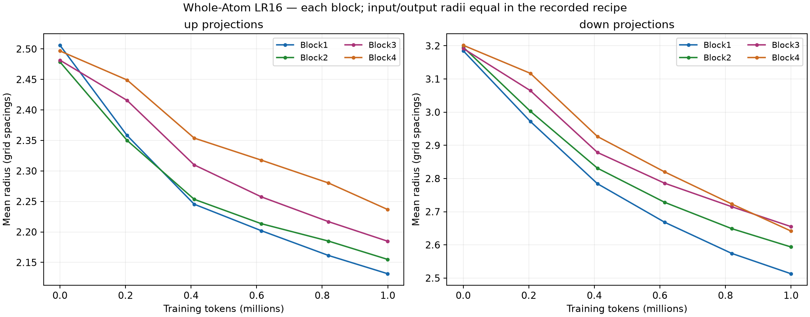
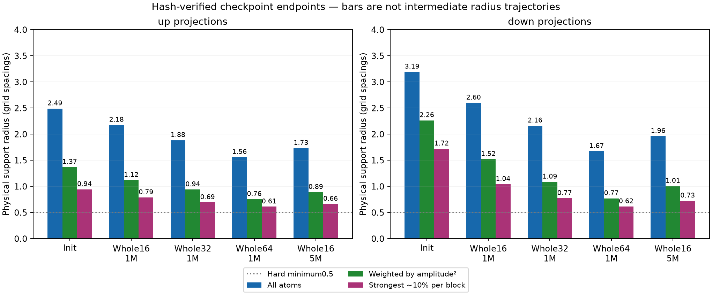
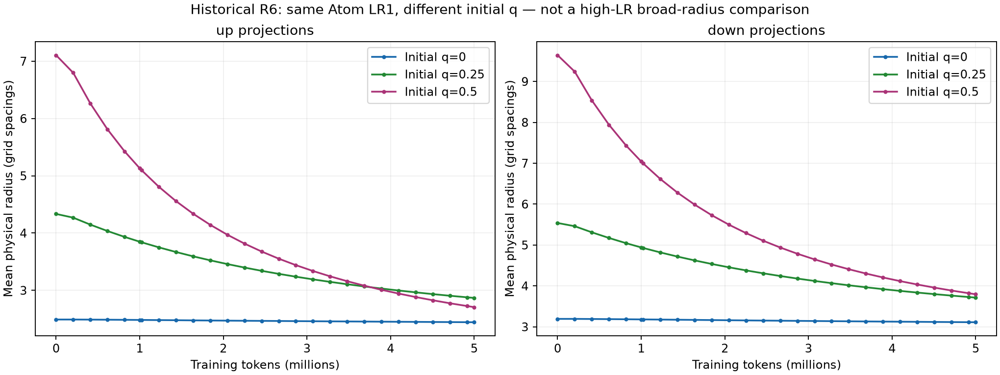

# 弱いAtomの半径を確認（事後解析）

[English](ffn-radius-review-20261107.md) | 日本語

弱いAtomは広い半径を持ち、初期から振幅の絶対値が減ったAtomでは、保存時点の半径が増えていました。
全体の平均半径が下がることから、弱いAtomも狭いままだとは言えません。
この解析では、強いAtomの局所化そのものを欠陥とは扱いません。

弱いAtomは現在の|a|<0.01（amplitude_max1）、振幅が減ったAtomは同じ行IDで
|a_final|<|a_initial|−0.001と定義します。減ったAtomがすべて現在も弱いとは限らず、別の集合です。
up/downごとに4096 Atom×4ブロック＝16384個を集計します。この設定では入出力の半径は等しく、
単位は間隔1のグリッド単位です。sigmaや支持範囲の全幅ではありません。
1M/5M表記の実トークン数は999,424/4,999,168で、N256/FFN4N/c8/seed17を固定しています。

| Condition | Weak up count /16384 | Weak up radius | Weak down count /16384 | Weak down radius |
| --- | ---: | ---: | ---: | ---: |
| Whole16 /1M | 527 | 3.9982 | 715 | 3.9980 |
| Whole32 /1M | 390 | 3.9999 | 527 | 3.9996 |
| Whole64 /1M | 283 | 4.0041 | 371 | 4.0032 |
| Whole16 /5M | 325 | 3.9982 | 385 | 3.9981 |

各条件内で、振幅減少群のすべてのAtomは、初期より終点の半径が増えました。
群は条件ごとに事後に選んでおり、LR間の共通群でも、毎step単調に動いたという主張でもありません。

| Condition | up initial→final radius (count) | down initial→final radius (count) | Fraction widened |
| --- | --- | --- | ---: |
| Whole16 /1M | 2.20→2.96 (5750) | 2.93→3.53 (4613) | 100% |
| Whole32 /1M | 2.08→3.01 (4594) | 2.84→3.54 (3471) | 100% |
| Whole64 /1M | 2.00→3.03 (3558) | 2.81→3.56 (2402) | 100% |
| Whole16 /5M | 2.05→2.95 (3809) | 2.83→3.51 (2713) | 100% |

## なぜ弱いAtomも半径4付近にとどまるのか

記録された半径の写像は次の式です。

$$
r=L(a)^{1-q}U(a)^q,\qquad
L(a)=0.5+rac{4-0.5}{1+3(a/0.3)^2}.
$$

a≈0ではL≈4、U≈50なので、r≈4*(50/4)^qです。q≈0.0002では4.002、
q=.25/.5/1なら約7.52/14.14/50になります。4は硬い上限ではなく、radius_birth4から来る
「振幅が小さいときの下側の曲線」の値です。初期化だけでなく学習中の復号にも作用します。

保存された設定はfactoryの標準値で、初期q0、finite_chord activity、activity_gain1、
radial_regularization0.1、dormant_expansion_rate0です。このPolar演算子では半径へ直接の
損失勾配を流さず、角度方向の更新の二乗からactivityを加え、正則化で減衰させます。
弱いAtom用の追加拡張項は無効です。そのため観測したqは下側に近いままでした。
全体16倍・5Mでは実半径と振幅依存の下側の曲線との差は平均0.00120(up)/0.00126(down)だけです。
硬い最小値0.5に張り付いたAtomはありません。弱まると半径4へ戻りますが、その後も弱いままなら
50へ向けて探索を広げ続ける設定にはなっていません。

これは観測された写像の説明であり、半径4でタスクの探索に十分か不十分か、Polar設計が悪いかは
示していません。より広い弱Atom探索には、下側の曲線変更や弱Atom拡張項の有効化など、
別途検証した設定が必要です。qがほぼ0のまま上限だけを大きくしても解決しません。
この解析では新規学習やruntime変更を行っていません。factoryとPolar updaterの標準値を照合しました。

## 保存された推移と背景

全体16倍の平均半径は1Mまでにup2.49→2.18、down3.19→2.60、保存した5M終点では1.73/1.96でした。
全体LRを上げた1Mの平均は32倍1.88/2.16、64倍1.56/1.67と小さくなります。
これは弱いAtomの半径拡大や、強い振幅の成長と同時に起きています。

R7には1Mまでの6回のgeometry記録があります。R12全16倍と共通のtrain CE54点・DEV6点が完全一致し、
終点の8投影の平均半径・qもcheckpointの読み取りと完全一致しました。
図はR7の履歴と明記し、R12の未保存の推移を再構築したとは扱いません。
R15全体32・64倍は終点だけ、全16倍の1M以降は保存した1M/5M checkpointだけであり、
途中の半径推移は推定・補間していません。

終点の振幅二乗による重み付き平均は診断用の指標で、実際の活性への寄与を測った値ではありません。
振幅が大きい約10%はブロックごとに選びます。古いR6のq0/.25/.5・Atom LR1の半径履歴も残っています。
これはmomentを合わせた再初期化を含み、後のLR16で半径だけを変えた実験ではありません。
5MのDEVは2.9928/3.0101/3.0629であり、LR16で広げた場合の良し悪しは示しません。

重み・活性のrankは計算していません。狭い支持だけでは代数的rankの低さは結論できず、
特異値分布や実際のFFN活性の共分散は別の診断です。
LRの中間探索、容量変更、Polar activity変更は未実施の仮説であり、この解析の結果ではありません。

## 来歴

元checkpointのハッシュを照合し、固定torchcst2b587/source351617d consumerを使い、
Torch2.11.0+cu126・Python3.12.9のCPU上でmemory-mapして復号しました。
初期状態のconstructorは元の初期化reportと完全一致しました。optimizer構築・タスク更新・
GPU確保・元checkpointやソースの上書きはなく、小さい診断JSONだけを回収しました。
checkpointは元のhostに保持しています。

- 終点probe SHA256: `73d390297fa6ccfcc35304869b3053a3b31fec5fce653b7ea4b34b65b2efad41`。
- 弱いAtom・同一ID probe SHA256: `3e6664bb86b09b14b59e5bc36fe1bc1f23165cd61dfc8841bd7fd75a375187f0`。

登録した証拠rootのradius-review-20261107-01に、request/probe/解析script、両結果、receipt・
ソースハッシュ・図を保持しています。[figure manifest](assets/ffn-feasibility-20261107/figure-manifest.json)に
ソース・派生図のハッシュを記録しています。R7のrawファイルはarchive manifest、R6のsummary・curveは
終了receiptのハッシュと一致します。事後の観測であり、新規学習や停止したseed系列の延長ではありません。
