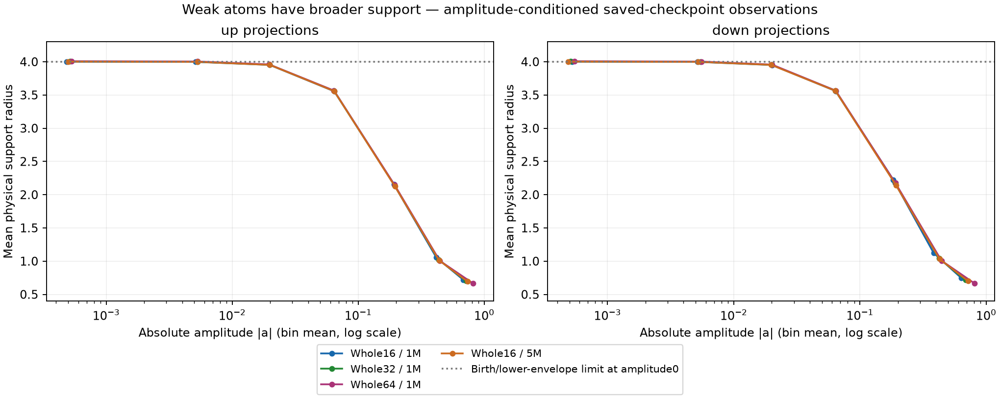
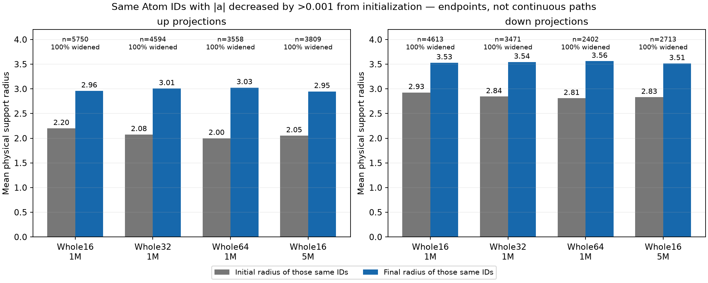
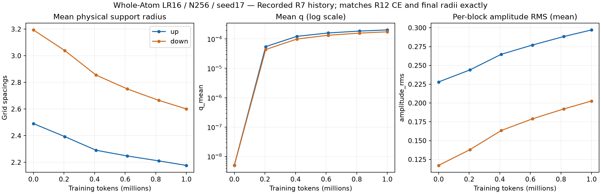
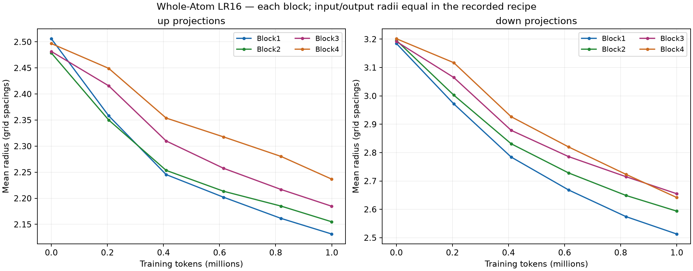
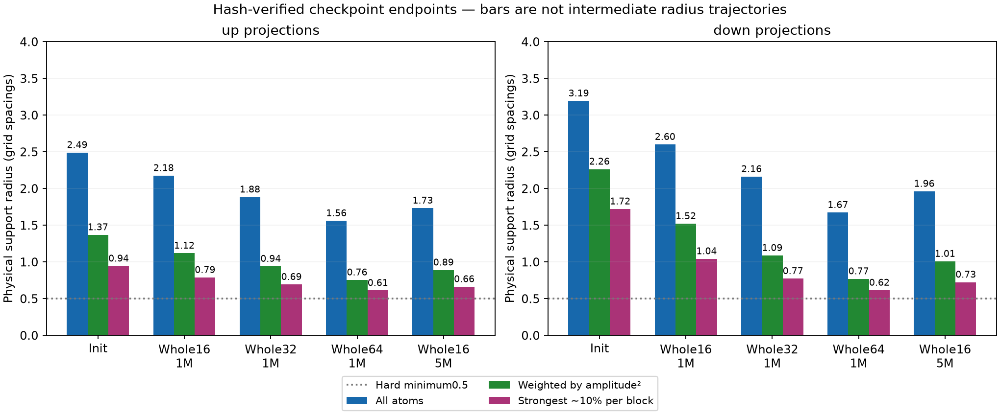
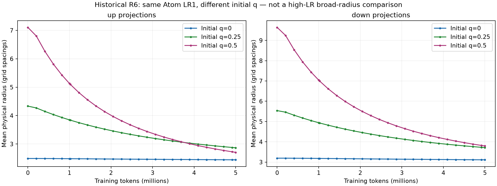

# Weak-Atom radius review (post-hoc)

English (canonical) | [日本語](ffn-radius-review-20261107.ja.md)

Weak Atoms do have broader support, and Atoms whose absolute physical amplitude
fell from initialization widened their radii at the saved endpoints. A falling
unconditional mean radius does not mean weak Atoms remained narrow. Strong-Atom
localization alone is not treated as a defect in this analysis.

Define weak as current |a|<0.01 (amplitude_max1). A decreased Atom has
|a_final|<|a_initial|−0.001 at the same row ID. The two definitions are distinct:
not every decreased Atom is currently weak. Each up/down group pools4096 Atoms
across each of4 blocks (16384 total). Input/output support radii are equal under
these recorded bounds; units are grid spacings1, not sigma or full support width.
1M/5M labels mean999,424/4,999,168 actual tokens. N256/FFN4N/c8/seed17 is fixed.

| Condition | Weak up count /16384 | Weak up radius | Weak down count /16384 | Weak down radius |
| --- | ---: | ---: | ---: | ---: |
| Whole16 /1M | 527 | 3.9982 | 715 | 3.9980 |
| Whole32 /1M | 390 | 3.9999 | 527 | 3.9996 |
| Whole64 /1M | 283 | 4.0041 | 371 | 4.0032 |
| Whole16 /5M | 325 | 3.9982 | 385 | 3.9981 |

Within each condition, all Atoms in the decreased-amplitude group have larger
radii at the endpoint. The group is chosen post-hoc separately per condition;
it is not a common cross-LR cohort or a claim of monotonic motion at every step.

| Condition | up initial→final radius (count) | down initial→final radius (count) | Fraction widened |
| --- | --- | --- | ---: |
| Whole16 /1M | 2.20→2.96 (5750) | 2.93→3.53 (4613) | 100% |
| Whole32 /1M | 2.08→3.01 (4594) | 2.84→3.54 (3471) | 100% |
| Whole64 /1M | 2.00→3.03 (3558) | 2.81→3.56 (2402) | 100% |
| Whole16 /5M | 2.05→2.95 (3809) | 2.83→3.51 (2713) | 100% |

## Why weak radii remain close to4

The recorded radius map is

$$
r=L(a)^{1-q}U(a)^q,\qquad
L(a)=0.5+rac{4-0.5}{1+3(a/0.3)^2}.
$$

For a≈0, L≈4 and U≈50, hence r≈4*(50/4)^q. With q≈0.0002 this is4.002;
q=.25/.5/1 would give approximately7.52/14.14/50. Thus4 is not the hard upper
limit. It comes from radius_birth4, the weak-amplitude end of the lower envelope.
This setting affects training-time decoding, not only initialization.

The saved recipe uses the factory defaults: initial q0, finite_chord activity,
activity_gain1, radial_regularization0.1, dormant_expansion_rate0. Radius is
detached from direct task gradients in this Polar operator; angular motion adds
squared-displacement activity while regularization decays it. The additional
weak-Atom expansion term is disabled. q therefore stayed near the lower side
in these observations. At whole16/5M, actual radius minus its amplitude-dependent
lower curve averages only0.00120(up)/0.00126(down). No Atom is on the hard
minimum0.5. Weakening restores radius towards4, but the configuration does not
make a weak Atom keep expanding towards50.

This explains the observed map; it does not establish that4 is sufficient or
insufficient for task exploration, or that the Polar design is defective.
A wider weak-Atom search would require a separately qualified recipe, for example
a different lower envelope or a nonzero weak-Atom expansion term. Changing only
the configured upper limit would not fix near-zero q. No such new run or runtime
change was made here. All defaults were checked in the factory and Polar updater.

## Recorded history and context

Whole16 mean radius falls up2.49→2.18 and down3.19→2.60 by1M, reaching
1.73/1.96 at the saved5M endpoint. Higher whole LR gives smaller unconditional
1M means:32 gives1.88/2.16,64 gives1.56/1.67. This coexists with weak-Atom
broadening and growth of the stronger amplitudes.

R7 contains six geometry observations through1M. Its54 common train CE rows and
six DEV values exactly match retained R12 all16; all8 final radius/q means also
match the checkpoint read exactly. The plotted history is explicitly R7,
not a newly reconstructed R12 sampling stream. R15whole32/64 has endpoints only;
whole16 after1M has only saved1M/5M checkpoints. Intermediate radius histories
are not inferred or filled in.

The endpoint weighted curve uses amplitude² as a diagnostic proxy, not measured
activation contribution. The strongest approximately10% are selected separately
within each block. Earlier R6 q0/.25/.5 pilots at Atom LR1 also retain radius
histories. They include moment-matched reinitialization, not an isolated radius
intervention at the later LR16. Their5M DEV scores were2.9928/3.0101/3.0629;
they do not establish that broadening at LR16 is good or bad.

No matrix/activation rank was calculated. Narrow support alone does not imply
low algebraic rank; singular spectra and actual FFN activation covariance would
be separate diagnostics. Fine LR interpolation, capacity changes and altered
Polar activity are unperformed hypotheses, not findings of this review.

## Provenance

Hash-verified original checkpoints were memory-mapped and decoded on CPU using
the frozen torchcst2b587/source351617d consumers under Torch2.11.0+cu126 and
Python3.12.9. Initial constructors exactly reproduced each original initializer
report. No optimizer was constructed, no task update ran, no GPU was allocated,
and no original checkpoint/source was overwritten. Only compact diagnostic JSON
was downloaded; checkpoints stayed on the original host.

- Endpoint probe SHA256: `73d390297fa6ccfcc35304869b3053a3b31fec5fce653b7ea4b34b65b2efad41`.
- Matched/weak probe SHA256: `3e6664bb86b09b14b59e5bc36fe1bc1f23165cd61dfc8841bd7fd75a375187f0`.

The registered evidence root's radius-review-20261107-01 directory retains
request/probe/analysis scripts, both results, receipt/source hashes and figures.
The [figure manifest](assets/ffn-feasibility-20261107/figure-manifest.json) records
source/derived hashes. Raw R7 files match their archive manifest; R6 summaries
and curves match their terminal receipt hashes. This is post-hoc observation,
not new training or an extension of the stopped seed family.
