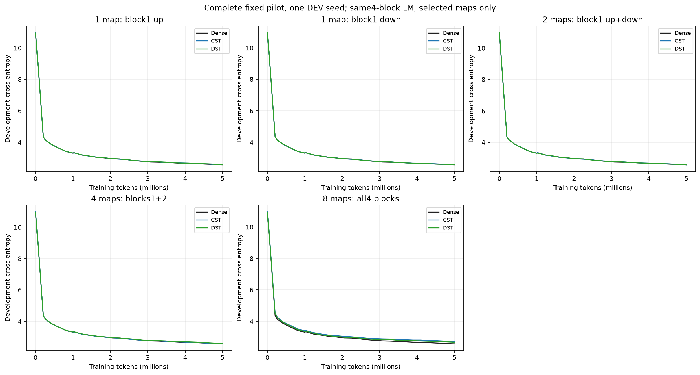
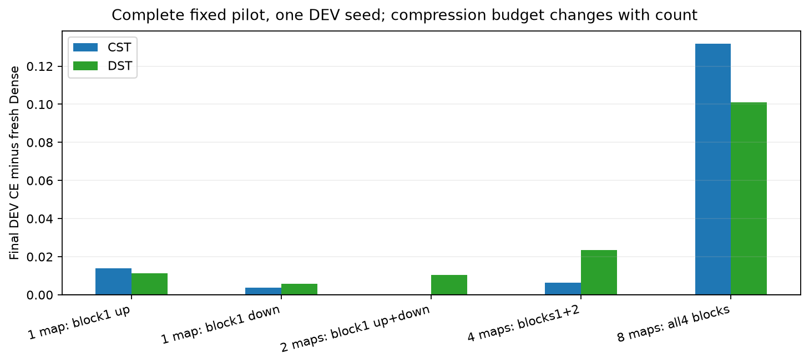
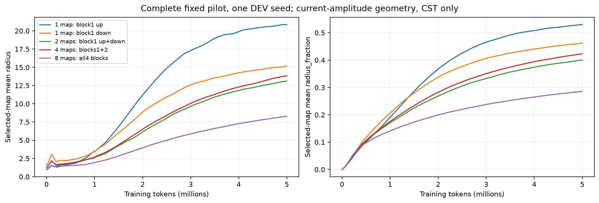
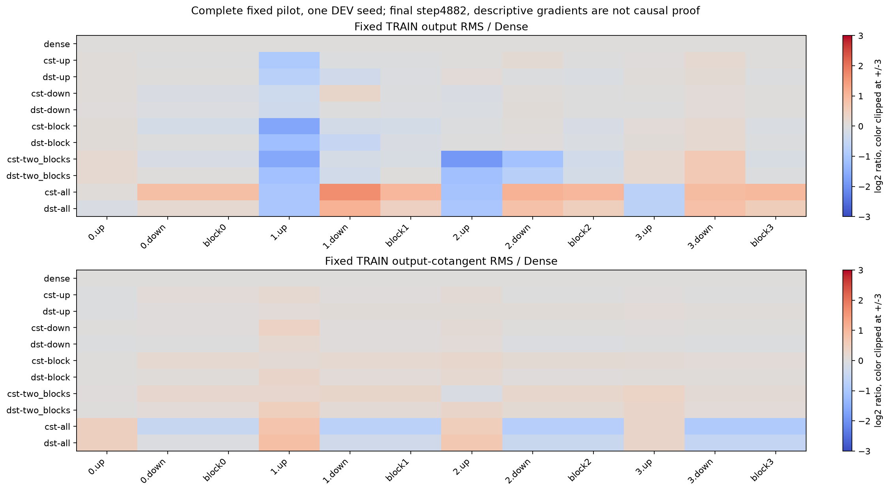
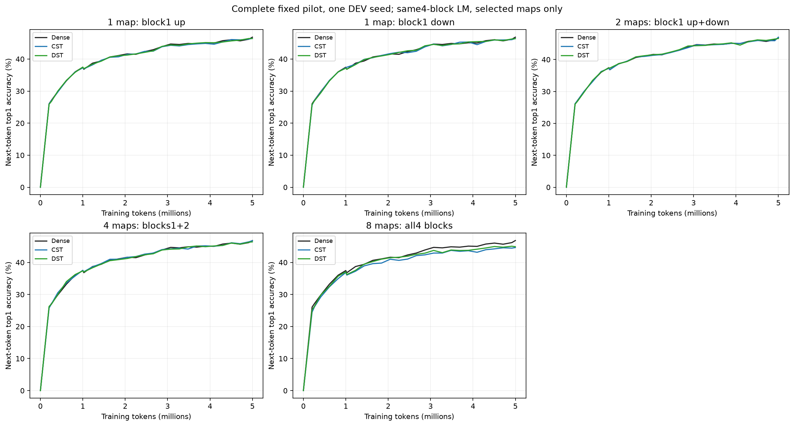
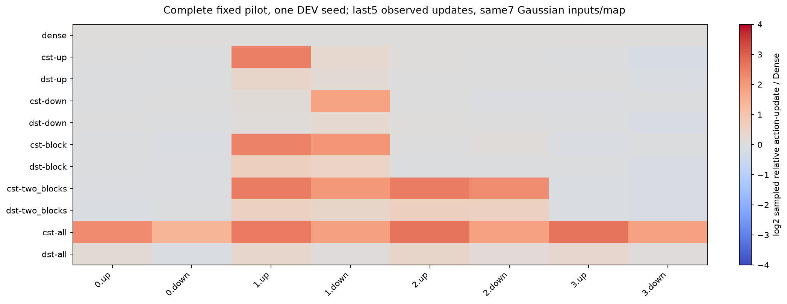
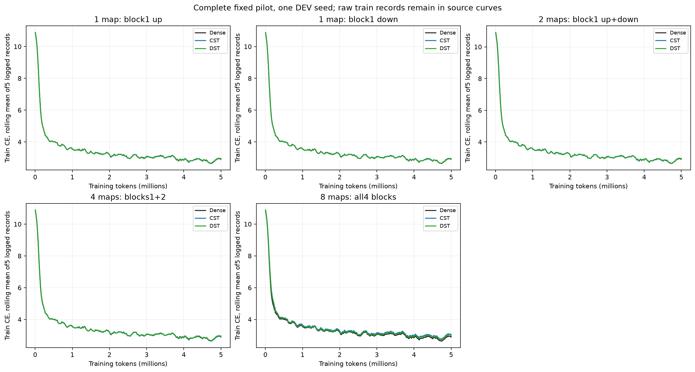

# FFNの置換箇所数：タスク学習の結果

[English](ffn-site-count-20261109-results.md) | 日本語

固定した11条件の5M-token学習・qualification・33 checkpoint監査・検証済みローカル回収を完了。
今回の1 seed DEVでは、1写像・1ブロック上下・中央2ブロック上下はDenseに近い値でしたが、
全8写像で差が大きくなりました。統計的同等性・深さの因果法則の証明ではありません。
すべて本来のタスクの正解トークンで学習しています。

## 条件とタスク性能

[計画](ffn-site-count-20261109.ja.md)：TinyStories・幅512・4ブロック・8ヘッド・文脈128・FFN拡張4。
新規seed17・4882step/4999168tokens・batch2×蓄積4、同じ20Mシャッフル順とLR/接続更新horizon。
CSTは写像あたりA8192・tau.003・fraction0・振幅上限32・半径.5..50・公開moments初期化・
RMS補正なし・全4field32倍。DSTは写像あたりK32768・疎LR.003。
通常LR3e-4・betas(.9,.95)・eps1e-8・WD0・clip1・warmup200、FP32 Parameters/moments・TF32無効・
eager・RTX4090/Torch2.9.1+cu128/CUDA12.8。CSTのmap中間値は固定したFP64 levels実装。
未置換写像・attention・embedding・共有headは学習可能なDenseのままです。

新規DenseはDEV CE=2.567102・perplexity=13.028013・
次token top1=46.826%、有効FFNスカラー8398848。
全条件で同じ、学習storyと重複しない8192 DEV targetsを使い、TRAIN CEは別に記録。
top1はteacher forcingでの次トークン正答率であり、文全体・自由生成の品質ではありません。

| Placement | CST CE | DST CE | CST top1 | DST top1 | Active FFN scalars |
|---|---:|---:|---:|---:|---:|
| block1 up only | 2.581049 | 2.578300 | 46.436% | 46.399% | 7383040 |
| block1 down only | 2.570749 | 2.572791 | 46.411% | 46.375% | 7383040 |
| block1 up+down | 2.567259 | 2.577541 | 47.009% | 46.594% | 6367232 |
| blocks1+2 up+down | 2.573492 | 2.590663 | 46.777% | 46.411% | 4335616 |
| all4 blocks up+down | 2.698948 | 2.668223 | 44.641% | 44.897% | 272384 |


1ブロック上下CSTはCE2.567259でDense2.567102に近く、block1/2上下もCE2.573492でした。
したがって、全8写像での差を「1つのFFN内で2写像をCSTにするだけで失敗する」とは解釈できません。
全8CST/DSTのDenseとの差は+0.131846/+0.101121。置換数に伴い全体の圧縮率も大きく変わります。
各配置のCST/DSTは有効スカラー予算を一致させていますが、関数クラス・optimizerは異なります。
1 seed・小さなDEVで順位を確定しません。次の[分散配置研究](ffn-block-placement-20261109.ja.md)で、
各ブロック1個と、同数up2/down2を分散する配置を比較します。

## 挙動の観測

固定128-token TRAIN probeでは、全8CSTの初期block出力RMSはDenseの1.026–1.041倍で、
以前のHIGGSにあった強い初期減衰とは違います。4882stepでは出力RMSが1.814–2.010倍、
block出力cotangent RMSが0.531–0.717倍。このprobeでゼロへの崩壊は見えませんが、
タスク性能差の原因を特定するものでもありません。最終観測stepのCST upの相対action更新は
Denseの約5.2–6.7倍、downは2.4–3.4倍。ただし上り1個でも更新比が大きく、Denseに近く学習できています。
大きさだけでLR過大を確定できません。7件の固定Gaussian入力は更新の測定だけに使い、
Dense出力を教師に学習させていません。

図に全曲線・終点の値/勾配・実更新・幾何推移を残します。action比の図は最後5観測step平均、
上の記述は最終1stepの値です。生勾配はパラメータの座標系が違うため、同等のLRと解釈しません。
















## 時間・メモリ・検査

| Arm | Median step ms | Allocated / reserved MiB | Total wall seconds |
|---|---:|---:|---:|
| dense | 17.96 | 952.66 / 1168 | 116.96 |
| cst-up | 35.40 | 958.17 / 1156 | 201.56 |
| dst-up | 18.03 | 955.68 / 1164 | 113.16 |
| cst-down | 35.83 | 956.04 / 1176 | 202.75 |
| dst-down | 18.05 | 955.66 / 1164 | 115.67 |
| cst-block | 52.01 | 951.70 / 1204 | 282.13 |
| dst-block | 18.06 | 962.55 / 1164 | 113.74 |
| cst-two_blocks | 85.86 | 940.35 / 1266 | 442.10 |
| dst-two_blocks | 18.09 | 972.82 / 1192 | 119.21 |
| cst-all | 143.38 | 973.82 / 1290 | 725.55 |
| dst-all | 18.13 | 995.86 / 1190 | 120.93 |


同期した学習時間には転送・4microbatch・backward・clip・optimizer/接続更新を含め、
zero_grad・LR設定・DEV・checkpoint・診断stepを除外。最初10stepと診断stepはサンプル外です。
allocated/reserved peakも非介入stepで測り、allocator履歴・順序固定の制限があります。
準備・wall時間はJSONに別記。DSTはdense保存/matmulなので最適化済み疎kernelの効率を示しません。
全条件にDense語彙射影・activationが残り、幅スケールの検証でもありません。

68件のoperator検査を再実行し、11モデルqualificationに成功。全8選択時のfactoryは過去の
CST/DST stateと完全一致し、未置換Dense初期値とRNGを保持します。
独立FP64の初期微分、保存再開した通常/接続更新、診断の非干渉を検査。
全33 checkpointでDEV CEの完全再現・top1正答数一致・有限FP32 moments・時計を確認。
学習済み96写像の出力/入力勾配/パラメータ勾配oracleは固定atol1e-4/rtol4e-3で成功。
Dense/CST時計256/976/4882、DST255/973/4863。HPO・早期停止・seed追加・confirmation・許容差緩和なし。

最終compactの76ファイル・固定source1936件を検証し、NFS上の33 checkpointハッシュを保持。
13個の途中snapshot、source archive・protocol・driver・元ログ/監査・backup receiptもローカル保全。
旧20Mのcontainer-home消失は別のSTOPPED記録のまま、その結果は借用していません。
基本全258 CPUテスト（197成功・61任意skip）に成功。その後のcatalog/配置追加は16対象テストと39研究registryで検証。

## 来歴・再現

Operator：`0d277ae6dc0ae14fe515c7559f39535ed0238950`、Consumer：
`7b89c7db7105b4212fa9aee3efbc2870f1b848e3`。
Source archive：`f5071a6cba6a4ffcff95242cd88a8db591c79b2e2fcd3757f2d5a9129247dba2`。
Data manifest：`5b995103ca95d3c9b62a4e860039683dc734b0a0bb20e232db1b2e45aa690d01`。
Final compact：`3a5d6844ca1e8cd47760a64e1b7dcdfb40f9efb5a2eb2ffdabebee02bc0e7518`。
証拠：CST_RESEARCH_EVIDENCE_ROOT/ffn-site-count-4090-20261109-01。
最終compactを記録されたretrievedディレクトリ名で復元し、backup-state.jsonも保持して実行：

```bash
python scripts/plot_ffn_site_count.py --run "$CST_RESEARCH_EVIDENCE_ROOT/ffn-site-count-4090-20261109-01"
```

[JSON](ffn-site-count-20261109-results.json)に全条件・測定範囲・checkpoint/sourceハッシュ・
probe比・図ハッシュを記録。英語・日本語で同じ限定した開発結果を説明しています。
