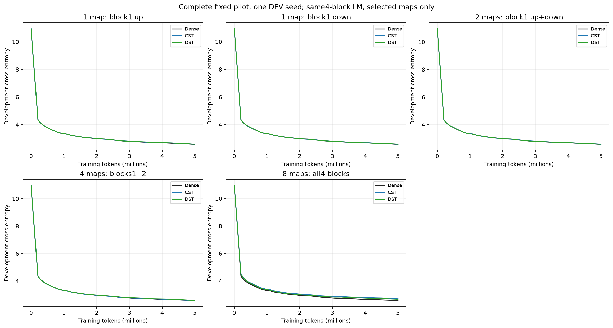
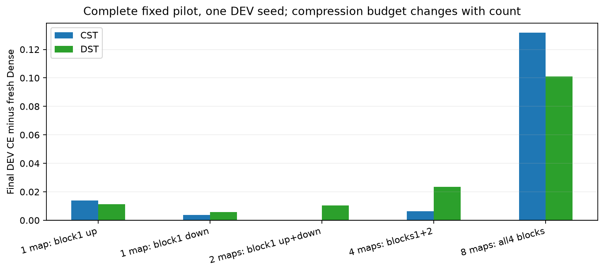
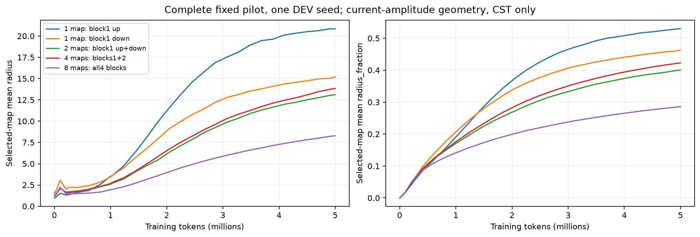
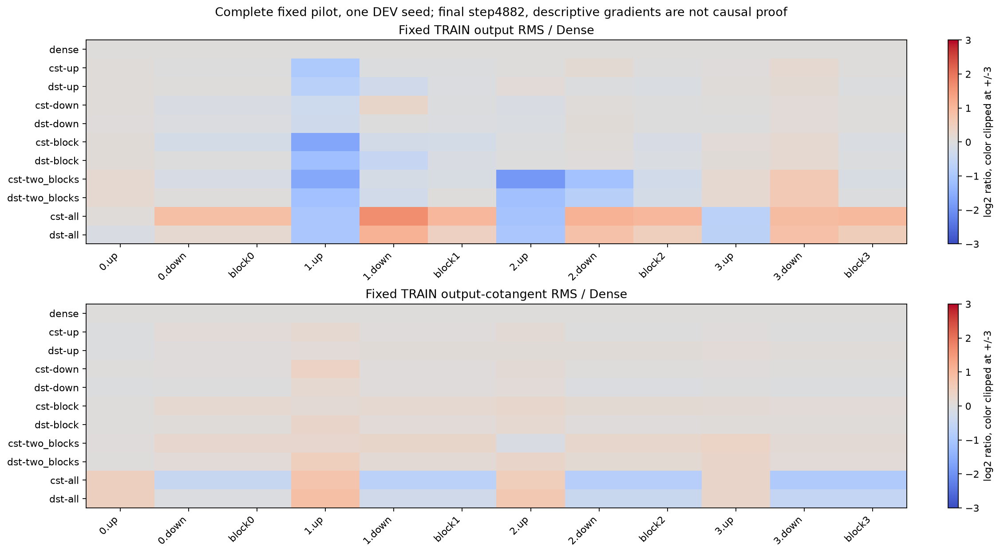
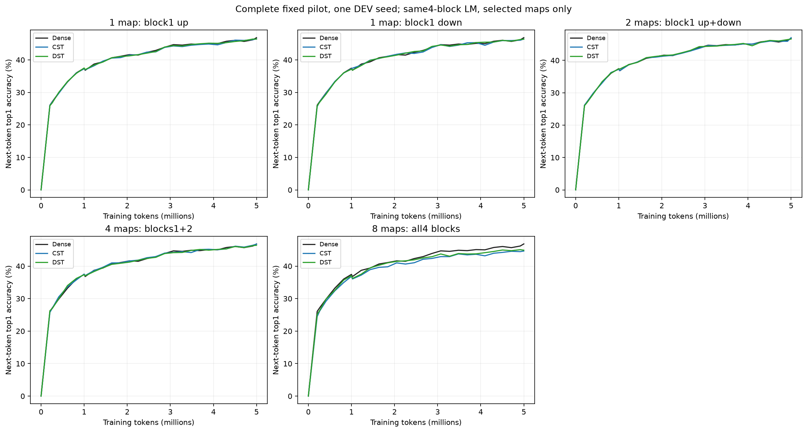
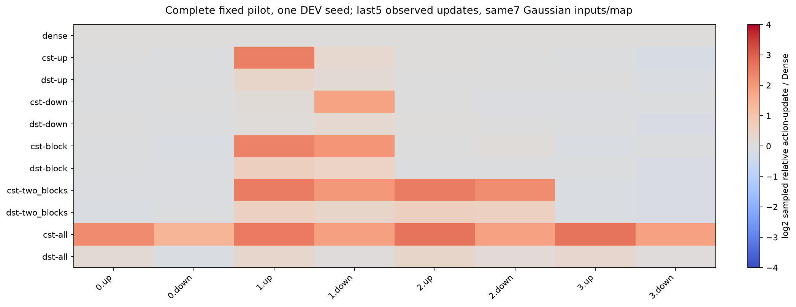
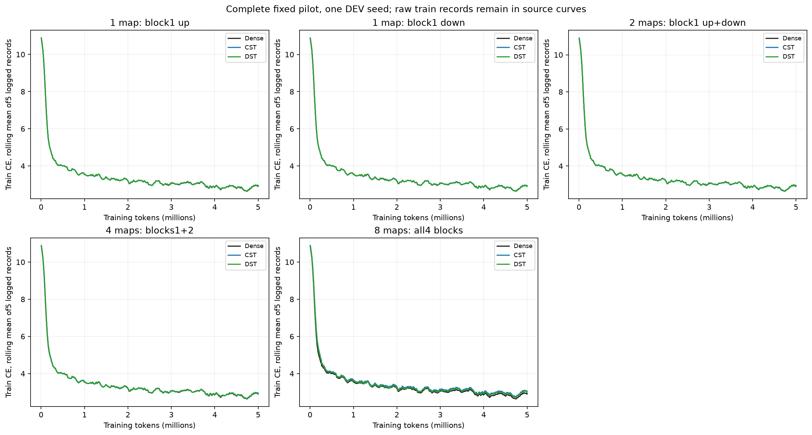

# Selective FFN task-learning results

English (canonical) | [日本語](ffn-site-count-20261109-results.ja.md)

All11 fixed5M-token arms completed qualification, training,33 trained checkpoint
audits and independently verified local compact retrieval. In this one-seed DEV
pilot, one selected map, one paired block and two paired middle blocks stay close
to Dense; replacing all8 FFN maps creates a larger gap. This is not a statistical
equivalence or causal depth claim. All training uses original task targets.

## Conditions and task performance

[Protocol](ffn-site-count-20261109.md): TinyStories,width512,four blocks,eight heads,
context128,FFN expansion4. Fresh seed17,4882steps/4999168tokens,batch2×accumulation4,
same shuffled20M stream and20M LR/topology horizon. CST:A8192/map,tau.003,fraction0,
cap32,radius.5..50,public moment initialization,no RMS calibration,all4 fields32×.
DST:K32768/map,sparse LR.003. Ordinary LR3e-4,betas(.9,.95),eps1e-8,WD0,clip1,
warmup200,FP32 Parameters/moments,TF32off,eager,RTX4090/Torch2.9.1+cu128/CUDA12.8.
CST map intermediates retain the frozen FP64 levels implementation. All unselected
maps,attention,embedding and tied head remain trainable Dense.

Fresh Dense DEV CE=2.567102,perplexity=13.028013,
next-token top1=46.826%;active FFN scalars8398848.
The same8192 story-disjoint DEV targets are used in every arm; TRAIN CE is separate.
Top1 is teacher-forced next-token accuracy, not sentence/generation quality.

| Placement | CST CE | DST CE | CST top1 | DST top1 | Active FFN scalars |
|---|---:|---:|---:|---:|---:|
| block1 up only | 2.581049 | 2.578300 | 46.436% | 46.399% | 7383040 |
| block1 down only | 2.570749 | 2.572791 | 46.411% | 46.375% | 7383040 |
| block1 up+down | 2.567259 | 2.577541 | 47.009% | 46.594% | 6367232 |
| blocks1+2 up+down | 2.573492 | 2.590663 | 46.777% | 46.411% | 4335616 |
| all4 blocks up+down | 2.698948 | 2.668223 | 44.641% | 44.897% | 272384 |


CST both maps in one block has CE2.567259 versus Dense2.567102. Both maps in
blocks1/2 have CE2.573492. The larger all8 gap therefore does not establish that
pairing two maps within a single FFN is itself sufficient to cause failure.
All8 CST/DST gaps to Dense are+0.131846/+0.101121. Global active compression also
changes strongly with replacement count; DST is matched at each set but remains
a different function class/optimizer. One seed and a small DEV set do not establish
rankings. The follow-up [distributed-map study](ffn-block-placement-20261109.md)
compares one replacement per block and an equal-count2up/2down mixed pattern.

## Mechanism observations

On the fixed128-token TRAIN probe, initial all8 CST block-output RMS is1.026–1.041×
Dense, rather than the severe initial attenuation previously seen in HIGGS.
At step4882 it is1.814–2.010× Dense, with block-output cotangent RMS0.531–0.717×.
Those values do not show a collapse toward zero on this probe; nor do they identify
why the task gap remains. CST up-map sampled relative action updates are about
5.2–6.7× Dense at the final observed step and down maps2.4–3.4×, but a single
up-map arm also has a large update ratio and learns close to Dense. Magnitude alone
cannot establish excessive LR. Action probes use7 fixed Gaussian inputs only for
measurement; no model is trained to imitate Dense outputs.

The plots retain all task curves, final signals, realized update and geometry
traces. Plot action ratios average the last5 observed steps; the numbers above
refer to the last step only. Raw gradients use different parameter coordinates
and must not be directly interpreted as equivalent learning rates.
















## Timing, memory and validation

| Arm | Median step ms | Allocated / reserved MiB | Total wall seconds |
|---|---:|---:|---:|
| dense | 17.96 | 952.66 / 1168 | 116.96 |
| cst-up | 35.40 | 958.17 / 1156 | 201.56 |
| dst-up | 18.03 | 955.68 / 1164 | 113.16 |
| cst-down | 35.83 | 956.04 / 1176 | 202.75 |
| dst-down | 18.05 | 955.66 / 1164 | 115.67 |
| cst-block | 52.01 | 951.70 / 1204 | 282.13 |
| dst-block | 18.06 | 962.55 / 1164 | 113.74 |
| cst-two_blocks | 85.86 | 940.35 / 1266 | 442.10 |
| dst-two_blocks | 18.09 | 972.82 / 1192 | 119.21 |
| cst-all | 143.38 | 973.82 / 1290 | 725.55 |
| dst-all | 18.13 | 995.86 / 1190 | 120.93 |


Synchronized training timings include transfer,4 microbatches,backward,clipping and
optimizer/topology work; exclude zero_grad,LR setup,DEV,checkpoints and diagnostic
steps. Timing samples exclude the first10 and observed steps. Allocated/reserved
peaks use those uninstrumented steps; allocator history and fixed-order execution
limit inference. Setup/wall are separate in JSON. DST uses dense storage/matmul,
so its timings do not establish optimized sparse-kernel efficiency. Dense
vocabulary/activation costs remain in all models. This is not a width-scaling test.

Fresh68 operator tests and all11 exact-model qualifications passed. The selective
factory reproduces historical all8 CST/DST state and preserves complementary
Dense initial Parameters and RNG. Qualification covers independent FP64 initial
map derivatives, serialized regular/topology updates and diagnostic noninterference.
All33 checkpoints reproduce DEV CE exactly and top1 counts identically, with
finite FP32 moments and correct clocks. All96 trained map Y/dX/parameter-gradient
oracles pass unchanged atol1e-4/rtol4e-3. Dense/CST clocks are256/976/4882; DST
255/973/4863. No HPO,early stopping,extra seed,confirmation or tolerance relaxation.

The final compact verifies76files and1936frozen source identities,33checkpoint
hashes retained on NFS. It is locally preserved along with13 progressive snapshots,
source archive,protocol,driver,original logs/audits and backup receipts. The old
20M container-home evidence incident remains separately STOPPED; no result from
that job is borrowed. Basic suite258CPU tests passed(197passed,61optional skips);
subsequent catalog/placement changes passed targeted16tests and39-study validation.

## Provenance and reproduction

Operator:`0d277ae6dc0ae14fe515c7559f39535ed0238950`. Consumer:
`7b89c7db7105b4212fa9aee3efbc2870f1b848e3`.
Source archive:`f5071a6cba6a4ffcff95242cd88a8db591c79b2e2fcd3757f2d5a9129247dba2`.
Data manifest:`5b995103ca95d3c9b62a4e860039683dc734b0a0bb20e232db1b2e45aa690d01`.
Final compact:`3a5d6844ca1e8cd47760a64e1b7dcdfb40f9efb5a2eb2ffdabebee02bc0e7518`.
Evidence:CST_RESEARCH_EVIDENCE_ROOT/ffn-site-count-4090-20261109-01. Restore the final compact under
its recorded retrieved-directory name and keep backup-state.json; then run:

```bash
python scripts/plot_ffn_site_count.py --run "$CST_RESEARCH_EVIDENCE_ROOT/ffn-site-count-4090-20261109-01"
```

[JSON](ffn-site-count-20261109-results.json) records every arm,resource scope,
checkpoint/source hashes,probe ratios and figure hashes. English and Japanese
reports describe the same bounded development evidence.
