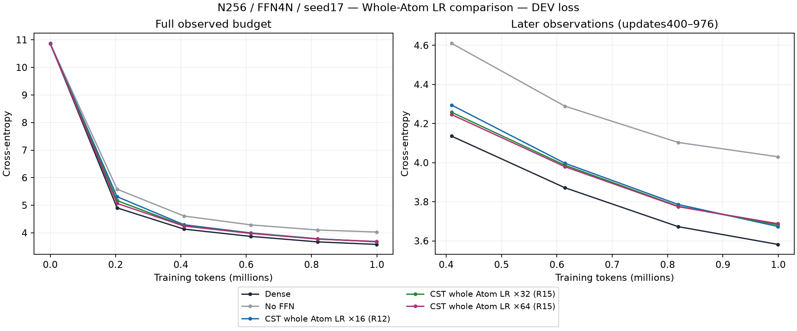
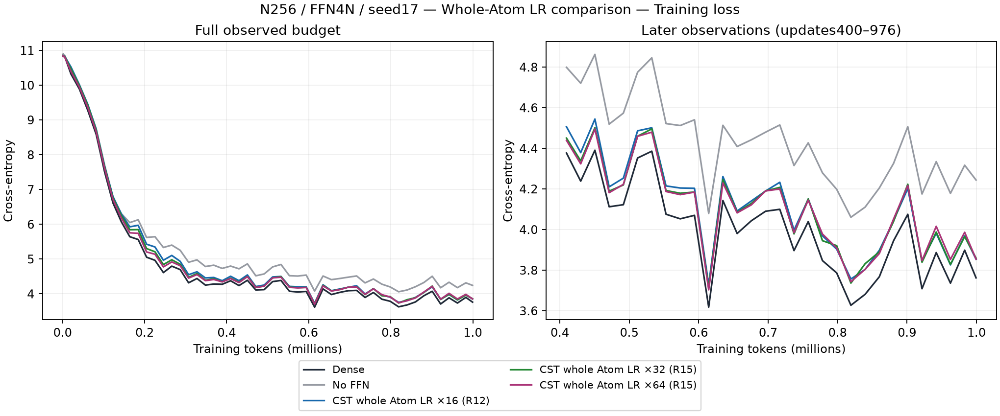
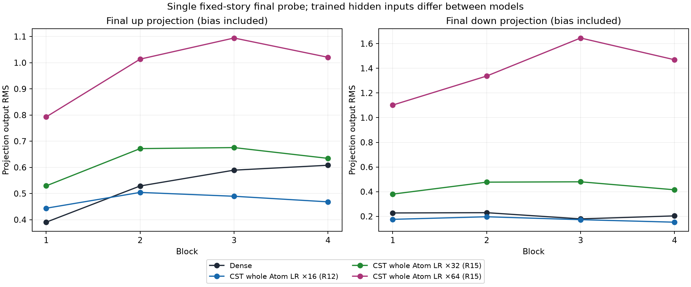
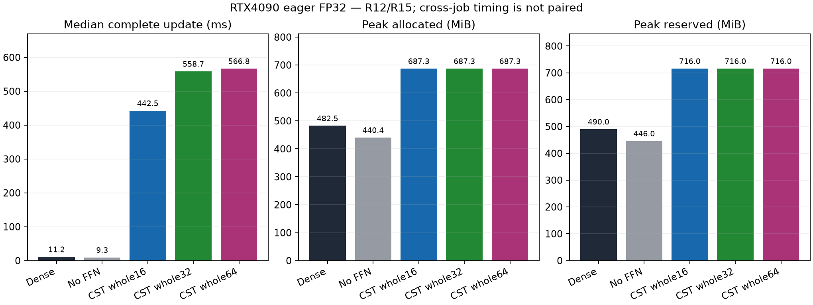

# Atom全体32倍・64倍の学習率の観察（R15）

[English](ffn-whole-lr-r15-20261107.md) | 日本語

ユーザーが訂正した問いに対応し、振幅の連成座標・両中心・Polar外部時間を含むAtom群
全体のLRを、通常のピーク0.0003の32倍・64倍に上げています。
フィールド別アダプタを使わずstock CSTAdamWを使用します。FFNバイアスを含む通常パラメータは
Denseと同じLRです。[振幅だけのR14](ffn-field-lr-r14-20261107.ja.md)は別の比較であり、
Atom全体の問いへの回答には使いません。

N256/FFN4N/4ブロック/CST8投影/c8/seed17、976更新・999,424トークン、予定20Mのデータ・LR期間、
AdamW(.9,.95)、epsilon1e-8、decay0、global clip1、batch2/context128/accumulation4、
eager FP32/TF32offは共通です。モデル・データ・初期化を変えず、Attention・embedding・outputは
Denseです。学習前に32倍・64倍それぞれで独立quadrature、実際256↔1024のY/dX/全Atom VJP、
CPU/nativeのoptimizer状態・タスク復元を検証しました。旧16倍の品質対照は監査済みR12を
再利用し、保存済みstock CSTAdamW学習軌跡との完全一致も別途確認済みです。

| Arm | DEV CE | Confirmation CE | Update median ms | Allocated MiB | Reserved MiB |
| --- | ---: | ---: | ---: | ---: | ---: |
| Dense | 3.581960 | 3.444963 | 11.20 | 482.50 | 490 |
| No FFN | 4.030150 | 3.914033 | 9.29 | 440.39 | 446 |
| CST whole Atom16 | 3.673505 | 3.537554 | 442.45 | 687.28 | 716 |
| CST whole Atom32 | 3.682039 | 3.543642 | 558.73 | 687.28 | 716 |
| CST whole Atom64 | 3.687784 | 3.548570 | 566.82 | 687.28 | 716 |

最終DEVは32倍が16倍より0.008533、64倍が0.014278高い値でした（低い方が良い）。
初期・中盤は先に下がる場合もありますが、短期の最終値は改善しませんでした。
CSTの3設定はいずれもFFNなしより学習し、Denseには届いていません。この1seedの結果で
16倍が最適、統計的同等、収束、別の予算・幅でも最良とは言えません。
128倍・256倍の追加探索は予定していません。倍率の選択にconfirmationは使っていません。

R15の新規4条件はすべて完了し、Dense・FFNなしのDEVとconfirmationは既存対照と完全一致しました。
終了監査で学習後16投影のVJPと4条件のシリアライズ後の実タスク次更新を検証し、
復元パラメータの最大誤差はすべて0、モーメント・カウンタも一致しました。
manifestを含む回収13ファイルをハッシュ照合しました。最初の起動は古いmanifestパスへの参照で、
ソース展開・journal作成・子プロセス開始より前に停止し、失敗を保全しています。
修正版controllerは同じ固定consumer archiveを使い、新規の展開先・出力先で実行しました。
学習の再試行・再開や元checkpointの上書きはありません。

高いAtom全体LRでは固定storyの最終投影RMS、特にdown投影が増えました。
バイアスを含み、モデル間の学習後の隠れ入力も違うため、損失差の因果説明でもDense RMSへ
一致させる必要性の証拠でもありません。旧16倍とR15のジョブ間時間は記述的観測であり、
対になった速度証拠ではありません。FFNパラメータを136,192対2,102,272へ圧縮していますが、
現在のeager CSTは実測allocationと時間ではDenseより大きい値です。

## 来歴と再現

- Consumer: `351617dc81f529ce10e964e5a762f336b7c24b39`。
- Operator: `2b587e0f04ddf64e2bfb0c2e3db591e87a6f6440`。
- Source archive SHA256: `11d3abb09303edf20a1cdea70a8088553bfe8abca48a2370316e296072f9c5e2`。
- Evidence archive SHA256: `c62faae68f548d0bbaf51e5f605f809063547d8a79a05fbe0420ccf1f9901453`。
- Trained audit SHA256: `15f4e15ab773036339d038dda242b95749731f537aa93c3d4898e4d9e3f11392`。
- Evidence manifest SHA256: `f2baa0e512e439f54277d4389f9f27104c5a07cdcec2729d50044ece8bafbd19`。
- Data manifest SHA256: `5b995103ca95d3c9b62a4e860039683dc734b0a0bb20e232db1b2e45aa690d01`。

実機RTX4090 CC8.9・24GB級、Torch2.11.0+cu126、Python3.12.9、NumPy2.0.2です。
raw script・receipt・元checkpoint・manifest・ソース再利用境界の証拠は登録済みの外部証拠保存先に
保持しています。`report-whole-lr-r15-02.py`は回収ツリーを照合し、旧厳格R14 reportのハッシュを
固定してから全16倍の品質対照を選びます。`--root`に回収R15ツリー、`--output`に新規ディレクトリを
指定し、同じ親ディレクトリのR14/R13/R12 reportも用意します。
[figure manifest](assets/ffn-feasibility-20261107/figure-manifest.json)に派生図ハッシュを記録します。
中止済みの長期seedは再開しません。次の限定した工学的検証は公開field_lrsのnative・完全LM対応で、
追加の長期学習やAttention置換ではありません。
