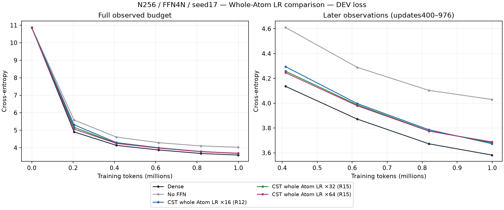
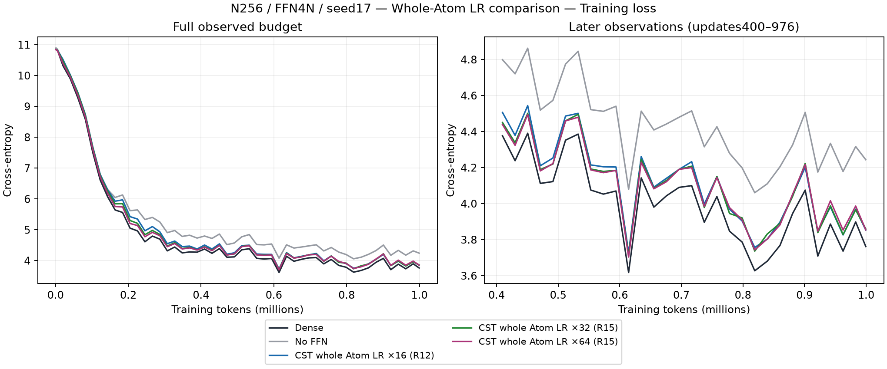
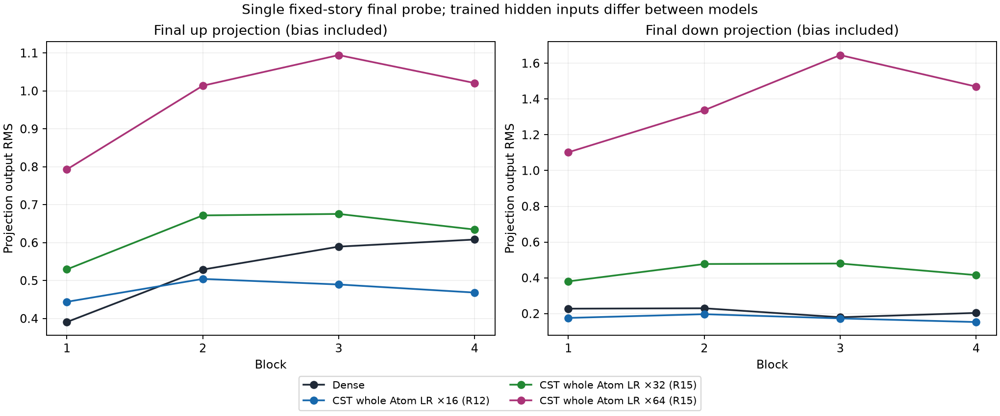
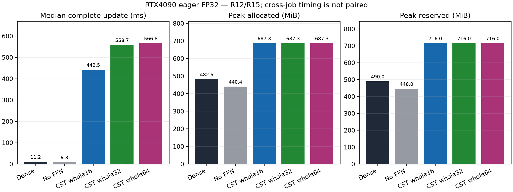

# Whole-Atom32×/64× learning-rate observations (R15)

English (canonical) | [日本語](ffn-whole-lr-r15-20261107.ja.md)

This answers the owner's corrected question: increase the entire Atom group's
LR, including joint amplitude coordinates, both centers and Polar outer time,
to32× or64× the ordinary peak0.0003. It uses stock CSTAdamW without a field-rate
adapter. Ordinary parameters, including FFN biases, retain the Dense LR. The
[amplitude-only R14 result](ffn-field-lr-r14-20261107.md) is a separate contrast
and cannot answer this question.

Same N256/FFN4N/four blocks/eight CST projections/c8/seed17,976updates and999,424
tokens,20M planned data/LR horizon, AdamW(.9,.95), epsilon1e-8, decay0, global
clip1, batch2/context128/accumulation4, eager FP32/TF32off. Model/data/initialization
are unchanged; attention/embedding/output remain Dense. Both exact32/64 recipes
passed independent quadrature, actual256↔1024 Y/dX/all Atom VJPs and CPU/native
optimizer-state/task-resume gates before learning. The original16× quality
baseline is reused from audited R12; its exact equality to the stored stock
CSTAdamW trajectory was separately checked.

| Arm | DEV CE | Confirmation CE | Update median ms | Allocated MiB | Reserved MiB |
| --- | ---: | ---: | ---: | ---: | ---: |
| Dense | 3.581960 | 3.444963 | 11.20 | 482.50 | 490 |
| No FFN | 4.030150 | 3.914033 | 9.29 | 440.39 | 446 |
| CST whole Atom16 | 3.673505 | 3.537554 | 442.45 | 687.28 | 716 |
| CST whole Atom32 | 3.682039 | 3.543642 | 558.73 | 687.28 | 716 |
| CST whole Atom64 | 3.687784 | 3.548570 | 566.82 | 687.28 | 716 |

At the final DEV endpoint,32× is0.008533 and64× is0.014278 above16× (lower is
better). Their initial/middle learning curves sometimes improve more quickly,
but the final short-budget value does not improve. All three CST settings learn
better than no FFN and remain behind Dense. This one-seed result does not prove
16× is optimal, equivalence, convergence or the best rate at other budgets or
widths. No additional128×/256× sweep is implied. Confirmation was not used for
selecting rates.

All four fresh R15 arms completed. Fresh Dense/no-FFN DEV and confirmation
exactly reproduce the retained controls. The terminal audit passed16 trained
projection VJPs and4 serialized actual next-task-step checks; resumed parameter
maximum differences were0, with matching moments/counters. All13 retrieved
archive members including the manifest match their hashes. A pre-execution
launch attempt stopped on a stale manifest path before source extraction,
journaling or any child; it is preserved. The corrected controller used the
same frozen consumer archive with fresh extraction/output paths. No learner
was retried/resumed or original checkpoint overwritten.

Higher whole-Atom rates produced larger final projection RMS on the fixed-story
probe, especially the down-projections. Bias is included and trained hidden
inputs differ, so this is an association, not a causal explanation of the loss
gap or a requirement to match Dense RMS. Cross-job16×/R15 timings are descriptive,
not paired speed evidence. Current eager CST uses more measured allocation and
time than Dense despite the FFN parameter reduction136,192 vs2,102,272.

## Provenance and reproduction

- Consumer: `351617dc81f529ce10e964e5a762f336b7c24b39`.
- Operator: `2b587e0f04ddf64e2bfb0c2e3db591e87a6f6440`.
- Source archive SHA256: `11d3abb09303edf20a1cdea70a8088553bfe8abca48a2370316e296072f9c5e2`.
- Evidence archive SHA256: `c62faae68f548d0bbaf51e5f605f809063547d8a79a05fbe0420ccf1f9901453`.
- Trained audit SHA256: `15f4e15ab773036339d038dda242b95749731f537aa93c3d4898e4d9e3f11392`.
- Evidence manifest SHA256: `f2baa0e512e439f54277d4389f9f27104c5a07cdcec2729d50044ece8bafbd19`.
- Data manifest SHA256: `5b995103ca95d3c9b62a4e860039683dc734b0a0bb20e232db1b2e45aa690d01`.

Actual RTX4090 CC8.9/24GB-class, Torch2.11.0+cu126, Python3.12.9 and NumPy2.0.2.
Raw scripts, receipts, original checkpoints, manifests and the source-reuse
proof remain at the registered external evidence locator. `report-whole-lr-r15-02.py`
validates the retrieved tree and anchors the prior strict R14 report before
selecting the all16 quality baseline. Run it with `--root` pointing to the
retrieved R15 tree and `--output` to a new directory; the sibling R14/R13/R12
reports are required. The [figure manifest](assets/ffn-feasibility-20261107/figure-manifest.json)
records derived hashes. Cancelled long seeds remain stopped. The next bounded
engineering gate is public field_lrs native/full-LM validation, not more learning
or Attention replacement.
