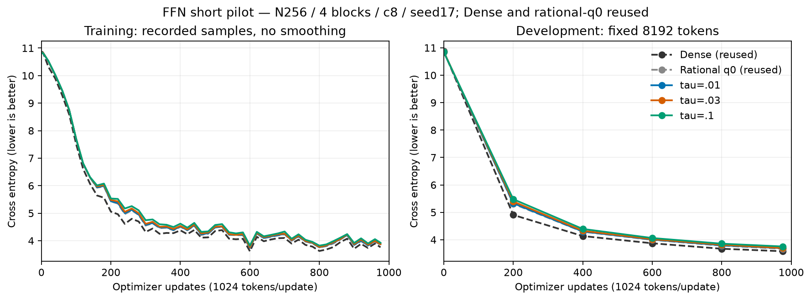
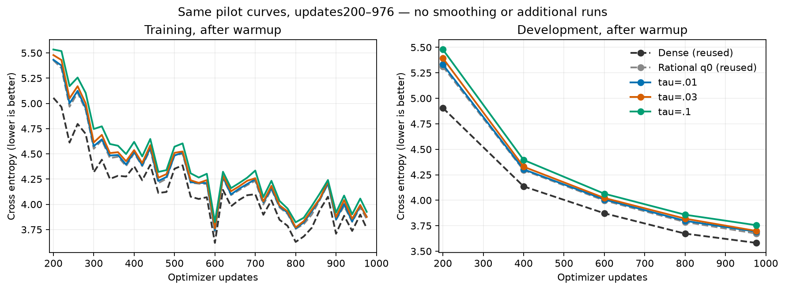
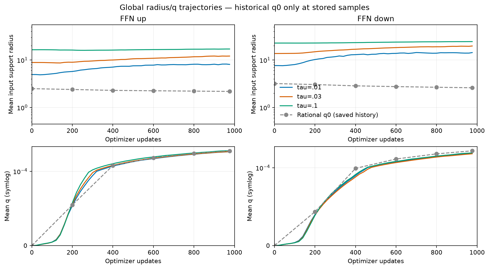
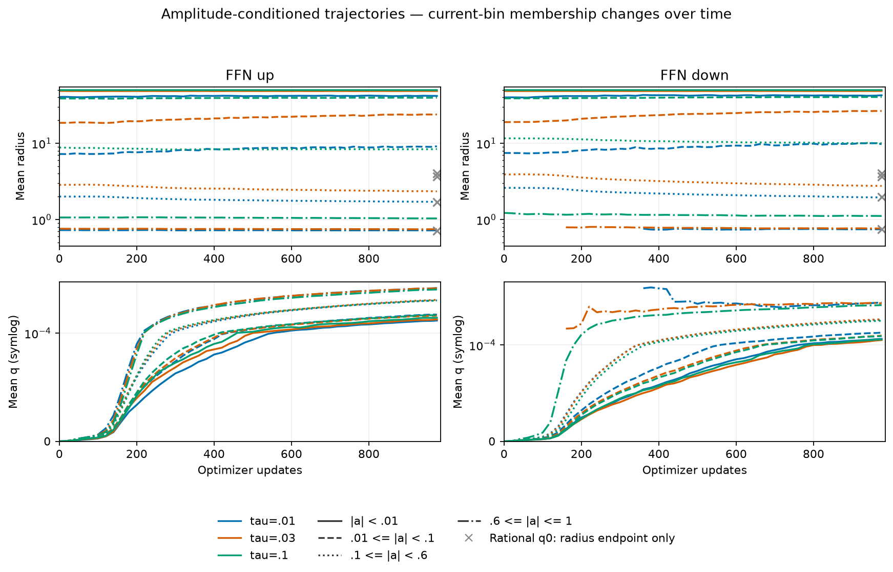
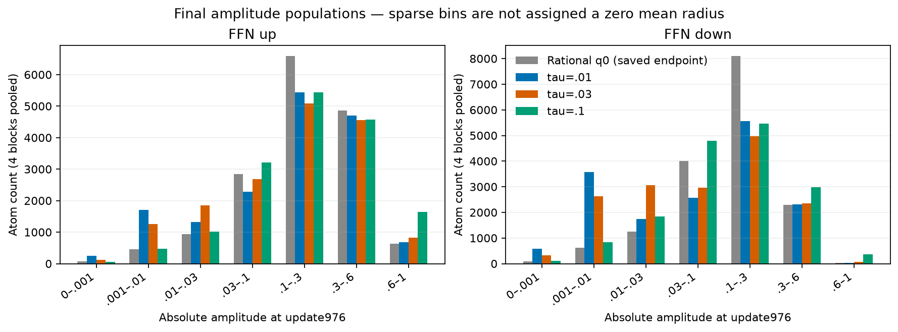
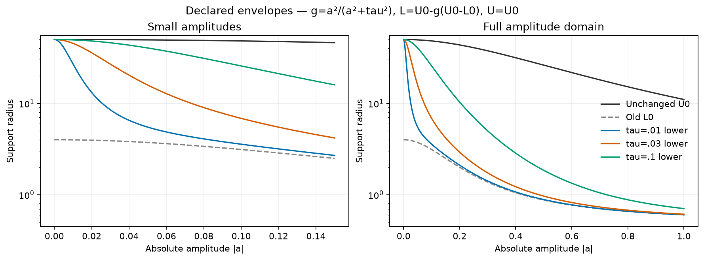

# ゼロから徐々に開く境界のFFN結果

[English (canonical)](ffn-zero-opening-results-20261107.md) | 日本語

3条件とも976更新/999424トークンを完了し、学習済み監査も通りました。
このseed17短期比較では tau=.01 のDEV CEが最小で、再利用した従来q0との差は
+0.018225 でした。記述的なDEV観測であり、最適tauや収束の主張ではありません。
[実行前プロトコル](ffn-zero-opening-20261107.ja.md)に条件を残しています。

式は `g=a²/(a²+tau²), L=U0-g*(U0-L0), U=U0`、初期q=0です。
U0と強振幅側は従来の有理式を保ち、ゼロ近傍の開き方を変えています。
|a|=tauで従来の隙間の半分になります。幅256、FFN4N、pre-LN4ブロック、
8射影、各4096Atom、c8、seed17、context128、batch2/累積4、eager FP32/TF32無効、
AdamW(.9,.95)、decay0、clip1、baseLR3e-4/Atom全体LR16倍、20Mトークン予定を共通にしました。
Attention・埋め込み・出力重みはDenseです。

| Condition | DEV CE | DEV PPL | Update ms | Allocated MiB | Reserved MiB |
| --- | ---: | ---: | ---: | ---: | ---: |
| Dense (reused) | 3.581960 | 35.9439 | 11.16 | 482.50 | 490 |
| Rational q0 (reused) | 3.673505 | 39.3897 | 442.45 | 687.28 | 716 |
| tau=.01 | 3.691730 | 40.1142 | 515.39 | 687.28 | 716 |
| tau=.03 | 3.699177 | 40.4140 | 513.34 | 687.28 | 716 |
| tau=.1 | 3.755353 | 42.7493 | 505.37 | 687.28 | 716 |






| Condition / direction | Mean radius | Mean q | Weak radius / count | Strong radius / count |
| --- | ---: | ---: | ---: | ---: |
| tau=.01 / up | 8.08107 | 0.000196525 | 41.7622 / 1955 | 0.721334 / 685 |
| tau=.01 / down | 14.3353 | 0.000161361 | 42.5956 / 4165 | 0.745984 / 39 |
| tau=.03 / up | 12.11 | 0.000197271 | 48.3862 / 1380 | 0.748141 / 824 |
| tau=.03 / down | 19.738 | 0.000158144 | 48.4933 / 2949 | 0.765875 / 79 |
| tau=.1 / up | 17.0502 | 0.000204074 | 49.8397 / 524 | 1.036 / 1637 |
| tau=.1 / down | 24.4263 | 0.000163173 | 49.8479 / 938 | 1.11444 / 373 |










| Condition / direction | Initial amplitude RMS (site mean) | Clipped Atoms /16384 |
| --- | ---: | ---: |
| tau=.01 / up | 0.230343 | 0 |
| tau=.01 / down | 0.120256 | 0 |
| tau=.03 / up | 0.243625 | 0 |
| tau=.03 / down | 0.135759 | 0 |
| tau=.1 / up | 0.303623 | 16 |
| tau=.1 / down | 0.192422 | 0 |


DEVは固定8192トークンです。Denseと従来q0は監査済みR12曲線を再利用し、
対照を再学習していません。従来q0の全初期Parameter byte・8初期化レポートが
凍結済み旧ソースと一致しました。過去のall16 wrapperとstockも、共通53学習点と
6 DEV点で一致済みです。confirmationや生成結果による選択は行っていません。

半径/qはup/down別に4層をAtom個数で重み付けします。同じ境界なので入出力半径は等しく、
弱振幅は|a|<.01、強振幅は|a|>=.6です。bin所属は学習中に変わります。
新3条件は各射影で初期・1–5・20更新ごと・976の55時点の個数、平均、p10/p90、L/Uを保存。
空binは欠測です。従来q0は全体の6時点と半径binの最終値のみがあり、灰色の×は
その終点だけを表します。存在しない途中のbin/q履歴は補間していません。
初期operator energyは同一Dense二次モーメントへ誤差.5%以内で再校正しています。
振幅そのものは同じではなく、初期RMSとclippingを上の表に残しました。

更新時間は同期したoptimizer更新全体の中央値で、診断と評価を除きます。
メモリは更新全体のallocated/reservedピークで、GPUプロセス全体の値ではありません。
過去対照を同時再実行しておらず、計測付き経過時間と別jobの資源比較は探索的です。
普遍的な速度・メモリ優位は主張しません。

## 検証とソース

operator `f864e3c9e57f5214462212e3fc05b898577438a8`、consumer `8e34d44f86ad16db4e6f721c3579c4a48b45828b`。
実機RTX4090、capability8.9、Torch2.11.0+cu126、Python3.12.9です。
native端点テストは3tauとq両端を含み、各recipeで独立求積・実FFN両方向の
全Atom勾配・optimizer moment/再開・4ブロック実タスク/再開を学習前に検証。
学習後も全24射影VJP、DEV3件の厳密再計算、3件の次更新Parameter/optimizer state厳密一致、
最終geometry/checkpoint一致が通りました。compact raw全39ファイルの
取得とハッシュを検証し、原ソースと大きいcheckpointはHubに保持しています。
所有workerは終了し、サーバーは維持しています。archive SHA256は
`310003c3aee8de66c49b6781dec9e1a304bd0bea826e62cbfcafb3d6bdeb6738`です。
[figure manifest](assets/ffn-zero-opening-20261107/figure-manifest.json)に新旧raw入力・描画ソース・PNG/SVGの対応を保存しています。

tau=.01,.03,.1ごとに新しい出力先と同じ凍結データを使用します。
```bash
# Use the frozen operator/consumer revisions and the fixed data manifest.
python -m pytest torchcst/tests/test_closed_radius_envelope.py torchcst/tests/test_zero_opening_radius.py -q
python -m cst_research.experiments.ffn_envelope --output QUAL --q 0 \
  --radius-envelope rational_zero_opening --zero-opening-scale TAU
python -m cst_research.experiments.ffn_run --data DATA \
  --data-manifest-sha256 5b995103ca95d3c9b62a4e860039683dc734b0a0bb20e232db1b2e45aa690d01 \
  --qualification QUAL/qualification.json --qualification-sha256 QUAL_SHA --output OUT \
  --kind cst --seed 17 --tokens 1000000 --schedule-tokens 20000000 \
  --max-wall-seconds 2400 --width 256 --expansion 4 --coefficient 8 \
  --atom-lr-multiplier 16 --q 0 --radius-envelope rational_zero_opening \
  --zero-opening-scale TAU --track-envelope --development-only
```


## 次の下限案（未学習）

ユーザーから、広い半径を強制するのをゼロのごく近傍に限定し、それ以外では
L–Uの区間をもっと広くする提案がありました。今回の式は常にL>=L0なので、
従来のゼロ近傍の下限約4をr_minまで下げることはできません。別案として
U=U0を保ち、次の式を考えられます。

$$L_*(a)=r_{min}+(U_0(a)-r_{min})\frac{\varepsilon^2}{a^2+\varepsilon^2}.$$

a=0でU0と厳密に合流し、離れるとr_minへ近づきます。例示としてepsilon=.001、
r_min=.5なら、今回のU0定数でL(.01)約.990、L(.03)約.555です。有限のゼロ近傍で
完全一致する式ではなく、厳密な合流はゼロのみです。この案は実装・検証・学習を
行っていません。初期q=0では実半径もLなので、下限を下げると初期状態も局所的に
なります。今回の最終の全体平均qは約2e-4と小さかったため、選べる区間の広さと
qが選んでいる実半径を分けて評価し、今後試す場合もDense二次モーメントへ再校正する
必要があります。図のq軸は観測範囲へ拡大しています。
