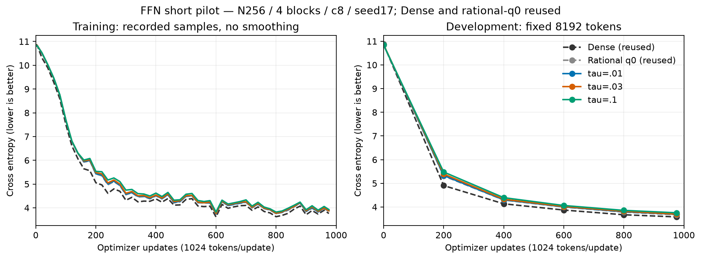
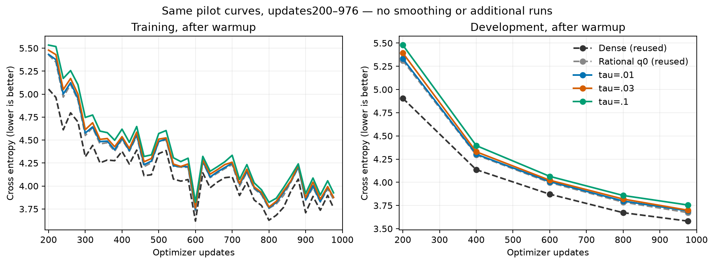
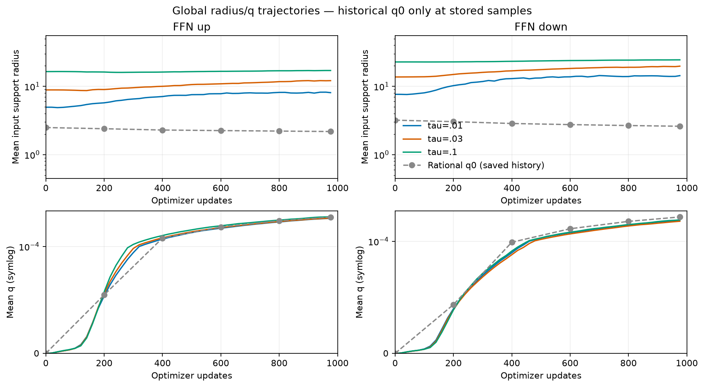
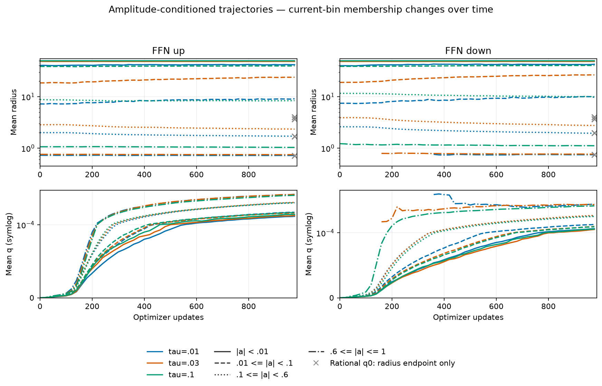
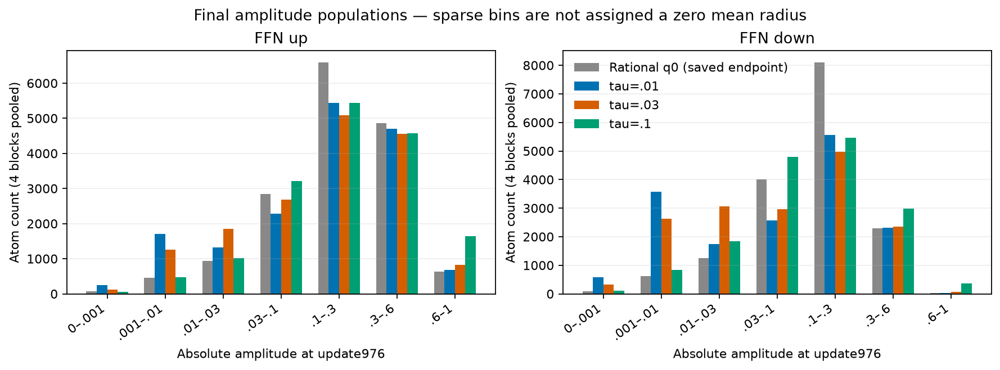
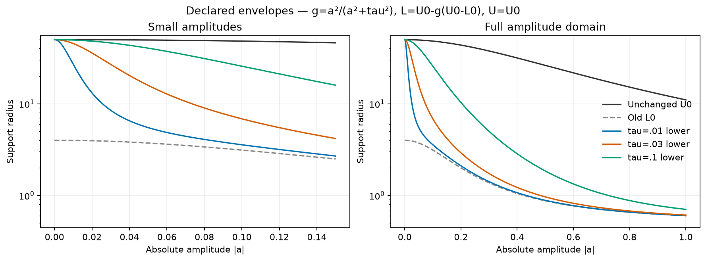

# Gradual zero-opening FFN results

English (canonical) | [日本語](ffn-zero-opening-results-20261107.ja.md)

All three tau arms completed976 updates/999424 tokens and passed trained audits.
Among these short seed17 runs, tau=.01 has the lowest DEV CE, with signed
CE difference +0.018225 relative to the reused rational-q0 control.
This is a descriptive DEV observation, not an optimal-tau or convergence claim.
See the [pre-execution protocol](ffn-zero-opening-20261107.md).

The map is `g=a²/(a²+tau²), L=U0-g*(U0-L0), U=U0`, q initially0.
U0 and the strong-amplitude behavior retain the rational reference; only the
opening near zero changes. At |a|=tau the interval is half the old gap.
N256, FFN4N, four pre-LN blocks, eight CST projections,4096 Atoms per projection,
c8, seed17, context128, batch2/accumulation4, eager FP32/TF32off, AdamW(.9,.95),
decay0, clip1, baseLR3e-4/whole-Atom LR16 and20M-token horizon are shared.
Attention, embedding and output weights remain Dense.

| Condition | DEV CE | DEV PPL | Update ms | Allocated MiB | Reserved MiB |
| --- | ---: | ---: | ---: | ---: | ---: |
| Dense (reused) | 3.581960 | 35.9439 | 11.16 | 482.50 | 490 |
| Rational q0 (reused) | 3.673505 | 39.3897 | 442.45 | 687.28 | 716 |
| tau=.01 | 3.691730 | 40.1142 | 515.39 | 687.28 | 716 |
| tau=.03 | 3.699177 | 40.4140 | 513.34 | 687.28 | 716 |
| tau=.1 | 3.755353 | 42.7493 | 505.37 | 687.28 | 716 |






| Condition / direction | Mean radius | Mean q | Weak radius / count | Strong radius / count |
| --- | ---: | ---: | ---: | ---: |
| tau=.01 / up | 8.08107 | 0.000196525 | 41.7622 / 1955 | 0.721334 / 685 |
| tau=.01 / down | 14.3353 | 0.000161361 | 42.5956 / 4165 | 0.745984 / 39 |
| tau=.03 / up | 12.11 | 0.000197271 | 48.3862 / 1380 | 0.748141 / 824 |
| tau=.03 / down | 19.738 | 0.000158144 | 48.4933 / 2949 | 0.765875 / 79 |
| tau=.1 / up | 17.0502 | 0.000204074 | 49.8397 / 524 | 1.036 / 1637 |
| tau=.1 / down | 24.4263 | 0.000163173 | 49.8479 / 938 | 1.11444 / 373 |










| Condition / direction | Initial amplitude RMS (site mean) | Clipped Atoms /16384 |
| --- | ---: | ---: |
| tau=.01 / up | 0.230343 | 0 |
| tau=.01 / down | 0.120256 | 0 |
| tau=.03 / up | 0.243625 | 0 |
| tau=.03 / down | 0.135759 | 0 |
| tau=.1 / up | 0.303623 | 16 |
| tau=.1 / down | 0.192422 | 0 |


DEV uses8192 fixed tokens. Dense and rational-q0 are reused audited R12 curves;
no baseline learner ran again. Every old-q0 initial Parameter byte and all eight
initialization reports matched the frozen historical source. The historical
all16 wrapper also matched stock training at53 shared training points and six
DEV points. No confirmation set or generations were used for pilot selection.

Radius/q means pool four blocks by Atom count, separately for up/down. Input
and output radii are equal with these shared bounds. Weak means |a|<.01,
strong means |a|>=.6. Bin membership changes over training. All new arms retain55
samples per site, at0,1–5,every20 updates and976, with counts, means,p10,p90,L/U.
Empty bins are missing. Old q0 has only six saved global samples and a final
radius-bin endpoint; gray crosses show only that endpoint. No missing historical
bin/q trajectories are filled in. Initial operator energy was recalibrated to
identical Dense second-moment targets within.5%; amplitudes need not be identical.
Clipping and initial amplitude RMS are retained above.

Update time is the median synchronized complete optimizer update, excluding
geometry probes/evaluation. Memory is complete-update allocated/reserved peak,
not whole-process GPU usage. These historical controls were not rerun as a paired
speed experiment. Instrumented elapsed times and cross-job resource comparisons
remain exploratory; no universal speed/memory claim follows.

## Verification and source identity

Operator `f864e3c9e57f5214462212e3fc05b898577438a8`; consumer `8e34d44f86ad16db4e6f721c3579c4a48b45828b`. Actual GPU NVIDIA GeForce RTX4090,
capability8.9, Torch2.11.0+cu126, Python3.12.9. The native endpoint suite includes
all three tau values and both q endpoints. Each recipe passed independent
quadrature, both actual FFN directions/all-Atom VJPs, optimizer moments/resume
and full four-block task/resume before learning. Trained audits passed24
projection VJPs, three exact DEV recomputations, three exact restored next task
updates/optimizer states and final geometry/checkpoint consistency checks.
All 39 compact raw members were retrieved and hash-verified;
source and original bulky checkpoints remain intact on the owned Hub, workers
inactive, server retained. Compact archive SHA256 `310003c3aee8de66c49b6781dec9e1a304bd0bea826e62cbfcafb3d6bdeb6738`.
The [figure manifest](assets/ffn-zero-opening-20261107/figure-manifest.json) binds
new raw evidence, historical inputs, plot source and PNG/SVG hashes.

Use tau=.01,.03,.1 separately, fresh output paths and the same frozen data.
```bash
# Use the frozen operator/consumer revisions and the fixed data manifest.
python -m pytest torchcst/tests/test_closed_radius_envelope.py torchcst/tests/test_zero_opening_radius.py -q
python -m cst_research.experiments.ffn_envelope --output QUAL --q 0 \
  --radius-envelope rational_zero_opening --zero-opening-scale TAU
python -m cst_research.experiments.ffn_run --data DATA \
  --data-manifest-sha256 5b995103ca95d3c9b62a4e860039683dc734b0a0bb20e232db1b2e45aa690d01 \
  --qualification QUAL/qualification.json --qualification-sha256 QUAL_SHA --output OUT \
  --kind cst --seed 17 --tokens 1000000 --schedule-tokens 20000000 \
  --max-wall-seconds 2400 --width 256 --expansion 4 --coefficient 8 \
  --atom-lr-multiplier 16 --q 0 --radius-envelope rational_zero_opening \
  --zero-opening-scale TAU --track-envelope --development-only
```


## Next lower-envelope proposal (not trained)

The owner suggested restricting broad compulsory support to amplitudes very near
zero while allowing a much wider L–U interval elsewhere. The tested map always
keeps L>=L0; it cannot lower the old near-zero baseline of about4 toward r_min.
A separate candidate would keep U=U0 and set

$$L_*(a)=r_{min}+(U_0(a)-r_{min})\frac{\varepsilon^2}{a^2+\varepsilon^2}.$$

At a=0 it joins U0 exactly; away from zero it approaches r_min. For illustration
only, epsilon=.001 and r_min=.5 yield L(.01)~.990 and L(.03)~.555 under these
U0 constants. A finite zero neighborhood is only approximately closed by this
formula; exact closure is at zero. This candidate has not been implemented,
qualified or trained. Initial q=0 makes the actual radius equal L, so lowering
L also sharpens initialization. The observed global mean q was only about2e-4
at the end. The allowed interval and actual q-selected radius should therefore
be assessed separately, with the Dense second-moment target recalibrated for
any subsequent experiment. The plotted q axes zoom to the observed range.
