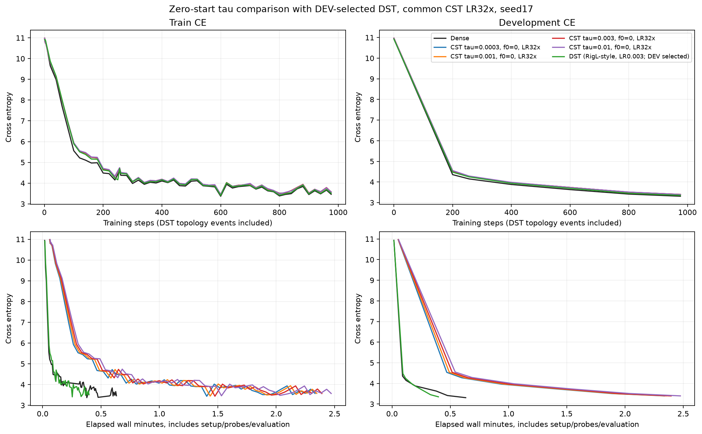
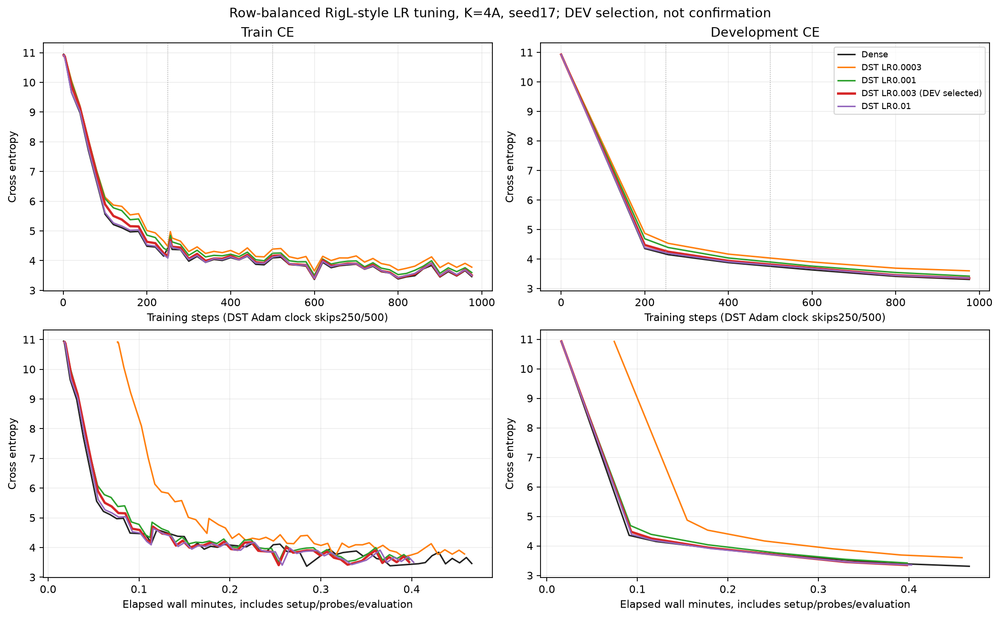
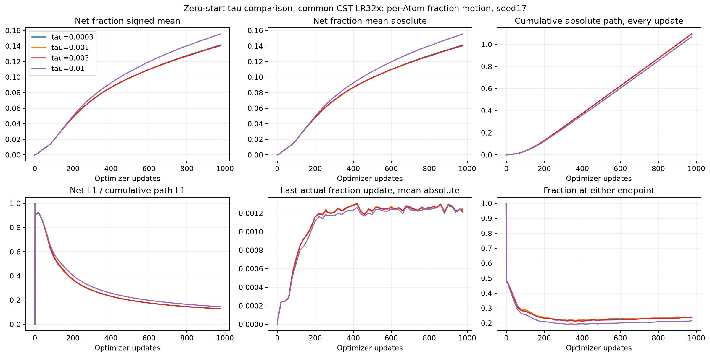
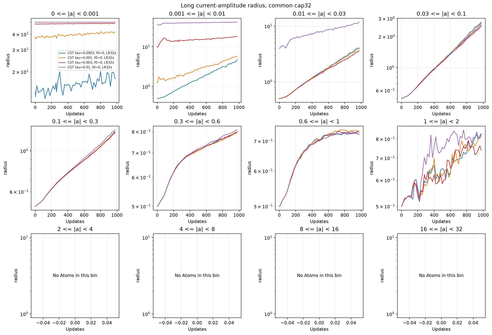

# fraction0のtau探索とTinyStoriesのDST対照

[English (canonical)](ffn-zero-start-tau-dst-20261109-results.md) | 日本語

2026-11-09、RTX6000 Adaで完了。tauを.0003〜.01に変えてもDenseとの差は埋まらず、
CSTのDEV CEは3.393048〜3.398653でした。
今回の最小はtau0.003の3.393048。開発用DEVで選択した
行予算保存RigL-style参照は3.350667で、CST最良より
0.042381低い結果です。Denseは3.308982。
1seed・976stepの開発用観測で、統計的優越・収束・普遍最適値の主張ではありません。

## 固定した学習条件

[計画](ffn-zero-start-tau-dst-20261109.ja.md)：TinyStories、幅512、pre-norm4ブロック、
8heads、context128、FFN拡大率4。FFN8行列を置換し、Attention・embedding・共有headは
Dense。CSTは各8192Atoms、初期fraction0、振幅上限32、半径[.5,50]、M8、
levels_wide_amplitude。振幅・入出力中心・fractionすべて基準LRの32倍、最大.0096。
他のParameterは基準LR3e-4。tauは.0003/.001/.003/.01。公開moment目標は共通ですが、
tauによって振幅初期値と振幅依存の半径境界がともに変わり得ます。出力/probe RMS校正なし。

全条件seed17、同じtoken順、976学習step/999424tokens、batch2×128×蓄積4、
256step時点も保存。AdamW betas(.9,.95)、eps1e-8、WD0、global clip1、warmup200、
共通20M-token LR予定長。Parameter/moment/physical rowはFP32、CST写像内部はFP64、
TF32off、eager、PyTorch2.9.1+cu128、CUDA12.8。DEV8192targetsのみでconfirmation未使用。
各jobの新規Denseは3.308982を再現し、tau.003も前の0スタートを再現。

## DSTの定義・予算・LR調整

過去のDSTは[HIGGS](higgs-dst-comparison.ja.md)で、今回のLMではありません。
[固定したHIGGS行予算保存参照](https://github.com/takumiecd/torchcst/blob/f37729e61dc11a57e76103aa2457c2be11c4c306/benchmarks/training/higgs_dst_reference.py)
を長方形LMへ移植し、RigL-styleと表示します。[原論文](https://arxiv.org/abs/1911.11134)
そのままの再現ではなく、LMへの研究用適用です。

各FFNでK=4A=32768有効scalarスロット、密度3.125%、up行あたり16/down行あたり64。
有効FFNスロット+biasは272384でCSTの学習scalar数と一致。新規成長した0もスロットです。
mask探索と連続CSTの幾何には異なる制約があり、scalar数一致は関数族一致ではありません。
参照実装はFFN Parameter要素をbias込み8398848個保存し、さらにDense mask/成長勾配を
持ちます。CSTのFFN Parameter保存要素は272384。有効予算とTensor.numel/保存量を区別します。

名前付きのランダムなDense normal初期値をmaskし、1/sqrt(行密度)倍して目標二次momentを維持。
通常Parameterの初期値はDenseと完全一致し、DST4候補の初期Parameter/mask hashも同一。
疎重みの最大LRだけ探索し、他は3e-4のままです。全体の絶対重みでpruneし、各行に旧接続を
最低1個残し、生のDense勾配で行予算まで再成長。同点は小さい列を優先。成長重みは0、
prune/成長(即時再成長を含む)のmomentは0にし、真の生存重み/momentは保存します。

cadence250、初期drop.3、cosine終点floor(.75×976)=732より手前なのでeventは250/500。
旧参照同様、eventは全ParameterのAdam更新を置換し、976学習stepに対しAdam更新974回。
生の蓄積成長勾配はmask/clip前、通常更新は無効dWをmask後にglobal clip。図の横軸と
checkpointのcounterでもこの違いを保持します。

| Sparse-weight peak LR | DEV CE976 | Selected |
|---|---:|---|
| 0.0003 | 3.600084 |  |
| 0.001 | 3.419746 |  |
| 0.003 | 3.350667 | yes |
| 0.01 | 3.353339 |  |


最終976stepのDEV CE最小、同点なら低LRという事前規則で選択。主図は選択候補を重ね、
別図に4候補すべてを保存。DEVでの調整であり、confirmationや最適DSTの主張ではありません。

## 損失・時間・メモリ

| Arm | DEV CE976 | Training steps / Adam updates | Scoped median ms | Allocated / reserved peak MiB |
|---|---:|---:|---:|---:|
| Dense | 3.3090 | 976 / 976 | 21.63 | 952.66 / 1168 |
| CST tau=0.0003 | 3.3964 | 976 / 976 | 125.92 | 975.53 / 1300 |
| CST tau=0.001 | 3.3987 | 976 / 976 | 126.64 | 975.53 / 1302 |
| CST tau=0.003 | 3.3930 | 976 / 976 | 127.52 | 975.53 / 1302 |
| CST tau=0.01 | 3.3954 | 976 / 976 | 130.66 | 975.53 / 1302 |
| DST LR=0.003 (DEV selected) | 3.3507 | 976 / 974 | 22.20 | 945.86 / 1010 |


CST−Dense差は0.084067、DST−Dense差は
0.041685。今回の短期比較ではDSTの方がDenseに
近い結果でした。CSTに残る差が幾何・最適化・Atom数・学習長のどれによるかは特定できず、
少なくとも今回の範囲ではtauを下げるだけでは解消しませんでした。

時間は転送・蓄積・forward/backward・clip・optimizerまたはtopologyを含み、zero_grad・
LR設定・probe・評価・observerを除きます。topology eventは全step集計に含みつつ別記録。
準備/wall時間と全候補のeventは[JSON](ffn-zero-start-tau-dst-20261109-results.json)に保存。
allocated/reservedはPyTorch peakで、process全体/Graphではありません。別source固定jobの
逐次測定で、順序反転はしていません。

DSTはDense保存/行列積の精度参照で、最適化済み疎kernelではありません。DST consumerは
返されたlogitsを直ちに解放しますが、以前の通常consumerはmicrobatch間で`_`にlogitsを
保持するため、一時Tensorの寿命も異なります。測定した速度/peak差を疎性に帰属したり、
疎DSTの効率として扱うことはできません。精度・データ・有効Parameter予算の比較とは区別します。










追加のCST診断(DSTには半径/fraction fieldがありません)：

- [adam-fraction-updates](assets/ffn-zero-start-tau-dst-20261109/adam-fraction-updates.png)
- [long-activation-rms](assets/ffn-zero-start-tau-dst-20261109/long-activation-rms.png)
- [long-amplitude-radius_fraction](assets/ffn-zero-start-tau-dst-20261109/long-amplitude-radius_fraction.png)
- [long-development-tail](assets/ffn-zero-start-tau-dst-20261109/long-development-tail.png)
- [long-field-gradients](assets/ffn-zero-start-tau-dst-20261109/long-field-gradients.png)
- [long-fraction_change-layers](assets/ffn-zero-start-tau-dst-20261109/long-fraction_change-layers.png)
- [long-radius-layers](assets/ffn-zero-start-tau-dst-20261109/long-radius-layers.png)
- [long-radius_fraction-layers](assets/ffn-zero-start-tau-dst-20261109/long-radius_fraction-layers.png)
- [radius-update-components](assets/ffn-zero-start-tau-dst-20261109/radius-update-components.png)

## 正しさ・監査・取得

CST4設定は全写像VJP・未完了forward保持・境界0のserialize後の次更新完全一致を新規GPU
検査。operator68項目は全byte・GPU/runtime・hash一致でのみ再利用。DST4LRは長方形の
独立FP64 Y/dX/生dW/有効dW、通常初期値共有、通常/topology次stepのserialize一致、
invariant検査を通過しました。CPUで同点・行/全体予算・moment reset/生存保存・全Parameter
時計停止、作図時のデータ/source/model/予算/選択不一致の拒否も検査。最終suite250件は
189passed/61optional skips、36studyも検証成功。

最終/途中の計20checkpointでDEV CE完全再現。FP32 moment有限、CST/Denseは256/976、
DSTは255/974counter、範囲/maskを確認。学習後CST up/downの16VJPは従来1e-4/4e-3で
通過し、Y/dX/全Atom微分の最大絶対差は
2.0611222e-06/2.7084214e-06/5.7220459e-06。
DST up/downの16oracleも同じgateを通過し、Y/dX/生dWの最大絶対差は
8.2434292e-07/1.5144821e-06/1.9414173e-06。
CST observerの8時点net変化も独立再現。両固定sourceは不変で、source/compact全ファイルと
remote checkpoint hash30個を検証。job別取得/監査はJSONに保存。所有21PIDは終了、
GPU0%、39MiB。大きなcheckpointはremote保全、compact/sourceはlocal取得済み。
学習失敗の再調整・数値gate緩和・confirmation評価・RMS校正・公開default採用・追加実験の
自動実行はありません。

## 来歴・再現

CST_RESEARCH_EVIDENCE_ROOT配下の`ffn-zero-start-tau-6000ada-20261109-01`と
`ffn-dst-tinystories-6000ada-20261109-01`に証拠を保全。raw log/checkpointはGit外です。
各jobにsource archive・protocol・driver・receipt・checkpoint hash・元の監査を保持。
作図は検証済み両jobを読み、実行receiptを書き換えません。モデル/runner source・データ・
runtime・形・予算・選択を照合。新tau図では--dst-runを必須とし、異なる過去タスクを
黙って重ねません。学習後の作図は固定学習sourceを変更しません。

| Job | Identity | Value |
|---|---|---|
| CST | consumer_commit | `cd7d7476db40202d3f0febdccf2caf46e0909e32` |
| CST | source_archive_sha256 | `63376b2cd42a33cda9e87bb29dc6c67b2c84d4cd1f07d2fefbb64139dc795473` |
| CST | qualification_sha256 | `aeba44e0c6d4c31f49bab5e62e7e36a2d553c5d56a8e7a77daa51f43e44db9e0` |
| CST | compact_archive_sha256 | `2999fa8cc45676925e7e6a7cd707f9b3b450a176bd8be58921ed3f09b1d2baff` |
| DST | consumer_commit | `778c57e889c2b2c9a9bcc5f8316ca88443bb1af1` |
| DST | source_archive_sha256 | `f307928998af1d6505277b6a0c8c51a8ae3593d7df91c1e4913198d129d29251` |
| DST | qualification_sha256 | `c54bafccab3a7212af146e86e7875069be380a77bafa8c983ed667a9c92599df` |
| DST | compact_archive_sha256 | `c4b0f9b4a7d19f23fdcd4521f75f460b6d761b12d5ce6c173ac3a193efede6a5` |
| Both | torchcst operator | `0d277ae6dc0ae14fe515c7559f39535ed0238950` |
| Both | data manifest | `5b995103ca95d3c9b62a4e860039683dc734b0a0bb20e232db1b2e45aa690d01` |


両方の検証済みcompactをretrieval-integrity.json/retrieved/とともに復元し、reporting依存を
導入すると再生成できます。

```bash
python scripts/plot_ffn_fraction_start.py --run "$CST_RESEARCH_EVIDENCE_ROOT/ffn-zero-start-tau-6000ada-20261109-01" --dst-run "$CST_RESEARCH_EVIDENCE_ROOT/ffn-dst-tinystories-6000ada-20261109-01"
python scripts/plot_ffn_fraction_lr.py --run "$CST_RESEARCH_EVIDENCE_ROOT/ffn-zero-start-tau-6000ada-20261109-01"
python scripts/plot_ffn_dst_lr.py --run "$CST_RESEARCH_EVIDENCE_ROOT/ffn-dst-tinystories-6000ada-20261109-01" --output "$CST_RESEARCH_EVIDENCE_ROOT/ffn-zero-start-tau-6000ada-20261109-01/figures"
```
