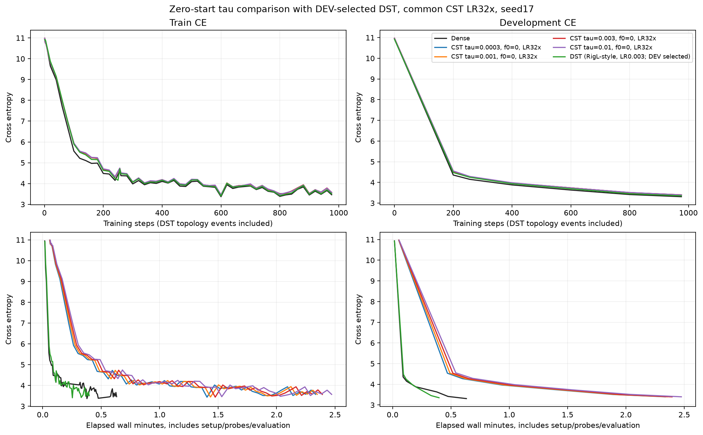
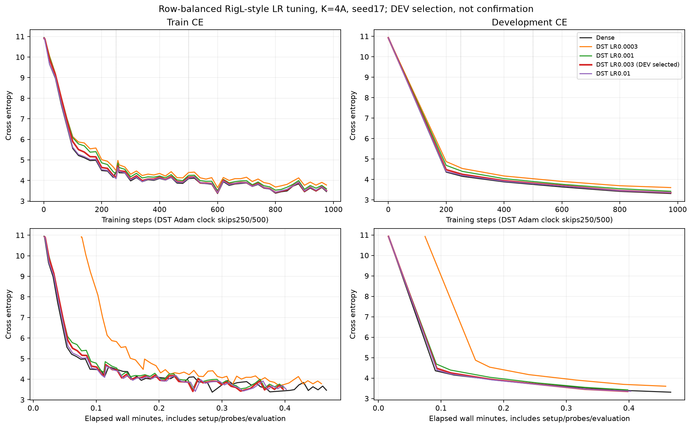
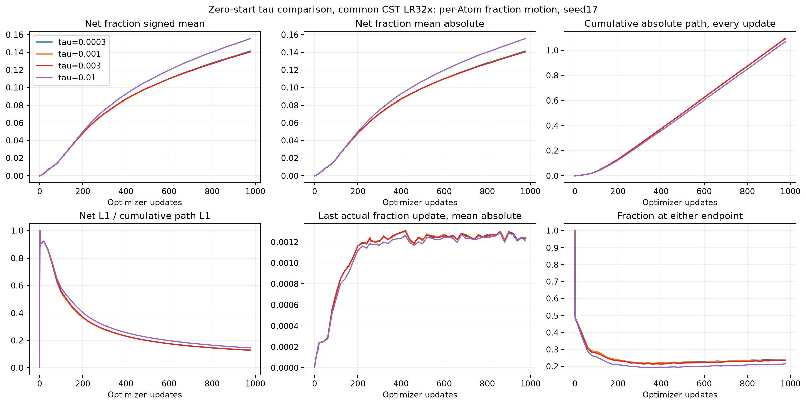
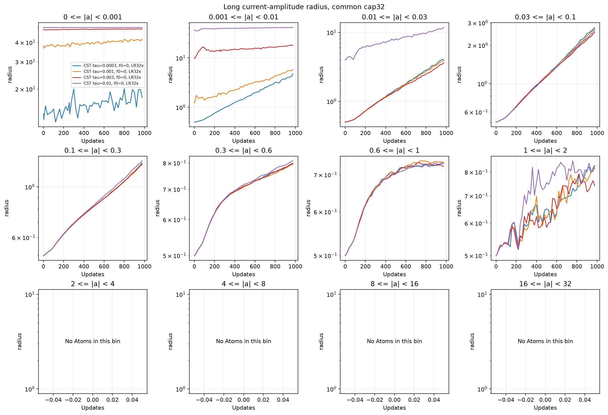

# Zero-start tau sweep with a matched TinyStories DST reference

English (canonical) | [日本語](ffn-zero-start-tau-dst-20261109-results.ja.md)

Completed on RTX 6000 Ada,2026-11-09. Changing tau from .0003 to .01 did not close
the Dense gap: CST DEV CE spans 3.393048–3.398653.
The lowest observed CST value is tau=0.003, CE=3.393048.
The development-selected row-balanced RigL-style reference has CE 3.350667,
0.042381 lower than the best CST in this pilot.
Dense is 3.308982. These are one-seed/976-step development
observations,not statistical superiority,convergence or universal optimum claims.

## Fixed learning conditions

[Protocol](ffn-zero-start-tau-dst-20261109.md): TinyStories,width 512,four pre-norm
blocks,8heads,context128,FFN expansion4. All 8 FFN maps are replaced;attention,
embedding and tied vocabulary head stay Dense. CST has 8192 Atoms/map,initial
fraction 0,amplitude cap32,radius[.5,50],M8,levels_wide_amplitude. All CST fields
(amplitude,input/output centers,fraction) share 32× base LR,peak .0096. Non-Atom
parameters stay at base LR 3e-4. Four tau arms=.0003/.001/.003/.01. Same public
moment targets,without output/probe-RMS calibration; each tau's initializer can
change amplitudes as well as the amplitude-dependent radius bounds.

All runs use seed 17,same token order,976training steps/999424tokens,batch2×128×
accumulation4,256step prefix,AdamW betas(.9,.95),eps1e-8,WD0,global clip1,
200-step warmup and common20M-token LR horizon. FP32 Parameters/moments/physical
rows,FP64 CST map intermediates,TF32off,eager,PyTorch2.9.1+cu128,CUDA12.8.
Only 8192 DEV targets;confirmation untouched. Fresh Dense control in each job
reproduces CE3.308982;tau.003 repeats the earlier zero-start result.

## DST definition, budget and tuning

Prior DST evidence was [HIGGS](higgs-dst-comparison.md),not this language model.
The research implementation adapts the [pinned HIGGS row-balanced reference](https://github.com/takumiecd/torchcst/blob/f37729e61dc11a57e76103aa2457c2be11c4c306/benchmarks/training/higgs_dst_reference.py).
It is labeled RigL-style; see the [RigL paper](https://arxiv.org/abs/1911.11134)
for the original method. This is a separate rectangular LM adaptation.

Each FFN matrix has K=4A=32768 active scalar slots,density 3.125%:16 per up row,
64 per down row. Active FFN slots+bias=272384,matching CST's trainable scalar
count. New grown zeros count as active slots. Mask search and continuous CST
geometry have different constraints; equal scalar counts are not equal function
classes. The reference stores 8398848 FFN Parameter elements including biases,
plus dense masks/growth gradients;CST stores 272384 FFN Parameter elements.
Dense Tensor.numel/storage is not the active DST budget.

Named random Dense normal weights are masked and scaled by1/sqrt(row density) for the
same target second moments;all shared ordinary initial Parameters match Dense
exactly. The four DST LR candidates have identical initial Parameter/mask hashes.
Only sparse-weight peak LR is tuned;ordinary layers keep 3e-4. Global magnitude
pruning retains one old survivor/row;stable absolute dense-gradient growth restores
each row budget. Newly grown weights and all pruned/grown moments reset to 0,
including immediate regrowth;true survivors retain values/moments.

Cadence 250,initial drop.3,cosine ending before floor(.75×976)=732 means events
at 250/500. As in the old reference,a topology step replaces the all-parameter
Adam update: 976training steps but 974Adam updates. Raw accumulated growth
gradients precede masking/clipping;ordinary updates mask inactive dW then globally
clip. This distinction is retained on plot axes and checkpoint counters.

| Sparse-weight peak LR | DEV CE976 | Selected |
|---|---:|---|
| 0.0003 | 3.600084 |  |
| 0.001 | 3.419746 |  |
| 0.003 | 3.350667 | yes |
| 0.01 | 3.353339 |  |


Selection was fixed as lowest final 976 DEV CE,ties lower LR. The main graph
shows that selected candidate;the second graph retains all four. Selection uses
DEV,not confirmation,and does not establish an optimally tuned DST baseline.

## Loss,time and memory

| Arm | DEV CE976 | Training steps / Adam updates | Scoped median ms | Allocated / reserved peak MiB |
|---|---:|---:|---:|---:|
| Dense | 3.3090 | 976 / 976 | 21.63 | 952.66 / 1168 |
| CST tau=0.0003 | 3.3964 | 976 / 976 | 125.92 | 975.53 / 1300 |
| CST tau=0.001 | 3.3987 | 976 / 976 | 126.64 | 975.53 / 1302 |
| CST tau=0.003 | 3.3930 | 976 / 976 | 127.52 | 975.53 / 1302 |
| CST tau=0.01 | 3.3954 | 976 / 976 | 130.66 | 975.53 / 1302 |
| DST LR=0.003 (DEV selected) | 3.3507 | 976 / 974 | 22.20 | 945.86 / 1010 |


CST-minus-Dense gap=0.084067;
DST-minus-Dense gap=0.041685.
In this bounded comparison DST is closer to Dense. This does not identify whether
the remaining CST gap arises from geometry,optimization,Atom budget or training
length;lowering tau alone did not resolve it in the tested range.

Scoped medians include transfers,accumulation,forward/backward,clip and optimizer
or topology work;exclude zero_grad,LR setup,probes,evaluation and observers.
Topology events are included in complete-step samples and recorded separately.
Setup/wall times and every candidate's event records are in [JSON](ffn-zero-start-tau-dst-20261109-results.json).
PyTorch allocated/reserved peaks exclude process-wide/Graph claims. Timings are
sequential across separate source-qualified jobs,without order reversal.

DST is a dense-storage/matmul accuracy reference,not an optimized sparse kernel.
The DST consumer immediately releases returned logits,while the older ordinary
consumer retains its `_` logits variable between microbatches;temporary lifetimes
also differ. Do not attribute the measured latency/peak difference to sparsity,
or use it as sparse DST efficiency evidence. Quality/data/parameter-budget
comparisons remain distinct from execution-efficiency claims.










Additional CST diagnostics (DST has no radius/fraction fields):

- [adam-fraction-updates](assets/ffn-zero-start-tau-dst-20261109/adam-fraction-updates.png)
- [long-activation-rms](assets/ffn-zero-start-tau-dst-20261109/long-activation-rms.png)
- [long-amplitude-radius_fraction](assets/ffn-zero-start-tau-dst-20261109/long-amplitude-radius_fraction.png)
- [long-development-tail](assets/ffn-zero-start-tau-dst-20261109/long-development-tail.png)
- [long-field-gradients](assets/ffn-zero-start-tau-dst-20261109/long-field-gradients.png)
- [long-fraction_change-layers](assets/ffn-zero-start-tau-dst-20261109/long-fraction_change-layers.png)
- [long-radius-layers](assets/ffn-zero-start-tau-dst-20261109/long-radius-layers.png)
- [long-radius_fraction-layers](assets/ffn-zero-start-tau-dst-20261109/long-radius_fraction-layers.png)
- [radius-update-components](assets/ffn-zero-start-tau-dst-20261109/radius-update-components.png)

## Qualification,audit and retrieval

All 4 CST tau models passed fresh GPU full-map VJP,outstanding-forward and
boundary-zero exact serialized next-update qualification;operator 68-check evidence
was reused only after full bytes/GPU/runtime/hash parity. Four DST LR models
passed independent rectangular FP64 Y/dX/raw and active dW oracles,shared-ordinary
initialization,exact serialized regular/topology next step,and invariant gates.
CPU tests independently exercise ties,row/global budgets,moment reset/survivors,
all-parameter clock skipping,and reject mismatched plotting data/source/model/
budget/selection. Final suite 250 tests: 189 passed, 61 optional skips; 36 studies validate.

All 20 final/prefix checkpoints reproduce DEV exactly:finite FP32 moments,
256/976 CST/Dense counters,255/974 DST counters,and bounds/masks verified.
Sixteen trained CST up/down Y/dX/all-Atom VJPs pass unchanged1e-4/4e-3;
max absolute Y/dX/dP=2.0611222e-06/2.7084214e-06/5.7220459e-06.
Sixteen trained DST up/down raw/active derivative oracles also pass 1e-4/4e-3;
max absolute Y/dX/raw-dW=8.2434292e-07/1.5144821e-06/1.9414173e-06.
Eight CST observer net-change frames independently reproduce. Both frozen source
trees remained unchanged;all source/compact files and 30 remote checkpoint hashes
were verified. See per-job retrieval/audit records in JSON. All 21 owned PIDs ended,
GPU 0%, 39 MiB. Large checkpoints stay remotely preserved;compact/source evidence is
local. No failed learning reruns,numeric-gate relaxation,confirmation evaluation,
RMS calibration,public-default adoption or automatic extra experiments.

## Provenance and reproduction

Evidence locators under CST_RESEARCH_EVIDENCE_ROOT:
`ffn-zero-start-tau-6000ada-20261109-01` and
`ffn-dst-tinystories-6000ada-20261109-01`. Raw logs/checkpoints stay outside Git.
Each job retains source archive,protocol,driver,receipt,checkpoint hashes and
original audits. Plotting reads both verified jobs without rewriting execution
receipts;matching model/runner source,data,runtime,shape,budget and selection are
checked. New tau plots require --dst-run. Historical incompatible tasks are not
silently overlaid. Post-training plots do not change frozen training source.

| Job | Identity | Value |
|---|---|---|
| CST | consumer_commit | `cd7d7476db40202d3f0febdccf2caf46e0909e32` |
| CST | source_archive_sha256 | `63376b2cd42a33cda9e87bb29dc6c67b2c84d4cd1f07d2fefbb64139dc795473` |
| CST | qualification_sha256 | `aeba44e0c6d4c31f49bab5e62e7e36a2d553c5d56a8e7a77daa51f43e44db9e0` |
| CST | compact_archive_sha256 | `2999fa8cc45676925e7e6a7cd707f9b3b450a176bd8be58921ed3f09b1d2baff` |
| DST | consumer_commit | `778c57e889c2b2c9a9bcc5f8316ca88443bb1af1` |
| DST | source_archive_sha256 | `f307928998af1d6505277b6a0c8c51a8ae3593d7df91c1e4913198d129d29251` |
| DST | qualification_sha256 | `c54bafccab3a7212af146e86e7875069be380a77bafa8c983ed667a9c92599df` |
| DST | compact_archive_sha256 | `c4b0f9b4a7d19f23fdcd4521f75f460b6d761b12d5ce6c173ac3a193efede6a5` |
| Both | torchcst operator | `0d277ae6dc0ae14fe515c7559f39535ed0238950` |
| Both | data manifest | `5b995103ca95d3c9b62a4e860039683dc734b0a0bb20e232db1b2e45aa690d01` |


Restore both verified compact archives with retrieval-integrity.json/retrieved/,
install reporting dependencies,and regenerate:

```bash
python scripts/plot_ffn_fraction_start.py --run "$CST_RESEARCH_EVIDENCE_ROOT/ffn-zero-start-tau-6000ada-20261109-01" --dst-run "$CST_RESEARCH_EVIDENCE_ROOT/ffn-dst-tinystories-6000ada-20261109-01"
python scripts/plot_ffn_fraction_lr.py --run "$CST_RESEARCH_EVIDENCE_ROOT/ffn-zero-start-tau-6000ada-20261109-01"
python scripts/plot_ffn_dst_lr.py --run "$CST_RESEARCH_EVIDENCE_ROOT/ffn-dst-tinystories-6000ada-20261109-01" --output "$CST_RESEARCH_EVIDENCE_ROOT/ffn-zero-start-tau-6000ada-20261109-01/figures"
```
