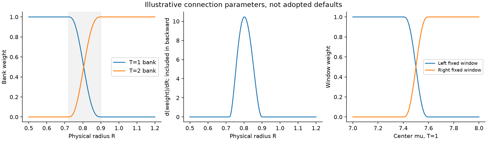
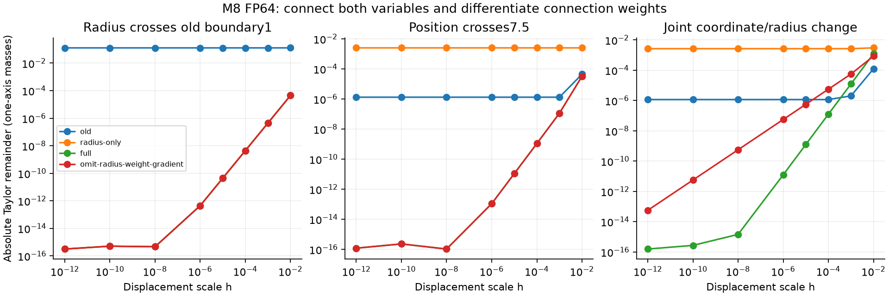
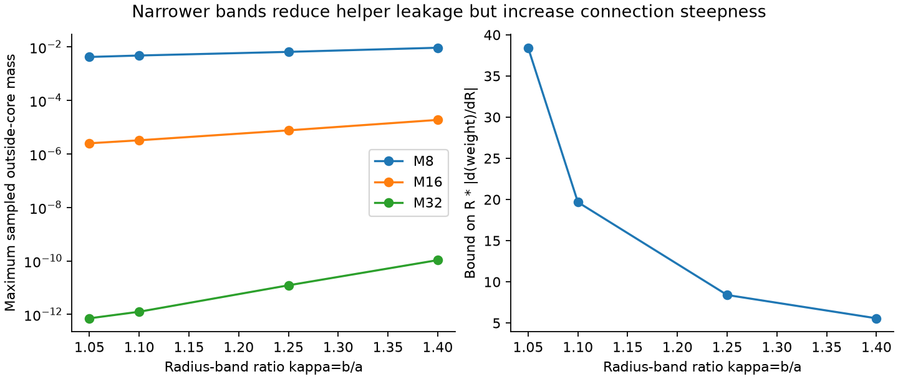

# Fourierの2bank接続：CPU適合確認と残るトレードオフ

[English (canonical)](fourier-scale-connection-20261109-results.md) | 日本語

**数学定義案とCPU診断を完了しました。本番採用ではありません。** 幾何条件を満たす
2bank・2窓の合成で、調べた半径・座標境界を接続し、総massとcore被覆を維持しました。
初期profileを含む数学定義が変わります。LM・optimizer・GPU backend・初期化・速度・
メモリ・品質の結果にはなりません。
[式と証明](fourier-scale-connection-20261109.ja.md) |
[選択した結果](fourier-scale-connection-20261109-results.json)。

## 接続式と幾何条件の修正

固定public Chebyshev密度とwhole-cell積分を使います。K3 bankのP=3Tと既存Fourier項を
維持し、両端の一次/二次微分がゼロのS(t)=10t^3-15t^4+6t^5で、座標の隣接固定窓と
半径の隣接bankを混ぜます。例の半径帯[.72T,.9T]では

\[
 v=\frac{\log(R/(.72T))}{\log(.9/.72)},\qquad
 m=(1-S(v))m^T+S(v)m^{2T}
\]

です。外では対応する1bankのみを使います。端ではS',S''がゼロになり、値と一次/二次
偏微分がつながります。半径微分にはS'(v)/(R*log(.9/.72))×bank差を含め、座標微分にも
窓weightの微分を含めます。この追加項はoptimizerの変更ではありません。

座標混合には余白が必要です。位置の半接続幅delta*Tについて、有効なK3窓の両方がcoreを
含むにはR<=(1-delta)*Tが必要です。delta.1ならR=.9Tまでに尺度移行を完了します。
先ほどの厳密な比[.5,1]を全補助bankに保つと接続の幅がなくなるため、最小/base領域を
除き、この例では(.36,.9]へ修正しています。採用する既定値ではありません。
最小tile幅に達した後の小さいRには、引き続き固定Mの集中限界があります。

1軸当たり最大2bank・各bank2窓です。同bankの窓は係数を共有でき、全てwhole-tile/
whole-cellの縮約を維持します。提案する実行設計にはper-cell clipや任意幅site走査を
必要としません。ただしCPU診断は小さい軸ベクトルをoracleとして作り、その高速実装では
ありません。入出力を別々に混ぜても、1 Atomの積のfactorizationは維持できます。



## 確認できたこと

FP64 M8の旧・半径のみ・全接続・微分を意図的に省いた2条件と、M16/32の全接続について、
20fixture・8尺度、140条件・1120変位を確認しました。幾何49点でもcore被覆と最大2bank/
4窓を維持しました。独立テストはquintic端点・外側の連鎖律・求積・周期性・size8での
重複imageを含みます。

h1e-6での絶対Taylor残差（1軸mass、M8）です。

| fixture | 旧public | 半径だけ接続 | 全接続 |
|---|---:|---:|---:|
| 旧半径1の境界 |0.12804|4.45e-13|4.45e-13|
| R.8で中心7.5を跨ぐ |1.31e-6|0.0024936|1.09e-13|
| 座標・半径同時変化 |1.16e-6|0.0026490|1.25e-11|

半径だけの接続は、位置の経路を直していない粗い補助bankを導入するため、残る座標の
跳びを大きくすることもあります。全接続では丸めまで微分予測へ近づき、新半径帯の端と
両方向も検証しました。半径weight微分を意図的に省くと、同時変化のh1e-6残差は5.59e-8で
一次でしか縮みません。完全な微分なら1.25e-11です。座標weight微分を省いても一次誤差が
残ります。forwardを滑らかにするだけでは勾配契約を満たしません。

全接続M8/16/32の総mass最大誤差は6.66e-16。数値上の最小massはM32で-2.50e-16で、
Fourierの丸めの範囲です。clipや正規化floorは導入していません。非負・C2の形式的な主張は
実数演算上の定義についてで、浮動小数点のビット単位の滑らかさではありません。



## 裾と微分のトレードオフ

半径.5..4の492点screenで、public support_epsから連続unwrapped core外massを求めました。
以下はgrid上の最大値で、厳密な全体上限・最大sidelobe・タスク許容差ではありません。

| 半径帯比kappa=b/a | M8 | M16 | M32 |
|---|---:|---:|---:|
|1.05|0.0042232|2.50e-6|7.14e-13|
|1.10|0.0047812|3.23e-6|1.26e-12|
|1.25の例|0.0065411|7.60e-6|1.22e-11|
|1.40|0.0093302|1.87e-5|1.07e-10|

従って例のM8は約0.65%漏れ、滑らかさだけでは十分な集中とは言えません。Mを増やすと
moment成分が増え、帯を狭めると勾配が急になります。無次元の接続傾き上限は
R*|w'|<=1.875/log(kappa)で、kappa1.05で約38.4、1.25で8.40です。
学習用のMや帯の設定は選択・推奨していません。



厳密なsidelobe上限、条件数、位置位相の癖、初期化/energy、振幅・fraction全体のpullback、
Plan対応、complete-step時間・allocated/reservedメモリ、学習品質は未検証です。
枝数が定数でも速度の保証にはなりません。旧checkpointをこの案で読み替えません。
Gaussian・Triweight・taper profileへの置換も行っていません。

## 出自と再現

実行consumerはb3807ec41e099d04ca1003370f7523fc4f37a47e、operatorはcleanな
0d277ae6dc0ae14fe515c7559f39535ed0238950です。CPU Torch2.13.0/Python3.11.15。
runner SHA256はf6a74ef10c69295f6785c4813e41adaf4b5b4c86ee5ac7b19c94b2b2be5f6bc1、
raw summaryは23a4e13f1227df3e9d62e3d27d9d8592c490db612aba28446b8d31d32f69b8afです。
固定archiveは53d75102411bd2aa9da5d6e93307d1ca01b0b902221c6570252a61a271e60515、
source2025件とrunner hashを独立に再読して検証しました。
証拠はCST_RESEARCH_EVIDENCE_ROOT/fourier-scale-connection-cpu-20261109-01です。
独立接続5テスト成功。全体285件中224成功・61任意skip、registry45研究、Ruff、図の確認が成功しました。

```bash
python scripts/inspect_fourier_connection.py --output "$NEW_OUTPUT"
python scripts/report_fourier_connection.py --run "$NEW_OUTPUT" --repository .
```
