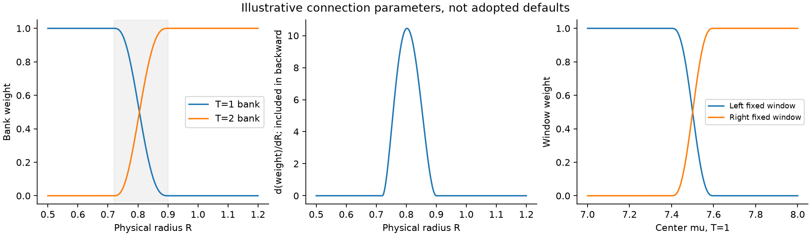
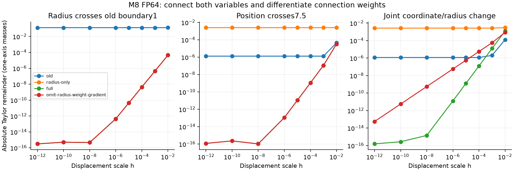
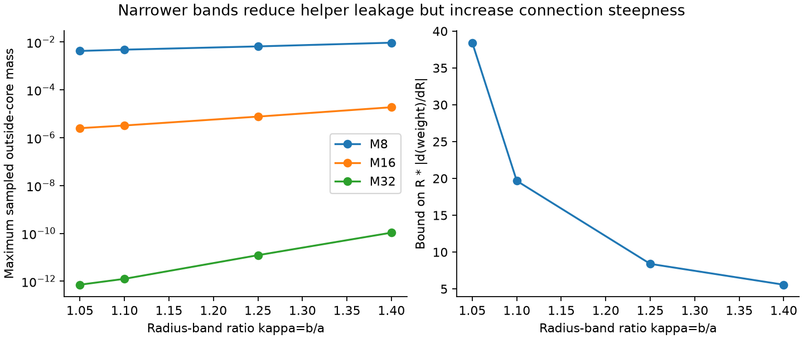

# Two-bank Fourier connection: CPU conformance and unresolved tradeoffs

English (canonical) | [日本語](fourier-scale-connection-20261109-results.ja.md)

**Completed mathematical proposal and CPU diagnostic, not a runtime adoption.**
The geometry-constrained two-bank/two-window composition connects sampled
radius and position boundaries while preserving unit mass and core coverage.
It changes the mathematical definition, including initial profiles. No LM,
optimizer, GPU backend, initialization, speed, memory or quality result follows.
[Equations and proof](fourier-scale-connection-20261109.md) |
[Selected results](fourier-scale-connection-20261109-results.json).

## Formula and revised geometry requirement

The proposal consumes the frozen public Chebyshev density and whole-cell
integrals. Fixed K3 banks retain P=3T and existing Fourier modes. A quintic
S(t)=10t^3-15t^4+6t^5, with zero first/second derivatives at both ends, mixes
neighboring fixed windows around position changes and neighboring banks across
radius changes. For the illustrative radius band[.72T,.9T]:

\[
 v=\frac{\log(R/(.72T))}{\log(.9/.72)},\qquad
 m=(1-S(v))m^T+S(v)m^{2T}.
\]

Use the relevant sole bank outside the band. At its ends, value and first/second
partials join because S',S'' vanish. Radius gradients must include
S'(v)/(R*log(.9/.72)) times the bank difference; coordinate gradients likewise
include the window-weight derivative. This new term is not an optimizer change.

Position blending needs a padding margin. With position half-band delta*T,
both active K3 windows contain the intended core only when R<=(1-delta)*T.
Delta.1 therefore requires completing scale transfer by R=.9T. The earlier
strict ratio[.5,1] cannot hold for every active helper bank with a nonzero overlap;
this example revises it to(.36,.9], outside the declared minimum/base region.
The example is not a selected default. At minimum tile width, smaller R still
faces a fixed-M concentration limit.

At most2 banks and2 windows per bank are active per axis. Same-bank windows
reuse coefficients; all windows remain whole-tile/whole-cell contractions.
There is no per-cell clipping or arbitrary-width site loop in the proposed
execution design. The CPU diagnostic materializes small axis vectors as an
oracle; it is not that fast implementation. Separate input/output mixtures
preserve a single Atom's product factorization.



## What passed

FP64 M8 old/radius-only/full and two intentionally incomplete derivative
controls, plus M16/32 full, cover20 fixtures/8 scales:140 records and1120 finite
displacements. Additional49 geometry samples retain the core, at most2 banks and
4 windows. Independent tests cover quintic endpoints, outer chain rule,
quadrature, periodicity and repeated images on a size8 chart.

Absolute Taylor remainder at h1e-6, one-axis masses, M8:

| Fixture | Old public | Radius-only connection | Full connection |
|---|---:|---:|---:|
| Radius crosses old1 boundary |0.12804|4.45e-13|4.45e-13|
| Position crosses7.5 at R.8 |1.31e-6|0.0024936|1.09e-13|
| Joint position/radius |1.16e-6|0.0026490|1.25e-11|

Radius-only glue can make the remaining position jump larger: it introduces a
coarser helper bank without fixing that bank's position routing. Full glue
approaches its derivative prediction until roundoff; all new radius-band
endpoints and both directions are covered. Deliberately omitting the radius
connection derivative leaves a joint-transition remainder5.59e-8 at h1e-6,
falling only linearly; full differentiation gives1.25e-11. Omitting the position
weight derivative also leaves a first-order defect. Smooth forward evaluation
alone is not enough for the gradient contract.

Across full M8/16/32 records, maximum mass error is6.66e-16. The minimum
numerical mass is-2.50e-16 at M32, consistent with Fourier roundoff; no clipping
or normalization floor was introduced. Formal nonnegativity and C2 statements
concern the real-arithmetic definition, not bitwise floating-point smoothness.



## Tail and derivative tradeoff

A492-point screen measures continuous unwrapped outside-core mass with the
public support_eps on radii.5..4. Values below are maxima on that grid, not
certified global/peak-sidelobe bounds or task tolerances.

| Radius band ratio kappa=b/a | M8 | M16 | M32 |
|---|---:|---:|---:|
|1.05|0.0042232|2.50e-6|7.14e-13|
|1.10|0.0047812|3.23e-6|1.26e-12|
|1.25 example|0.0065411|7.60e-6|1.22e-11|
|1.40|0.0093302|1.87e-5|1.07e-10|

M8 therefore leaks up to about0.65% in the example; smoothness does not imply
adequate concentration. Larger M costs more moment components, and narrower
bands increase stiffness. The dimensionless connection-slope bound is
R*|w'|<=1.875/log(kappa), about38.4 at kappa1.05 versus8.40 at1.25.
No M/band parameter is selected or recommended for model training.



Remaining work includes an actual sidelobe bound, conditioning, position-phase
artifacts, initialization/energy, full amplitude/fraction pullback, Plan support,
complete-step time/allocated/reserved memory and learned quality. A constant
number of branches is not a speed guarantee. No old checkpoint is reinterpreted
under this proposal. No Gaussian/Triweight/taper profile is substituted here.

## Provenance and reproduction

Executed consumer b3807ec41e099d04ca1003370f7523fc4f37a47e;
operator0d277ae6dc0ae14fe515c7559f39535ed0238950, clean checkout.
CPU Torch2.13.0/Python3.11.15. Runner SHA256
f6a74ef10c69295f6785c4813e41adaf4b5b4c86ee5ac7b19c94b2b2be5f6bc1;
raw summary23a4e13f1227df3e9d62e3d27d9d8592c490db612aba28446b8d31d32f69b8af.
Frozen archive53d75102411bd2aa9da5d6e93307d1ca01b0b902221c6570252a61a271e60515;
2025 source-file identities and the runner hash were independently re-read.
Evidence:CST_RESEARCH_EVIDENCE_ROOT/fourier-scale-connection-cpu-20261109-01.
Five independent connection tests pass. Full suite285 tests:224 passed,61 optional
skips. Registry45 studies, Ruff and figure inspection pass.

```bash
python scripts/inspect_fourier_connection.py --output "$NEW_OUTPUT"
python scripts/report_fourier_connection.py --run "$NEW_OUTPUT" --repository .
```
