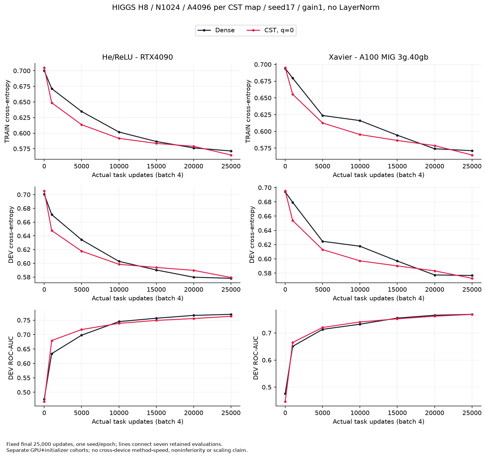
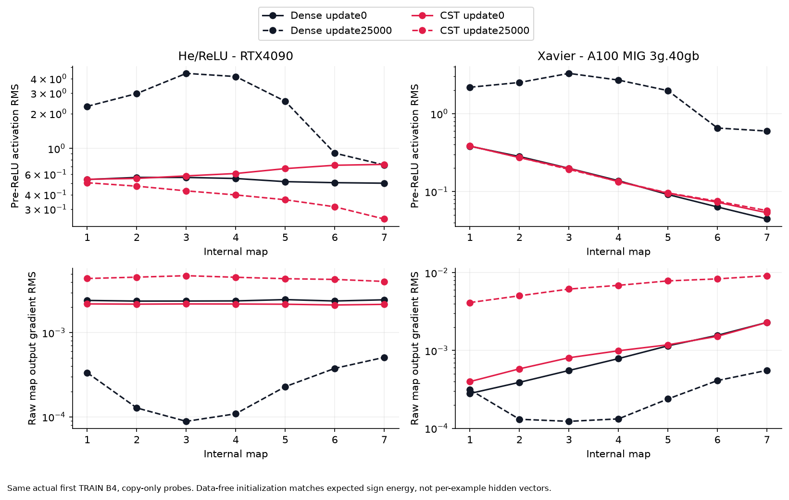

# 完了したHIGGS初期化比較

[English (canonical)](higgs-initialization-results.md) | 日本語

限定したdevelopment観測であり、普遍的な初期化や非劣性の結果ではありません。
以下の全cohortは正常終了し、全保存証拠の独立CPU検証を通過しました。
confirmation・公式testは採点していません。

## 何を変更したか

正方形幅N・各A Atomsで、旧振幅scaleは0.1/sqrt(A)でした。sqrt(N)倍した
0.1/sqrt(A/N)でも今回の深層モデルは停滞しました。その後のTRAIN特徴校正では
k_l/sqrt(A/N)の層ごとのk_lを選び、従来Denseの初期ReLU前RMSへ合わせました。
TRAIN特徴256件だけを使い、ラベル・DEVは使わず、実行時gain1・LayerNormなしです。
N1024/A4096ではk_l=.63125〜.71875、名目振幅標準偏差.315625〜.359375でした。
これはHeではありません。従来Dense内部重みの集団分散は1/(3N)です。

次のデータ不要の方式は、対応するHe／Xavierの**作用素の二乗平均**へ合わせます。
独立な対称振幅符号に対し、振幅依存半径・クリップを含めた期待値E||W||_F²は
各Atom行列の二乗ノルムの和になります。He/ReLU fan_inは2*d_out、
Xavier gain1は2*d_in*d_out/(d_in+d_out)が目標です。因子ノルムの計算だけで、
Dense W・参照Dense・実データ特徴は不要です。[数学的protocol](higgs-fan-initialization.ja.md)と
[torchcst公開API](https://github.com/takumiecd/torchcst/blob/main/docs/initialization.ja.md)を参照してください。

これらの学習試行はすべて小文字q=0、振幅依存半径の下限を使いました。
一般にR=L(a)^(1-q)*U(a)^qなので、qは上下限間の対数的な割合で、密度alphaとは別です。
方式はqを0〜1で明示指定できますが、最適qの選択や全qのGPU検証を行ったわけではありません。

## 条件と最終結果

H8/N1024・内部7層・各A4096・seed17、学習可能な従来Dense入出力、実B4・FP32・
TF32無効・eager、LR.0003・stockq1 AdamW/CSTAdamW、eps1e-8、通常/amplitude decay.01、
raw Atom decay0。TRAIN100k/DEV50k、各25,000実データ更新で最終固定選択し、
HPO・early stoppingは行いません。He／Xavier pilotでは**Dense内部初期化も**対応する
normal presetへ変更し、通常入出力は対応を保って変更しません。

| RTX4090条件 | DEV損失 | accuracy | ROC-AUC |
|---|---:|---:|---:|
| 従来Dense |.573237|70.318%|.771360|
| 旧生CST |.691499|52.960%|.500000|
| 幅対応CST・係数.1 |.691499|52.960%|.500000|
| 旧CST＋固定gain |.607279|67.326%|.732033|
| TRAIN-Dense-RMS生CST |.576001|69.680%|.765233|
| 旧CST＋bare LayerNorm |.578485|69.500%|.763612|
| 旧CST＋LayerNorm＋gain |.574005|69.752%|.769498|
| 新規He Dense |.578093|69.884%|.770218|
| データ不要He CST・q=0 |.579310|69.588%|.763395|

| A100 MIG3g.40gb条件 | DEV損失 | accuracy | ROC-AUC |
|---|---:|---:|---:|
| 従来Dense |.573300|70.138%|.771087|
| 旧生CST |.691499|52.960%|.500000|
| 幅対応CST・係数.1 |.691499|52.960%|.500000|
| 旧CST＋固定gain |.612581|66.916%|.732758|
| 新規Xavier Dense |.576681|69.926%|.768982|
| データ不要Xavier CST・q=0 |.572677|70.152%|.768723|

bare LayerNormは学習affineなし・epsilon1e-5です。生TRAIN-RMSはA100で実行していません。
Heは学習が進みましたが、対応Denseよりaccuracy .296ポイント・AUC .006823低い終点です。
Xavierは対応Denseよりaccuracy .226ポイント高く、AUC .000260低い終点です。
1 seedの差であり、方式の順位や正式な同等性を意味しません。異なるGPUでpresetを分けて
実行したため、両者の時間から初期化方式の高速化は判断できません。

## 時間・メモリ・クリップ

同期した素の完全学習step区間は、保持した観測付き初回更新の後の24,999更新を含みます。
規定の1000更新ごとのloggingは含み、評価・copy probe・初期化・保存・起動は含みません。
allocatedとreservedは別指標で、プロセス全体のメモリではありません。

| cohort／方式 | 平均bare step | ピークallocated | ピークreserved |
|---|---:|---:|---:|
| RTX4090 He Dense |.726ms|147.69MiB|208MiB|
| RTX4090 He CST |2.456ms|41.58MiB|50MiB|
| A100 Xavier Dense |5.065ms|147.69MiB|208MiB|
| A100 Xavier CST |15.407ms|41.58MiB|50MiB|

今回のCST allocatedピークはDenseの約28.2%ですが、素のstepは各cohortで約3.38倍・
3.04倍かかります。小バッチ診断であり、LMのtoken throughputや大バッチのメモリの証拠では
ありません。総学習費用には初期化とsource/native検証も含めて考える必要があります。

全層の初期条件付き符号エネルギーがpreset目標の0.5%以内でした。
Heの名目scaleは1.325〜1.4、各4096 Atomsの1822〜1920がクリップされました
（44.5〜46.9%）。Xavierはscale .625〜.65、459〜498がクリップ（11.2〜12.2%）。
物理振幅分布は非有界Gaussianと異なります。平均エネルギーの一致だけで、行ごとの
coverage・独立重み・勾配の条件の良さは保証しません。初期の順伝播・勾配scaleは
従来の停滞領域から回復しましたが、学習後の隠れ値の分布はDenseと大きく異なります。

## 来歴と統合境界

作用素はすべて外部torchcst `97580582ed28c4e494bf5c2656bbe94a85c544c3`です。
実測consumerは以下のとおりです。

| cohort | 実測consumer commit | 独立CPU audit SHA256 |
|---|---|---|
| A100正規化6対照 |`a43d6a938db7ff1bbf3522343cd35f10f3dcac1c`|`0084d9faeab476c493e86c4f9b82194ac0c36f9e37002de4a444268e6c6f0844`|
| RTX4090正規化6対照 |`4845e0c6649ecf3e822f014a554482478e2fe2cf`|`2163b6e1a026d2b2dea8316f04f758582682a0716a17b69314fb05aa2ed59d43`|
| 幅対応RTX4090 |`ee5422e41971f97c2f48857e2e23d225b9602571`|`9b1a82f7ba32839724a874ff676f18557ecb8bed0f1991c42d10726e2c730ed5`|
| 幅対応A100 |`ee5422e41971f97c2f48857e2e23d225b9602571`|`6e636ffba0f4e9ccd98b8d25f7b257c3db9103c6050de37932e0a78324a4a1a4`|
| 生TRAIN-RMS RTX4090 |`2c5ec2cfbe8e31e776ad41161ef5e00d6b518cd5`|`2b45ef20f2ad2524a5aeefbdd06de4aa903024206f9d63a1de514d214e5dd603`|
| He RTX4090 |`7f562481db09321e658a80051275dee21b0ec26a`|`4d73c97596f6b02cec69c361015a1e651df56a61852fe592ffed57f425a2eca7`|
| Xavier A100 |`7f562481db09321e658a80051275dee21b0ec26a`|`aa7b22b60184a1937f336b5363839134dfcd710b1ea45d934b689186d6078692`|

He／Xavierは各cohort137 raw payloadファイル・独立再集計28 split指標・14 B4 copy probe・
50,000実データ更新・別の合成40更新です。source/input/runtime bytes、初期Atomごとの
エネルギー、Polar符号化、Dense RNG初期化、保持した勾配・moments、native再開・観測証拠を
検証しました。readerは実データ推論の再実行や、未保存の中間optimizer軌跡の再現は
行いません。fan readerはGPU結果が出る前に固定しました。以前のTRAIN-RMS reader準備では
online要約を見ており、その時系列補足を外部証拠に保持し、判定条件の緩和はしていません。

[派生artifactの来歴](results/higgs-fan-initialization/provenance.json)は曲線・層/パラメータ勾配CSV・
校正・資源要約を結びます。raw予測・checkpoint・config・reader seal・正常終了outerは
registryの証拠locatorで保持し、Gitには追加しません。

公開`torchcst.init`は別version `ab7e9546c1c167576d2652f0b72383c9a2d465cb`で、
[torchcst PR149](https://github.com/takumiecd/torchcst/pull/149)を通して統合しました。
このpilotの古い対応乱数を復元せず、新しいGaussian proposalを生成します。
公開APIのCPU/GPU検証と、これらのHIGGS学習結果は区別します。
constructor既定は保持し、一般的な精度保証はしません。元のprimary/DST admission・評価は
停止したままです。
