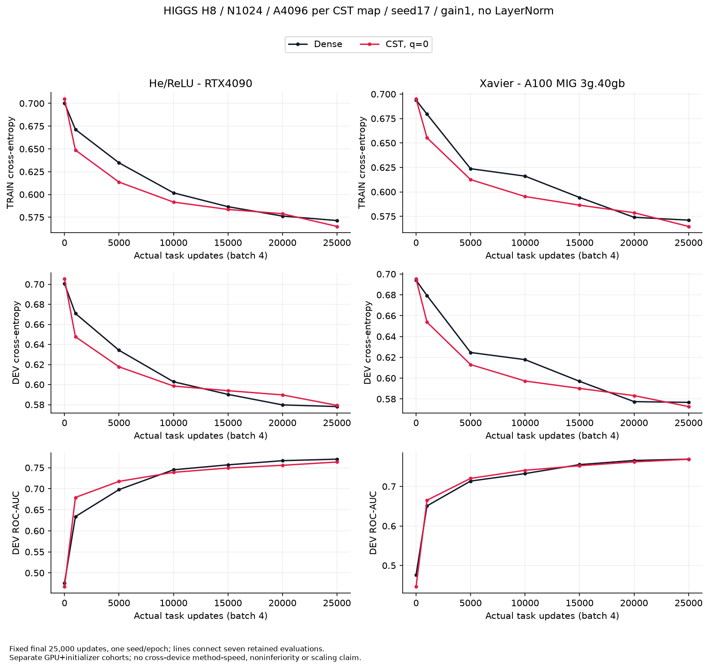
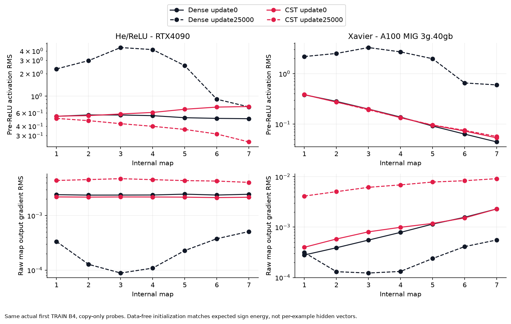

# Completed HIGGS initialization comparisons

English (canonical) | [日本語](higgs-initialization-results.ja.md)

These are bounded development observations, not a universal initializer or
noninferiority result. All listed cohorts completed normally and passed full
saved-evidence CPU admission. No confirmation or official test was scored.

## What changed

For square width N and A Atoms per map, the old raw amplitude scale was
0.1/sqrt(A). Multiplying by sqrt(N) gives 0.1/sqrt(A/N), but this still stalled
in the tested deep model. A subsequent TRAIN-feature calibration selected
per-layer k_l in k_l/sqrt(A/N) to match the initial legacy Dense pre-ReLU RMS.
It used only256 TRAIN feature rows, no labels or DEV; runtime gain stayed1 and
LayerNorm was absent. At N1024/A4096, k_l=.63125–.71875 gives nominal amplitude
standard deviations .315625–.359375. This was not He initialization: the legacy
Dense internal weights have ensemble variance1/(3N).

The next data-free method matches the corresponding He or Xavier **operator
second moment**. For independent symmetric amplitude signs, including
amplitude-dependent radii and clipping, expected ||W||_F² equals the sum of
individual Atom matrix squared norms. He/ReLU fan_in targets2*d_out; Xavier
gain1 targets2*d_in*d_out/(d_in+d_out). The factor-norm calculation needs no
Dense W, Dense reference or task features. See the [mathematical protocol](higgs-fan-initialization.md)
and the explicit [public torchcst API](https://github.com/takumiecd/torchcst/blob/main/docs/initialization.md).

All these learning trials used lowercase q=0: the amplitude-dependent lower
radius bound. In general R=L(a)^(1-q)*U(a)^q, so q selects a logarithmic fraction
between bounds; q is distinct from density alpha. The method permits explicit
q in[0,1]; this pilot does not select an optimal q or validate all q on GPUs.

## Conditions and endpoints

H8/N1024/seven bias-free internal maps/A4096/seed17, trainable legacy Dense
input/output, true B4 FP32/TF32-off/eager, LR.0003 stockq1 AdamW/CSTAdamW,
eps1e-8, ordinary/amplitude decay.01, raw Atom decay0. TRAIN100k/DEV50k,
25,000 actual task updates per arm, fixed final selection, no HPO/early stopping.
The He/Xavier pilot also changes the **Dense internal** initialization to its
corresponding normal preset; ordinary input/output remain paired and unchanged.

| RTX4090 condition | DEV loss | Accuracy | ROC-AUC |
|---|---:|---:|---:|
| Legacy Dense | .573237 |70.318%|.771360|
| Old raw CST | .691499 |52.960%|.500000|
| Width-aware CST, coefficient .1 | .691499 |52.960%|.500000|
| Old CST + fixed gain | .607279 |67.326%|.732033|
| TRAIN-Dense-RMS raw CST | .576001 |69.680%|.765233|
| Old CST + bare LayerNorm | .578485 |69.500%|.763612|
| Old CST + LayerNorm + gain | .574005 |69.752%|.769498|
| Fresh He Dense | .578093 |69.884%|.770218|
| Data-free He CST, q=0 | .579310 |69.588%|.763395|

| A100 MIG3g.40gb condition | DEV loss | Accuracy | ROC-AUC |
|---|---:|---:|---:|
| Legacy Dense |.573300|70.138%|.771087|
| Old raw CST |.691499|52.960%|.500000|
| Width-aware CST, coefficient .1 |.691499|52.960%|.500000|
| Old CST + fixed gain |.612581|66.916%|.732758|
| Fresh Xavier Dense |.576681|69.926%|.768982|
| Data-free Xavier CST, q=0 |.572677|70.152%|.768723|

Bare LayerNorm has no trainable affine and epsilon1e-5. The raw TRAIN-RMS trial
was not run on A100. The He pilot learns but ends .296 accuracy points and
.006823 AUC below its Dense control. The Xavier pilot ends .226 accuracy points
above its control and .000260 AUC below it. These are single-seed differences,
not a method ranking or formal equivalence. The two presets ran on different
GPUs, so their timings cannot identify an initializer-method speedup.

## Time, memory and clipping

Synchronized bare complete-step intervals cover24,999 updates after the retained
observed first step; prescribed1000-update logging is included. Evaluation,
copy-only probes, calibration, saving and startup are outside these intervals.
Allocated and reserved peaks are different metrics, not total process memory.

| Cohort / method | Mean bare step | Peak allocated | Peak reserved |
|---|---:|---:|---:|
| RTX4090 He Dense |.726ms|147.69MiB|208MiB|
| RTX4090 He CST |2.456ms|41.58MiB|50MiB|
| A100 Xavier Dense |5.065ms|147.69MiB|208MiB|
| A100 Xavier CST |15.407ms|41.58MiB|50MiB|

CST uses about28.2% of the measured Dense peak allocated memory here, while
bare steps take about3.38x/3.04x as long on the respective cohorts. This is a
small-batch diagnostic, not evidence for LM token throughput or large-batch
memory. Calibration and source/native qualification must also be accounted for
when considering total training cost.

Every initial layer's conditional-sign energy matched its preset within0.5%.
He nominal scales were1.325–1.4 with1822–1920 of4096 Atoms clipped per map
(44.5–46.9%). Xavier scales were.625–.65 with459–498 clipped (11.2–12.2%).
The physical amplitude distribution therefore differs from an unbounded
Gaussian. A mean-energy target alone does not guarantee row-wise coverage,
independent weights or well-conditioned gradients. Initial forward/gradient
scales recovered from the earlier stalled regime, but final hidden-value
profiles differ substantially from Dense.

## Provenance and integration boundary

All operators in these experiments use external torchcst
`97580582ed28c4e494bf5c2656bbe94a85c544c3`. Actual research consumers:

| Cohort | Measured consumer commit | Independent CPU audit SHA256 |
|---|---|---|
| A100 six normalization controls |`a43d6a938db7ff1bbf3522343cd35f10f3dcac1c`|`0084d9faeab476c493e86c4f9b82194ac0c36f9e37002de4a444268e6c6f0844`|
| RTX4090 six normalization controls |`4845e0c6649ecf3e822f014a554482478e2fe2cf`|`2163b6e1a026d2b2dea8316f04f758582682a0716a17b69314fb05aa2ed59d43`|
| Width-init RTX4090 |`ee5422e41971f97c2f48857e2e23d225b9602571`|`9b1a82f7ba32839724a874ff676f18557ecb8bed0f1991c42d10726e2c730ed5`|
| Width-init A100 |`ee5422e41971f97c2f48857e2e23d225b9602571`|`6e636ffba0f4e9ccd98b8d25f7b257c3db9103c6050de37932e0a78324a4a1a4`|
| Raw TRAIN-RMS RTX4090 |`2c5ec2cfbe8e31e776ad41161ef5e00d6b518cd5`|`2b45ef20f2ad2524a5aeefbdd06de4aa903024206f9d63a1de514d214e5dd603`|
| He RTX4090 |`7f562481db09321e658a80051275dee21b0ec26a`|`4d73c97596f6b02cec69c361015a1e651df56a61852fe592ffed57f425a2eca7`|
| Xavier A100 |`7f562481db09321e658a80051275dee21b0ec26a`|`aa7b22b60184a1937f336b5363839134dfcd710b1ea45d934b689186d6078692`|

Each He/Xavier cohort has137 raw payload files,28 independently recounted
split metrics,14 copy-only B4 probes,50,000 task updates and40 separate synthetic
qualification updates. Source/input/runtime bytes, initial per-Atom energies,
Polar encoding, Dense RNG initialization, all saved gradients/moments and native
resume/observer proofs were checked. Readers did not rerun task inference or
reproduce unsaved intermediate optimizer trajectories. The fan reader was sealed
before its GPU results. Earlier TRAIN-RMS reader preparation saw online summaries;
its timing clarification remains in external evidence, with no gate relaxation.

The [derived artifact provenance](results/higgs-fan-initialization/provenance.json)
binds curves, layer/parameter-gradient CSVs, calibration and resource summaries.
Keep raw predictions, checkpoints, configs, reader seals and normal outer
receipts under the registry evidence locators; they are not committed to Git.

The public `torchcst.init` API is separately versioned at
`ab7e9546c1c167576d2652f0b72383c9a2d465cb`, merged through
[torchcst PR149](https://github.com/takumiecd/torchcst/pull/149). It uses fresh
Gaussian proposals rather than recovering this pilot's paired old draws.
Public CPU and GPU API checks are separate from these HIGGS learning results.
Constructor defaults remain unchanged; no general model-quality guarantee is
made. Original primary/DST admission and assessment remain paused.
