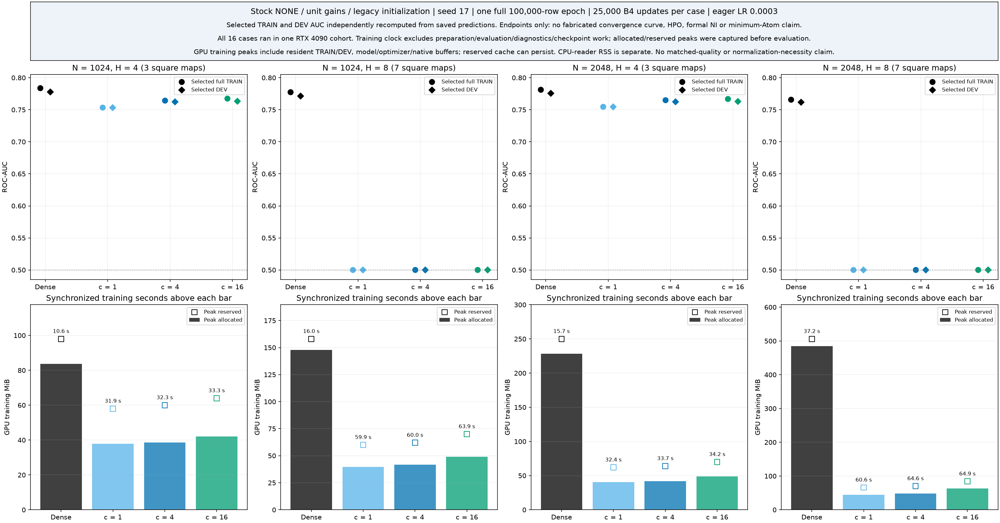

# 線形Atom pilot：16条件の1 epoch終点

[English (canonical)](higgs-linear-atom-results.md) | 日本語

**2026-11-06完了の限定的な探索screen。** 全16条件が1 epochを完了し、保存証拠の独立admissionを
通過しました。H4のCSTは全Atom数で有用な順位付けを学習しました。H8のCST全6条件は、
FP32の予測が一定の出力biasだけとなり、対応するDenseは学習しました。これは1 epoch・seed17・
一つの初期化/optimizer recipeでの観測です。内在的な最小Atom数や必要Atom数のオーダを確定しません。

## 固定条件とsourceの境界

[Stage A設計](higgs-linear-atom-scaling.ja.md)と
[Stage B学習protocol](higgs-linear-atom-learning.ja.md)が実験を規定します。
実測consumerは `d00a98bc97ec1cc6be4e2ebdfbea114758b2fca3`、外部公開torchcstは
`97580582ed28c4e494bf5c2656bbe94a85c544c3` です。この追加result packは科学的moduleや
固定registryを変更しません。PREPAREDは準備時点の履歴として残し、本noteで後のStage B完了証拠を記録します。

幅N=1024/2048、hidden深さH=4/8、biasなし正方写像L=H−1=3/7です。
入力28→Nと出力N→2のDenseは学習可能で、各hidden写像後にReLUを置きます。
各CST写像は正確にA=cN atoms、c=1/4/16です。正規化NONE、gain1、従来の初期化を変更しません。
全条件でstock q1 AdamW、LR 0.0003、B4、FP32、TF32 off、eagerを使いました。
各条件はfresh stateから開始し、同じ規定の初epoch順序でTRAIN 100,000行、25,000更新を実行しました。
全16条件のtask更新は400,000です。継承したsynthetic資格検証の更新は別枠で、学習証拠ではありません。

TRAIN行[1,000,000,1,100,000)だけで正規化をfitし、DEV行[1,100,000,1,150,000)で
ここに示すdevelopment指標を得ました。DEVは以前の探索研究にも使われており、新規の確認集合ではありません。
将来の確認データや公式testはpayloadに含めず、採点していません。LR探索・seed反復・最小c探索も未実施です。

全条件は同一RTX 4090 cohortです。CC 8.9、128 SM、device memory 25,262,096,384 bytes、
Python 3.12.9、Torch 2.11.0+cu126、CUDA 12.6、Triton 3.6.0、NumPy 2.0.2、
driver 570.133.20でした。結果の範囲はこの実行環境です。

## 全16終点

表の全TRAIN/DEV評価は同じ保存epoch-1 stateを使い、reloadと予測の完全一致も検査しています。
AUCは保存FP32 logitの差から計算しています。
[変更なしの終点CSV](results/higgs-linear-atom-stageB/selected-quality-resources.csv)に
丸め前の値、TRAIN CE/accuracy、全評価/restore時間、checkpoint SHAを残しています。

| N | H | Method / A per map | Parameters | TRAIN AUC | DEV CE | DEV accuracy % | DEV AUC | Train s | Alloc / reserved MiB |
|---|---|---|---:|---:|---:|---:|---:|---:|---:|
| 1024 | 4 | Dense | 3,177,474 | 0.783696 | 0.566296613 | 70.752 | 0.777785 | 10.59 | 83.69 / 98.00 |
| 1024 | 4 | CST / 1024 | 44,034 | 0.753357 | 0.587867936 | 68.774 | 0.753265 | 31.92 | 37.80 / 58.00 |
| 1024 | 4 | CST / 4096 | 80,898 | 0.764259 | 0.579047085 | 69.350 | 0.762312 | 32.28 | 38.65 / 60.00 |
| 1024 | 4 | CST / 16384 | 228,354 | 0.767397 | 0.580091552 | 69.460 | 0.763269 | 33.26 | 42.02 / 64.00 |
| 1024 | 8 | Dense | 7,371,778 | 0.777402 | 0.573237058 | 70.318 | 0.771360 | 16.03 | 147.69 / 158.00 |
| 1024 | 8 | CST / 1024 | 60,418 | 0.500000 | 0.691499270 | 52.960 | 0.500000 | 59.87 | 39.71 / 60.00 |
| 1024 | 8 | CST / 4096 | 146,434 | 0.500000 | 0.691499270 | 52.960 | 0.500000 | 60.05 | 41.58 / 62.00 |
| 1024 | 8 | CST / 16384 | 490,498 | 0.500000 | 0.691499270 | 52.960 | 0.500000 | 63.86 | 49.08 / 70.00 |
| 2048 | 4 | Dense | 12,646,402 | 0.781179 | 0.571195444 | 70.752 | 0.775637 | 15.66 | 228.19 / 250.00 |
| 2048 | 4 | CST / 2048 | 88,066 | 0.754580 | 0.586913911 | 68.990 | 0.754512 | 32.41 | 40.39 / 62.00 |
| 2048 | 4 | CST / 8192 | 161,794 | 0.764898 | 0.579064868 | 69.596 | 0.762450 | 33.74 | 42.08 / 64.00 |
| 2048 | 4 | CST / 32768 | 456,706 | 0.766774 | 0.579868843 | 69.450 | 0.762918 | 34.22 | 48.83 / 70.00 |
| 2048 | 8 | Dense | 29,423,618 | 0.765670 | 0.580290042 | 69.508 | 0.761750 | 37.24 | 484.19 / 506.00 |
| 2048 | 8 | CST / 2048 | 120,834 | 0.500000 | 0.691499272 | 52.960 | 0.500000 | 60.63 | 44.16 / 66.00 |
| 2048 | 8 | CST / 8192 | 292,866 | 0.500000 | 0.691499272 | 52.960 | 0.500000 | 64.61 | 47.91 / 70.00 |
| 2048 | 8 | CST / 32768 | 980,994 | 0.500000 | 0.691499272 | 52.960 | 0.500000 | 64.94 | 62.91 / 84.00 |

[PDF](results/higgs-linear-atom-stageB/selected-quality-and-memory.pdf)。
点は終点であり、収束曲線や信頼区間ではありません。

Train sは同期したoptimizer完結のordinary step区間だけです。準備・診断・checkpoint I/O・
評価・restoreは含みません。GPU allocated/reserved peakは学習直前にresetし、
学習同期直後かつ評価前に取得しています。常駐TRAIN/DEV、model、optimizer、native bufferを含みます。
以前の処理で確保したallocatorのreserved cacheは残る場合があります。process memoryやCPU reader RSSではありません。
case準備時間と総時間には包含・非加算の成分があるため、CSVの全時間列を単純合計できません。
ここでCSTのメモリが少なくても、同品質・採用コスト・速度優位・漸近的な時間/メモリのオーダは確定しません。

L=H−1とすると学習scalar数は

\[
P_{\rm Dense}=LN^2+31N+2,\qquad
P_{\rm CST}=(4cL+31)N+2.
\]

これはc,L固定時のparameter数の代数であり、実測計算量ではありません。

## H8の証拠が示すこと

H8 CSTの保存split配列12個（6条件×全TRAIN/DEV）は、各々FP32 logit対を一つだけ持ちます。
全行で**各checkpoint自身の保存出力biasとbit単位で完全一致**します。
AUC=0.5から推測せず、全行を調べました。同じ幅のc三条件でbiasも一致しますが、幅間では異なります。
DEV accuracyは全6条件で52.960%です。CEの正確な値は幅間で少し異なり、CSVに残しています。
Dense H8のDEV AUCは0.771360/0.761750です。
[全32 splitの個数検査](results/higgs-linear-atom-stageB/all32-logit-counts.csv)を参照してください。

保存された先頭256 TRAIN forward probeについて、最終ReLU出力をh、producerが保存した
その最大絶対値をM、出力biasをbとすれば、

\[
|(W_{\rm out}h)_j|\le M\sum_i|W_{{\rm out},ji}|,\qquad
U_j=\tfrac12\min\{\operatorname{nextafter}(b_j,+\infty)-b_j,
 b_j-\operatorname{nextafter}(b_j,-\infty)\}.
\]

[条件付きbound/U比12個](results/higgs-linear-atom-stageB/H8-six-conditional-probe-head-bounds.csv)は
4.57e-12〜7.66e-11です。Mは保存されたproducer要約に由来し、独立した再推論ではありません。
これはprobeだけの実数演算boundであり、GPU GEMMの丸め誤差証明や全split hidden activationのboundではありません。
全splitのbias一致は別の経験的byte比較です。

[終点denominatorの192行](results/higgs-linear-atom-stageB/H8-six-endpoint-denominator-fields.csv)は、
固定済みでscalar資格検証を通ったFP32 reporting helperを使い、t=25,000のaccepted optimizer stateから再構成しています。

\[
\widehat v_t=\frac{v_t}{1-\beta_{2,\rm op}^{t}},\qquad
f_\epsilon=\frac1n\sum_i\mathbf1\{\sqrt{\widehat v_{t,i}}\le\epsilon_{\rm op}\}.
\]

各条件でpacked全28列と入力weight/bias・出力weightはf=1、出力biasはf=0です。
この終点でFP32の第2moment bias correctionは1です。
これはaccepted stateの再構成であり、kernel中間値のcapture、初回task勾配、初更新の因果計測ではありません。
prepare/retraction、moment transport、amplitude decayも更新に含まれます。
この割合だけで物理的な更新ゼロやstallの唯一の原因は証明できません。

[保存layer RMS図](results/higgs-linear-atom-stageB/retained-linear-RMS-depth-profiles.png)
（[PDF](results/higgs-linear-atom-stageB/retained-linear-RMS-depth-profiles.pdf)）、
[activation要約224行](results/higgs-linear-atom-stageB/linear-activation-summaries.csv)、
[勾配/moment要約144行](results/higgs-linear-atom-stageB/accepted-gradient-moments.csv)は、
初期/終点forward probeと最後のminibatchのoptimizer fieldを区別します。
raw証拠と照合済みのproducer統計であり、新たなfeature/backward実験ではありません。

## 解釈と残る課題

[正確なinitializer](https://github.com/takumiecd/torchcst/blob/97580582ed28c4e494bf5c2656bbe94a85c544c3/src/torchcst/_backends/torch/kernels/polar_amp_width.py#L25-L50)は
標準偏差0.1/√Aの符号付きamplitudeを生成します。理想化した独立・対称な符号、
符号反転に不変なradius結合、非負unit-mass factor u,vの下で、sourceだけからのensemble議論は

\[
W=\sum_k a_k u_kv_k^T,\qquad
\mathbb E_{\rm init}\|W\|_F^2\le0.01,\qquad
\mathbb E_{\rm init}\|W\|_F^2/N\le0.01/N.
\]

平均の初期row energyへのboundであり、各row、実task gain、学習後modelのboundではありません。
総energyがほぼ一定という近似には局所性・小amplitude等の追加仮定が必要で、radiusはamplitudeの絶対値に依存します。
balanced center、ReLU相関、有限chart/FP32、一つの固定実現から、正確な深さ方向の減衰則や因果則は導けません。
このinitializerではAを増やすだけで初期信号scaleが直るとは限りません。

forward scale・optimizer・有限精度の機構は候補のままです。
このscreenはLayerNormが必要とも、c≤16がcapacity限界とも証明しません。
NONE・biasなしReLU・無制限headでは、
[正の固定gainは理想的なglobal function familyを維持](positive-gain-equivalence.ja.md)しますが、
初期関数とoptimizer軌道は変わります。この積gainの議論をepsilon付き中間LayerNormへは拡張できません。
別の統制介入が必要です。A100 conditioning研究は進行中で、本packに結果を含めていません。

必要Atom数のオーダA*(N,L)はtask・学習recipe・予算・品質基準に依存します。
同定には学習可能性とDense品質の閾値を挟み、適切なLR調整・さらに多くの幅・paired seedが必要です。
今回の1 epoch screenはその最終主張を確立しません。

## 来歴と再現

[公開provenance](results/higgs-linear-atom-stageB/provenance.json)に全CSV/PNG/PDFのbyteと
実測source・protocol・data・runtime・raw archive SHAを結び付けています。
設定した外部evidence rootから `higgs-linear-atom-learning-20261106` を参照してください。
raw checkpoint・private path・datasetはGitに含めていません。
保存証拠CPU admissionは `003b2a9ae6d09acf57c3d5d20a3a4db4b0defb5a23488a43d4fc705300ca3d95` です。
Root reviewは `f4a92eb6de266fe9045cdf817e9fd288213c83321284b5f672b7767cef67614b`
（終点pack）、`191405fb1156332a0ebc48c845f4a029a373ebb284f71ef7421b79127b66b4db`
（H8診断）、`32db69aadf63ac935171e45cce03b6274ebd78a4f5c9ec5c5f22650099d0ae82`
（sourceのみのenergy議論）です。元のreader失敗attemptは保持しています。
admitされたreaderはI/O/schemaを修正し、数値acceptanceを変更していません。
この公開作業はadmit済みの派生artifactをコピーするもので、実測consumerの再実行・再検証ではありません。
再構成は固定protocolに従い、本noteを読むことで実行や追加実験は起動しません。
